# AYBAK Hospital Platform — Entity Relationship Diagram

> Generated from the live PostgreSQL catalog by `database/tools/generate_erd.py`.
> Do not edit by hand; regenerate after every migration.

**103 tables, 272 foreign keys, 387 indexes.**

Every tenant-owned table carries `tenant_id` and a composite `(tenant_id, id)` unique key so that every relationship is tenant-safe by construction rather than by convention.

## Relationship map

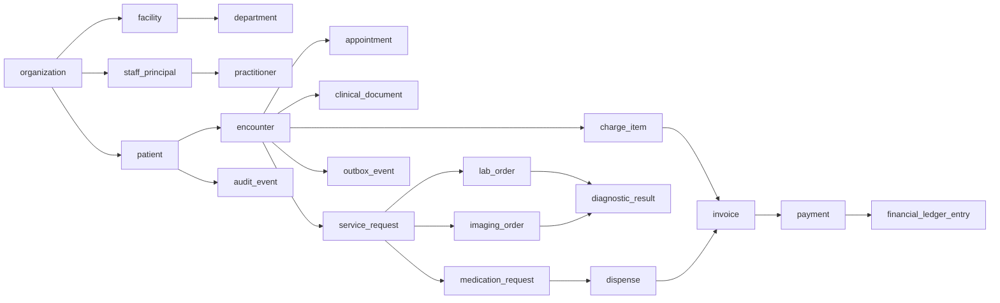

## Module diagrams

### 1. Tenancy, security, and audit

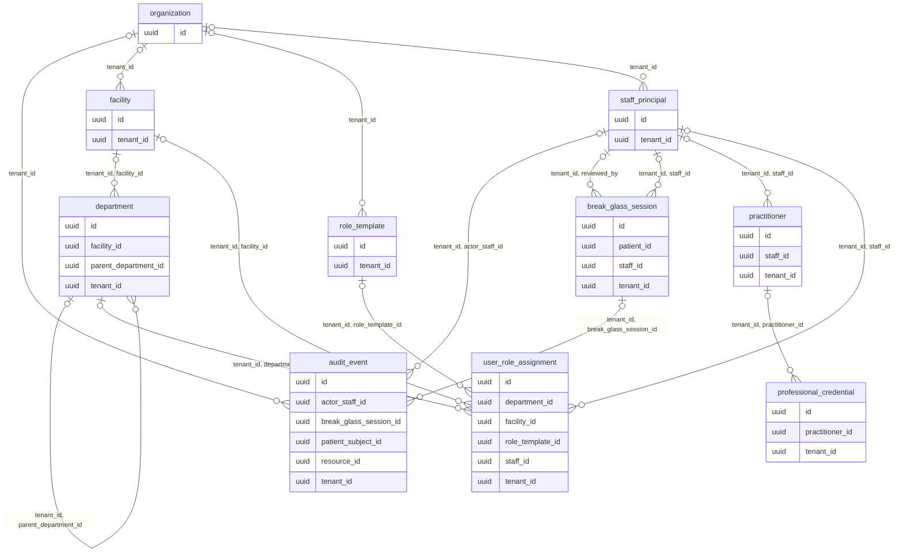

### 2. Patient record

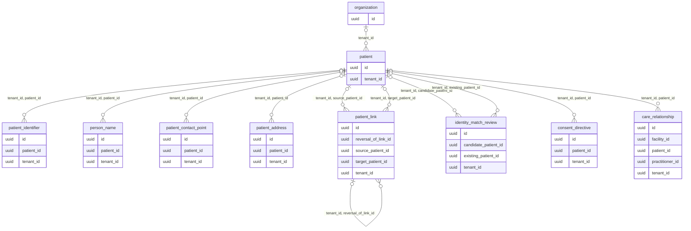

### 3. Encounters and scheduling

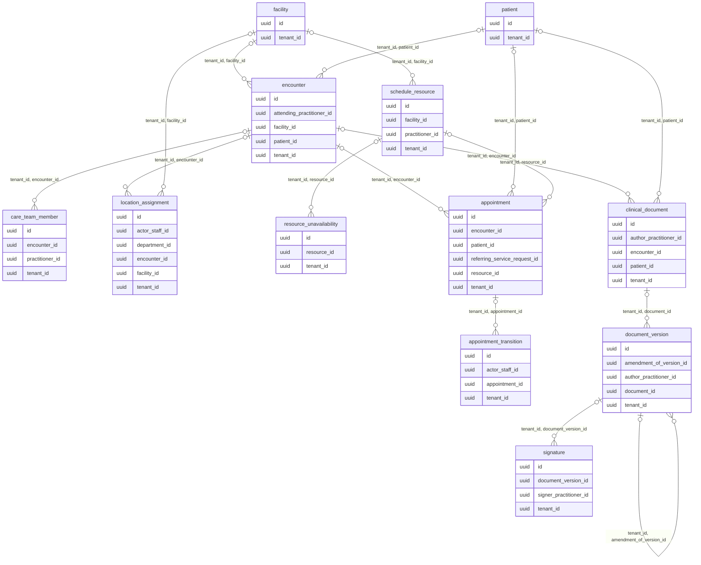

### 4. Medical history

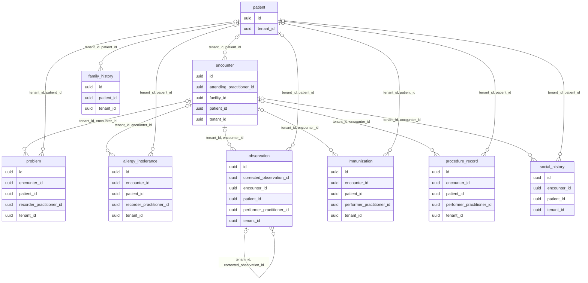

### 5. Orders and results

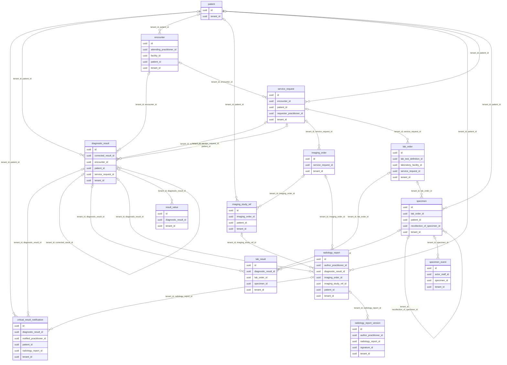

### 6. Pharmacy and inventory

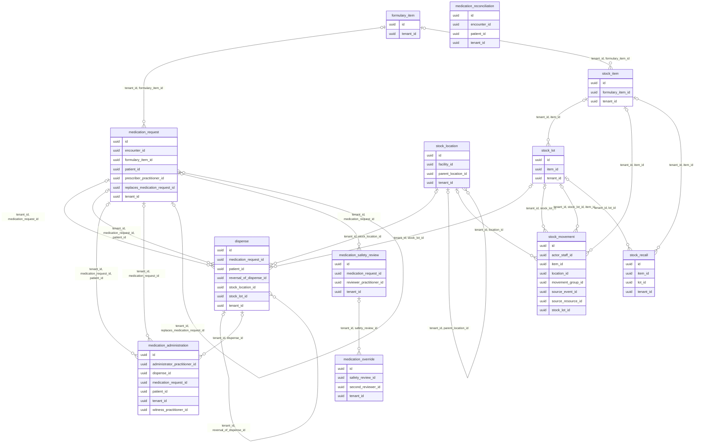

### 7. Billing and revenue

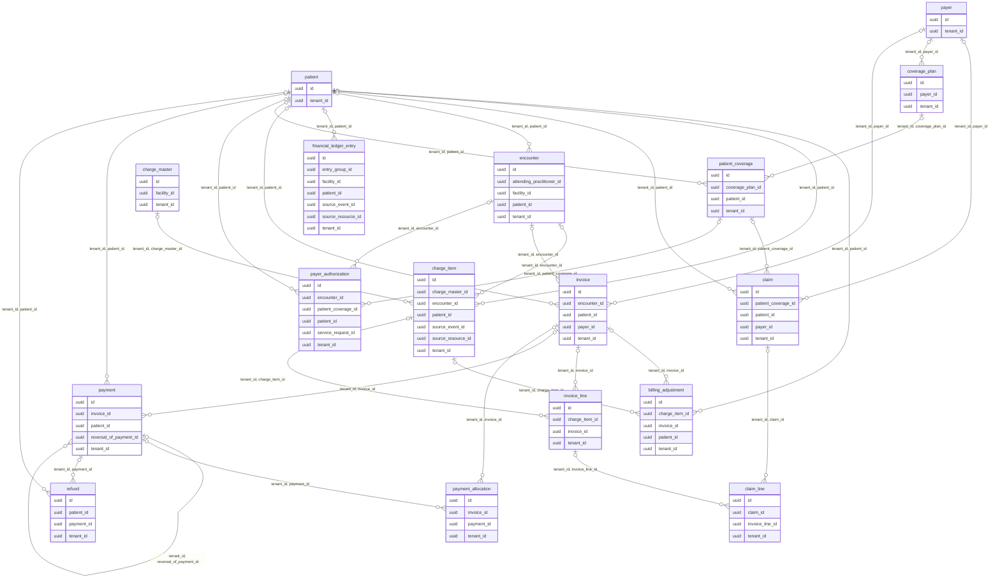

### 8. Integration, sync, and AI

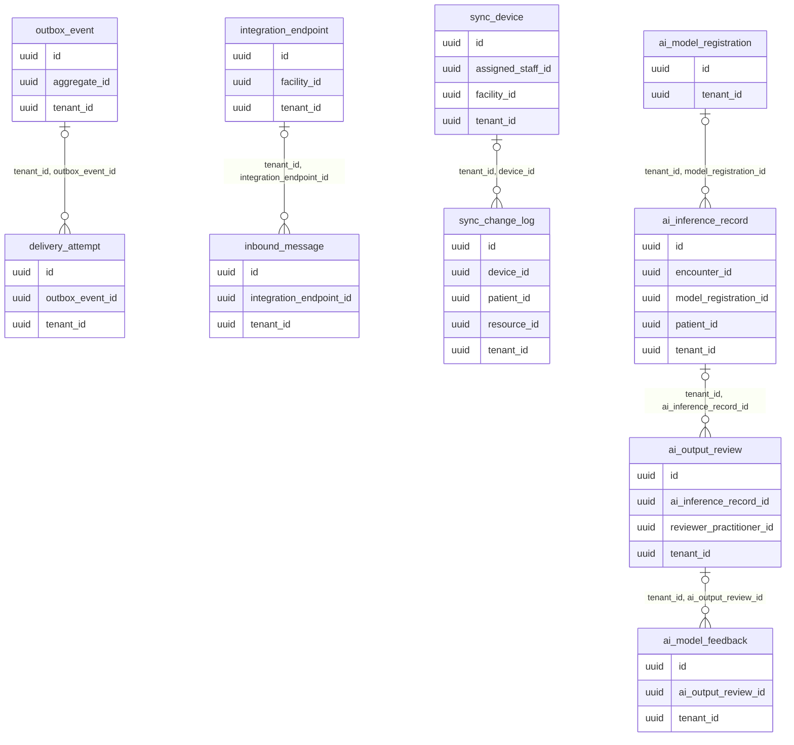

### 9. Telemedicine and referrals

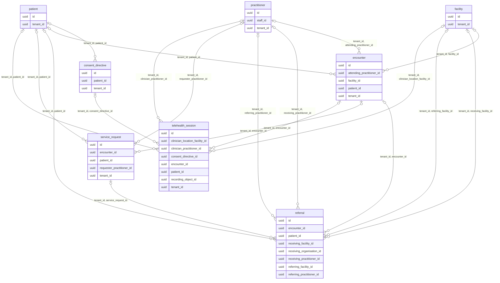

### 10. National exchange and Health ID

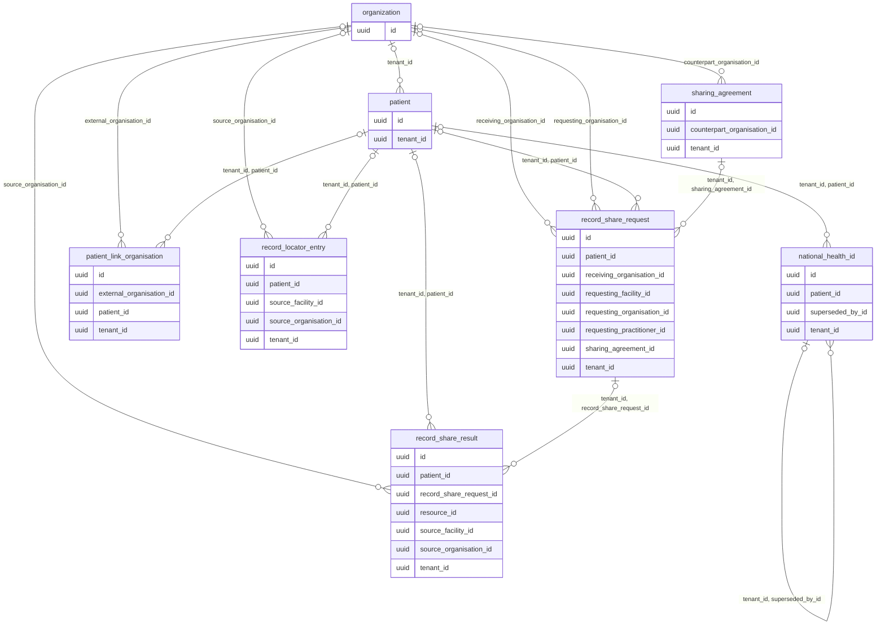

## Table inventory

| Module | Table | Columns | FKs out | Indexes | RLS | Purpose |
|---|---|---|---|---|---|---|
| Tenancy, identity, and security | `organization` | 10 | 0 | 2 | no | — |
| Tenancy, identity, and security | `facility` | 12 | 1 | 3 | no | — |
| Tenancy, identity, and security | `department` | 12 | 2 | 3 | no | — |
| Tenancy, identity, and security | `staff_principal` | 12 | 1 | 3 | no | — |
| Tenancy, identity, and security | `practitioner` | 9 | 1 | 3 | no | — |
| Tenancy, identity, and security | `role_template` | 11 | 1 | 3 | no | — |
| Tenancy, identity, and security | `user_role_assignment` | 14 | 4 | 2 | no | — |
| Tenancy, identity, and security | `worker_assignment` | 13 | 3 | 2 | no | — |
| Tenancy, identity, and security | `professional_credential` | 16 | 1 | 3 | no | — |
| Tenancy, identity, and security | `training_privilege` | 12 | 1 | 2 | no | — |
| Patient record and identity resolution | `patient` | 15 | 1 | 2 | no | Tenant-scoped identity spine |
| Patient record and identity resolution | `patient_identifier` | 14 | 1 | 4 | no | — |
| Patient record and identity resolution | `person_name` | 15 | 1 | 2 | no | — |
| Patient record and identity resolution | `patient_contact_point` | 12 | 1 | 3 | no | — |
| Patient record and identity resolution | `patient_address` | 16 | 1 | 2 | no | — |
| Patient record and identity resolution | `patient_link` | 12 | 4 | 4 | no | — |
| Patient record and identity resolution | `identity_match_review` | 15 | 3 | 2 | no | — |
| Patient record and identity resolution | `consent_directive` | 15 | 2 | 3 | no | — |
| Patient record and identity resolution | `care_relationship` | 12 | 3 | 4 | no | — |
| Patient record and identity resolution | `break_glass_session` | 13 | 3 | 2 | no | — |
| Patient record and identity resolution | `access_export` | 18 | 3 | 3 | no | — |
| Audit | `audit_event` | 19 | 4 | 7 | no | Restricted append-only audit |
| Encounters, scheduling, and clinical documents | `encounter` | 17 | 3 | 7 | no | — |
| Encounters, scheduling, and clinical documents | `care_team_member` | 11 | 2 | 4 | no | — |
| Encounters, scheduling, and clinical documents | `location_assignment` | 12 | 4 | 3 | no | — |
| Encounters, scheduling, and clinical documents | `schedule_resource` | 12 | 2 | 3 | no | — |
| Encounters, scheduling, and clinical documents | `resource_unavailability` | 10 | 1 | 3 | no | — |
| Encounters, scheduling, and clinical documents | `appointment` | 19 | 3 | 6 | no | — |
| Encounters, scheduling, and clinical documents | `appointment_transition` | 11 | 2 | 3 | no | — |
| Encounters, scheduling, and clinical documents | `clinical_document` | 14 | 3 | 4 | no | — |
| Encounters, scheduling, and clinical documents | `document_version` | 14 | 3 | 4 | no | — |
| Encounters, scheduling, and clinical documents | `signature` | 11 | 2 | 3 | no | — |
| Medical history and clinical findings | `problem` | 20 | 3 | 4 | no | — |
| Medical history and clinical findings | `allergy_intolerance` | 22 | 3 | 4 | no | — |
| Medical history and clinical findings | `observation` | 27 | 4 | 4 | no | — |
| Medical history and clinical findings | `immunization` | 21 | 3 | 3 | no | — |
| Medical history and clinical findings | `procedure_record` | 18 | 3 | 3 | no | — |
| Medical history and clinical findings | `family_history` | 17 | 1 | 3 | no | — |
| Medical history and clinical findings | `social_history` | 17 | 2 | 3 | no | — |
| Medical history and clinical findings | `service_request` | 19 | 3 | 5 | no | — |
| Medical history and clinical findings | `diagnostic_result` | 22 | 6 | 6 | no | — |
| Medical history and clinical findings | `result_value` | 19 | 1 | 3 | no | — |
| Medical history and clinical findings | `clinical_provenance` | 14 | 2 | 3 | no | — |
| Pharmacy, medication safety, and inventory | `formulary_item` | 19 | 0 | 4 | no | — |
| Pharmacy, medication safety, and inventory | `medication_request` | 30 | 6 | 6 | no | Structured proposed medication order |
| Pharmacy, medication safety, and inventory | `medication_safety_review` | 14 | 2 | 5 | no | — |
| Pharmacy, medication safety, and inventory | `medication_override` | 8 | 3 | 2 | no | — |
| Pharmacy, medication safety, and inventory | `stock_item` | 15 | 1 | 3 | no | — |
| Pharmacy, medication safety, and inventory | `stock_location` | 12 | 2 | 3 | no | — |
| Pharmacy, medication safety, and inventory | `stock_lot` | 13 | 1 | 6 | no | — |
| Pharmacy, medication safety, and inventory | `stock_recall` | 13 | 2 | 2 | no | — |
| Pharmacy, medication safety, and inventory | `dispense` | 15 | 7 | 6 | no | — |
| Pharmacy, medication safety, and inventory | `medication_administration` | 18 | 6 | 5 | no | — |
| Pharmacy, medication safety, and inventory | `medication_reconciliation` | 14 | 3 | 3 | no | — |
| Pharmacy, medication safety, and inventory | `stock_movement` | 19 | 6 | 6 | no | Append-only signed ledger |
| Laboratory | `lab_test_definition` | 17 | 0 | 3 | no | — |
| Laboratory | `lab_order` | 14 | 3 | 5 | no | — |
| Laboratory | `specimen` | 17 | 4 | 5 | no | — |
| Laboratory | `specimen_event` | 10 | 2 | 3 | no | — |
| Laboratory | `reference_range` | 20 | 1 | 3 | no | — |
| Laboratory | `lab_result` | 15 | 5 | 5 | no | — |
| Laboratory | `delta_check` | 11 | 3 | 2 | no | — |
| Radiology | `imaging_order` | 16 | 1 | 5 | no | — |
| Radiology | `imaging_protocol` | 13 | 2 | 2 | no | — |
| Radiology | `imaging_study_ref` | 18 | 2 | 5 | no | — |
| Radiology | `radiology_report` | 13 | 5 | 4 | no | — |
| Radiology | `radiology_report_version` | 19 | 3 | 4 | no | — |
| Radiology | `critical_result_notification` | 14 | 5 | 3 | no | — |
| Radiology | `external_result_import` | 17 | 2 | 4 | no | — |
| Billing, payer, and revenue | `currency` | 3 | 0 | 1 | no | — |
| Billing, payer, and revenue | `payer` | 13 | 1 | 3 | no | — |
| Billing, payer, and revenue | `coverage_plan` | 16 | 2 | 3 | no | — |
| Billing, payer, and revenue | `patient_coverage` | 18 | 3 | 4 | no | — |
| Billing, payer, and revenue | `payer_authorization` | 19 | 5 | 4 | no | — |
| Billing, payer, and revenue | `charge_master` | 17 | 2 | 3 | no | — |
| Billing, payer, and revenue | `charge_item` | 28 | 4 | 6 | no | — |
| Billing, payer, and revenue | `invoice` | 22 | 4 | 6 | no | — |
| Billing, payer, and revenue | `invoice_line` | 16 | 2 | 4 | no | — |
| Billing, payer, and revenue | `payment` | 18 | 5 | 7 | no | — |
| Billing, payer, and revenue | `payment_allocation` | 9 | 3 | 4 | no | — |
| Billing, payer, and revenue | `refund` | 17 | 4 | 3 | no | — |
| Billing, payer, and revenue | `billing_adjustment` | 19 | 6 | 2 | no | — |
| Billing, payer, and revenue | `claim` | 19 | 4 | 5 | no | — |
| Billing, payer, and revenue | `claim_line` | 13 | 2 | 4 | no | — |
| Billing, payer, and revenue | `financial_ledger_entry` | 17 | 3 | 6 | no | Append-only double-entry postings |
| Integration, offline sync, and AI | `integration_endpoint` | 16 | 1 | 3 | no | — |
| Integration, offline sync, and AI | `inbound_message` | 14 | 1 | 4 | no | — |
| Integration, offline sync, and AI | `outbox_event` | 13 | 0 | 5 | no | Transactional outbox |
| Integration, offline sync, and AI | `delivery_attempt` | 9 | 1 | 3 | no | — |
| Integration, offline sync, and AI | `sync_device` | 16 | 2 | 4 | no | — |
| Integration, offline sync, and AI | `sync_change_log` | 18 | 2 | 6 | no | — |
| Integration, offline sync, and AI | `ai_model_registration` | 19 | 1 | 3 | no | — |
| Integration, offline sync, and AI | `ai_inference_record` | 18 | 3 | 4 | no | — |
| Integration, offline sync, and AI | `ai_output_review` | 10 | 2 | 3 | no | — |
| Integration, offline sync, and AI | `ai_model_feedback` | 9 | 1 | 2 | no | — |
| Telemedicine and referrals | `telehealth_session` | 25 | 5 | 6 | no | Remote care session |
| Telemedicine and referrals | `referral` | 25 | 8 | 6 | no | Cross-organisation referral |
| Telemedicine and referrals | `consent_directive` | 15 | 2 | 3 | no | — |
| Telemedicine and referrals | `encounter` | 17 | 3 | 7 | no | — |
| Telemedicine and referrals | `patient` | 15 | 1 | 2 | no | Tenant-scoped identity spine |
| Telemedicine and referrals | `practitioner` | 9 | 1 | 3 | no | — |
| Telemedicine and referrals | `facility` | 12 | 1 | 3 | no | — |
| Telemedicine and referrals | `organization` | 10 | 0 | 2 | no | — |
| National exchange and Health ID | `national_health_id` | 15 | 2 | 4 | no | National Health ID |
| National exchange and Health ID | `patient_link_organisation` | 14 | 3 | 4 | no | Foreign-key-free link from a local patient to a patient at another organisation |
| National exchange and Health ID | `record_locator_entry` | 15 | 3 | 4 | no | Record locator: answers "where does this patient have records" without centralising the records themselves (data sovereignty) |
| National exchange and Health ID | `sharing_agreement` | 17 | 2 | 4 | no | — |
| National exchange and Health ID | `record_share_request` | 24 | 6 | 4 | no | One governed cross-organisation access decision |
| National exchange and Health ID | `record_share_result` | 19 | 4 | 4 | no | Materialised artefact of an approved share, verified for signature and provenance before it can influence care |
| National exchange and Health ID | `organization` | 10 | 0 | 2 | no | — |
| National exchange and Health ID | `patient` | 15 | 1 | 2 | no | Tenant-scoped identity spine |

## Index inventory

Indexes are listed per table and include both plain B-tree access paths and the specialised structures that carry correctness guarantees (GiST exclusion constraints for scheduling, BRIN for the audit time axis, partial indexes for worklists and open balances).

| Table | Index | Definition |
|---|---|---|
| `access_export` | `access_export_pkey` | `CREATE UNIQUE INDEX access_export_pkey ON aybak.access_export USING btree (id)` |
| `access_export` | `access_export_requester_idx` | `CREATE INDEX access_export_requester_idx ON aybak.access_export USING btree (tenant_id, requested_by, created_at DESC)` |
| `access_export` | `access_export_tenant_id_id_key` | `CREATE UNIQUE INDEX access_export_tenant_id_id_key ON aybak.access_export USING btree (tenant_id, id)` |
| `ai_inference_record` | `ai_inference_model_idx` | `CREATE INDEX ai_inference_model_idx ON aybak.ai_inference_record USING btree (tenant_id, model_registration_id, status, created_at)` |
| `ai_inference_record` | `ai_inference_patient_idx` | `CREATE INDEX ai_inference_patient_idx ON aybak.ai_inference_record USING btree (tenant_id, patient_id, created_at DESC)` |
| `ai_inference_record` | `ai_inference_record_pkey` | `CREATE UNIQUE INDEX ai_inference_record_pkey ON aybak.ai_inference_record USING btree (id)` |
| `ai_inference_record` | `ai_inference_record_tenant_id_id_key` | `CREATE UNIQUE INDEX ai_inference_record_tenant_id_id_key ON aybak.ai_inference_record USING btree (tenant_id, id)` |
| `ai_model_feedback` | `ai_model_feedback_pkey` | `CREATE UNIQUE INDEX ai_model_feedback_pkey ON aybak.ai_model_feedback USING btree (id)` |
| `ai_model_feedback` | `ai_model_feedback_tenant_id_id_key` | `CREATE UNIQUE INDEX ai_model_feedback_tenant_id_id_key ON aybak.ai_model_feedback USING btree (tenant_id, id)` |
| `ai_model_registration` | `ai_model_registration_model_key_model_version_key` | `CREATE UNIQUE INDEX ai_model_registration_model_key_model_version_key ON aybak.ai_model_registration USING btree (model_key, model_version)` |
| `ai_model_registration` | `ai_model_registration_pkey` | `CREATE UNIQUE INDEX ai_model_registration_pkey ON aybak.ai_model_registration USING btree (id)` |
| `ai_model_registration` | `ai_model_registration_tenant_id_id_key` | `CREATE UNIQUE INDEX ai_model_registration_tenant_id_id_key ON aybak.ai_model_registration USING btree (tenant_id, id)` |
| `ai_output_review` | `ai_output_review_pkey` | `CREATE UNIQUE INDEX ai_output_review_pkey ON aybak.ai_output_review USING btree (id)` |
| `ai_output_review` | `ai_output_review_tenant_id_ai_inference_record_id_key` | `CREATE UNIQUE INDEX ai_output_review_tenant_id_ai_inference_record_id_key ON aybak.ai_output_review USING btree (tenant_id, ai_inference_record_id)` |
| `ai_output_review` | `ai_output_review_tenant_id_id_key` | `CREATE UNIQUE INDEX ai_output_review_tenant_id_id_key ON aybak.ai_output_review USING btree (tenant_id, id)` |
| `allergy_intolerance` | `allergy_active_patient_idx` | `CREATE INDEX allergy_active_patient_idx ON aybak.allergy_intolerance USING btree (tenant_id, patient_id, clinical_status, verification_status)` |
| `allergy_intolerance` | `allergy_intolerance_pkey` | `CREATE UNIQUE INDEX allergy_intolerance_pkey ON aybak.allergy_intolerance USING btree (id)` |
| `allergy_intolerance` | `allergy_intolerance_tenant_id_id_key` | `CREATE UNIQUE INDEX allergy_intolerance_tenant_id_id_key ON aybak.allergy_intolerance USING btree (tenant_id, id)` |
| `allergy_intolerance` | `allergy_substance_idx` | `CREATE INDEX allergy_substance_idx ON aybak.allergy_intolerance USING btree (tenant_id, substance_system, substance_code) WHERE (substance_code IS NOT NULL)` |
| `appointment` | `appointment_encounter_idx` | `CREATE INDEX appointment_encounter_idx ON aybak.appointment USING btree (tenant_id, encounter_id) WHERE (encounter_id IS NOT NULL)` |
| `appointment` | `appointment_patient_time_idx` | `CREATE INDEX appointment_patient_time_idx ON aybak.appointment USING btree (tenant_id, patient_id, starts_at DESC)` |
| `appointment` | `appointment_pkey` | `CREATE UNIQUE INDEX appointment_pkey ON aybak.appointment USING btree (id)` |
| `appointment` | `appointment_resource_status_time_idx` | `CREATE INDEX appointment_resource_status_time_idx ON aybak.appointment USING btree (tenant_id, resource_id, status, starts_at)` |
| `appointment` | `appointment_tenant_id_id_key` | `CREATE UNIQUE INDEX appointment_tenant_id_id_key ON aybak.appointment USING btree (tenant_id, id)` |
| `appointment` | `appointment_tenant_id_resource_id_occupied_during_excl` | `CREATE INDEX appointment_tenant_id_resource_id_occupied_during_excl ON aybak.appointment USING gist (tenant_id, resource_id, occupied_during) WHERE (status = ANY (ARRAY['booked'::text, 'confirmed'::text, 'arrived'::text, 'in_progress'::text]))` |
| `appointment_transition` | `appointment_transition_history_idx` | `CREATE INDEX appointment_transition_history_idx ON aybak.appointment_transition USING btree (tenant_id, appointment_id, occurred_at)` |
| `appointment_transition` | `appointment_transition_pkey` | `CREATE UNIQUE INDEX appointment_transition_pkey ON aybak.appointment_transition USING btree (id)` |
| `appointment_transition` | `appointment_transition_tenant_id_id_key` | `CREATE UNIQUE INDEX appointment_transition_tenant_id_id_key ON aybak.appointment_transition USING btree (tenant_id, id)` |
| `audit_event` | `audit_event_actor_time_idx` | `CREATE INDEX audit_event_actor_time_idx ON aybak.audit_event USING btree (tenant_id, actor_staff_id, occurred_at DESC)` |
| `audit_event` | `audit_event_correlation_idx` | `CREATE INDEX audit_event_correlation_idx ON aybak.audit_event USING btree (tenant_id, correlation_id, occurred_at)` |
| `audit_event` | `audit_event_pkey` | `CREATE UNIQUE INDEX audit_event_pkey ON aybak.audit_event USING btree (id)` |
| `audit_event` | `audit_event_resource_time_idx` | `CREATE INDEX audit_event_resource_time_idx ON aybak.audit_event USING btree (tenant_id, resource_type, resource_id, occurred_at DESC)` |
| `audit_event` | `audit_event_subject_time_idx` | `CREATE INDEX audit_event_subject_time_idx ON aybak.audit_event USING btree (tenant_id, patient_subject_id, occurred_at DESC)` |
| `audit_event` | `audit_event_tenant_id_id_key` | `CREATE UNIQUE INDEX audit_event_tenant_id_id_key ON aybak.audit_event USING btree (tenant_id, id)` |
| `audit_event` | `audit_event_time_brin` | `CREATE INDEX audit_event_time_brin ON aybak.audit_event USING brin (occurred_at)` |
| `billing_adjustment` | `billing_adjustment_pkey` | `CREATE UNIQUE INDEX billing_adjustment_pkey ON aybak.billing_adjustment USING btree (id)` |
| `billing_adjustment` | `billing_adjustment_tenant_id_id_key` | `CREATE UNIQUE INDEX billing_adjustment_tenant_id_id_key ON aybak.billing_adjustment USING btree (tenant_id, id)` |
| `break_glass_session` | `break_glass_session_pkey` | `CREATE UNIQUE INDEX break_glass_session_pkey ON aybak.break_glass_session USING btree (id)` |
| `break_glass_session` | `break_glass_session_tenant_id_id_key` | `CREATE UNIQUE INDEX break_glass_session_tenant_id_id_key ON aybak.break_glass_session USING btree (tenant_id, id)` |
| `care_relationship` | `care_relationship_access_idx` | `CREATE INDEX care_relationship_access_idx ON aybak.care_relationship USING btree (tenant_id, practitioner_id, patient_id, valid_from, valid_until)` |
| `care_relationship` | `care_relationship_patient_idx` | `CREATE INDEX care_relationship_patient_idx ON aybak.care_relationship USING btree (tenant_id, patient_id, valid_until)` |
| `care_relationship` | `care_relationship_pkey` | `CREATE UNIQUE INDEX care_relationship_pkey ON aybak.care_relationship USING btree (id)` |
| `care_relationship` | `care_relationship_tenant_id_id_key` | `CREATE UNIQUE INDEX care_relationship_tenant_id_id_key ON aybak.care_relationship USING btree (tenant_id, id)` |
| `care_team_member` | `care_team_member_active_uq` | `CREATE UNIQUE INDEX care_team_member_active_uq ON aybak.care_team_member USING btree (tenant_id, encounter_id, practitioner_id, role_code) WHERE (valid_until IS NULL)` |
| `care_team_member` | `care_team_member_pkey` | `CREATE UNIQUE INDEX care_team_member_pkey ON aybak.care_team_member USING btree (id)` |
| `care_team_member` | `care_team_member_practitioner_idx` | `CREATE INDEX care_team_member_practitioner_idx ON aybak.care_team_member USING btree (tenant_id, practitioner_id, valid_from, valid_until)` |
| `care_team_member` | `care_team_member_tenant_id_id_key` | `CREATE UNIQUE INDEX care_team_member_tenant_id_id_key ON aybak.care_team_member USING btree (tenant_id, id)` |
| `charge_item` | `charge_item_patient_time_idx` | `CREATE INDEX charge_item_patient_time_idx ON aybak.charge_item USING btree (tenant_id, patient_id, service_date DESC)` |
| `charge_item` | `charge_item_pkey` | `CREATE UNIQUE INDEX charge_item_pkey ON aybak.charge_item USING btree (id)` |
| `charge_item` | `charge_item_tenant_id_id_key` | `CREATE UNIQUE INDEX charge_item_tenant_id_id_key ON aybak.charge_item USING btree (tenant_id, id)` |
| `charge_item` | `charge_item_tenant_id_idempotency_key_key` | `CREATE UNIQUE INDEX charge_item_tenant_id_idempotency_key_key ON aybak.charge_item USING btree (tenant_id, idempotency_key)` |
| `charge_item` | `charge_item_tenant_id_source_event_id_key` | `CREATE UNIQUE INDEX charge_item_tenant_id_source_event_id_key ON aybak.charge_item USING btree (tenant_id, source_event_id)` |
| `charge_item` | `charge_item_unbilled_idx` | `CREATE INDEX charge_item_unbilled_idx ON aybak.charge_item USING btree (tenant_id, status, service_date) WHERE (status = 'posted'::text)` |
| `charge_master` | `charge_master_pkey` | `CREATE UNIQUE INDEX charge_master_pkey ON aybak.charge_master USING btree (id)` |
| `charge_master` | `charge_master_price_uq` | `CREATE UNIQUE INDEX charge_master_price_uq ON aybak.charge_master USING btree (tenant_id, code_system, code_value, effective_from, COALESCE(facility_id, '00000000-0000-0000-0000-000000000000'::uuid))` |
| `charge_master` | `charge_master_tenant_id_id_key` | `CREATE UNIQUE INDEX charge_master_tenant_id_id_key ON aybak.charge_master USING btree (tenant_id, id)` |
| `claim` | `claim_patient_idx` | `CREATE INDEX claim_patient_idx ON aybak.claim USING btree (tenant_id, patient_id, created_at DESC)` |
| `claim` | `claim_pkey` | `CREATE UNIQUE INDEX claim_pkey ON aybak.claim USING btree (id)` |
| `claim` | `claim_status_idx` | `CREATE INDEX claim_status_idx ON aybak.claim USING btree (tenant_id, payer_id, status, submitted_at)` |
| `claim` | `claim_tenant_id_claim_number_key` | `CREATE UNIQUE INDEX claim_tenant_id_claim_number_key ON aybak.claim USING btree (tenant_id, claim_number)` |
| `claim` | `claim_tenant_id_id_key` | `CREATE UNIQUE INDEX claim_tenant_id_id_key ON aybak.claim USING btree (tenant_id, id)` |
| `claim_line` | `claim_line_invoice_idx` | `CREATE INDEX claim_line_invoice_idx ON aybak.claim_line USING btree (tenant_id, invoice_line_id)` |
| `claim_line` | `claim_line_pkey` | `CREATE UNIQUE INDEX claim_line_pkey ON aybak.claim_line USING btree (id)` |
| `claim_line` | `claim_line_tenant_id_claim_id_line_number_key` | `CREATE UNIQUE INDEX claim_line_tenant_id_claim_id_line_number_key ON aybak.claim_line USING btree (tenant_id, claim_id, line_number)` |
| `claim_line` | `claim_line_tenant_id_id_key` | `CREATE UNIQUE INDEX claim_line_tenant_id_id_key ON aybak.claim_line USING btree (tenant_id, id)` |
| `clinical_document` | `clinical_document_encounter_idx` | `CREATE INDEX clinical_document_encounter_idx ON aybak.clinical_document USING btree (tenant_id, encounter_id, status)` |
| `clinical_document` | `clinical_document_patient_time_idx` | `CREATE INDEX clinical_document_patient_time_idx ON aybak.clinical_document USING btree (tenant_id, patient_id, created_at DESC)` |
| `clinical_document` | `clinical_document_pkey` | `CREATE UNIQUE INDEX clinical_document_pkey ON aybak.clinical_document USING btree (id)` |
| `clinical_document` | `clinical_document_tenant_id_id_key` | `CREATE UNIQUE INDEX clinical_document_tenant_id_id_key ON aybak.clinical_document USING btree (tenant_id, id)` |
| `clinical_provenance` | `clinical_provenance_pkey` | `CREATE UNIQUE INDEX clinical_provenance_pkey ON aybak.clinical_provenance USING btree (id)` |
| `clinical_provenance` | `clinical_provenance_resource_idx` | `CREATE INDEX clinical_provenance_resource_idx ON aybak.clinical_provenance USING btree (tenant_id, resource_type, resource_id, occurred_at)` |
| `clinical_provenance` | `clinical_provenance_tenant_id_id_key` | `CREATE UNIQUE INDEX clinical_provenance_tenant_id_id_key ON aybak.clinical_provenance USING btree (tenant_id, id)` |
| `consent_directive` | `consent_directive_lookup_idx` | `CREATE INDEX consent_directive_lookup_idx ON aybak.consent_directive USING btree (tenant_id, patient_id, status, purpose_code, valid_from, valid_until)` |
| `consent_directive` | `consent_directive_pkey` | `CREATE UNIQUE INDEX consent_directive_pkey ON aybak.consent_directive USING btree (id)` |
| `consent_directive` | `consent_directive_tenant_id_id_key` | `CREATE UNIQUE INDEX consent_directive_tenant_id_id_key ON aybak.consent_directive USING btree (tenant_id, id)` |
| `coverage_plan` | `coverage_plan_pkey` | `CREATE UNIQUE INDEX coverage_plan_pkey ON aybak.coverage_plan USING btree (id)` |
| `coverage_plan` | `coverage_plan_tenant_id_id_key` | `CREATE UNIQUE INDEX coverage_plan_tenant_id_id_key ON aybak.coverage_plan USING btree (tenant_id, id)` |
| `coverage_plan` | `coverage_plan_tenant_id_payer_id_plan_code_effective_from_key` | `CREATE UNIQUE INDEX coverage_plan_tenant_id_payer_id_plan_code_effective_from_key ON aybak.coverage_plan USING btree (tenant_id, payer_id, plan_code, effective_from)` |
| `critical_result_notification` | `critical_result_notification_patient_idx` | `CREATE INDEX critical_result_notification_patient_idx ON aybak.critical_result_notification USING btree (tenant_id, patient_id, notified_at DESC)` |
| `critical_result_notification` | `critical_result_notification_pkey` | `CREATE UNIQUE INDEX critical_result_notification_pkey ON aybak.critical_result_notification USING btree (id)` |
| `critical_result_notification` | `critical_result_notification_tenant_id_id_key` | `CREATE UNIQUE INDEX critical_result_notification_tenant_id_id_key ON aybak.critical_result_notification USING btree (tenant_id, id)` |
| `currency` | `currency_pkey` | `CREATE UNIQUE INDEX currency_pkey ON aybak.currency USING btree (code)` |
| `delivery_attempt` | `delivery_attempt_pkey` | `CREATE UNIQUE INDEX delivery_attempt_pkey ON aybak.delivery_attempt USING btree (id)` |
| `delivery_attempt` | `delivery_attempt_tenant_id_id_key` | `CREATE UNIQUE INDEX delivery_attempt_tenant_id_id_key ON aybak.delivery_attempt USING btree (tenant_id, id)` |
| `delivery_attempt` | `delivery_attempt_tenant_id_outbox_event_id_destination_atte_key` | `CREATE UNIQUE INDEX delivery_attempt_tenant_id_outbox_event_id_destination_atte_key ON aybak.delivery_attempt USING btree (tenant_id, outbox_event_id, destination, attempt_number)` |
| `delta_check` | `delta_check_pkey` | `CREATE UNIQUE INDEX delta_check_pkey ON aybak.delta_check USING btree (id)` |
| `delta_check` | `delta_check_tenant_id_id_key` | `CREATE UNIQUE INDEX delta_check_tenant_id_id_key ON aybak.delta_check USING btree (tenant_id, id)` |
| `department` | `department_pkey` | `CREATE UNIQUE INDEX department_pkey ON aybak.department USING btree (id)` |
| `department` | `department_tenant_id_facility_id_code_key` | `CREATE UNIQUE INDEX department_tenant_id_facility_id_code_key ON aybak.department USING btree (tenant_id, facility_id, code)` |
| `department` | `department_tenant_id_id_key` | `CREATE UNIQUE INDEX department_tenant_id_id_key ON aybak.department USING btree (tenant_id, id)` |
| `diagnostic_result` | `diagnostic_result_patient_time_idx` | `CREATE INDEX diagnostic_result_patient_time_idx ON aybak.diagnostic_result USING btree (tenant_id, patient_id, result_type, issued_at DESC)` |
| `diagnostic_result` | `diagnostic_result_pkey` | `CREATE UNIQUE INDEX diagnostic_result_pkey ON aybak.diagnostic_result USING btree (id)` |
| `diagnostic_result` | `diagnostic_result_request_idx` | `CREATE INDEX diagnostic_result_request_idx ON aybak.diagnostic_result USING btree (tenant_id, service_request_id, status)` |
| `diagnostic_result` | `diagnostic_result_tenant_id_id_key` | `CREATE UNIQUE INDEX diagnostic_result_tenant_id_id_key ON aybak.diagnostic_result USING btree (tenant_id, id)` |
| `diagnostic_result` | `diagnostic_result_tenant_id_id_patient_id_key` | `CREATE UNIQUE INDEX diagnostic_result_tenant_id_id_patient_id_key ON aybak.diagnostic_result USING btree (tenant_id, id, patient_id)` |
| `diagnostic_result` | `diagnostic_result_tenant_id_source_system_source_resource_i_key` | `CREATE UNIQUE INDEX diagnostic_result_tenant_id_source_system_source_resource_i_key ON aybak.diagnostic_result USING btree (tenant_id, source_system, source_resource_id)` |
| `dispense` | `dispense_lot_time_idx` | `CREATE INDEX dispense_lot_time_idx ON aybak.dispense USING btree (tenant_id, stock_lot_id, dispensed_at DESC)` |
| `dispense` | `dispense_patient_time_idx` | `CREATE INDEX dispense_patient_time_idx ON aybak.dispense USING btree (tenant_id, patient_id, dispensed_at DESC)` |
| `dispense` | `dispense_pkey` | `CREATE UNIQUE INDEX dispense_pkey ON aybak.dispense USING btree (id)` |
| `dispense` | `dispense_request_time_idx` | `CREATE INDEX dispense_request_time_idx ON aybak.dispense USING btree (tenant_id, medication_request_id, dispensed_at DESC)` |
| `dispense` | `dispense_tenant_id_id_key` | `CREATE UNIQUE INDEX dispense_tenant_id_id_key ON aybak.dispense USING btree (tenant_id, id)` |
| `dispense` | `dispense_tenant_id_idempotency_key_key` | `CREATE UNIQUE INDEX dispense_tenant_id_idempotency_key_key ON aybak.dispense USING btree (tenant_id, idempotency_key)` |
| `document_version` | `document_version_history_idx` | `CREATE INDEX document_version_history_idx ON aybak.document_version USING btree (tenant_id, document_id, version_number DESC)` |
| `document_version` | `document_version_pkey` | `CREATE UNIQUE INDEX document_version_pkey ON aybak.document_version USING btree (id)` |
| `document_version` | `document_version_tenant_id_document_id_version_number_key` | `CREATE UNIQUE INDEX document_version_tenant_id_document_id_version_number_key ON aybak.document_version USING btree (tenant_id, document_id, version_number)` |
| `document_version` | `document_version_tenant_id_id_key` | `CREATE UNIQUE INDEX document_version_tenant_id_id_key ON aybak.document_version USING btree (tenant_id, id)` |
| `encounter` | `encounter_attending_idx` | `CREATE INDEX encounter_attending_idx ON aybak.encounter USING btree (tenant_id, attending_practitioner_id, status) WHERE (attending_practitioner_id IS NOT NULL)` |
| `encounter` | `encounter_facility_status_idx` | `CREATE INDEX encounter_facility_status_idx ON aybak.encounter USING btree (tenant_id, facility_id, status, starts_at)` |
| `encounter` | `encounter_patient_time_idx` | `CREATE INDEX encounter_patient_time_idx ON aybak.encounter USING btree (tenant_id, patient_id, starts_at DESC)` |
| `encounter` | `encounter_pkey` | `CREATE UNIQUE INDEX encounter_pkey ON aybak.encounter USING btree (id)` |
| `encounter` | `encounter_tenant_id_id_facility_id_key` | `CREATE UNIQUE INDEX encounter_tenant_id_id_facility_id_key ON aybak.encounter USING btree (tenant_id, id, facility_id)` |
| `encounter` | `encounter_tenant_id_id_key` | `CREATE UNIQUE INDEX encounter_tenant_id_id_key ON aybak.encounter USING btree (tenant_id, id)` |
| `encounter` | `encounter_tenant_id_id_patient_id_key` | `CREATE UNIQUE INDEX encounter_tenant_id_id_patient_id_key ON aybak.encounter USING btree (tenant_id, id, patient_id)` |
| `external_result_import` | `external_result_import_pkey` | `CREATE UNIQUE INDEX external_result_import_pkey ON aybak.external_result_import USING btree (id)` |
| `external_result_import` | `external_result_import_review_idx` | `CREATE INDEX external_result_import_review_idx ON aybak.external_result_import USING btree (tenant_id, status, received_at)` |
| `external_result_import` | `external_result_import_tenant_id_id_key` | `CREATE UNIQUE INDEX external_result_import_tenant_id_id_key ON aybak.external_result_import USING btree (tenant_id, id)` |
| `external_result_import` | `external_result_import_tenant_id_source_system_message_cont_key` | `CREATE UNIQUE INDEX external_result_import_tenant_id_source_system_message_cont_key ON aybak.external_result_import USING btree (tenant_id, source_system, message_control_id)` |
| `facility` | `facility_pkey` | `CREATE UNIQUE INDEX facility_pkey ON aybak.facility USING btree (id)` |
| `facility` | `facility_tenant_id_code_key` | `CREATE UNIQUE INDEX facility_tenant_id_code_key ON aybak.facility USING btree (tenant_id, code)` |
| `facility` | `facility_tenant_id_id_key` | `CREATE UNIQUE INDEX facility_tenant_id_id_key ON aybak.facility USING btree (tenant_id, id)` |
| `family_history` | `family_history_patient_idx` | `CREATE INDEX family_history_patient_idx ON aybak.family_history USING btree (tenant_id, patient_id, relationship_code)` |
| `family_history` | `family_history_pkey` | `CREATE UNIQUE INDEX family_history_pkey ON aybak.family_history USING btree (id)` |
| `family_history` | `family_history_tenant_id_id_key` | `CREATE UNIQUE INDEX family_history_tenant_id_id_key ON aybak.family_history USING btree (tenant_id, id)` |
| `financial_ledger_entry` | `financial_ledger_account_idx` | `CREATE INDEX financial_ledger_account_idx ON aybak.financial_ledger_entry USING btree (tenant_id, debit_account, occurred_at)` |
| `financial_ledger_entry` | `financial_ledger_entry_pkey` | `CREATE UNIQUE INDEX financial_ledger_entry_pkey ON aybak.financial_ledger_entry USING btree (id)` |
| `financial_ledger_entry` | `financial_ledger_entry_tenant_id_entry_group_id_debit_accou_key` | `CREATE UNIQUE INDEX financial_ledger_entry_tenant_id_entry_group_id_debit_accou_key ON aybak.financial_ledger_entry USING btree (tenant_id, entry_group_id, debit_account, credit_account, amount_minor)` |
| `financial_ledger_entry` | `financial_ledger_entry_tenant_id_id_key` | `CREATE UNIQUE INDEX financial_ledger_entry_tenant_id_id_key ON aybak.financial_ledger_entry USING btree (tenant_id, id)` |
| `financial_ledger_entry` | `financial_ledger_patient_time_idx` | `CREATE INDEX financial_ledger_patient_time_idx ON aybak.financial_ledger_entry USING btree (tenant_id, patient_id, occurred_at DESC)` |
| `financial_ledger_entry` | `financial_ledger_source_idx` | `CREATE INDEX financial_ledger_source_idx ON aybak.financial_ledger_entry USING btree (tenant_id, source_resource_type, source_resource_id)` |
| `formulary_item` | `formulary_item_lookup_idx` | `CREATE INDEX formulary_item_lookup_idx ON aybak.formulary_item USING btree (tenant_id, status, medication_system, medication_code)` |
| `formulary_item` | `formulary_item_pkey` | `CREATE UNIQUE INDEX formulary_item_pkey ON aybak.formulary_item USING btree (id)` |
| `formulary_item` | `formulary_item_tenant_id_id_key` | `CREATE UNIQUE INDEX formulary_item_tenant_id_id_key ON aybak.formulary_item USING btree (tenant_id, id)` |
| `formulary_item` | `formulary_item_tenant_id_medication_system_medication_code__key` | `CREATE UNIQUE INDEX formulary_item_tenant_id_medication_system_medication_code__key ON aybak.formulary_item USING btree (tenant_id, medication_system, medication_code, knowledge_base_version, valid_from)` |
| `identity_match_review` | `identity_match_review_pkey` | `CREATE UNIQUE INDEX identity_match_review_pkey ON aybak.identity_match_review USING btree (id)` |
| `identity_match_review` | `identity_match_review_tenant_id_id_key` | `CREATE UNIQUE INDEX identity_match_review_tenant_id_id_key ON aybak.identity_match_review USING btree (tenant_id, id)` |
| `imaging_order` | `imaging_order_pkey` | `CREATE UNIQUE INDEX imaging_order_pkey ON aybak.imaging_order USING btree (id)` |
| `imaging_order` | `imaging_order_tenant_id_accession_number_key` | `CREATE UNIQUE INDEX imaging_order_tenant_id_accession_number_key ON aybak.imaging_order USING btree (tenant_id, accession_number)` |
| `imaging_order` | `imaging_order_tenant_id_id_key` | `CREATE UNIQUE INDEX imaging_order_tenant_id_id_key ON aybak.imaging_order USING btree (tenant_id, id)` |
| `imaging_order` | `imaging_order_tenant_id_service_request_id_key` | `CREATE UNIQUE INDEX imaging_order_tenant_id_service_request_id_key ON aybak.imaging_order USING btree (tenant_id, service_request_id)` |
| `imaging_order` | `imaging_order_worklist_idx` | `CREATE INDEX imaging_order_worklist_idx ON aybak.imaging_order USING btree (tenant_id, modality_code, status, priority, scheduled_start)` |
| `imaging_protocol` | `imaging_protocol_pkey` | `CREATE UNIQUE INDEX imaging_protocol_pkey ON aybak.imaging_protocol USING btree (id)` |
| `imaging_protocol` | `imaging_protocol_tenant_id_id_key` | `CREATE UNIQUE INDEX imaging_protocol_tenant_id_id_key ON aybak.imaging_protocol USING btree (tenant_id, id)` |
| `imaging_study_ref` | `imaging_study_order_idx` | `CREATE INDEX imaging_study_order_idx ON aybak.imaging_study_ref USING btree (tenant_id, imaging_order_id)` |
| `imaging_study_ref` | `imaging_study_patient_time_idx` | `CREATE INDEX imaging_study_patient_time_idx ON aybak.imaging_study_ref USING btree (tenant_id, patient_id, study_datetime DESC)` |
| `imaging_study_ref` | `imaging_study_ref_pkey` | `CREATE UNIQUE INDEX imaging_study_ref_pkey ON aybak.imaging_study_ref USING btree (id)` |
| `imaging_study_ref` | `imaging_study_ref_tenant_id_id_key` | `CREATE UNIQUE INDEX imaging_study_ref_tenant_id_id_key ON aybak.imaging_study_ref USING btree (tenant_id, id)` |
| `imaging_study_ref` | `imaging_study_ref_tenant_id_study_instance_uid_key` | `CREATE UNIQUE INDEX imaging_study_ref_tenant_id_study_instance_uid_key ON aybak.imaging_study_ref USING btree (tenant_id, study_instance_uid)` |
| `immunization` | `immunization_patient_time_idx` | `CREATE INDEX immunization_patient_time_idx ON aybak.immunization USING btree (tenant_id, patient_id, occurrence_at DESC)` |
| `immunization` | `immunization_pkey` | `CREATE UNIQUE INDEX immunization_pkey ON aybak.immunization USING btree (id)` |
| `immunization` | `immunization_tenant_id_id_key` | `CREATE UNIQUE INDEX immunization_tenant_id_id_key ON aybak.immunization USING btree (tenant_id, id)` |
| `inbound_message` | `inbound_message_pkey` | `CREATE UNIQUE INDEX inbound_message_pkey ON aybak.inbound_message USING btree (id)` |
| `inbound_message` | `inbound_message_status_idx` | `CREATE INDEX inbound_message_status_idx ON aybak.inbound_message USING btree (tenant_id, status, received_at)` |
| `inbound_message` | `inbound_message_tenant_id_id_key` | `CREATE UNIQUE INDEX inbound_message_tenant_id_id_key ON aybak.inbound_message USING btree (tenant_id, id)` |
| `inbound_message` | `inbound_message_tenant_id_integration_endpoint_id_message_c_key` | `CREATE UNIQUE INDEX inbound_message_tenant_id_integration_endpoint_id_message_c_key ON aybak.inbound_message USING btree (tenant_id, integration_endpoint_id, message_control_id)` |
| `integration_endpoint` | `integration_endpoint_pkey` | `CREATE UNIQUE INDEX integration_endpoint_pkey ON aybak.integration_endpoint USING btree (id)` |
| `integration_endpoint` | `integration_endpoint_tenant_id_code_key` | `CREATE UNIQUE INDEX integration_endpoint_tenant_id_code_key ON aybak.integration_endpoint USING btree (tenant_id, code)` |
| `integration_endpoint` | `integration_endpoint_tenant_id_id_key` | `CREATE UNIQUE INDEX integration_endpoint_tenant_id_id_key ON aybak.integration_endpoint USING btree (tenant_id, id)` |
| `invoice` | `invoice_open_balance_idx` | `CREATE INDEX invoice_open_balance_idx ON aybak.invoice USING btree (tenant_id, due_date) WHERE (balance_minor > 0)` |
| `invoice` | `invoice_patient_time_idx` | `CREATE INDEX invoice_patient_time_idx ON aybak.invoice USING btree (tenant_id, patient_id, created_at DESC)` |
| `invoice` | `invoice_payer_status_idx` | `CREATE INDEX invoice_payer_status_idx ON aybak.invoice USING btree (tenant_id, payer_id, status, due_date)` |
| `invoice` | `invoice_pkey` | `CREATE UNIQUE INDEX invoice_pkey ON aybak.invoice USING btree (id)` |
| `invoice` | `invoice_tenant_id_id_key` | `CREATE UNIQUE INDEX invoice_tenant_id_id_key ON aybak.invoice USING btree (tenant_id, id)` |
| `invoice` | `invoice_tenant_id_invoice_number_key` | `CREATE UNIQUE INDEX invoice_tenant_id_invoice_number_key ON aybak.invoice USING btree (tenant_id, invoice_number)` |
| `invoice_line` | `invoice_line_charge_idx` | `CREATE INDEX invoice_line_charge_idx ON aybak.invoice_line USING btree (tenant_id, charge_item_id)` |
| `invoice_line` | `invoice_line_pkey` | `CREATE UNIQUE INDEX invoice_line_pkey ON aybak.invoice_line USING btree (id)` |
| `invoice_line` | `invoice_line_tenant_id_id_key` | `CREATE UNIQUE INDEX invoice_line_tenant_id_id_key ON aybak.invoice_line USING btree (tenant_id, id)` |
| `invoice_line` | `invoice_line_tenant_id_invoice_id_line_number_key` | `CREATE UNIQUE INDEX invoice_line_tenant_id_invoice_id_line_number_key ON aybak.invoice_line USING btree (tenant_id, invoice_id, line_number)` |
| `lab_order` | `lab_order_pkey` | `CREATE UNIQUE INDEX lab_order_pkey ON aybak.lab_order USING btree (id)` |
| `lab_order` | `lab_order_tenant_id_accession_number_key` | `CREATE UNIQUE INDEX lab_order_tenant_id_accession_number_key ON aybak.lab_order USING btree (tenant_id, accession_number)` |
| `lab_order` | `lab_order_tenant_id_id_key` | `CREATE UNIQUE INDEX lab_order_tenant_id_id_key ON aybak.lab_order USING btree (tenant_id, id)` |
| `lab_order` | `lab_order_tenant_id_service_request_id_key` | `CREATE UNIQUE INDEX lab_order_tenant_id_service_request_id_key ON aybak.lab_order USING btree (tenant_id, service_request_id)` |
| `lab_order` | `lab_order_worklist_idx` | `CREATE INDEX lab_order_worklist_idx ON aybak.lab_order USING btree (tenant_id, laboratory_facility_id, status, collection_priority)` |
| `lab_result` | `lab_result_order_idx` | `CREATE INDEX lab_result_order_idx ON aybak.lab_result USING btree (tenant_id, lab_order_id)` |
| `lab_result` | `lab_result_pkey` | `CREATE UNIQUE INDEX lab_result_pkey ON aybak.lab_result USING btree (id)` |
| `lab_result` | `lab_result_tenant_id_diagnostic_result_id_key` | `CREATE UNIQUE INDEX lab_result_tenant_id_diagnostic_result_id_key ON aybak.lab_result USING btree (tenant_id, diagnostic_result_id)` |
| `lab_result` | `lab_result_tenant_id_id_key` | `CREATE UNIQUE INDEX lab_result_tenant_id_id_key ON aybak.lab_result USING btree (tenant_id, id)` |
| `lab_result` | `lab_result_verification_idx` | `CREATE INDEX lab_result_verification_idx ON aybak.lab_result USING btree (tenant_id, clinical_verified_by, clinical_verified_at)` |
| `lab_test_definition` | `lab_test_definition_pkey` | `CREATE UNIQUE INDEX lab_test_definition_pkey ON aybak.lab_test_definition USING btree (id)` |
| `lab_test_definition` | `lab_test_definition_tenant_id_code_system_code_value_versio_key` | `CREATE UNIQUE INDEX lab_test_definition_tenant_id_code_system_code_value_versio_key ON aybak.lab_test_definition USING btree (tenant_id, code_system, code_value, version)` |
| `lab_test_definition` | `lab_test_definition_tenant_id_id_key` | `CREATE UNIQUE INDEX lab_test_definition_tenant_id_id_key ON aybak.lab_test_definition USING btree (tenant_id, id)` |
| `location_assignment` | `location_assignment_encounter_time_idx` | `CREATE INDEX location_assignment_encounter_time_idx ON aybak.location_assignment USING btree (tenant_id, encounter_id, assigned_at DESC)` |
| `location_assignment` | `location_assignment_pkey` | `CREATE UNIQUE INDEX location_assignment_pkey ON aybak.location_assignment USING btree (id)` |
| `location_assignment` | `location_assignment_tenant_id_id_key` | `CREATE UNIQUE INDEX location_assignment_tenant_id_id_key ON aybak.location_assignment USING btree (tenant_id, id)` |
| `medication_administration` | `medication_administration_patient_time_idx` | `CREATE INDEX medication_administration_patient_time_idx ON aybak.medication_administration USING btree (tenant_id, patient_id, administered_at DESC)` |
| `medication_administration` | `medication_administration_pkey` | `CREATE UNIQUE INDEX medication_administration_pkey ON aybak.medication_administration USING btree (id)` |
| `medication_administration` | `medication_administration_request_time_idx` | `CREATE INDEX medication_administration_request_time_idx ON aybak.medication_administration USING btree (tenant_id, medication_request_id, administered_at DESC)` |
| `medication_administration` | `medication_administration_tenant_id_id_key` | `CREATE UNIQUE INDEX medication_administration_tenant_id_id_key ON aybak.medication_administration USING btree (tenant_id, id)` |
| `medication_administration` | `medication_administration_tenant_id_idempotency_key_key` | `CREATE UNIQUE INDEX medication_administration_tenant_id_idempotency_key_key ON aybak.medication_administration USING btree (tenant_id, idempotency_key)` |
| `medication_override` | `medication_override_pkey` | `CREATE UNIQUE INDEX medication_override_pkey ON aybak.medication_override USING btree (id)` |
| `medication_override` | `medication_override_tenant_id_id_key` | `CREATE UNIQUE INDEX medication_override_tenant_id_id_key ON aybak.medication_override USING btree (tenant_id, id)` |
| `medication_reconciliation` | `medication_reconciliation_patient_idx` | `CREATE INDEX medication_reconciliation_patient_idx ON aybak.medication_reconciliation USING btree (tenant_id, patient_id, encounter_id, status)` |
| `medication_reconciliation` | `medication_reconciliation_pkey` | `CREATE UNIQUE INDEX medication_reconciliation_pkey ON aybak.medication_reconciliation USING btree (id)` |
| `medication_reconciliation` | `medication_reconciliation_tenant_id_id_key` | `CREATE UNIQUE INDEX medication_reconciliation_tenant_id_id_key ON aybak.medication_reconciliation USING btree (tenant_id, id)` |
| `medication_request` | `medication_request_patient_status_idx` | `CREATE INDEX medication_request_patient_status_idx ON aybak.medication_request USING btree (tenant_id, patient_id, status, authored_at DESC)` |
| `medication_request` | `medication_request_pharmacy_worklist_idx` | `CREATE INDEX medication_request_pharmacy_worklist_idx ON aybak.medication_request USING btree (tenant_id, status, priority, authored_at)` |
| `medication_request` | `medication_request_pkey` | `CREATE UNIQUE INDEX medication_request_pkey ON aybak.medication_request USING btree (id)` |
| `medication_request` | `medication_request_prescriber_idx` | `CREATE INDEX medication_request_prescriber_idx ON aybak.medication_request USING btree (tenant_id, prescriber_practitioner_id, authored_at DESC)` |
| `medication_request` | `medication_request_tenant_id_id_key` | `CREATE UNIQUE INDEX medication_request_tenant_id_id_key ON aybak.medication_request USING btree (tenant_id, id)` |
| `medication_request` | `medication_request_tenant_id_id_patient_id_key` | `CREATE UNIQUE INDEX medication_request_tenant_id_id_patient_id_key ON aybak.medication_request USING btree (tenant_id, id, patient_id)` |
| `medication_safety_review` | `medication_safety_review_alert_idx` | `CREATE INDEX medication_safety_review_alert_idx ON aybak.medication_safety_review USING btree (tenant_id, outcome, reviewed_at) WHERE (outcome = ANY (ARRAY['hard_stop'::text, 'overridden'::text, 'failed_closed'::text]))` |
| `medication_safety_review` | `medication_safety_review_pkey` | `CREATE UNIQUE INDEX medication_safety_review_pkey ON aybak.medication_safety_review USING btree (id)` |
| `medication_safety_review` | `medication_safety_review_request_idx` | `CREATE INDEX medication_safety_review_request_idx ON aybak.medication_safety_review USING btree (tenant_id, medication_request_id, reviewed_at DESC)` |
| `medication_safety_review` | `medication_safety_review_tenant_id_id_key` | `CREATE UNIQUE INDEX medication_safety_review_tenant_id_id_key ON aybak.medication_safety_review USING btree (tenant_id, id)` |
| `medication_safety_review` | `medication_safety_review_tenant_id_medication_request_id_re_key` | `CREATE UNIQUE INDEX medication_safety_review_tenant_id_medication_request_id_re_key ON aybak.medication_safety_review USING btree (tenant_id, medication_request_id, request_version, review_type, id)` |
| `national_health_id` | `national_health_id_health_id_hash_key` | `CREATE UNIQUE INDEX national_health_id_health_id_hash_key ON aybak.national_health_id USING btree (health_id_hash)` |
| `national_health_id` | `national_health_id_patient_idx` | `CREATE INDEX national_health_id_patient_idx ON aybak.national_health_id USING btree (tenant_id, patient_id, status)` |
| `national_health_id` | `national_health_id_pkey` | `CREATE UNIQUE INDEX national_health_id_pkey ON aybak.national_health_id USING btree (id)` |
| `national_health_id` | `national_health_id_tenant_id_id_key` | `CREATE UNIQUE INDEX national_health_id_tenant_id_id_key ON aybak.national_health_id USING btree (tenant_id, id)` |
| `observation` | `observation_encounter_time_idx` | `CREATE INDEX observation_encounter_time_idx ON aybak.observation USING btree (tenant_id, encounter_id, effective_at DESC)` |
| `observation` | `observation_patient_code_time_idx` | `CREATE INDEX observation_patient_code_time_idx ON aybak.observation USING btree (tenant_id, patient_id, code_system, code_value, effective_at DESC)` |
| `observation` | `observation_pkey` | `CREATE UNIQUE INDEX observation_pkey ON aybak.observation USING btree (id)` |
| `observation` | `observation_tenant_id_id_key` | `CREATE UNIQUE INDEX observation_tenant_id_id_key ON aybak.observation USING btree (tenant_id, id)` |
| `organization` | `organization_code_uq` | `CREATE UNIQUE INDEX organization_code_uq ON aybak.organization USING btree (lower(code))` |
| `organization` | `organization_pkey` | `CREATE UNIQUE INDEX organization_pkey ON aybak.organization USING btree (id)` |
| `outbox_event` | `outbox_aggregate_idx` | `CREATE INDEX outbox_aggregate_idx ON aybak.outbox_event USING btree (tenant_id, aggregate_type, aggregate_id, occurred_at)` |
| `outbox_event` | `outbox_event_pkey` | `CREATE UNIQUE INDEX outbox_event_pkey ON aybak.outbox_event USING btree (id)` |
| `outbox_event` | `outbox_event_tenant_id_aggregate_type_aggregate_id_event_ty_key` | `CREATE UNIQUE INDEX outbox_event_tenant_id_aggregate_type_aggregate_id_event_ty_key ON aybak.outbox_event USING btree (tenant_id, aggregate_type, aggregate_id, event_type, event_version)` |
| `outbox_event` | `outbox_event_tenant_id_id_key` | `CREATE UNIQUE INDEX outbox_event_tenant_id_id_key ON aybak.outbox_event USING btree (tenant_id, id)` |
| `outbox_event` | `outbox_unpublished_idx` | `CREATE INDEX outbox_unpublished_idx ON aybak.outbox_event USING btree (occurred_at) WHERE (published_at IS NULL)` |
| `patient` | `patient_pkey` | `CREATE UNIQUE INDEX patient_pkey ON aybak.patient USING btree (id)` |
| `patient` | `patient_tenant_id_id_key` | `CREATE UNIQUE INDEX patient_tenant_id_id_key ON aybak.patient USING btree (tenant_id, id)` |
| `patient_address` | `patient_address_pkey` | `CREATE UNIQUE INDEX patient_address_pkey ON aybak.patient_address USING btree (id)` |
| `patient_address` | `patient_address_tenant_id_id_key` | `CREATE UNIQUE INDEX patient_address_tenant_id_id_key ON aybak.patient_address USING btree (tenant_id, id)` |
| `patient_contact_point` | `patient_contact_point_pkey` | `CREATE UNIQUE INDEX patient_contact_point_pkey ON aybak.patient_contact_point USING btree (id)` |
| `patient_contact_point` | `patient_contact_point_tenant_id_id_key` | `CREATE UNIQUE INDEX patient_contact_point_tenant_id_id_key ON aybak.patient_contact_point USING btree (tenant_id, id)` |
| `patient_contact_point` | `patient_primary_contact_uq` | `CREATE UNIQUE INDEX patient_primary_contact_uq ON aybak.patient_contact_point USING btree (tenant_id, patient_id, contact_type, use_code) WHERE is_primary` |
| `patient_coverage` | `patient_coverage_lookup_idx` | `CREATE INDEX patient_coverage_lookup_idx ON aybak.patient_coverage USING btree (tenant_id, patient_id, status, priority)` |
| `patient_coverage` | `patient_coverage_pkey` | `CREATE UNIQUE INDEX patient_coverage_pkey ON aybak.patient_coverage USING btree (id)` |
| `patient_coverage` | `patient_coverage_tenant_id_id_key` | `CREATE UNIQUE INDEX patient_coverage_tenant_id_id_key ON aybak.patient_coverage USING btree (tenant_id, id)` |
| `patient_coverage` | `patient_coverage_tenant_id_patient_id_priority_key` | `CREATE UNIQUE INDEX patient_coverage_tenant_id_patient_id_priority_key ON aybak.patient_coverage USING btree (tenant_id, patient_id, priority)` |
| `patient_identifier` | `patient_identifier_active_uq` | `CREATE UNIQUE INDEX patient_identifier_active_uq ON aybak.patient_identifier USING btree (tenant_id, issuer, identifier_type, value_normalized) WHERE (status = 'active'::text)` |
| `patient_identifier` | `patient_identifier_patient_idx` | `CREATE INDEX patient_identifier_patient_idx ON aybak.patient_identifier USING btree (tenant_id, patient_id, status)` |
| `patient_identifier` | `patient_identifier_pkey` | `CREATE UNIQUE INDEX patient_identifier_pkey ON aybak.patient_identifier USING btree (id)` |
| `patient_identifier` | `patient_identifier_tenant_id_id_key` | `CREATE UNIQUE INDEX patient_identifier_tenant_id_id_key ON aybak.patient_identifier USING btree (tenant_id, id)` |
| `patient_link` | `patient_link_pkey` | `CREATE UNIQUE INDEX patient_link_pkey ON aybak.patient_link USING btree (id)` |
| `patient_link` | `patient_link_source_idx` | `CREATE INDEX patient_link_source_idx ON aybak.patient_link USING btree (tenant_id, source_patient_id, status)` |
| `patient_link` | `patient_link_target_idx` | `CREATE INDEX patient_link_target_idx ON aybak.patient_link USING btree (tenant_id, target_patient_id, status)` |
| `patient_link` | `patient_link_tenant_id_id_key` | `CREATE UNIQUE INDEX patient_link_tenant_id_id_key ON aybak.patient_link USING btree (tenant_id, id)` |
| `patient_link_organisation` | `patient_link_organisation_external_idx` | `CREATE INDEX patient_link_organisation_external_idx ON aybak.patient_link_organisation USING btree (tenant_id, external_organisation_id, status)` |
| `patient_link_organisation` | `patient_link_organisation_pkey` | `CREATE UNIQUE INDEX patient_link_organisation_pkey ON aybak.patient_link_organisation USING btree (id)` |
| `patient_link_organisation` | `patient_link_organisation_tenant_id_external_organisation_i_key` | `CREATE UNIQUE INDEX patient_link_organisation_tenant_id_external_organisation_i_key ON aybak.patient_link_organisation USING btree (tenant_id, external_organisation_id, external_patient_reference)` |
| `patient_link_organisation` | `patient_link_organisation_tenant_id_id_key` | `CREATE UNIQUE INDEX patient_link_organisation_tenant_id_id_key ON aybak.patient_link_organisation USING btree (tenant_id, id)` |
| `payer` | `payer_pkey` | `CREATE UNIQUE INDEX payer_pkey ON aybak.payer USING btree (id)` |
| `payer` | `payer_tenant_id_code_key` | `CREATE UNIQUE INDEX payer_tenant_id_code_key ON aybak.payer USING btree (tenant_id, code)` |
| `payer` | `payer_tenant_id_id_key` | `CREATE UNIQUE INDEX payer_tenant_id_id_key ON aybak.payer USING btree (tenant_id, id)` |
| `payer_authorization` | `payer_authorization_pkey` | `CREATE UNIQUE INDEX payer_authorization_pkey ON aybak.payer_authorization USING btree (id)` |
| `payer_authorization` | `payer_authorization_tenant_id_id_key` | `CREATE UNIQUE INDEX payer_authorization_tenant_id_id_key ON aybak.payer_authorization USING btree (tenant_id, id)` |
| `payer_authorization` | `payer_authorization_tenant_id_patient_coverage_id_authoriza_key` | `CREATE UNIQUE INDEX payer_authorization_tenant_id_patient_coverage_id_authoriza_key ON aybak.payer_authorization USING btree (tenant_id, patient_coverage_id, authorization_number)` |
| `payer_authorization` | `payer_authorization_worklist_idx` | `CREATE INDEX payer_authorization_worklist_idx ON aybak.payer_authorization USING btree (tenant_id, status, requested_at)` |
| `payment` | `payment_invoice_idx` | `CREATE INDEX payment_invoice_idx ON aybak.payment USING btree (tenant_id, invoice_id)` |
| `payment` | `payment_method_time_idx` | `CREATE INDEX payment_method_time_idx ON aybak.payment USING btree (tenant_id, payment_method, received_at)` |
| `payment` | `payment_patient_time_idx` | `CREATE INDEX payment_patient_time_idx ON aybak.payment USING btree (tenant_id, patient_id, received_at DESC)` |
| `payment` | `payment_pkey` | `CREATE UNIQUE INDEX payment_pkey ON aybak.payment USING btree (id)` |
| `payment` | `payment_tenant_id_id_key` | `CREATE UNIQUE INDEX payment_tenant_id_id_key ON aybak.payment USING btree (tenant_id, id)` |
| `payment` | `payment_tenant_id_idempotency_key_key` | `CREATE UNIQUE INDEX payment_tenant_id_idempotency_key_key ON aybak.payment USING btree (tenant_id, idempotency_key)` |
| `payment` | `payment_tenant_id_receipt_number_key` | `CREATE UNIQUE INDEX payment_tenant_id_receipt_number_key ON aybak.payment USING btree (tenant_id, receipt_number)` |
| `payment_allocation` | `payment_allocation_invoice_idx` | `CREATE INDEX payment_allocation_invoice_idx ON aybak.payment_allocation USING btree (tenant_id, invoice_id)` |
| `payment_allocation` | `payment_allocation_payment_idx` | `CREATE INDEX payment_allocation_payment_idx ON aybak.payment_allocation USING btree (tenant_id, payment_id)` |
| `payment_allocation` | `payment_allocation_pkey` | `CREATE UNIQUE INDEX payment_allocation_pkey ON aybak.payment_allocation USING btree (id)` |
| `payment_allocation` | `payment_allocation_tenant_id_id_key` | `CREATE UNIQUE INDEX payment_allocation_tenant_id_id_key ON aybak.payment_allocation USING btree (tenant_id, id)` |
| `person_name` | `person_name_pkey` | `CREATE UNIQUE INDEX person_name_pkey ON aybak.person_name USING btree (id)` |
| `person_name` | `person_name_tenant_id_id_key` | `CREATE UNIQUE INDEX person_name_tenant_id_id_key ON aybak.person_name USING btree (tenant_id, id)` |
| `practitioner` | `practitioner_pkey` | `CREATE UNIQUE INDEX practitioner_pkey ON aybak.practitioner USING btree (id)` |
| `practitioner` | `practitioner_tenant_id_id_key` | `CREATE UNIQUE INDEX practitioner_tenant_id_id_key ON aybak.practitioner USING btree (tenant_id, id)` |
| `practitioner` | `practitioner_tenant_id_staff_id_key` | `CREATE UNIQUE INDEX practitioner_tenant_id_staff_id_key ON aybak.practitioner USING btree (tenant_id, staff_id)` |
| `problem` | `problem_active_patient_idx` | `CREATE INDEX problem_active_patient_idx ON aybak.problem USING btree (tenant_id, patient_id, clinical_status, verification_status)` |
| `problem` | `problem_code_idx` | `CREATE INDEX problem_code_idx ON aybak.problem USING btree (tenant_id, code_system, code_value)` |
| `problem` | `problem_pkey` | `CREATE UNIQUE INDEX problem_pkey ON aybak.problem USING btree (id)` |
| `problem` | `problem_tenant_id_id_key` | `CREATE UNIQUE INDEX problem_tenant_id_id_key ON aybak.problem USING btree (tenant_id, id)` |
| `procedure_record` | `procedure_patient_time_idx` | `CREATE INDEX procedure_patient_time_idx ON aybak.procedure_record USING btree (tenant_id, patient_id, performed_start DESC)` |
| `procedure_record` | `procedure_record_pkey` | `CREATE UNIQUE INDEX procedure_record_pkey ON aybak.procedure_record USING btree (id)` |
| `procedure_record` | `procedure_record_tenant_id_id_key` | `CREATE UNIQUE INDEX procedure_record_tenant_id_id_key ON aybak.procedure_record USING btree (tenant_id, id)` |
| `professional_credential` | `professional_credential_pkey` | `CREATE UNIQUE INDEX professional_credential_pkey ON aybak.professional_credential USING btree (id)` |
| `professional_credential` | `professional_credential_tenant_id_credential_type_issuer_id_key` | `CREATE UNIQUE INDEX professional_credential_tenant_id_credential_type_issuer_id_key ON aybak.professional_credential USING btree (tenant_id, credential_type, issuer, identifier_value)` |
| `professional_credential` | `professional_credential_tenant_id_id_key` | `CREATE UNIQUE INDEX professional_credential_tenant_id_id_key ON aybak.professional_credential USING btree (tenant_id, id)` |
| `radiology_report` | `radiology_report_author_idx` | `CREATE INDEX radiology_report_author_idx ON aybak.radiology_report USING btree (tenant_id, author_practitioner_id, status)` |
| `radiology_report` | `radiology_report_order_idx` | `CREATE INDEX radiology_report_order_idx ON aybak.radiology_report USING btree (tenant_id, imaging_order_id, current_version DESC)` |
| `radiology_report` | `radiology_report_pkey` | `CREATE UNIQUE INDEX radiology_report_pkey ON aybak.radiology_report USING btree (id)` |
| `radiology_report` | `radiology_report_tenant_id_id_key` | `CREATE UNIQUE INDEX radiology_report_tenant_id_id_key ON aybak.radiology_report USING btree (tenant_id, id)` |
| `radiology_report_version` | `radiology_report_version_history_idx` | `CREATE INDEX radiology_report_version_history_idx ON aybak.radiology_report_version USING btree (tenant_id, radiology_report_id, version_number DESC)` |
| `radiology_report_version` | `radiology_report_version_pkey` | `CREATE UNIQUE INDEX radiology_report_version_pkey ON aybak.radiology_report_version USING btree (id)` |
| `radiology_report_version` | `radiology_report_version_tenant_id_id_key` | `CREATE UNIQUE INDEX radiology_report_version_tenant_id_id_key ON aybak.radiology_report_version USING btree (tenant_id, id)` |
| `radiology_report_version` | `radiology_report_version_tenant_id_radiology_report_id_vers_key` | `CREATE UNIQUE INDEX radiology_report_version_tenant_id_radiology_report_id_vers_key ON aybak.radiology_report_version USING btree (tenant_id, radiology_report_id, version_number)` |
| `record_locator_entry` | `record_locator_entry_pkey` | `CREATE UNIQUE INDEX record_locator_entry_pkey ON aybak.record_locator_entry USING btree (id)` |
| `record_locator_entry` | `record_locator_entry_tenant_id_id_key` | `CREATE UNIQUE INDEX record_locator_entry_tenant_id_id_key ON aybak.record_locator_entry USING btree (tenant_id, id)` |
| `record_locator_entry` | `record_locator_entry_tenant_id_patient_id_source_organisati_key` | `CREATE UNIQUE INDEX record_locator_entry_tenant_id_patient_id_source_organisati_key ON aybak.record_locator_entry USING btree (tenant_id, patient_id, source_organisation_id, resource_type, first_at)` |
| `record_locator_entry` | `record_locator_patient_idx` | `CREATE INDEX record_locator_patient_idx ON aybak.record_locator_entry USING btree (tenant_id, patient_id, last_at DESC)` |
| `record_share_request` | `record_share_request_patient_idx` | `CREATE INDEX record_share_request_patient_idx ON aybak.record_share_request USING btree (tenant_id, patient_id, created_at DESC)` |
| `record_share_request` | `record_share_request_pkey` | `CREATE UNIQUE INDEX record_share_request_pkey ON aybak.record_share_request USING btree (id)` |
| `record_share_request` | `record_share_request_status_idx` | `CREATE INDEX record_share_request_status_idx ON aybak.record_share_request USING btree (tenant_id, requesting_organisation_id, status, created_at)` |
| `record_share_request` | `record_share_request_tenant_id_id_key` | `CREATE UNIQUE INDEX record_share_request_tenant_id_id_key ON aybak.record_share_request USING btree (tenant_id, id)` |
| `record_share_result` | `record_share_result_patient_idx` | `CREATE INDEX record_share_result_patient_idx ON aybak.record_share_result USING btree (tenant_id, patient_id, effective_at DESC)` |
| `record_share_result` | `record_share_result_pkey` | `CREATE UNIQUE INDEX record_share_result_pkey ON aybak.record_share_result USING btree (id)` |
| `record_share_result` | `record_share_result_tenant_id_id_key` | `CREATE UNIQUE INDEX record_share_result_tenant_id_id_key ON aybak.record_share_result USING btree (tenant_id, id)` |
| `record_share_result` | `record_share_result_tenant_id_record_share_request_id_resou_key` | `CREATE UNIQUE INDEX record_share_result_tenant_id_record_share_request_id_resou_key ON aybak.record_share_result USING btree (tenant_id, record_share_request_id, resource_type, content_hash)` |
| `reference_range` | `reference_range_lookup_idx` | `CREATE INDEX reference_range_lookup_idx ON aybak.reference_range USING btree (tenant_id, lab_test_definition_id, component_system, component_code, method_code, valid_from)` |
| `reference_range` | `reference_range_pkey` | `CREATE UNIQUE INDEX reference_range_pkey ON aybak.reference_range USING btree (id)` |
| `reference_range` | `reference_range_tenant_id_id_key` | `CREATE UNIQUE INDEX reference_range_tenant_id_id_key ON aybak.reference_range USING btree (tenant_id, id)` |
| `referral` | `referral_open_idx` | `CREATE INDEX referral_open_idx ON aybak.referral USING btree (tenant_id, status, priority) WHERE (status = ANY (ARRAY['sent'::text, 'acknowledged'::text, 'accepted'::text, 'scheduled'::text]))` |
| `referral` | `referral_patient_idx` | `CREATE INDEX referral_patient_idx ON aybak.referral USING btree (tenant_id, patient_id, created_at DESC)` |
| `referral` | `referral_pkey` | `CREATE UNIQUE INDEX referral_pkey ON aybak.referral USING btree (id)` |
| `referral` | `referral_receiving_idx` | `CREATE INDEX referral_receiving_idx ON aybak.referral USING btree (tenant_id, receiving_organisation_id, status, sent_at DESC)` |
| `referral` | `referral_tenant_id_id_key` | `CREATE UNIQUE INDEX referral_tenant_id_id_key ON aybak.referral USING btree (tenant_id, id)` |
| `referral` | `referral_tenant_id_referral_number_key` | `CREATE UNIQUE INDEX referral_tenant_id_referral_number_key ON aybak.referral USING btree (tenant_id, referral_number)` |
| `refund` | `refund_approval_worklist_idx` | `CREATE INDEX refund_approval_worklist_idx ON aybak.refund USING btree (tenant_id, status, requested_at)` |
| `refund` | `refund_pkey` | `CREATE UNIQUE INDEX refund_pkey ON aybak.refund USING btree (id)` |
| `refund` | `refund_tenant_id_id_key` | `CREATE UNIQUE INDEX refund_tenant_id_id_key ON aybak.refund USING btree (tenant_id, id)` |
| `resource_unavailability` | `resource_unavailability_pkey` | `CREATE UNIQUE INDEX resource_unavailability_pkey ON aybak.resource_unavailability USING btree (id)` |
| `resource_unavailability` | `resource_unavailability_tenant_id_id_key` | `CREATE UNIQUE INDEX resource_unavailability_tenant_id_id_key ON aybak.resource_unavailability USING btree (tenant_id, id)` |
| `resource_unavailability` | `resource_unavailability_tenant_id_resource_id_unavailable__excl` | `CREATE INDEX resource_unavailability_tenant_id_resource_id_unavailable__excl ON aybak.resource_unavailability USING gist (tenant_id, resource_id, unavailable_during)` |
| `result_value` | `result_value_pkey` | `CREATE UNIQUE INDEX result_value_pkey ON aybak.result_value USING btree (id)` |
| `result_value` | `result_value_result_sequence_idx` | `CREATE INDEX result_value_result_sequence_idx ON aybak.result_value USING btree (tenant_id, diagnostic_result_id, sequence)` |
| `result_value` | `result_value_tenant_id_id_key` | `CREATE UNIQUE INDEX result_value_tenant_id_id_key ON aybak.result_value USING btree (tenant_id, id)` |
| `role_template` | `role_template_pkey` | `CREATE UNIQUE INDEX role_template_pkey ON aybak.role_template USING btree (id)` |
| `role_template` | `role_template_tenant_id_code_version_key` | `CREATE UNIQUE INDEX role_template_tenant_id_code_version_key ON aybak.role_template USING btree (tenant_id, code, version)` |
| `role_template` | `role_template_tenant_id_id_key` | `CREATE UNIQUE INDEX role_template_tenant_id_id_key ON aybak.role_template USING btree (tenant_id, id)` |
| `schedule_resource` | `schedule_resource_pkey` | `CREATE UNIQUE INDEX schedule_resource_pkey ON aybak.schedule_resource USING btree (id)` |
| `schedule_resource` | `schedule_resource_tenant_id_facility_id_code_key` | `CREATE UNIQUE INDEX schedule_resource_tenant_id_facility_id_code_key ON aybak.schedule_resource USING btree (tenant_id, facility_id, code)` |
| `schedule_resource` | `schedule_resource_tenant_id_id_key` | `CREATE UNIQUE INDEX schedule_resource_tenant_id_id_key ON aybak.schedule_resource USING btree (tenant_id, id)` |
| `service_request` | `service_request_department_worklist_idx` | `CREATE INDEX service_request_department_worklist_idx ON aybak.service_request USING btree (tenant_id, service_type, status, priority, authored_at)` |
| `service_request` | `service_request_patient_time_idx` | `CREATE INDEX service_request_patient_time_idx ON aybak.service_request USING btree (tenant_id, patient_id, authored_at DESC)` |
| `service_request` | `service_request_pkey` | `CREATE UNIQUE INDEX service_request_pkey ON aybak.service_request USING btree (id)` |
| `service_request` | `service_request_tenant_id_id_key` | `CREATE UNIQUE INDEX service_request_tenant_id_id_key ON aybak.service_request USING btree (tenant_id, id)` |
| `service_request` | `service_request_tenant_id_id_patient_id_key` | `CREATE UNIQUE INDEX service_request_tenant_id_id_patient_id_key ON aybak.service_request USING btree (tenant_id, id, patient_id)` |
| `sharing_agreement` | `sharing_agreement_active_idx` | `CREATE INDEX sharing_agreement_active_idx ON aybak.sharing_agreement USING btree (tenant_id, status, effective_from) WHERE (status = 'active'::text)` |
| `sharing_agreement` | `sharing_agreement_pkey` | `CREATE UNIQUE INDEX sharing_agreement_pkey ON aybak.sharing_agreement USING btree (id)` |
| `sharing_agreement` | `sharing_agreement_tenant_id_counterpart_organisation_id_agr_key` | `CREATE UNIQUE INDEX sharing_agreement_tenant_id_counterpart_organisation_id_agr_key ON aybak.sharing_agreement USING btree (tenant_id, counterpart_organisation_id, agreement_reference)` |
| `sharing_agreement` | `sharing_agreement_tenant_id_id_key` | `CREATE UNIQUE INDEX sharing_agreement_tenant_id_id_key ON aybak.sharing_agreement USING btree (tenant_id, id)` |
| `signature` | `signature_pkey` | `CREATE UNIQUE INDEX signature_pkey ON aybak.signature USING btree (id)` |
| `signature` | `signature_tenant_id_document_version_id_signer_practitioner_key` | `CREATE UNIQUE INDEX signature_tenant_id_document_version_id_signer_practitioner_key ON aybak.signature USING btree (tenant_id, document_version_id, signer_practitioner_id, signature_type)` |
| `signature` | `signature_tenant_id_id_key` | `CREATE UNIQUE INDEX signature_tenant_id_id_key ON aybak.signature USING btree (tenant_id, id)` |
| `social_history` | `social_history_patient_category_idx` | `CREATE INDEX social_history_patient_category_idx ON aybak.social_history USING btree (tenant_id, patient_id, category_code, status)` |
| `social_history` | `social_history_pkey` | `CREATE UNIQUE INDEX social_history_pkey ON aybak.social_history USING btree (id)` |
| `social_history` | `social_history_tenant_id_id_key` | `CREATE UNIQUE INDEX social_history_tenant_id_id_key ON aybak.social_history USING btree (tenant_id, id)` |
| `specimen` | `specimen_order_idx` | `CREATE INDEX specimen_order_idx ON aybak.specimen USING btree (tenant_id, lab_order_id, status)` |
| `specimen` | `specimen_patient_time_idx` | `CREATE INDEX specimen_patient_time_idx ON aybak.specimen USING btree (tenant_id, patient_id, collected_at DESC)` |
| `specimen` | `specimen_pkey` | `CREATE UNIQUE INDEX specimen_pkey ON aybak.specimen USING btree (id)` |
| `specimen` | `specimen_tenant_id_id_key` | `CREATE UNIQUE INDEX specimen_tenant_id_id_key ON aybak.specimen USING btree (tenant_id, id)` |
| `specimen` | `specimen_tenant_id_specimen_identifier_key` | `CREATE UNIQUE INDEX specimen_tenant_id_specimen_identifier_key ON aybak.specimen USING btree (tenant_id, specimen_identifier)` |
| `specimen_event` | `specimen_event_history_idx` | `CREATE INDEX specimen_event_history_idx ON aybak.specimen_event USING btree (tenant_id, specimen_id, occurred_at)` |
| `specimen_event` | `specimen_event_pkey` | `CREATE UNIQUE INDEX specimen_event_pkey ON aybak.specimen_event USING btree (id)` |
| `specimen_event` | `specimen_event_tenant_id_id_key` | `CREATE UNIQUE INDEX specimen_event_tenant_id_id_key ON aybak.specimen_event USING btree (tenant_id, id)` |
| `staff_principal` | `staff_principal_idp_issuer_idp_subject_key` | `CREATE UNIQUE INDEX staff_principal_idp_issuer_idp_subject_key ON aybak.staff_principal USING btree (idp_issuer, idp_subject)` |
| `staff_principal` | `staff_principal_pkey` | `CREATE UNIQUE INDEX staff_principal_pkey ON aybak.staff_principal USING btree (id)` |
| `staff_principal` | `staff_principal_tenant_id_id_key` | `CREATE UNIQUE INDEX staff_principal_tenant_id_id_key ON aybak.staff_principal USING btree (tenant_id, id)` |
| `stock_item` | `stock_item_pkey` | `CREATE UNIQUE INDEX stock_item_pkey ON aybak.stock_item USING btree (id)` |
| `stock_item` | `stock_item_tenant_id_id_key` | `CREATE UNIQUE INDEX stock_item_tenant_id_id_key ON aybak.stock_item USING btree (tenant_id, id)` |
| `stock_item` | `stock_item_tenant_id_item_code_key` | `CREATE UNIQUE INDEX stock_item_tenant_id_item_code_key ON aybak.stock_item USING btree (tenant_id, item_code)` |
| `stock_location` | `stock_location_pkey` | `CREATE UNIQUE INDEX stock_location_pkey ON aybak.stock_location USING btree (id)` |
| `stock_location` | `stock_location_tenant_id_facility_id_code_key` | `CREATE UNIQUE INDEX stock_location_tenant_id_facility_id_code_key ON aybak.stock_location USING btree (tenant_id, facility_id, code)` |
| `stock_location` | `stock_location_tenant_id_id_key` | `CREATE UNIQUE INDEX stock_location_tenant_id_id_key ON aybak.stock_location USING btree (tenant_id, id)` |
| `stock_lot` | `stock_lot_fefo_idx` | `CREATE INDEX stock_lot_fefo_idx ON aybak.stock_lot USING btree (tenant_id, item_id, quarantine_status, expiration_date, received_at)` |
| `stock_lot` | `stock_lot_number_idx` | `CREATE INDEX stock_lot_number_idx ON aybak.stock_lot USING btree (tenant_id, lot_number)` |
| `stock_lot` | `stock_lot_pkey` | `CREATE UNIQUE INDEX stock_lot_pkey ON aybak.stock_lot USING btree (id)` |
| `stock_lot` | `stock_lot_tenant_id_id_item_id_key` | `CREATE UNIQUE INDEX stock_lot_tenant_id_id_item_id_key ON aybak.stock_lot USING btree (tenant_id, id, item_id)` |
| `stock_lot` | `stock_lot_tenant_id_id_key` | `CREATE UNIQUE INDEX stock_lot_tenant_id_id_key ON aybak.stock_lot USING btree (tenant_id, id)` |
| `stock_lot` | `stock_lot_tenant_id_item_id_lot_number_serial_number_key` | `CREATE UNIQUE INDEX stock_lot_tenant_id_item_id_lot_number_serial_number_key ON aybak.stock_lot USING btree (tenant_id, item_id, lot_number, serial_number)` |
| `stock_movement` | `stock_movement_balance_idx` | `CREATE INDEX stock_movement_balance_idx ON aybak.stock_movement USING btree (tenant_id, item_id, stock_lot_id, location_id, occurred_at)` |
| `stock_movement` | `stock_movement_group_idx` | `CREATE INDEX stock_movement_group_idx ON aybak.stock_movement USING btree (tenant_id, movement_group_id)` |
| `stock_movement` | `stock_movement_pkey` | `CREATE UNIQUE INDEX stock_movement_pkey ON aybak.stock_movement USING btree (id)` |
| `stock_movement` | `stock_movement_source_event_uq` | `CREATE UNIQUE INDEX stock_movement_source_event_uq ON aybak.stock_movement USING btree (tenant_id, source_event_id, location_id) WHERE (source_event_id IS NOT NULL)` |
| `stock_movement` | `stock_movement_source_idx` | `CREATE INDEX stock_movement_source_idx ON aybak.stock_movement USING btree (tenant_id, source_resource_type, source_resource_id)` |
| `stock_movement` | `stock_movement_tenant_id_id_key` | `CREATE UNIQUE INDEX stock_movement_tenant_id_id_key ON aybak.stock_movement USING btree (tenant_id, id)` |
| `stock_recall` | `stock_recall_pkey` | `CREATE UNIQUE INDEX stock_recall_pkey ON aybak.stock_recall USING btree (id)` |
| `stock_recall` | `stock_recall_tenant_id_id_key` | `CREATE UNIQUE INDEX stock_recall_tenant_id_id_key ON aybak.stock_recall USING btree (tenant_id, id)` |
| `sync_change_log` | `sync_change_log_conflicts_idx` | `CREATE INDEX sync_change_log_conflicts_idx ON aybak.sync_change_log USING btree (tenant_id, outcome, server_recorded_at) WHERE (outcome = 'conflict'::text)` |
| `sync_change_log` | `sync_change_log_device_idx` | `CREATE INDEX sync_change_log_device_idx ON aybak.sync_change_log USING btree (tenant_id, device_id, server_recorded_at)` |
| `sync_change_log` | `sync_change_log_patient_idx` | `CREATE INDEX sync_change_log_patient_idx ON aybak.sync_change_log USING btree (tenant_id, patient_id, server_recorded_at) WHERE (patient_id IS NOT NULL)` |
| `sync_change_log` | `sync_change_log_pkey` | `CREATE UNIQUE INDEX sync_change_log_pkey ON aybak.sync_change_log USING btree (id)` |
| `sync_change_log` | `sync_change_log_tenant_id_device_id_direction_ordinal_key` | `CREATE UNIQUE INDEX sync_change_log_tenant_id_device_id_direction_ordinal_key ON aybak.sync_change_log USING btree (tenant_id, device_id, direction, ordinal)` |
| `sync_change_log` | `sync_change_log_tenant_id_id_key` | `CREATE UNIQUE INDEX sync_change_log_tenant_id_id_key ON aybak.sync_change_log USING btree (tenant_id, id)` |
| `sync_device` | `sync_device_pkey` | `CREATE UNIQUE INDEX sync_device_pkey ON aybak.sync_device USING btree (id)` |
| `sync_device` | `sync_device_staff_idx` | `CREATE INDEX sync_device_staff_idx ON aybak.sync_device USING btree (tenant_id, assigned_staff_id, status)` |
| `sync_device` | `sync_device_tenant_id_device_fingerprint_key` | `CREATE UNIQUE INDEX sync_device_tenant_id_device_fingerprint_key ON aybak.sync_device USING btree (tenant_id, device_fingerprint)` |
| `sync_device` | `sync_device_tenant_id_id_key` | `CREATE UNIQUE INDEX sync_device_tenant_id_id_key ON aybak.sync_device USING btree (tenant_id, id)` |
| `telehealth_session` | `telehealth_session_active_idx` | `CREATE INDEX telehealth_session_active_idx ON aybak.telehealth_session USING btree (tenant_id, status, scheduled_start) WHERE (status = ANY (ARRAY['scheduled'::text, 'waiting'::text, 'in_progress'::text]))` |
| `telehealth_session` | `telehealth_session_clinician_idx` | `CREATE INDEX telehealth_session_clinician_idx ON aybak.telehealth_session USING btree (tenant_id, clinician_practitioner_id, scheduled_start DESC)` |
| `telehealth_session` | `telehealth_session_patient_idx` | `CREATE INDEX telehealth_session_patient_idx ON aybak.telehealth_session USING btree (tenant_id, patient_id, scheduled_start DESC)` |
| `telehealth_session` | `telehealth_session_pkey` | `CREATE UNIQUE INDEX telehealth_session_pkey ON aybak.telehealth_session USING btree (id)` |
| `telehealth_session` | `telehealth_session_tenant_id_encounter_id_channel_scheduled_key` | `CREATE UNIQUE INDEX telehealth_session_tenant_id_encounter_id_channel_scheduled_key ON aybak.telehealth_session USING btree (tenant_id, encounter_id, channel, scheduled_start)` |
| `telehealth_session` | `telehealth_session_tenant_id_id_key` | `CREATE UNIQUE INDEX telehealth_session_tenant_id_id_key ON aybak.telehealth_session USING btree (tenant_id, id)` |
| `training_privilege` | `training_privilege_pkey` | `CREATE UNIQUE INDEX training_privilege_pkey ON aybak.training_privilege USING btree (id)` |
| `training_privilege` | `training_privilege_tenant_id_id_key` | `CREATE UNIQUE INDEX training_privilege_tenant_id_id_key ON aybak.training_privilege USING btree (tenant_id, id)` |
| `user_role_assignment` | `user_role_assignment_pkey` | `CREATE UNIQUE INDEX user_role_assignment_pkey ON aybak.user_role_assignment USING btree (id)` |
| `user_role_assignment` | `user_role_assignment_tenant_id_id_key` | `CREATE UNIQUE INDEX user_role_assignment_tenant_id_id_key ON aybak.user_role_assignment USING btree (tenant_id, id)` |
| `worker_assignment` | `worker_assignment_pkey` | `CREATE UNIQUE INDEX worker_assignment_pkey ON aybak.worker_assignment USING btree (id)` |
| `worker_assignment` | `worker_assignment_tenant_id_id_key` | `CREATE UNIQUE INDEX worker_assignment_tenant_id_id_key ON aybak.worker_assignment USING btree (tenant_id, id)` |
