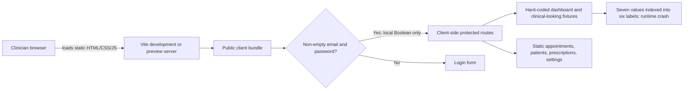
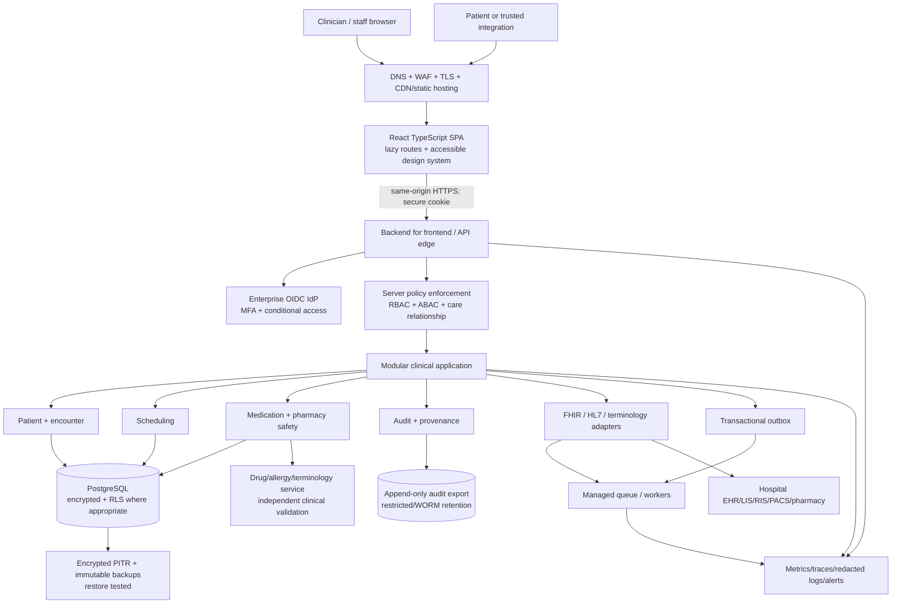

# AYBAK Hospital Platform — Enterprise Architecture, Security, Clinical-Safety, and Production-Readiness Audit

**Audit date:** 2026-11-04  
**Audited commit:** `9c1b9f826d2cfa63f5a25aef80b7b259889a22ba`  
**Branch:** `arena/c4041469-aybak-hospital-platform`  
**Assessment type:** Source, configuration, dependency, build, and targeted runtime review  
**Release decision:** **NO-GO for production, real PHI, or clinical use**  
**Overall production-readiness score:** **6/100**

> This report evaluates what is actually present in the repository. It does not infer an unseen backend, database, infrastructure, or compliance program. The current repository is a React interface prototype, not an implemented hospital management system. Risk ratings describe the consequence of promoting the current implementation to clinical production without remediation; where appropriate, the lower risk of the present static demo is stated explicitly. This is an engineering assessment, not a legal compliance certification or a clinical validation.

# Executive Summary

AYBAK has a visually coherent React/Vite doctor-portal prototype with routes for a dashboard, appointments, patients, prescriptions, and settings. It uses React's normal escaped rendering, has a useful `.gitignore`, and produces a production bundle successfully. Those positives do not translate into clinical production readiness.

The most immediate defect is a deterministic dashboard crash: seven chart values are rendered against six schedule labels, causing `schedule[6].day` to throw. A temporary server-rendering probe reproduced the error. Authentication is only a browser Boolean; any non-empty email and password grant access, while demo credentials and clinical-looking fixtures are shipped in the public JavaScript bundle. There are no server-side sessions, roles, permissions, APIs, database, migrations, transactional writes, audit events, clinical provenance, backups, monitoring, or deployment controls. Medication orders lack the structured data and independent safety checks required for a safe prescribing workflow.

The largest architectural gap is not a missing optimization; it is the absence of the entire trusted server and data layer. The correct response is **not** to add more hard-coded screens. AYBAK should first be explicitly classified and isolated as a synthetic-data demo, then rebuilt around a modular, API-backed architecture with strong identity, patient/encounter context, append-only audit history, validated clinical state transitions, interoperability, and measurable operating objectives.

## Highest-priority decisions

1. **Stop any real-patient or clinical use.** Label the current build “DEMO — synthetic data only,” and prevent its deployment as a clinical service.
2. **Fix and regression-test the dashboard crash** before using the prototype even as a demo.
3. **Remove the apparent authentication boundary.** Do not present the Boolean login as security; use a real OIDC identity provider and server-enforced authorization before exposing non-synthetic data.
4. **Do not implement prescribing as a display card.** Require a clinically governed medication lifecycle, allergy/interaction checks, human authorization, and an immutable audit trail.
5. **Establish the trusted platform foundation:** versioned APIs, PostgreSQL integrity controls, audit/provenance, encryption, backups, observability, CI/CD, and recovery testing.
6. **Adopt a modular monolith first.** Microservices would currently add operational risk without solving the missing clinical, security, or data semantics.

## Verification snapshot

| Check | Result | Interpretation |
|---|---|---|
| Tracked source/configuration files | 7 | Entire repository reviewed; no hidden application tiers exist in Git |
| Production build | Passed with Vite 5.4.21 | Compilation only; does not detect the runtime chart failure |
| Targeted dashboard runtime probe | Failed as predicted | `TypeError: Cannot read properties of undefined (reading 'day')` |
| Automated tests | None; no test script or framework | No regression, clinical-rule, accessibility, integration, or end-to-end assurance |
| `npm audit` on resolved dependency tree | 2 vulnerable packages: 1 high, 1 moderate | Direct Vite and transitive esbuild advisories; primarily development-server exposure |
| Production JavaScript | 201.04 kB uncompressed / 63.42 kB gzip | Reasonable for this small prototype; no evidence of performance at clinical scale |
| Production CSS | 23.34 kB uncompressed / 5.15 kB gzip | No current CSS-size emergency |
| Demo credentials and clinical fixtures in built JS | Confirmed | Route gating does not protect data embedded in static assets |
| Backend/API/database | Absent | No real workflow, persistence, security boundary, or system of record |
| Docker/CI/CD/IaC/monitoring/backups | Absent | No reproducible enterprise operating model |

# Project Overview

## Repository purpose as implemented

The code implements a single-doctor, dark-themed portal with hard-coded demo values. The login page advertises clinical workflow management, live patient monitoring, scheduling, and reports, but only navigation and display are implemented. No data is fetched, created, updated, exported, or securely persisted.

## Implemented modules

| Module | Source | Actual purpose | Production gap |
|---|---|---|---|
| Bootstrap | `src/main.jsx` | Mounts React in `StrictMode` | No global error/telemetry provider |
| Application/router | `src/App.jsx` | Holds all state, fixtures, routes, layout, and pages | Single 546-line module; no domain boundaries |
| Login | `LoginPage` | Collects email/password and toggles local state | No identity verification, MFA, throttling, recovery, or session |
| Protected layout | `ProtectedLayout` | Sidebar/header/navigation and Boolean route gate | Not a security boundary; no mobile navigation |
| Dashboard | `DoctorDashboardPage` | Static statistics, schedule chart, appointments, patient table | Crashes on seventh chart item; data has no source/provenance |
| Appointments | `AppointmentsPage` | Three static booking cards | No date, provider, encounter, persistence, or state machine |
| Patients | `PatientsPage` | Static patient registry | No authoritative identifiers, search, consent, or record access controls |
| Prescriptions | `PrescriptionsPage` | Static medication cards | No safe order model, validation, pharmacy workflow, or audit |
| Settings | `SettingsPage` | Static profile and local checkbox appearance | No persisted preferences or authoritative profile |
| Styling | `src/index.css`, Tailwind utilities | Global dark theme and layout | No tested accessible clinical design system |
| Build | `vite.config.js`, `package.json` | React/Tailwind development and static build | No locked toolchain, CI, release, or deployment policy |

## What is explicitly absent

There are no server applications, API routes, API clients, database drivers, schemas, migrations, queues, caches, object stores, integration engines, authentication services, policy engines, test files, CI workflows, container definitions, infrastructure definitions, dashboards, alerts, runbooks, or backup jobs. Consequently, backend, database, API, compliance, and disaster-recovery sections below are gap analyses and target designs—not reviews of nonexistent implementations.

# Repository Structure

```text
aybak-hospital-platform/
├── .gitignore             # Generic dependency, environment, build, and secret ignores
├── index.html             # Vite HTML shell; static title/description
├── package.json           # React, Router, Tailwind, Vite; dev/build/preview only
├── vite.config.js         # React and Tailwind Vite plugins
└── src/
    ├── App.jsx            # All fixtures, state, routing, layout, and five protected pages
    ├── index.css          # Tailwind import and global styles
    └── main.jsx           # React root and StrictMode
```

**Scale:** 698 lines across tracked files; `src/App.jsx` alone contains 546 lines (approximately 78% of all tracked lines). The initial commit is also the entire available history, so there is no useful change history, ADR trail, release record, or rationale to audit.

## Architecture map by responsibility

| Responsibility | Current location | Assessment |
|---|---|---|
| Presentation | React functions in `App.jsx` | Present but tightly coupled |
| Routing | `BrowserRouter` in `App.jsx` | Basic client routing present |
| Authentication state | `useState(false)` in `App` | Demo-only and bypassable |
| Authorization | None | Missing |
| Domain services | None | Missing |
| HTTP/API client | None | Missing |
| Persistence | None | Missing |
| Analytics/monitoring | None | Missing |
| Configuration/secrets | Hard-coded demo values | Not production-capable |
| Build | Vite | Works, but unlocked and vulnerable resolved toolchain |
| Runtime infrastructure | None | Missing |

# System Architecture

## Current architecture



There is no trusted enforcement point. The browser is simultaneously the presentation layer, credential checker, authorization decision, data store, and clinical-data distribution mechanism. Reloading resets the login state; inspecting or altering client state defeats the conceptual gate. All fixtures can be downloaded without logging in because they are compiled into the bundle.

## Recommended target architecture

Start with a **modular monolith and well-defined domain boundaries**, not distributed microservices. Extract a service only when scaling, isolation, regulatory, or ownership evidence justifies it.



### Required trust and data-flow rules

- The SPA never connects directly to the clinical database and never receives authoritative identity or role claims from its own state.
- Prefer a same-origin BFF with `HttpOnly`, `Secure`, appropriately `SameSite` cookies over browser token storage. If a pure SPA is retained, use OIDC authorization code with PKCE and a rigorously reviewed token design.
- Every API request enforces tenant, role, purpose, care relationship, resource, and action. UI route guards are usability only.
- All writes use validated commands, database transactions, concurrency control, and an audit event written atomically with the change.
- Patient, encounter, prescription, and schedule identifiers are opaque immutable IDs; names and display labels are never identity keys.
- Integration side effects use an outbox, idempotency keys, retry policy, dead-letter handling, and reconciliation.
- Logs and telemetry exclude PHI by default. Clinical audit and technical observability are separate data classes with separate access and retention.
- Downtime procedures are part of the product: clinicians must have a clearly governed fallback when scheduling, records, or medication services are unavailable.

# Frontend Analysis

## Positive observations

- React escapes rendered values by default; no `dangerouslySetInnerHTML`, `eval`, or direct HTML injection was found.
- `StrictMode` is enabled.
- Semantic labels exist for email/password inputs, and navigation uses links rather than click-only containers.
- Tailwind provides consistent spacing and visual styling.
- The current bundle is modest for a prototype; indiscriminate performance work would be lower priority than correctness and safety.

## Architectural and correctness findings

- `App.jsx` mixes fixtures, authentication, routing, layout, page rendering, domain display, and settings. See **M-01**.
- The dashboard has a confirmed runtime failure. See **C-01**.
- The route gate is not authentication, and there is no role/permission model. See **C-02** and **C-03**.
- Data and metrics are static but use language such as “Live,” trends, emergency cases, and risk. See **C-04**.
- Medication cards create a clinical affordance without the required order lifecycle. See **C-05**.
- Patient identity and list keys are unsafe for real data. See **H-12**.
- The sidebar disappears below `lg` with no replacement, and wide tables can be clipped. See **H-15**.
- There is no route-level error boundary, asynchronous state model, accessible chart alternative, or complete keyboard/focus strategy. See **H-11** and **M-03**.
- Several controls imply actions but do nothing. See **M-02**.
- There is no code splitting, typed contract, linting, formatting, testing, or server-state convention. See **M-04**, **M-05**, and **M-07**.

## Recommended frontend module map

```text
src/
├── app/                 # providers, router, error boundaries, runtime config
├── routes/              # lazy route entry points only
├── features/
│   ├── auth/            # OIDC/BFF flow; no password demo in production
│   ├── dashboard/
│   ├── appointments/
│   ├── patients/
│   ├── medications/
│   └── settings/
├── components/          # accessible, domain-neutral design system
├── api/                 # generated typed client, errors, retry/idempotency helpers
├── domain/              # formatting and pure validated domain rules
├── test/                # fixtures explicitly marked synthetic
└── observability/       # redacted errors, RUM, trace correlation
```

Clinical pages should always display patient context, data freshness, source, timezone, status, and the last authenticated author where relevant. Stale or unavailable data must never silently resemble current data.

# Backend Analysis

**Current state:** No backend exists. There are no controllers, services, domain entities, authorization middleware, validation schemas, background jobs, integration adapters, or server configuration. The `handleLogin` function is the only workflow decision and runs entirely in the browser.

This absence causes **C-02, C-03, C-04, C-05, H-01, H-03, and H-14**. A frontend-only patch cannot remedy these findings.

## Required backend domain boundaries

| Bounded context | Minimum responsibilities |
|---|---|
| Identity and access | OIDC callback/session, MFA context, staff lifecycle, roles, care relationships, break-glass |
| Patient | Master patient index/identifiers, demographics, consent directives, merge/unmerge provenance |
| Encounter | Episode, location, attending team, admission/discharge/transfer context |
| Scheduling | Resources, provider availability, conflicts, timezone, appointment state machine, waitlist |
| Medication | Order, review, interaction/allergy decision support, authorization, dispensing/administration status, discontinuation |
| Clinical document | Versioned notes, authorship, attestation, amendment rather than overwrite |
| Audit/provenance | Who/what/when/where/why, before/after or signed event reference, access and export events |
| Integration | FHIR/HL7 mappings, terminology, idempotent import/export, reconciliation |
| Notification | Preference and policy-driven delivery, no uncontrolled PHI in email/SMS |
| Reporting | De-identified/authorized aggregates, freshness, export approval and audit |

## Backend implementation standard

1. Choose a maintainable typed stack supported by the team; for example TypeScript with a mature framework and OpenAPI, or an equivalent enterprise JVM/.NET stack. The framework is less important than explicit boundaries and enforcement.
2. Define domain invariants before controllers. Validate all external input with allowlisted schemas and reject unknown/invalid clinical states.
3. Use PostgreSQL transactions for each command; write domain state, audit event, and outbox event together.
4. Require idempotency keys for retries of non-idempotent operations and optimistic/version checks for concurrent edits.
5. Return standards-based problem responses with safe correlation IDs; never expose stack traces or raw database errors.
6. Add anti-automation/rate controls to identity, search, export, and integration endpoints without blocking urgent clinical access.
7. Build contract, authorization, concurrency, failure, and audit tests into every module's definition of done.
8. Keep PHI out of URLs, analytics, exception trackers, and ordinary application logs.

# Database Analysis

**Current state:** No database or persistence exists. Arrays in `App.jsx` are reset from source on load. There is no schema, migration tool, transaction model, tenant model, encryption, indexing, retention, backup, or recovery implementation. See **H-02**, **H-10**, and **H-17**.

## Minimum clinical data model

| Entity | Required invariants and attributes |
|---|---|
| `patient` | Immutable UUID; tenant; separate demographic record; no mutable display name as primary identity |
| `patient_identifier` | Tenant-scoped identifier type/value; unique MRN where applicable; issuer and validity; merge history |
| `person_name` | Versioned structured names; avoid unnecessary replication |
| `consent_directive` | Scope, purpose, status, valid period, source, actor, version |
| `encounter` | Patient, facility, care team, class, start/end, status, version |
| `care_relationship` | Practitioner/patient or team/encounter scope and valid period for ABAC |
| `appointment` | Patient, encounter optional, provider/resource, UTC start/end, source timezone, location, status, reason, version |
| `medication_request` | Patient/encounter, coded medication, dose quantity + UCUM unit, route, frequency, timing, duration, indication, prescriber, status, authored time |
| `medication_safety_review` | Allergy/interaction/duplicate-therapy checks, override reason, reviewer, decision-support version |
| `clinical_event` | Provenance, author, subject, encounter, occurred/recorded times, amendment link |
| `audit_event` | Actor, subject, action, resource, purpose, outcome, correlation, timestamp, protected details |
| `outbox_event` | Aggregate/event ID, idempotency key, status, attempts, available time, payload protection |

## Database rules

- Store dates of birth where clinically required; derive age at display rather than letting a stored age become stale.
- Store timestamps in UTC and retain the source timezone/offset for scheduling and clinical interpretation.
- Use foreign keys, `NOT NULL`, constrained status values, appropriate exclusion constraints for resource conflicts, and uniqueness that reflects real clinical identity.
- Use optimistic locking (`version`) to prevent silent lost updates. Do not hard-delete signed clinical records; use corrections, amendments, and legally governed retention.
- Use tenant-scoped authorization at the application and defense-in-depth row-level security where operationally supportable. Test cross-tenant isolation explicitly.
- Encrypt storage and backups with managed keys, rotate keys, restrict KMS permissions, and minimize decrypted query surfaces. Transport encryption is mandatory.
- Index actual access paths (tenant + identifier, patient + encounter time, provider + schedule time, outbox status) and verify plans with production-shaped data.
- Keep large documents/images in governed encrypted object storage or connected PACS, not unbounded database byte columns.
- Define RPO/RTO with hospital leadership and prove them through restore drills; a backup without a restored validation is not a recovery capability.

# API Analysis

**Current state:** No HTTP API or client call exists. There is no `fetch`, Axios, SDK, GraphQL, WebSocket, or service-worker integration. Therefore there is no API authentication, validation, pagination, versioning, rate limiting, contract test, error model, retry behavior, idempotency, or audit semantics to approve. See **H-01** and **M-07**.

## Initial API surface for the target system

| Capability | Illustrative endpoint | Mandatory controls |
|---|---|---|
| Session | `GET /v1/me`, `POST /v1/logout` | Secure BFF session, CSRF where applicable, MFA/assurance claims |
| Patient search | `GET /v1/patients?query=...&cursor=...` | Minimum necessary fields, care scope, throttling, access audit |
| Patient record | `GET /v1/patients/{id}` | ABAC, purpose, consent, field-level filtering |
| Appointments | `GET/POST /v1/appointments` | Timezone, conflict checks, idempotency, audit |
| Appointment transitions | `POST /v1/appointments/{id}/transitions` | Explicit allowed state, version, actor reason |
| Medication orders | `POST /v1/medication-requests` | Clinical validation, step-up authorization, idempotency, safety review |
| Medication review | `POST /v1/medication-requests/{id}/reviews` | Independent reviewer rules, override reason, immutable history |
| Export | `POST /v1/exports` | Elevated permission, purpose, minimization, watermark/encryption, expiry, audit |
| FHIR integration | Scoped `/fhir/...` or adapter endpoints | SMART/OAuth scopes as applicable, profiles, provenance, reconciliation |

All list APIs require bounded cursor pagination and deterministic ordering. Mutations require explicit schemas and version handling. Retrying a create operation must not create a second appointment or medication order. Error payloads should follow RFC 9457-style problem details without leaking PHI. External integrations require timeouts, bounded retries with jitter, circuit breaking where suitable, and visible stale/degraded status.

# Security Audit

## Security posture

The current app must not be treated as secured. Its client route gate provides no confidentiality, integrity, or accountability. The only potential credential is a public demo string. No real identity or authorization decision reaches a server because no server exists.

### Threat summary

| Threat | Current exposure | Required response |
|---|---|---|
| Broken authentication | Any non-empty values pass; password is embedded | **C-02:** remove demo flow from production; OIDC/BFF/MFA |
| Broken access control | No roles, scopes, care relationship, tenant checks | **C-03:** deny-by-default server policies and tests |
| PHI disclosure | Clinical-looking names/conditions/medications are in public JS | **H-16:** synthetic fixtures only; authenticated server retrieval |
| Session theft/replay | No real session, revocation, expiry, or assurance | **C-03:** managed session lifecycle and secure cookies |
| Clinical-data tampering | No trusted writes or signatures/provenance | **H-01/H-03:** transactional commands and audit |
| Development-server attack | Vulnerable Vite/esbuild tree and `0.0.0.0` bind | **H-06:** upgrade and isolate development |
| Secret leakage | Demo password in source; no secret-management design | **C-02/H-09:** remove; managed runtime secrets |
| Web attacks in future APIs | No API controls yet | Validate, authorize, rate-limit, CSRF/CORS policy, security headers |
| XSS | No direct injection sink found; React escaping is positive | Preserve escaping; CSP and dependency controls; test future rich text |
| Dependency/supply chain | No lockfile, SBOM, provenance, or CI scan | **H-07/M-09:** locked verified pipeline |

### Dependency findings

The audit resolved `vite@5.4.21` and `esbuild<=0.24.2`. `npm audit` reported:

- **Vite, direct, high package severity:** multiple development-server advisories, including file-serving/path traversal and platform-specific command/file issues. One example is [GHSA-587h-7wmj-h5pm](https://github.com/advisories/GHSA-587h-7wmj-h5pm).
- **esbuild, transitive, moderate:** [GHSA-67mh-4wv8-2f99](https://github.com/advisories/GHSA-67mh-4wv8-2f99), allowing a malicious website to send requests to and read responses from susceptible development servers.

These are not evidence that the compiled static production bundle is remotely exploitable in the same way. They are nevertheless high priority because `npm run dev` and `npm run preview` bind to all interfaces. Upgrade to a supported patched toolchain as a tested unit; do not blindly run a force upgrade in a clinical repository.

## Security objectives and release gates

- No real data until a security architecture review, threat model, DPIA/privacy review as applicable, and clinical hazard review are approved.
- 100% of protected API integration tests verify authentication, object scope, tenant scope, and action permission.
- No critical/high exploitable dependency or SAST finding without documented, time-bound acceptance by security leadership.
- MFA for staff; step-up assurance for prescribing, export, break-glass, and privileged administration.
- Short-lived, revocable sessions; idle and absolute expiry; secure logout; suspicious-session response.
- Encryption in transit/at rest, managed keys, restricted production access, and immutable privileged/audit events.
- Tested incident response for privacy breach, ransomware, account takeover, wrong-patient access, and integration corruption.

# Performance Audit

No production-like load, browser trace, backend query, or real network exists to profile. It would be misleading to claim that the platform is performant at hospital scale.

## What can be concluded

- The single prototype JavaScript bundle is 201.04 kB uncompressed (63.42 kB gzip), and CSS is 23.34 kB (5.15 kB gzip). This is not currently a critical payload problem.
- Every page and every fixture is bundled eagerly. As modules grow, this will increase initial parse/compile and expose more data in the public artifact. See **M-05**.
- The chart crash is a correctness failure, not a performance issue; optimizing around it would be inappropriate.
- No API pagination, caching, database indexing, queueing, connection pooling, or query telemetry exists. These are design gaps under **H-01/H-02**, not measured bottlenecks.

## Proposed measurable budgets and SLOs

| Area | Initial objective; validate with clinical operations |
|---|---|
| Web vitals | p75 LCP < 2.5 s, INP < 200 ms, CLS < 0.1 on agreed hospital device/network profiles |
| Initial JS | ≤100 kB gzip for the unauthenticated shell; protected feature chunks loaded on demand |
| Route JS | Normally ≤50 kB gzip per lazy feature; review exceptions |
| API reads | p95 <300 ms for ordinary online clinical reads, excluding explicitly identified external dependencies |
| API writes | p95 <500 ms for ordinary commands; no unbounded integration call in the synchronous transaction |
| Availability | Proposed 99.95% monthly for core clinical APIs; finalize by care criticality |
| Capacity | Pass at expected peak and 2× forecast peak with defined data volume, concurrent users, and integration latency |
| Degradation | Show freshness and unavailable source status; never replace failed data with stale values silently |

Use server timings, tracing, real-user monitoring without PHI, query plans, and k6/Gatling-style load scenarios. Test low-powered hospital workstations and unreliable wireless, not only developer laptops.

# Scalability Audit

The prototype has no horizontal scalability model because it has no server or data plane. Local `useState` cannot share sessions or transactions. Static arrays do not exercise patient volumes, scheduling contention, medication concurrency, or reporting growth.

## Scalability limitations and remedies

- **No shared transactional state:** introduce the backend and PostgreSQL model in **H-01/H-02**.
- **No asynchronous integration boundary:** add outbox/queue workers, idempotency, backpressure, and reconciliation as described in **H-01/H-14**.
- **No bounded data retrieval:** require cursor pagination and field minimization in every list/search endpoint.
- **No query/capacity evidence:** add realistic fixtures, indexes from query patterns, slow-query alerts, connection limits, and load tests.
- **No independent background workload control:** separate web and worker resource limits, retry budgets, dead-letter queues, and per-tenant fairness where needed.
- **No audit/reporting growth strategy:** partition large append-only tables only after measurements; archive according to legal retention without destroying required access history.
- **No frontend route isolation:** lazy-load features and use accessible virtualized lists only where pagination is unsuitable; never virtualize away clinically important context.

Prefer vertical/database optimization and a modular monolith until evidence identifies a scaling boundary. Microservices, event sourcing everywhere, Kubernetes, and client-side caching of PHI would presently increase risk rather than readiness.

# Documentation Audit

There is no README or other project documentation. The repository has no explanation of setup, demo limitations, data classification, architecture, clinical scope, security, testing, contribution, release, operations, or incident response. See **M-12** and **L-03**.

## Missing documentation inventory

| Priority | Required artifact | Minimum content |
|---|---|---|
| Immediate | `README.md` | Demo status, synthetic-data rule, prerequisites, locked install, run/build/test, support |
| Immediate | Clinical safety case/hazard log | Hazards, mitigations, residual risk, owner, validation evidence |
| Immediate | Security/privacy threat model | Data flows, actors, trust boundaries, abuse cases, controls |
| Immediate | `SECURITY.md` | Private vulnerability reporting, response targets, disclosure process |
| High | Architecture overview + ADRs | Context, decisions, alternatives, consequences, review dates |
| High | Data dictionary/classification | PHI/PII fields, ownership, source, retention, residency, allowed use |
| High | API specifications | OpenAPI/FHIR profiles, errors, auth, idempotency, versioning |
| High | Authorization matrix | Role + relationship + action + resource + break-glass rules |
| High | Deployment and configuration | Environments, secrets, headers, database migration/rollback policy |
| High | Operations runbooks | Alerts, outage, stale integration, wrong-patient, medication outage |
| High | Backup/restore and DR | RPO/RTO, responsibilities, restore proof, downtime procedures |
| High | Incident/breach response | Triage, containment, evidence, notification decision, communications |
| High | Test/validation plan | Unit through clinical UAT, accessibility, security, performance, traceability |
| Medium | Contribution and coding standards | Branch/review, secure coding, formatting, test requirements |
| Medium | Terminology/integration guide | HL7/FHIR mappings, code systems, failure/reconciliation behavior |
| Medium | AI governance, if AI added | Intended use, validation, bias, oversight, monitoring, rollback |
| Medium | Changelog/release notes | Version, migrations, known issues, approvals, rollback |

# DevOps Audit

No Dockerfile, Compose file, CI workflow, infrastructure as code, deployment manifest, environment specification, health policy, monitoring, log pipeline, alert, backup, or recovery automation exists. The package has useful `dev`, `build`, and `preview` scripts but no `test`, `lint`, `typecheck`, or security scripts.

## Principal gaps

- Vulnerable resolved development dependencies and all-interface binding: **H-06**.
- No lockfile or Node/package-manager version pin: **H-07**.
- No application monitoring or alerting: **H-08**.
- No repeatable deployment, TLS/header policy, or environment promotion: **H-09**.
- No backup/DR implementation: **H-10**.
- No CI test/security gates: **H-05/M-09**.
- `.dockerignore` itself is ignored: **M-10**.

## Required delivery pipeline

1. `npm ci` with a committed lockfile on the pinned runtime.
2. Format check, lint, typecheck, unit tests, production build.
3. SAST, secret scan, dependency audit with exploitability review, license policy, SBOM generation.
4. Browser integration/E2E and automated accessibility tests against an isolated synthetic environment.
5. API contract, authorization, database migration, and integration tests when those tiers are added.
6. Build once; generate a signed immutable artifact/image with provenance; promote the same artifact between environments.
7. Deploy with migration compatibility, health checks, rollback/roll-forward plan, and smoke tests. Never use `npm run dev` or Vite preview as the public production server.
8. Monitor SLOs and security/clinical signals; alert a staffed owner with a tested runbook.
9. Automate encrypted backups, PITR, immutable copies, and scheduled restoration verification.

# Healthcare Compliance Review

Compliance cannot be inferred from UI code. No policy, agreement, consent process, audit mechanism, retention schedule, risk file, or validation evidence is present. **H-04 and H-17 are release blockers.** Applicability depends on deployment geography, customers, intended use, and whether the product crosses into medical-device functionality.

| Framework/obligation | Relevance | Current gap and required evidence |
|---|---|---|
| GDPR/UK GDPR and local health-data law | Likely relevant for NL/EU operations; confirm scope | Controller/processor roles, lawful basis and Article 9 condition, DPIA, minimization, rights, retention, residency/transfers, processors, breach process |
| HIPAA | Only if US covered-entity/business-associate scope applies | Security risk analysis, BAAs, administrative/physical/technical safeguards, audit, minimum necessary, breach procedures |
| ISO/IEC 27001/27701 | Useful security/privacy management frameworks | ISMS/PIMS scope, asset/risk registers, control ownership, internal audit and improvement |
| SOC 2 | Customer assurance, not clinical compliance | Operating evidence for security, availability, confidentiality commitments |
| HL7 FHIR / HL7v2 / DICOM | Interoperability rather than legal certification | Versioned profiles, terminology, provenance, conformance tests; PACS/DICOM boundaries for imaging |
| IEC 62304 / ISO 14971 / IEC 62366 | Potentially relevant if intended use is medical device/clinical decision support | Intended-use determination, software lifecycle, hazard log, risk controls, usability validation, regulatory review |
| Local prescribing/pharmacy law | Applies to medication ordering and controlled medicines | Licensed workflow, prescriber identity/assurance, formulary, signatures, dispensing/administration separation |
| Records retention and patient-access law | Jurisdiction-specific | Legal schedule, amendments, export/access process, legal holds, defensible disposal |

## Patient-safety and medical-data risk themes

- **Wrong-patient selection:** names and ages are insufficient identifiers; use MRN plus additional verification and persistent context (**H-12**).
- **Wrong time/encounter:** schedule cards lack dates, zones, provider/resource identity, and state history (**H-13**).
- **Medication harm:** incomplete orders and no safety review (**C-05**).
- **False confidence:** static values are labeled “Live” and show trends without provenance (**C-04**).
- **Unavailable information:** the chart crash and mobile clipping can hide information (**C-01/H-15**).
- **Privacy exposure:** public fixtures and no access audit (**H-16/H-03**).
- **Silent integration/data loss:** no transactions, idempotency, provenance, monitoring, or recovery (**H-01/H-08/H-10/H-14**).

A named clinical safety officer, privacy lead, security owner, and appropriate human-factors/pharmacy reviewers must approve residual risk. Engineers must not independently declare clinical fitness.

# Technical Debt Report

| Debt | Evidence | Consequence | Priority/effort |
|---|---|---|---|
| Entire trusted platform absent | Only Vite/React static source | Cannot safely perform any real clinical operation | Critical / foundational program |
| Runtime correctness | Six labels versus seven values | Dashboard unusable after login | Critical / small fix, broad test need |
| Fake security boundary | Local Boolean and public demo password | False assurance and total access-control failure if reused | Critical / identity workstream |
| Monolithic frontend file | 546-line `App.jsx` | Coupled changes, difficult review/testing | Medium / 3–5 days initial extraction |
| Duplicated patient tables and panel styles | Dashboard and Patients page | Divergent clinical formatting and behavior | Medium / 2–3 days |
| Static, incomplete clinical models | Arrays in source | Wrong identity/time/status/medication semantics | Critical/High / domain redesign |
| No automated assurance | No test/lint/type/CI scripts | Regressions compile successfully | High / ongoing |
| Unlocked toolchain | Caret ranges, no lockfile | Non-reproducible builds and uncontrolled dependency change | High / 1 day plus upgrade testing |
| Vulnerable development tooling | `npm audit` results | Developer/source exposure under advisory conditions | High / 1–3 days |
| No operability | No telemetry, runbooks, backup, DR | Unbounded outage and untestable recovery | High / foundational |
| Dead UI affordances | Buttons/checkboxes without behavior | User deception and unsafe assumptions | Medium / remove or implement |
| Documentation vacuum | No project docs | Knowledge concentrated and unreviewable | High / continuous |

Dead code is limited but present: `schedule[].active` is never read (**L-01**). Buttons without handlers are not called dead code here; they are nonfunctional product behavior (**M-02**). Generic duplicate ignore entries are cleanup debt (**L-02**), not a clinical risk.

# Critical Issues

Each finding below states root cause, impact, risk, solution, and executable implementation steps. “Critical” means a production release blocker, not a claim that the current synthetic demo has already caused harm.

## C-01 — Dashboard crashes while rendering the weekly chart

- **Evidence:** `src/App.jsx:32-39` defines six schedule entries; `:338-351` maps seven values and reads `schedule[index].day`. The targeted runtime probe reproduced the undefined `day` TypeError.
- **Root cause:** Parallel arrays encode one concept without a length invariant; no component test or error boundary detects/contains the mismatch.
- **Impact:** The main dashboard fails after the nominal login. In a clinical product this could deny access to schedule and patient context and encourage unsafe workarounds.
- **Risk level:** **Critical patient-safety/reliability release blocker; certain runtime failure.**
- **Solution:** Model each chart point as `{day, value}` and render one collection. Add an error boundary and a regression test for every chart point.
- **Implementation steps:** (1) Merge values and labels into one typed array including the missing day or remove the unsupported value. (2) Validate non-empty finite values and required labels at fixture/schema boundaries. (3) Add a component test that renders seven points and asserts seven accessible labels. (4) Add route error UI with safe retry and support correlation. (5) Run the full dashboard E2E path in CI before any further demo.

## C-02 — Authentication accepts arbitrary credentials and ships a demo password

- **Evidence:** `src/App.jsx:62-70` initializes `doctor@aybak.com` / `admin123` and sets `isLoggedIn=true` for any two non-empty strings; `:265` publishes the same credentials. Both were found in the production bundle.
- **Root cause:** A UI demonstration was implemented where a trusted identity flow is expected; no server or identity provider participates.
- **Impact:** If reused with real data, any visitor could impersonate a doctor. The public password also normalizes hard-coded credential handling.
- **Risk level:** **Critical security risk in any non-synthetic deployment.**
- **Solution:** Remove this flow from production and implement OIDC/OAuth through an enterprise IdP, preferably using a same-origin BFF. Require MFA and verified staff lifecycle.
- **Implementation steps:** (1) Immediately label and isolate the demo; empty the default password and prohibit real credentials. (2) Add a production build-time failure if demo auth is enabled. (3) Configure OIDC authorization-code flow, MFA/assurance, and issuer/audience validation. (4) Establish secure, expiring server sessions and verified logout. (5) Add throttling/lockout signals at the IdP, account recovery, joiner/mover/leaver deprovisioning, and security tests. (6) Rotate any real credential ever used with this pattern.

## C-03 — No server-side session, authorization, tenant, or care-relationship enforcement

- **Evidence:** Only `isLoggedIn` controls routes; there are no roles, scopes, policies, API middleware, or session records. Logout only flips a Boolean.
- **Root cause:** The browser route guard was mistaken for a security boundary; no trusted authorization service exists.
- **Impact:** Doctor-only routes provide no actual protection. There is no distinction among physician, nurse, pharmacist, scheduler, administrator, patient, or auditor and no record-level access restriction, revocation, or break-glass accountability.
- **Risk level:** **Critical security/privacy and patient-safety risk.**
- **Solution:** Implement deny-by-default server RBAC plus ABAC and purpose-of-use, with explicit care relationships and tenant boundaries.
- **Implementation steps:** (1) Publish a role/action/resource matrix with clinical and privacy owners. (2) Enforce session authenticity, expiry, assurance, and revocation on every API call. (3) Scope queries by tenant and authorized patient/encounter relationship. (4) Require reason, enhanced audit, time limit, and alerting for break-glass. (5) Add object-level, function-level, cross-tenant, revoked-user, expired-session, and privilege-escalation tests. (6) Keep frontend guards only for navigation convenience.

## C-04 — Static demo information is presented as live clinical truth with no system of record

- **Evidence:** All stats, trends, risks, emergency counts, schedules, and patient statuses are hard-coded arrays. “Live” appears on the dashboard navigation, but no fetch or write path exists.
- **Root cause:** Visual prototype data has not been separated from production domain data or marked with demo provenance.
- **Impact:** Users could believe synthetic values are current, make decisions from false information, or assume actions were saved. There is no source, freshness, encounter, author, or version to validate.
- **Risk level:** **Critical patient-safety and data-integrity risk if used clinically.**
- **Solution:** Restrict this build to unmistakably marked synthetic demonstrations. Build authoritative APIs with source/freshness/status metadata before presenting values as clinical facts.
- **Implementation steps:** (1) Add a persistent demo banner and use generated, obviously synthetic fixtures outside production. (2) Remove “Live,” trend, emergency, and risk claims until backed by approved definitions and data. (3) Implement a system of record and encounter-scoped read models. (4) Display source, last-updated time, timezone, stale/unavailable state, and correction history. (5) Clinically validate each metric and alert threshold. (6) Test unavailable and stale integrations.

## C-05 — Prescription display lacks the safety controls of a medication workflow

- **Evidence:** `src/App.jsx:47-51` stores only patient name, medicine string, dosage string, and note; `:481-512` displays them and offers a nonfunctional “New Prescription” button.
- **Root cause:** Medication ordering is modeled as display text rather than a governed clinical transaction.
- **Impact:** A real implementation on this model could omit coded drug identity, dose/unit semantics, route, frequency, duration, indication, prescriber, encounter, allergy/interaction/duplicate checks, review, discontinuation, or amendments. This can contribute to wrong-patient, wrong-drug, wrong-dose, and duplicate-therapy harm.
- **Risk level:** **Critical patient-safety risk; prescribing must remain disabled.**
- **Solution:** Keep prescribing non-operational until a licensed clinical/pharmacy owner approves a complete medication lifecycle and independent validation.
- **Implementation steps:** (1) Remove or disable the creation affordance and mark the cards synthetic. (2) Define a structured medication model using applicable terminology and UCUM units. (3) Require patient/encounter verification, allergy status, interaction/duplicate/dose-range decision support, and documented override reasons. (4) Separate prescribe, review, dispense, administer, and discontinue permissions/states. (5) Require strong prescriber identity, versioning, immutable audit, idempotency, and local legal controls. (6) Validate with pharmacists using hazardous test cases and never allow an AI system to autonomously prescribe.

# High Priority Issues

## H-01 — Backend and API layer are entirely absent

- **Root cause:** Repository scope stopped at static UI screens; no application service or contract was implemented.
- **Impact:** No trusted validation, transaction, integration, persistence, or access control is possible; all higher clinical workflows are blocked.
- **Risk level:** **High architectural/reliability risk and production blocker.**
- **Solution:** Build a typed modular backend with explicit domain contexts and OpenAPI contracts.
- **Implementation steps:** (1) Approve context boundaries and ADRs. (2) Implement identity/session and patient/encounter first. (3) Add schema validation, problem errors, pagination, correlation, timeouts, idempotency, and audit middleware. (4) Add scheduling with transactions and concurrency. (5) Add medication only after C-05 controls. (6) Require contract and failure tests before UI integration.

## H-02 — No database, schema, migration, transaction, or integrity architecture

- **Root cause:** Arrays substitute for a system of record.
- **Impact:** Data cannot be durable, concurrent, consistent, tenant-safe, recoverable, or clinically traceable.
- **Risk level:** **High data-integrity/scalability risk and production blocker.**
- **Solution:** Use PostgreSQL with versioned migrations and domain-owned invariants.
- **Implementation steps:** (1) Create the conceptual model and data dictionary. (2) Add identifiers, foreign keys, constraints, status invariants, UTC/source timezone, and versions. (3) Implement transactional commands and outbox. (4) Add tenant isolation and query indexes. (5) Test migration up/forward compatibility, contention, duplicate retries, and cross-tenant access. (6) Enable managed encryption and restricted database access.

## H-03 — No immutable audit trail, clinical provenance, or access history

- **Root cause:** No server events or actor identity exist.
- **Impact:** The organization cannot establish who viewed, created, changed, exported, overrode, or corrected a record; incident reconstruction and accountability fail.
- **Risk level:** **High security/compliance/clinical risk.**
- **Solution:** Add append-only access and mutation audit with provenance, written transactionally for state changes.
- **Implementation steps:** (1) Define audit event taxonomy and minimum fields. (2) Record actor, subject, action, resource, purpose, outcome, correlation, and trusted timestamp. (3) Write mutation audit with the domain transaction. (4) Export to restricted append-only/WORM-capable storage with controlled retention. (5) Protect audit details from ordinary support users and technical log pipelines. (6) Test tamper resistance and investigate access/export events.

## H-04 — Privacy, security, clinical-safety, and regulatory governance is absent

- **Root cause:** No documentation or accountable control program accompanies the prototype.
- **Impact:** Lawful basis, intended use, risk acceptance, processing scope, residency, patient rights, and regulatory obligations are unknown; engineering cannot demonstrate due care.
- **Risk level:** **High legal/ethical/patient-safety risk.**
- **Solution:** Establish governance before real data or clinical pilots.
- **Implementation steps:** (1) Name clinical safety, security, privacy/DPO, product, and operational owners. (2) Determine intended use and jurisdiction. (3) Complete data-flow inventory, DPIA where required, threat model, and clinical hazard log. (4) Record lawful basis/Article 9 condition or HIPAA scope as applicable. (5) Execute processor/BA agreements and review transfers. (6) Trace each hazard/control to tests and approvals; repeat at material changes.

## H-05 — No automated tests or CI quality gates

- **Root cause:** `package.json` exposes only dev/build/preview; no test files or workflows exist.
- **Impact:** A deterministic crash passed the build. Authentication, authorization, clinical rules, accessibility, and migrations have no executable assurance.
- **Risk level:** **High reliability/patient-safety/maintainability risk.**
- **Solution:** Establish a risk-based test pyramid and required CI checks.
- **Implementation steps:** (1) Add Vitest/React Testing Library, Playwright, lint, typecheck, and coverage reporting. (2) Start with C-01 and login/demo-mode regression tests. (3) Add API contract, authorization matrix, clinical invariant, concurrency, and migration tests as tiers arrive. (4) Add E2E and accessibility checks. (5) Block merges on failures and require review for clinical-risk changes. (6) Track coverage of hazards and critical paths, not line percentage alone.

## H-06 — Vulnerable Vite/esbuild development tooling is exposed on all interfaces

- **Root cause:** Vite 5 resolves to an advisory-affected tree; scripts explicitly use `--host 0.0.0.0`; no isolation policy exists.
- **Impact:** Under advisory-specific conditions, a malicious site or network peer may read development files/responses or exploit platform-specific behavior. Developer source and accessible services are at risk.
- **Risk level:** **High dependency/development security priority; no equivalent production-bundle exploit was established.**
- **Solution:** Upgrade to a supported patched Vite/plugin/Node combination and isolate development/preview services.
- **Implementation steps:** (1) Read all audit advisories and choose patched compatible versions rather than forcing blindly. (2) Upgrade Vite and `@vitejs/plugin-react`, regenerate the lockfile, and run builds/E2E. (3) Bind to loopback by default except controlled preview containers; never expose dev/preview publicly. (4) Restrict allowed hosts/origins and filesystem access. (5) Re-run audit and document any accepted residual advisory.

## H-07 — Dependencies and runtime are not reproducible

- **Root cause:** No lockfile, `engines`, or version-manager file; caret ranges allow silent updates. Verification resolved newer packages than the declared minimums.
- **Impact:** Two builds from the same commit can differ, making vulnerability response, rollback, and incident reproduction unreliable.
- **Risk level:** **High supply-chain/reliability risk.**
- **Solution:** Commit the lockfile and pin the supported Node/package-manager toolchain.
- **Implementation steps:** (1) Upgrade/patch dependencies first. (2) Commit `package-lock.json` and use `npm ci`. (3) Declare Node and package-manager versions and document the LTS policy. (4) Use lockfile-only dependency update automation with human review. (5) Rebuild the same immutable artifact for promotion. (6) Verify reproducibility in clean CI.

## H-08 — No monitoring, redacted logging, tracing, alerting, or clinical freshness signals

- **Root cause:** No instrumentation libraries, backends, dashboards, alert rules, or runbooks exist.
- **Impact:** Crashes and future outages, stale integrations, suspicious record access, failed medication messages, and backup failures can remain undetected; mean time to detect/recover is unbounded.
- **Risk level:** **High reliability/security/patient-safety risk.**
- **Solution:** Implement privacy-safe observability plus explicit clinical data-health monitoring.
- **Implementation steps:** (1) Add route error capture and correlation without PHI. (2) Instrument server RED metrics, traces, worker lag, DB health, and external dependency latency. (3) Monitor record/integration freshness and failed reconciliation separately. (4) Define SLOs, actionable alerts, escalation, and runbooks. (5) Prohibit tokens, credentials, free-text PHI, and patient identifiers in telemetry. (6) Exercise outage and alert drills.

## H-09 — No production deployment, container, infrastructure, TLS, or security-header configuration

- **Root cause:** Only development/build scripts exist; no target runtime or edge policy is defined.
- **Impact:** Deployments would be manual and inconsistent, with unknown TLS, isolation, CSP, clickjacking, MIME-sniffing, referrer, permissions, caching, rollback, and secret behavior.
- **Risk level:** **High security/reliability risk.**
- **Solution:** Define immutable infrastructure and secure static/BFF/API deployment baselines.
- **Implementation steps:** (1) Choose a managed target and write IaC for separated dev/test/stage/prod. (2) Serve built assets through a supported server/CDN, never Vite dev. (3) Enforce TLS/HSTS and test a nonce/hash-based CSP, `frame-ancestors`, `nosniff`, restrictive referrer/permissions policies. (4) Set no-store for authenticated PHI/API responses and deliberate immutable caching only for hashed public assets. (5) Manage secrets in a vault and identities through workload IAM. (6) Add health/smoke tests, signed artifacts, rollback, and network restrictions.

## H-10 — No backup, disaster-recovery, restore-validation, or downtime strategy

- **Root cause:** There is no data service or operational design. The current source arrays can be restored from Git, but that is not a clinical backup strategy.
- **Impact:** Once persistence is added without recovery controls, ransomware, accidental deletion, regional failure, or migration errors could cause permanent record loss and prolonged care disruption.
- **Risk level:** **High resilience/patient-safety risk before any production data.**
- **Solution:** Implement encrypted PITR and immutable backups, documented DR, and clinically approved downtime procedures.
- **Implementation steps:** (1) Set business-approved RPO/RTO and retention per data class. (2) Enable PITR, automated snapshots, cross-account/region protection as justified, and restricted keys. (3) Back up audit, objects, configuration, and integration state consistently. (4) Schedule isolated restore tests with integrity/application verification. (5) Define ransomware and regional recovery exercises. (6) Provide downtime forms/read-only packs and reconciliation procedures without unsafe informal workarounds.

## H-11 — No error containment or truthful asynchronous/degraded UI states

- **Root cause:** The React tree has no error boundary, and no API states exist for loading, empty, error, stale, retry, or partial data.
- **Impact:** C-01 can blank the entire experience. Future network failures could be indistinguishable from “no patients/results,” leading to unsafe assumptions.
- **Risk level:** **High reliability/patient-safety risk.**
- **Solution:** Add nested error boundaries and an explicit async state model with data freshness.
- **Implementation steps:** (1) Add app and route boundaries with non-PHI correlation IDs. (2) Define loading, empty, error, stale, offline, forbidden, and partial-source components. (3) Preserve patient context only when safe and provide reauthentication/recovery paths. (4) Never silently substitute cached/default clinical data. (5) Test thrown renders, timeouts, offline behavior, and partial integrations. (6) Attach telemetry under H-08.

## H-12 — Patient identity and React keys are unsafe for clinical use

- **Root cause:** Patients are represented by name, age, condition, and risk; patient/prescription rows use names as keys, appointments use time, and bookings use title.
- **Impact:** Duplicate names, multiple prescriptions, or equal times create duplicate keys and ambiguous identity. Age becomes stale. In a real system this increases wrong-patient rendering, reconciliation, and update risk.
- **Risk level:** **High patient-safety/data-integrity risk.**
- **Solution:** Introduce immutable IDs and verified patient-context presentation.
- **Implementation steps:** (1) Model patient/encounter/order IDs independently of display data. (2) Store structured identifiers and DOB; derive age with explicit reference time. (3) Use stable unique keys for every list. (4) Display at least two approved identifiers and persistent patient context during ordering. (5) Add duplicate-name and multiple-order tests. (6) Implement governed merge/unmerge and wrong-patient correction workflows.

## H-13 — Scheduling and temporal semantics are incomplete and ambiguous

- **Root cause:** Appointment data has only 12-hour time strings; no date, UTC instant, source zone, duration, provider/resource ID, or version exists. Age and shift values are also static text.
- **Impact:** Daylight-saving changes, travel, distributed facilities, midnight crossing, and concurrent updates can produce wrong-time or wrong-resource care.
- **Risk level:** **High patient-safety/reliability risk.**
- **Solution:** Model scheduling with UTC instants, original timezone, durations, resources, and explicit transitions.
- **Implementation steps:** (1) Add date/timezone/duration/provider/location/patient/encounter IDs. (2) Store UTC plus source IANA zone and display the zone unambiguously. (3) Add conflict/exclusion checks and optimistic versions. (4) Define booking/cancel/arrive/complete/no-show state rules. (5) Test DST gaps/overlaps, leap days, cross-midnight shifts, and concurrent booking. (6) Show corrected/rescheduled history.

## H-14 — No interoperability or terminology architecture

- **Root cause:** No integration adapter, code system, interface contract, or reconciliation process exists.
- **Impact:** The platform cannot safely exchange patient, lab, imaging, appointment, or medication context with hospital systems; free-text medicines and conditions impede decision support.
- **Risk level:** **High clinical/integration/maintainability risk.**
- **Solution:** Build versioned FHIR/HL7 adapters and governed terminology, independent of core domain storage.
- **Implementation steps:** (1) Inventory source systems and ownership. (2) Select FHIR version/profiles and HL7v2 feeds; avoid claiming compliance based only on endpoint names. (3) Adopt applicable SNOMED CT, LOINC, ICD, UCUM, and local drug terminologies with licensing. (4) Add provenance, mapping/version tests, idempotent consumers, dead letters, and replay controls. (5) Reconcile rejected/missing messages and alert on lag. (6) Use PACS/DICOM-aware components for imaging rather than ad hoc file handling.

## H-15 — Mobile layouts remove navigation and can clip clinical tables

- **Root cause:** The only navigation sidebar is `hidden ... lg:block`; no mobile menu exists. Table wrappers use `overflow-hidden` with multi-column minimum content and no responsive alternative.
- **Impact:** Phone/tablet users cannot reach core routes through navigation and may not see risk/status columns. Hidden or inaccessible context can contribute to clinical mistakes.
- **Risk level:** **High usability/patient-safety risk on supported mobile devices.**
- **Solution:** Provide accessible responsive navigation and clinically prioritized responsive record layouts.
- **Implementation steps:** (1) Add a keyboard/screen-reader-accessible mobile navigation trigger, focus management, and current-route state. (2) Use controlled horizontal scrolling with visible cues or a tested card/priority-column layout. (3) Preserve essential identifiers, status, and actions. (4) Test 320 CSS px, tablet, 200–400% zoom, landscape, keyboard, and screen readers. (5) Add responsive E2E assertions that all routes and critical fields remain reachable.

## H-16 — Clinical-looking patient and medication data is embedded in the public bundle

- **Root cause:** Fixtures live in `App.jsx`, which is compiled into the same asset served before authentication. Build inspection confirmed patient names and a medication string in the JS.
- **Impact:** Route gating cannot prevent download or inspection of these records. If any fixture is real rather than synthetic, this is direct unauthorized PHI disclosure; even synthetic names can confuse users about data origin.
- **Risk level:** **High now for classification uncertainty; Critical if any value is real PHI.**
- **Solution:** Use verifiably synthetic development fixtures and retrieve real records only through authorized APIs.
- **Implementation steps:** (1) Confirm data provenance immediately; invoke breach response if any real PHI is found. (2) Replace records with generated synthetic fixtures labeled in every environment. (3) Move test fixtures outside production entry chunks. (4) Fetch minimum necessary fields after server authorization. (5) Scan built artifacts for known fixture/PHI patterns. (6) Add a policy forbidding production data in source, tickets, screenshots, and tests.

## H-17 — Consent, data lifecycle, retention, export, and patient-rights controls are absent

- **Root cause:** No technical or documented lifecycle exists beyond static source records.
- **Impact:** The system cannot enforce consent directives, legal holds, correction/amendment, retention/disposal, minimization, export expiry, or access requests.
- **Risk level:** **High privacy/compliance/medical-data risk.**
- **Solution:** Implement a policy-driven data lifecycle alongside the system of record.
- **Implementation steps:** (1) Classify fields and purposes in a data dictionary. (2) Model consent/directives and enforce them in query/export policies where applicable. (3) Define jurisdiction-approved retention, amendment, legal hold, and deletion/anonymization behavior. (4) Build authorized, encrypted, expiring exports with access audit. (5) Support access/correction workflows without overwriting signed history. (6) Test lifecycle jobs and retain evidence of disposal.

# Medium Priority Issues

## M-01 — One module contains all frontend responsibilities and duplicates record rendering

- **Root cause:** All pages and shared concerns were added directly to `App.jsx`; no feature/design-system boundaries were established.
- **Impact:** Changes have broad blast radius, reviews are difficult, duplicate patient tables can diverge, and isolated testing is unnecessarily hard.
- **Risk level:** **Medium maintainability/reliability risk.**
- **Solution:** Extract feature modules and shared accessible clinical components without creating a premature generic abstraction for everything.
- **Implementation steps:** (1) Move each page under `features/`. (2) Separate fixtures into synthetic test/dev files. (3) Create typed `PatientTable`, status, page panel, and async-state components based on repeated behavior. (4) Centralize routing/providers. (5) Add component tests before/during extraction. (6) Enforce dependency direction with lint boundaries.

## M-02 — Multiple controls imply completed actions but have no behavior or persistence

- **Root cause:** Export, forgot password, new booking, add patient, new prescription, and remember-me controls have no implemented action; notification boxes only toggle uncontrolled DOM state.
- **Impact:** Users may think a request, recovery, booking, export, or preference succeeded. This erodes trust and can become clinically dangerous when actions affect care.
- **Risk level:** **Medium current UX risk; High if retained in a clinical workflow.**
- **Solution:** Remove/disable unfinished controls with explicit explanations or implement complete transactional flows.
- **Implementation steps:** (1) Inventory every interactive element and its state/result. (2) Hide unsafe prescription creation until C-05 closes. (3) Disable unavailable actions with accessible reason text rather than clickable no-ops. (4) Implement settings through authenticated APIs with success/failure feedback. (5) Add E2E tests asserting each visible action has an outcome. (6) Never show a success message before server confirmation.

## M-03 — Accessibility and clinical usability validation is incomplete

- **Root cause:** No accessibility tests or design standard exists; chart bars are unlabeled visual `div`s, inputs remove outlines and rely on border focus, the document title never changes, no skip link exists, and global smooth scrolling ignores reduced motion.
- **Impact:** Keyboard, low-vision, motor, and screen-reader users may miss chart values, focus, page context, or navigation; clinical efficiency and equitable access suffer.
- **Risk level:** **Medium accessibility/usability risk, rising to High for essential workflows.**
- **Solution:** Adopt WCAG 2.2 AA as a minimum engineering target and validate clinical usability with representative users.
- **Implementation steps:** (1) Add a textual/table alternative and accessible name for charts. (2) Implement visible `:focus-visible` styles, skip navigation, route titles/announcements, and reduced-motion handling. (3) Add appropriate autocomplete attributes without encouraging shared-device credential storage. (4) Verify contrast, touch targets, zoom, keyboard flow, and errors. (5) Run axe plus manual screen-reader testing. (6) Conduct formative human-factors review for patient identification and medication tasks.

## M-04 — No TypeScript, schema validation, linting, formatting, or import-boundary checks

- **Root cause:** The project uses untyped JSX and has no static-quality scripts/configuration.
- **Impact:** Parallel-array and domain-shape errors are not caught; inconsistent conventions and unsafe boundary drift are more likely.
- **Risk level:** **Medium maintainability/correctness risk.**
- **Solution:** Migrate incrementally to strict TypeScript and enforce a small, meaningful quality ruleset.
- **Implementation steps:** (1) Add TypeScript and strict configuration. (2) Type routes, domain models, API contracts, and component props. (3) Use runtime schema validation at network/configuration boundaries because types alone do not validate input. (4) Add ESLint React hooks/accessibility/import rules and Prettier. (5) Add `typecheck`, `lint`, and `format:check` to CI. (6) Avoid unsafe `any` and blanket lint suppressions.

## M-05 — All routes are eagerly bundled and no performance budget exists

- **Root cause:** Every page is declared in one module; Vite has no manual/lazy route strategy or bundle checks.
- **Impact:** The small current bundle will grow with clinical modules, increasing startup cost and shipping unnecessary code/data to every user.
- **Risk level:** **Medium future performance/security-minimization risk.**
- **Solution:** Lazy-load route entry points and enforce role-appropriate, measured bundles.
- **Implementation steps:** (1) Complete M-01 extraction. (2) Use `React.lazy`/route lazy APIs with accessible loading and error states. (3) Analyze chunks and remove duplicate/large dependencies. (4) Set the budgets in the Performance Audit and fail on unexplained regressions. (5) Preload likely next routes only when clinically and technically appropriate. (6) Do not cache PHI in a service worker without a separate approved security design.

## M-06 — Direct-link behavior in production is unspecified

- **Root cause:** `BrowserRouter` requires a hosting fallback to `index.html`, but no deployment configuration defines one or protects unauthorized deep links server-side.
- **Impact:** `/patients` and other direct links may return host 404s; ad hoc fallback setups can also cache or serve authenticated content incorrectly.
- **Risk level:** **Medium reliability/deployment risk.**
- **Solution:** Define and test an SPA fallback at the production edge while keeping API routes separate.
- **Implementation steps:** (1) Configure non-API routes to serve the app shell and return real API 404s normally. (2) Set hashed asset caching and HTML revalidation/no-store policy appropriately. (3) Test reload/deep link for every route and unknown path. (4) Keep real authorization at APIs, not the fallback. (5) Add hosting smoke tests post-deployment.

## M-07 — No frontend server-state, retry, cancellation, or idempotency convention

- **Root cause:** There is no API client; local state is the only state model.
- **Impact:** Future pages may duplicate requests, show stale data, update the wrong patient after rapid navigation, or duplicate clinical commands on retry.
- **Risk level:** **Medium architectural risk now; High patient-safety risk if writes are added naively.**
- **Solution:** Standardize typed query/command handling with clinical safety rules.
- **Implementation steps:** (1) Generate a client from OpenAPI. (2) Add request cancellation and patient/encounter-scoped query keys. (3) Retry only safe/idempotent reads by default; use idempotency keys for approved command retries. (4) Handle 401/403/conflict/stale responses explicitly. (5) Invalidate/update views only after authoritative responses. (6) Test double-click, refresh, timeout-after-commit, and rapid patient switching.

## M-08 — Major dependency lifecycle is not managed

- **Root cause:** React 18, Vite 5, and the older React plugin line are used without a support/upgrade policy; `npm outdated` reported newer major lines.
- **Impact:** Beyond current Vite advisories, unsupported dependencies eventually lose fixes and make incremental upgrades harder. React Router 7 on a React 18 codebase also warrants explicit compatibility testing during upgrades.
- **Risk level:** **Medium maintainability/supply-chain risk; Vite vulnerabilities are separately High under H-06.**
- **Solution:** Maintain supported versions through planned, tested upgrades rather than chasing latest automatically.
- **Implementation steps:** (1) Record support dates and current compatibility matrix. (2) Address Vite first under H-06. (3) Plan React/plugin/router upgrades together with E2E regression tests. (4) Use small reviewed pull requests and automated dependency updates. (5) Remove unused dependencies. (6) Document rollback and browser-support requirements.

## M-09 — No software supply-chain integrity controls

- **Root cause:** No SBOM, artifact signing, provenance, dependency review, secret scanning, or protected release pipeline exists.
- **Impact:** Compromised dependencies or artifacts are harder to detect, and customers cannot verify what was deployed.
- **Risk level:** **Medium security/enterprise-assurance risk.**
- **Solution:** Add a signed, traceable build-and-release chain.
- **Implementation steps:** (1) Generate CycloneDX/SPDX SBOMs per release. (2) Add secret/dependency/license scans with triage SLAs. (3) Build in isolated CI using pinned actions by commit. (4) Sign artifacts/images and attach provenance. (5) Protect branches/releases and require reviewed changes. (6) Retain artifact, scan, approval, and deployment evidence.

## M-10 — `.dockerignore` is itself excluded by `.gitignore`

- **Root cause:** A generic template contains `.dockerignore` under its Docker section.
- **Impact:** A future Docker ignore policy may be silently left uncommitted, increasing build-context size and the chance of including secrets, local data, or unnecessary files.
- **Risk level:** **Medium DevOps/security risk once containers are introduced.**
- **Solution:** Track a reviewed `.dockerignore` and minimize build context.
- **Implementation steps:** (1) Remove the `.dockerignore` ignore rule or add an explicit negation. (2) Create `.dockerignore` excluding `.git`, dependencies, build outputs, environment files, secrets, tests/fixtures as appropriate, and local data. (3) Verify the context in CI. (4) Use multistage builds and a non-root runtime. (5) Scan images and never copy production secrets into layers.

## M-11 — Configuration and environment policy is undefined

- **Root cause:** Demo values are source constants; no runtime configuration schema, environment example, or environment-specific build policy exists.
- **Impact:** Future teams may add API URLs and secrets to source, build production with demo behavior, or create irreproducible environment differences.
- **Risk level:** **Medium security/reliability risk.**
- **Solution:** Define validated, non-secret frontend configuration and server-only secret management.
- **Implementation steps:** (1) Add a documented `.env.example` with placeholders only. (2) Validate public `VITE_*` values and assume all are visible to browsers. (3) Keep credentials, signing keys, and database URLs server-side in managed secrets. (4) Make demo mode fail closed in production. (5) Record environment differences in IaC. (6) Test missing/invalid configuration at startup.

## M-12 — Project and operational documentation is completely missing

- **Root cause:** No README, ADRs, runbooks, data dictionary, security guide, test plan, or contribution/release documentation was created.
- **Impact:** Setup, safe use, ownership, architectural rationale, incident response, and clinical validation cannot be reproduced or audited.
- **Risk level:** **Medium maintainability risk and High operational/compliance blocker for production.**
- **Solution:** Build the documentation set in the Documentation Audit as living, owned artifacts.
- **Implementation steps:** (1) Publish a README immediately with demo-only scope and verified commands. (2) Add security reporting and contribution guides. (3) Record target choices in ADRs. (4) Create the clinical hazard log, threat model, authorization matrix, and data dictionary before backend implementation. (5) Add runbooks and validation traceability with each feature. (6) Review documentation in CI/change reviews and assign owners/review dates.

# Low Priority Issues

## L-01 — Unused schedule flags are dead data

- **Root cause:** `schedule[].active` is defined but never read; chart highlighting instead checks `index === 5`.
- **Impact:** Conflicting sources of display intent make the chart harder to maintain and could highlight the wrong day after reordering.
- **Risk level:** **Low maintainability risk; clinical meaning would increase its priority.**
- **Solution:** Remove the unused field or use a semantically named, derived highlight property.
- **Implementation steps:** (1) Unify chart points under C-01. (2) Derive highlighting from actual date/selection rather than a numeric index. (3) Remove unused fields. (4) Add a test for highlighted and labeled values.

## L-02 — `.gitignore` contains duplicate and irrelevant template entries

- **Root cause:** `dist/`, `build/`, and `.DS_Store` are repeated, and many unrelated ecosystems are included without explanation.
- **Impact:** The file is harder to reason about; unrelated rules can conceal accidental exclusions such as M-10.
- **Risk level:** **Low maintainability risk.**
- **Solution:** Reduce and organize ignore rules around actual project tooling while retaining strong secret/data exclusions.
- **Implementation steps:** (1) Remove duplicates. (2) Review every broad rule. (3) Preserve environment, key, local database, and log exclusions. (4) Add explicit rules for clinical exports/local fixtures if needed. (5) Verify with `git status --ignored` in CI/development guidance.

## L-03 — Package metadata and release governance overstate or underspecify maturity

- **Root cause:** The package is version `1.0.0` despite prototype functionality, and no changelog, release process, license file, or support metadata exists.
- **Impact:** Consumers may misread maturity, releases cannot be traced, and usage/licensing expectations are unclear.
- **Risk level:** **Low technical risk but Medium governance concern for external distribution.**
- **Solution:** Adopt honest pre-production versioning and explicit release/licensing decisions.
- **Implementation steps:** (1) Mark the package/app as pre-release until validated. (2) Choose and document an appropriate license with legal ownership. (3) Maintain changelogs and signed release tags. (4) Link release notes to migrations, hazards, tests, and approvals. (5) Document support and deprecation policy.

# Refactoring Recommendations

1. **Stabilize before restructuring:** fix C-01 with a regression test and mark the demo. Do not perform a broad rewrite on top of a known crash.
2. **Extract by feature, not by file type alone:** move dashboard, patient, appointment, medication, and settings into independently testable route modules.
3. **Create shared clinical primitives:** patient banner, identifier display, status with provenance, timestamp/timezone, risk indicator with definition, table/card responsive views, and async-state panel.
4. **Use strict TypeScript and runtime schemas:** share generated API types, but keep authoritative domain invariants on the server.
5. **Remove public fixture imports from production entry points:** use synthetic test data only and server-backed views for protected data.
6. **Introduce route error boundaries and lazy loading:** every route should fail safely without taking down the entire portal.
7. **Unify list identity and date formatting:** no names/times as keys; centralized locale/timezone-aware formatting with unambiguous clinical output.
8. **Make actions honest:** hide unfinished controls or implement them completely. A no-op is not acceptable as clinical UX.
9. **Keep the backend modular:** application use cases, domain model, infrastructure adapters, and API transport should have explicit dependency direction.
10. **Refactor with characterization and clinical-rule tests:** visual similarity is not sufficient; test semantics and failure behavior.

## Suggested incremental pull-request sequence

| PR | Scope | Acceptance evidence |
|---|---|---|
| 1 | Demo warning, C-01 fix, test harness, lock/toolchain patch | Dashboard E2E passes; patched audit; demo unmistakable |
| 2 | TypeScript, lint/format, CI, accessibility baseline | Clean required checks; no suppressed critical rules |
| 3 | Feature extraction, error boundaries, responsive navigation/tables | Same behavior, mobile/E2E and component tests |
| 4 | Architecture/data/threat/hazard documentation and ADRs | Named owners approve target and residual risks |
| 5 | OIDC/BFF/session + policy engine | AuthN/Z integration tests and revocation proof |
| 6 | Patient/encounter API + PostgreSQL + audit | Identity, tenant, concurrency, audit, migration tests |
| 7 | Scheduling | DST/conflict/idempotency/state-transition tests |
| 8 | Observability, backup/restore, secure deployment | Alerts and restore/DR exercises evidenced |
| 9 | Interoperability and reporting | Conformance, replay, reconciliation, freshness tests |
| 10 | Medication only after clinical/pharmacy approval | Hazard traceability and independent safety validation |

# Security Improvements

- **Identity:** Enterprise OIDC, MFA, conditional access, short-lived revocable sessions, joiner/mover/leaver integration, no embedded passwords.
- **Authorization:** Deny-by-default RBAC + ABAC, tenant and care-relationship checks, field-level minimization, step-up for high-risk actions.
- **Break-glass:** Time-limited, purpose-required, prominently displayed, audited, and reviewed; never a hidden shared administrator backdoor.
- **Data:** Managed encryption keys, TLS, secure backups, minimum necessary responses, no PHI in public assets/logs/analytics, controlled exports.
- **Application:** Strict schemas, output encoding, safe rich-text policy if introduced, CSRF protection for cookie mutations, narrow CORS, rate limits, secure headers.
- **Audit:** Append-only clinical access/mutation history, restricted access, correlation across API/worker/integration, tamper-evident export.
- **Endpoints:** Managed workstations, supported browsers, screen-lock/shared-device workflows, EDR and patching through hospital IT rather than ad hoc browser storage.
- **Pipeline:** Locked dependencies, scanned signed artifacts, pinned CI actions, protected branches, secret detection, SBOM and provenance.
- **Operations:** Least-privilege production IAM, just-in-time admin access, network segmentation, tested incident response and restore.
- **Assurance:** Independent penetration test and privacy/clinical safety review before production; repeat after major architectural changes.

# Architecture Improvements

1. Preserve React/Vite for the SPA, but move to strict TypeScript and feature boundaries.
2. Add a same-origin BFF/API edge and enterprise IdP; remove all trust in client login state.
3. Implement a modular monolith around patient, encounter, scheduling, medication, audit, integration, and reporting contexts.
4. Use PostgreSQL as the transactional source of truth; add Redis only for measured ephemeral needs, never as the sole clinical store.
5. Use a transactional outbox and managed queue for external side effects; build reconciliation into every adapter.
6. Separate clinical audit from operational telemetry and analytical data. De-identify analytics by design.
7. Use FHIR/HL7 terminology-aware anti-corruption layers so external payloads do not dictate internal domain integrity.
8. Define service-level objectives, data-freshness contracts, downtime workflows, and ownership as architectural components.
9. Prefer managed infrastructure and simple deployment topologies. Kubernetes is optional evidence-driven infrastructure, not a readiness badge.
10. Require ADRs for identity, tenant isolation, data residency, audit retention, prescribing, AI, and service extraction.

# Database Improvements

- Implement the entity/invariant model in the Database Analysis before UI CRUD.
- Use surrogate UUIDs plus tenant-scoped external identifiers; add explicit merge history.
- Model all clinical statuses as constrained transitions with actor, reason, and version.
- Store code system/version/value for medications, allergies, conditions, observations, and units; retain display text for provenance.
- Prevent double booking and silent concurrent overwrites using database constraints and optimistic concurrency.
- Use transactions and outbox records for state + audit + integration event atomicity.
- Build indexes from measured query plans; test with realistic multi-year and multi-facility volume.
- Separate current transactional views from reporting workloads; do not run unbounded analytics on clinical primaries.
- Apply managed encryption, restricted administrative roles, network policy, and database audit.
- Enable PITR/immutable backups and perform application-level restore drills.
- Implement retention/legal hold/amendment behavior without destructive ad hoc SQL.
- Add migration checks for backward-compatible deploys and safe roll-forward; clinical migrations require explicit reconciliation evidence.

# UI-UX Improvements

1. **Truthfulness:** Mark demo data, remove unsupported live/trend claims, show source/freshness, and distinguish empty from unavailable.
2. **Patient context:** Persistent verified identifiers, encounter/location, age derived from DOB, and clear patient-switch confirmation for high-risk actions.
3. **Scheduling:** Full date, timezone, duration, provider/resource, location, state, conflict and reschedule history; support DST explicitly.
4. **Medication:** No new-order UX until C-05 is resolved. Then use structured sig, allergy/interaction review, clear status, prescriber/reviewer, and change history.
5. **Responsiveness:** Accessible mobile navigation and non-clipping patient/status views at all supported widths and zoom levels.
6. **Accessibility:** WCAG 2.2 AA target, textual charts, visible focus, reduced motion, keyboard/focus management, route titles, screen-reader validation.
7. **Error recovery:** Route boundaries, safe retry, correlation ID, offline/stale banners, and downtime instructions; never conceal uncertainty.
8. **Action feedback:** Pending state prevents double submission; success only after authoritative confirmation; conflicts require informed review.
9. **Privacy on shared devices:** Minimum necessary lists, automatic reauthentication policies, no sensitive browser notifications by default, controlled exports and print views.
10. **Clinical design system:** Standardize statuses and risk language with definitions; color is supplemental, never the only indicator.
11. **Usability validation:** Test wrong-patient, duplicate-name, interruption, high-workload, low-bandwidth, and time-pressure scenarios with clinicians.

# Documentation Improvements

## First documentation package (within 30 days)

- README with demo status, architecture diagram, prerequisites, `npm ci`, scripts, testing, security reporting, and synthetic-data rule.
- `SECURITY.md`, contribution guide, coding standards, changelog, license decision.
- System context/container diagrams and ADRs for BFF/OIDC, modular monolith, PostgreSQL, tenancy, and audit.
- Data classification/dictionary, authorization matrix, threat model, and initial clinical hazard log.
- Test strategy and traceability template linking hazard → control → implementation → test → approval.

## Production documentation package (before any pilot)

- OpenAPI and FHIR profiles; integration mapping and reconciliation guide.
- Configuration/deployment guide, migration runbook, rollback/roll-forward policy.
- SLOs, dashboards, alert catalog, on-call ownership, and operational runbooks.
- Backup/restore/DR plan and latest exercise evidence.
- Privacy/DPIA, incident/breach response, retention, patient-rights, processor/BA inventory.
- Clinical training, downtime procedure, known limitations, release approval, and support process.
- Accessibility statement and validation report; clinical usability validation.
- AI model cards and monitoring plans if any AI feature is introduced.

Documentation should have an owner, status, last-reviewed date, and change-triggered review. A document without operating evidence does not close a risk.

# Testing Improvements

## Required test layers

| Layer | Initial scope | Release evidence |
|---|---|---|
| Unit | Chart shape, date/age/timezone, pure domain transitions, dose/unit validation | Deterministic tests for normal and boundary cases |
| Component | Patient identifiers, async states, accessible chart/table, focus and errors | React Testing Library + axe; duplicate names and stale states |
| API contract | Schema, problem errors, pagination, idempotency, versioning | Consumer/provider tests and backward-compatibility checks |
| Authorization | Every role/action/resource, tenant, relationship, break-glass | Deny-by-default matrix and object-level tests |
| Database | Constraints, transactions, migration, concurrency, restore | Conflict/lost-update/rollback and restore verification |
| Integration | FHIR/HL7 mapping, retries, duplicates, dead letters, replay | Simulated malformed/out-of-order/duplicate messages |
| E2E | Login/revocation, patient switch, appointment lifecycle, outage | Playwright on synthetic isolated environment |
| Clinical safety | Wrong-patient, stale data, medication hazards, downtime | Pharmacist/clinician-approved hazard-based cases |
| Accessibility | Keyboard, screen reader, zoom, reduced motion, mobile | Automated plus manual WCAG review |
| Performance | Peak/2× peak, large records, integration slowness, wireless | Percentiles, saturation, no data corruption |
| Security | SAST/DAST/dependency/secrets, session and API abuse | Clean or time-bound accepted findings; independent pentest |
| Resilience | Dependency outage, worker backlog, DB failover, DR | Alerts, safe degradation, RPO/RTO evidence |

## Immediate tests to add

1. Render the dashboard with seven points and verify no exception and seven accessible labels.
2. Verify the app cannot be built in production with demo authentication or real-looking fixture mode.
3. Verify every route reloads correctly at the target host.
4. Verify all visible buttons either perform a tested action or are disabled with an explanation.
5. Verify mobile navigation and all critical patient columns at narrow width and zoom.
6. Verify any non-empty arbitrary credentials do **not** create a production session once real auth is added.

Coverage targets should follow risk: require 100% branch coverage of safety-critical pure rules where feasible and complete hazard/control coverage, rather than using a global percentage to mask untested critical paths.

# AI Integration Opportunities

No AI currently exists. AI should be introduced only after reliable identity, structured data, provenance, audit, monitoring, and clinical governance exist. AI output must never silently become an order, diagnosis, or patient communication.

| Opportunity | Value | Safety/implementation conditions |
|---|---|---|
| Documentation summarization | Reduce review time | Source-linked extractive summary, encounter scope, human attestation, no invented facts, freshness |
| Clinical-note drafting assistance | Reduce administrative burden | Clinician review/edit/sign, original source retention, no autonomous orders |
| Appointment operations | Predict no-shows and improve scheduling | Bias/accessibility review, no denial of care, explainable prioritization, human override |
| Inbox/message triage | Route administrative messages | Conservative urgency handling, immediate clinician escalation, never reassure based only on model output |
| Coding and terminology suggestions | Improve structured capture | Suggest-only SNOMED/ICD/LOINC coding, confidence and evidence, coder review |
| Operational anomaly detection | Find integration lag or unusual access | Combine deterministic rules with models; security/clinical owners investigate |
| De-identification assistance | Support approved analytics | Recall-focused validation, residual re-identification review, never assume perfect anonymization |
| Clinical decision support | Potential future value | Separate regulatory intended-use assessment, prospective validation, subgroup performance, monitoring, override, rollback |

## AI control requirements

- Complete a model-specific intended use, risk assessment, DPIA and medical-device/regulatory determination where applicable.
- Use approved vendors/contracts with no unapproved training on PHI; control residency, retention, prompts, outputs, and subprocessors.
- Ground outputs in authorized encounter data and show citations/source timestamps; prevent cross-patient context leakage.
- Evaluate factuality, omission, unsafe recommendation, bias, language/accessibility, and adversarial prompt injection against clinically approved datasets.
- Keep a qualified human accountable. Require separate validation for high-risk medication or triage uses; do not start there.
- Record model/version/configuration and user disposition in audit without duplicating unnecessary PHI.
- Monitor drift, overrides, incidents, and subgroup performance; provide immediate feature-level kill switch and deterministic fallback.
- Treat EU AI Act and local requirements as applicability questions for legal/regulatory owners, not as claims of current compliance.

# Automation Opportunities

1. **CI quality:** locked install, format, lint, typecheck, unit/build, E2E, accessibility, and clinical-rule tests.
2. **Security:** secret/SAST/dependency/license/container/IaC scans, SBOM, artifact signing, provenance, and controlled dependency updates.
3. **Database:** validated migrations, ephemeral preview databases, seed synthetic data, rollback/forward checks, query-plan regression tests.
4. **API/integration:** generated clients, contract tests, FHIR validation, duplicate/replay/reconciliation simulation.
5. **Deployment:** immutable build once/promote, infrastructure plan policy, smoke tests, signed approvals, automated rollback where safe.
6. **Observability:** SLO burn alerts, integration freshness, queue/dead-letter alarms, synthetic login/read checks, automated status communication.
7. **Recovery:** PITR configuration checks, backup immutability verification, scheduled isolated restores and evidence reports.
8. **Compliance evidence:** map controls to tests and release artifacts; retain approvals and exceptions with expiry.
9. **Clinical regression:** reusable wrong-patient, DST, stale-data, duplicate-order, and downtime scenarios run on every relevant release.
10. **Documentation:** validate links, generate API docs/data diagrams from reviewed specifications, and flag stale owner/review dates.

Automation must fail closed for security and clinical gates. Do not auto-merge major clinical-library/model changes or auto-apply irreversible production migrations.

# Enterprise Readiness Assessment

| Capability | Weight | Score | Rationale |
|---|---:|---:|---|
| Patient safety and clinical workflow | 20 | 0 | Crash, static data, unsafe medication representation, no clinical validation |
| Security and privacy | 20 | 1 | React escaping and secret-ignore intent only; no real identity/control plane |
| Reliability and data integrity | 15 | 1 | Build passes; runtime fails and no transaction/recovery design |
| Architecture and maintainability | 10 | 3 | Basic component/router structure, but one coupled module and no trusted tiers |
| Data, API, and interoperability | 10 | 0 | Entirely absent |
| Testing and quality assurance | 10 | 0 | No tests or CI |
| DevOps, observability, and recovery | 10 | 1 | Basic Vite scripts only |
| Documentation and governance | 5 | 0 | Absent |
| **Total** | **100** | **6** | **Prototype only; not enterprise or production ready** |

## Enterprise capabilities that must exist before a pilot

- Approved intended use, scope, hazard log, privacy/security reviews, and named accountable owners.
- Real identity, MFA, server authorization, tenant/care-relationship enforcement, and secure session operations.
- Transactional patient/encounter system of record, audit/provenance, validated APIs, and structured scheduling.
- Tested recovery, observability, incident response, downtime procedures, and support/on-call ownership.
- CI/CD with reproducible artifacts and risk-based quality/security evidence.
- Clinician-approved usability and workflow validation with synthetic data, followed by a tightly controlled pilot plan.
- Medication functionality remains out of scope until C-05 is independently closed.

# Production Readiness Score

**6/100 — NO-GO.**

This score does not mean the prototype has no value. It means the repository currently demonstrates a small portion of presentation work while almost all production capabilities are absent. The successful build and modest bundle do not offset the certain dashboard crash or the lack of a trusted system.

## Release thresholds

| Stage | Minimum expectation |
|---|---|
| Safe design demo | C-01 fixed; synthetic banner; no real credentials/data; no false successful actions; patched/locked toolchain; basic E2E |
| Development foundation | H-05/H-07/M-01/M-04 closed; target architecture, threat model, hazard log, and CI approved |
| Integrated test environment | Real OIDC/session/authZ, patient/encounter/scheduling APIs, DB migrations, audit, observability, synthetic integration tests |
| Limited clinical pilot candidate | All Critical/High findings closed or formally excluded from scope; restore/DR, incident, accessibility, usability, performance, security validation; signed clinical/privacy/security approvals |
| General production | Pilot evidence, staffed SLO operations, independent penetration test, validated recovery, controlled releases, support/training, ongoing compliance |

No roadmap date alone should override these gates.

# 30-Day Roadmap

The 30-day goal is a **safe, reproducible demo and an approved foundation**, not a falsely accelerated clinical launch.

## Days 1–2: contain immediate risk

- Prohibit real PHI, clinical use, and public exposure of the prototype.
- Add an unmistakable synthetic-demo banner; inventory fixture provenance under H-16.
- Fix C-01 using one chart collection and add the first regression test.
- Disable prescription creation and all no-op clinical actions; remove unsupported “Live” claims.
- Assign clinical safety, security/privacy, technical, and product owners.

**Exit:** Safe demo behavior reviewed; dashboard E2E passes; no real data/credentials confirmed.

## Days 3–7: restore engineering control

- Patch Vite/esbuild, commit lockfile, pin Node/package manager, and use `npm ci`.
- Add strict TypeScript migration baseline, lint, format, Vitest, Playwright, and CI.
- Add app/route error boundaries and global non-PHI error capture design.
- Add mobile navigation, table responsiveness, focus/reduced-motion/chart accessibility fixes.
- Track `.dockerignore`; create README and SECURITY documentation.

**Exit:** Clean repeatable CI, patched audit, successful build/test, no known Critical UI crash, core mobile/E2E flows pass.

## Week 2: define the trusted system

- Approve intended use and explicitly excluded scope, especially prescribing/AI.
- Write system/data-flow diagrams, ADRs, threat model, data classification, authorization matrix, and initial hazard log.
- Select IdP/BFF, backend framework, PostgreSQL, migration, OpenAPI, hosting, secrets, observability, and backup services.
- Define patient/encounter/appointment schemas, temporal rules, audit model, API conventions, and SLO/RPO/RTO proposals.
- Build a delivery backlog with owners, acceptance tests, and traceability to findings.

**Exit:** Clinical, security, privacy, architecture, and operations owners approve the foundation design.

## Weeks 3–4: implement the vertical foundation

- Implement OIDC/BFF session flow with MFA claims and server-enforced deny-by-default policies in a test environment.
- Create PostgreSQL migrations for patient, identifiers, encounter, care relationship, appointment, audit, and outbox.
- Implement minimum patient/encounter read and scheduling vertical slices with pagination, concurrency, idempotency, and audit.
- Replace frontend fixtures with typed API clients while retaining synthetic demo mode separately.
- Add structured logs/metrics/traces, deployment IaC baseline, encrypted backups, and the first isolated restore test.

**Exit:** One synthetic end-to-end patient/scheduling flow demonstrates authentication, object authorization, transaction, audit, monitoring, backup, and rollback. No production pilot is implied.

# 90-Day Roadmap

## Days 31–60: complete core non-prescribing workflows

- Finish patient search/record context, encounter, scheduling state machine, staff lifecycle, and consent enforcement needed for scope.
- Add duplicate-name/wrong-patient, DST, concurrent booking, idempotency, cross-tenant, revoked-session, and break-glass tests.
- Add FHIR/HL7 integration proof of concept with terminology, provenance, dead letters, replay, reconciliation, and freshness monitoring.
- Complete responsive/accessibility remediation and manual clinician usability sessions.
- Implement secure export only if required, with purpose, minimization, expiry, and audit.
- Establish signed CI/CD artifacts, SBOM, isolated staging, deployment runbooks, and synthetic monitoring.

**Gate:** Core workflows pass contract, authorization, E2E, accessibility, failure, and performance tests; no open Critical/High defect in pilot scope.

## Days 61–90: prove operations and pilot candidacy

- Run load/soak tests at agreed peak and 2× forecast load; tune indexes and resource limits from evidence.
- Exercise dependency outage, stale feeds, database failover, queue backlog, account revocation, and privacy/security incidents.
- Complete restore and DR exercises against approved RPO/RTO; validate clinical downtime/reconciliation procedures.
- Perform independent penetration test, privacy/DPIA review, clinical hazard review, and regulatory intended-use determination.
- Train pilot users/support, finalize onboarding/offboarding, support, release/rollback, and known-limitation documents.
- Decide pilot go/no-go based on evidence. Medication remains excluded unless C-05 receives dedicated pharmacy-led implementation and validation.

**90-day target:** A candidate for a tightly scoped synthetic or carefully governed limited pilot. General production and prescribing are not automatic outcomes.

# 1-Year Roadmap

## Quarter 1 (months 1–3)

Deliver the 30/90-day foundation: safe demo, real identity and patient/scheduling vertical slice, CI/CD, observability, recovery evidence, governance, and pilot decision.

## Quarter 2 (months 4–6)

- Harden and evaluate the limited pilot against safety, reliability, performance, user, and privacy metrics.
- Add encounter-driven reporting and required interoperability; complete reconciliation and data-quality dashboards.
- Implement retention, correction, patient access/export, legal hold, and lifecycle automation.
- Establish formal ISMS/PIMS practices, vendor reviews, access recertification, and routine tabletop exercises.
- Only if separately approved, begin medication domain design and pharmacist-led validation in isolation; no autonomous AI.

**Quarter gate:** Pilot hazards and incidents addressed; sustained SLOs and recovery; no uncontrolled scope growth.

## Quarter 3 (months 7–9)

- Scale facilities/tenants using tested isolation, capacity, data residency, and per-facility configuration.
- Add high-value administrative AI only after governance and retrospective/prospective validation; maintain source links and human review.
- Introduce analytics through de-identified, purpose-controlled pipelines rather than direct production queries.
- Perform another independent security assessment and clinical usability review; rehearse regional/ransomware recovery.
- Extract a backend module only if measured scaling/fault/ownership needs justify a service.

**Quarter gate:** Multi-facility isolation and operating evidence; AI/model monitoring and rollback if enabled.

## Quarter 4 (months 10–12)

- Complete any approved prescribing/pharmacy workflow with independent clinical validation, legal controls, downtime, and audit evidence.
- Mature predictive capacity, disaster recovery, compliance audits, and customer assurance packages.
- Validate long-term data growth, partition/archive strategies, upgrade/migration rehearsal, and patient-access operations.
- Conduct annual risk, vendor, model, access, retention, and architecture reviews; refresh the multi-year roadmap from outcomes.
- Consider ISO/SOC external assessments if business requirements justify them.

**One-year target:** An evidence-backed enterprise service with controlled scope—not merely a larger UI. Production breadth follows demonstrated safety and operational capability.

# CTO Recommendations

## Immediate leadership actions

1. **Reset the product claim.** Call the repository a doctor-portal UI prototype. Do not represent it as a smart hospital, live monitoring platform, or version 1.0 clinical system.
2. **Issue a no-real-data directive.** Prohibit PHI in this repository, public deployments, test fixtures, screenshots, logs, and AI tools until governance and controls are approved.
3. **Fund the invisible foundation.** Identity, authorization, audit, data integrity, recovery, observability, testing, and clinical governance are the product—not overhead after UI completion.
4. **Sequence by patient harm.** Close C-01 through C-05 first; explicitly exclude medication and AI from early scope rather than shipping attractive unsafe features.
5. **Choose boring, operable technology.** React/Vite + typed modular backend + PostgreSQL + enterprise OIDC + managed queue/observability/backup is sufficient. Avoid premature microservices, Kubernetes, blockchain, and autonomous agents.
6. **Buy undifferentiated high-risk capabilities where sensible.** Prefer established identity, drug knowledge/terminology, security monitoring, and interoperability components over building them from scratch, subject to validation and contracts.
7. **Create joint accountability.** Engineering cannot own clinical risk alone. Establish clinical safety, pharmacy, privacy/DPO, security, operations, accessibility, and product decision rights.
8. **Tie completion to evidence.** A feature is done only when its hazard controls, tests, audit, monitoring, recovery behavior, documentation, and owner approval are present.
9. **Use small vertical slices.** Patient identity → encounter → scheduling → integrations → reporting → medication only after approval. Each slice must include security and operations.
10. **Protect time for validation.** A polished UI can be produced quickly; trustworthy clinical behavior, recovery, and compliance evidence cannot be compressed into a deadline without increasing patient risk.

## Recommended team topology for the first 90 days

- Product lead with hospital workflow experience and explicit scope authority.
- Tech lead/architect and a small full-stack team organized around patient/scheduling vertical slices.
- Dedicated clinical safety officer and practicing clinician representatives; pharmacist before medication work.
- Security engineer and privacy/DPO support embedded in design reviews.
- Platform/SRE owner for CI/CD, IaC, observability, backup, restore, and incident exercises.
- QA/SDET capability focused on hazard-based automation, accessibility, integration failure, and clinical UAT traceability.
- Integration/terminology expertise when FHIR/HL7/PACS work begins.

## Final go/no-go position

**Do not deploy this repository for real patient care or real medical data.** Continue only as a synthetic-data design prototype after C-01 is fixed and the interface is honestly labeled. Re-evaluate production readiness only when every Critical and High finding is closed or explicitly outside an approved scope, with executable evidence and accountable clinical, security, privacy, and operations sign-off.
