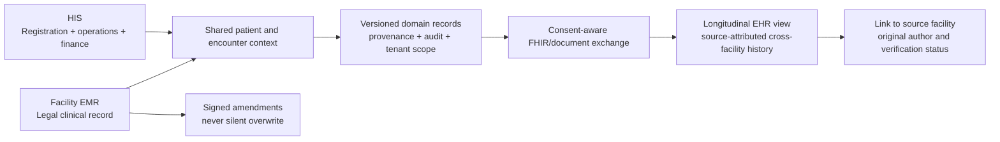
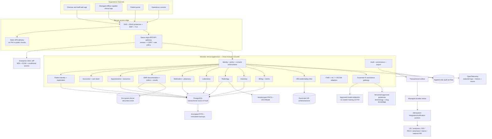
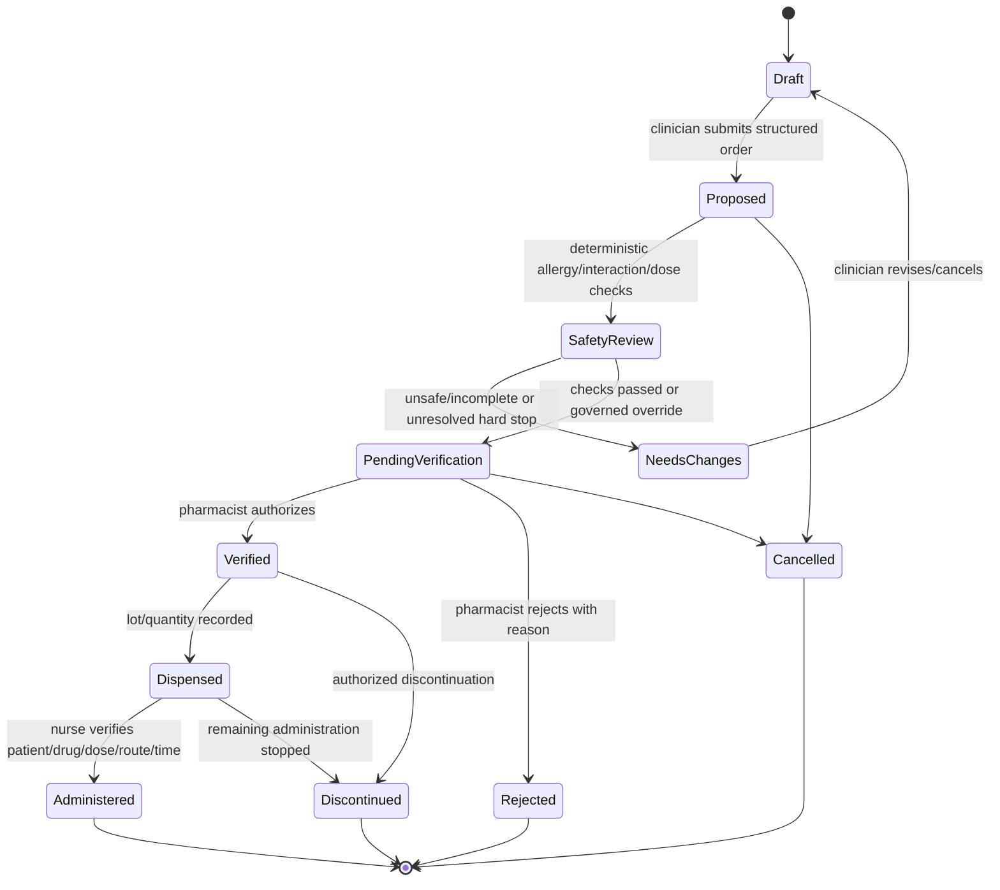
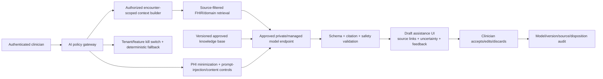
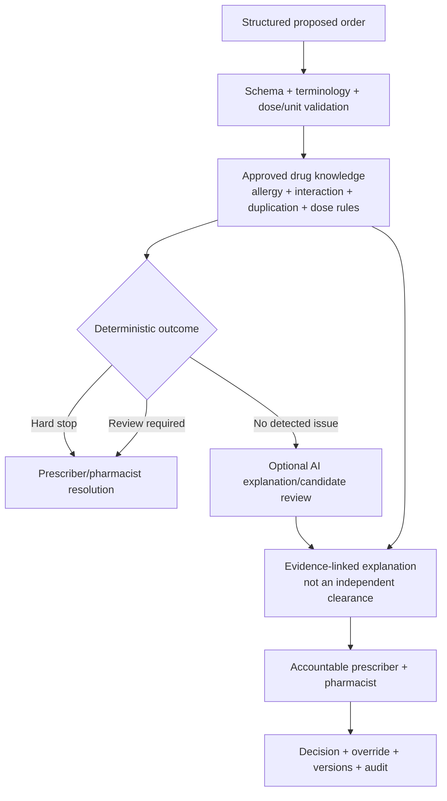
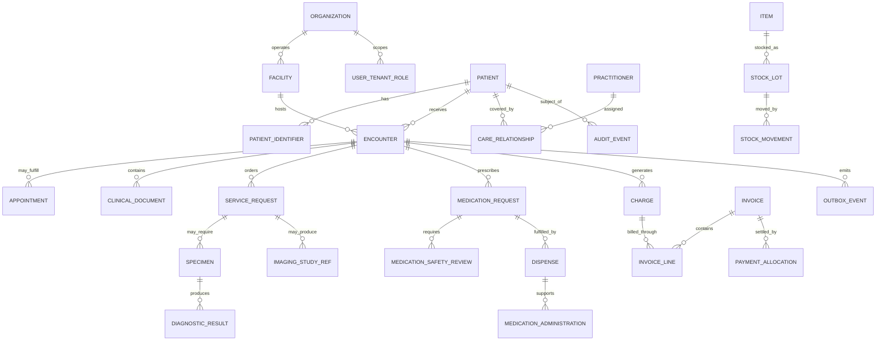
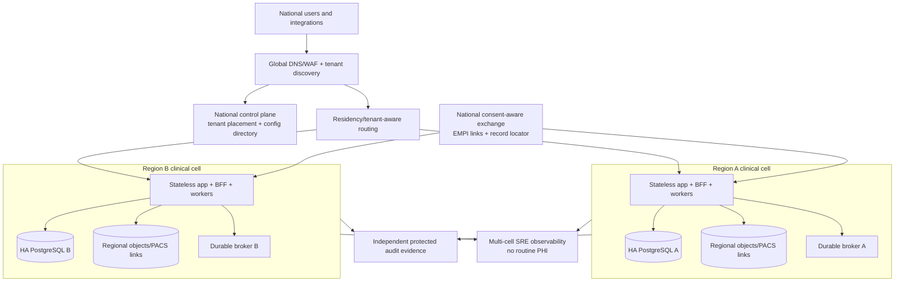

# AYBAK Enterprise Hospital Transformation Plan

**From React prototype to multi-facility and national-scale healthcare platform**  
**Plan date:** 2026-11-04  
**Baseline:** Commit `9c1b9f826d2cfa63f5a25aef80b7b259889a22ba`  
**Companion assessment:** [`ENTERPRISE_AUDIT.md`](./ENTERPRISE_AUDIT.md)  
**Planning horizon:** 36 months  
**Current release position:** No real PHI, clinical use, prescribing, or production deployment until the applicable safety and security gates in this plan are met

> This is a target architecture and delivery plan, not a claim that the capabilities already exist. Regulatory applicability, clinical intended use, service objectives, retention periods, and recovery objectives must be approved for each deployment jurisdiction. Patient safety, privacy, and clinical validation take precedence over delivery dates.

---

## 1. Executive Direction

AYBAK should evolve from its current static doctor portal into a **tenant-isolated, API-first, interoperable hospital platform** with a single transactional clinical core and reusable administrative and integration capabilities. The transformation should begin with identity, patient/encounter context, scheduling, audit, and recovery—not with AI or a broad collection of visually complete but unsafe modules.

The recommended path is:

1. **Stabilize and honestly label the prototype.** Fix the confirmed dashboard crash, remove implied real authentication and live clinical claims, and use only verifiably synthetic data.
2. **Build a trusted foundation.** Enterprise identity, server authorization, patient/encounter records, PostgreSQL transactions, append-only audit, OpenAPI, CI/CD, observability, backups, and clinical governance.
3. **Deliver a narrow single-facility MVP.** Registration, encounters, appointments, basic clinical documentation, result viewing, and operational administration with complete audit and downtime procedures.
4. **Add closed-loop clinical departments.** Pharmacy, laboratory, radiology, inventory, and billing through validated state machines and HL7/FHIR/DICOM integrations.
5. **Expand to multi-facility EHR.** Longitudinal records, consent, health-information exchange, enterprise master patient identity, and data-residency-aware tenancy.
6. **Scale through independent regional cells.** Replicate a proven architecture rather than creating one global database or a premature microservice estate.
7. **Introduce AI only as governed assistance.** Source-linked drafts and decision support with human accountability; no autonomous diagnosis, prescribing, result verification, or patient reassurance.

### 1.1 Architecture principles

| Priority | Principle | Practical consequence |
|---|---|---|
| Patient safety | Preserve context and uncertainty | Patient/encounter identifiers, source, timestamp, status, and freshness travel with clinical data |
| Security | Browser is never a trust boundary | All identity, authorization, validation, and audit decisions are enforced server-side |
| Reliability | No silent loss or duplication | Transactions, idempotency, optimistic concurrency, outbox delivery, reconciliation |
| Clinical integrity | Explicit workflows, not generic CRUD | Constrained state transitions and separation of prescribing, verification, dispensing, and administration |
| Interoperability | Standards at the boundary | FHIR/HL7/DICOM adapters protect the internal model from external inconsistencies |
| Privacy | Minimum necessary by default | Scoped responses, purpose-of-use, controlled export, no PHI in ordinary telemetry |
| Scalability | Scale out in cells | Independent regional/tenant groups with bounded failure domains and data residency |
| Maintainability | Modular monolith before microservices | Strong domain boundaries without early distributed-system overhead |
| Offline safety | Degrade explicitly | Read-only continuity and limited drafts; never pretend offline orders or results are current |
| AI governance | Assist, cite, and defer | Human review, model/version audit, validation, monitoring, and kill switch |

### 1.2 Explicit non-goals for the initial MVP

- No autonomous diagnosis, treatment, triage, medication order, or patient-facing clinical recommendation.
- No custom drug-knowledge database, PACS, laboratory analyzer middleware, or identity provider when validated commercial/open standards-based products can be integrated safely.
- No nationwide shared clinical database.
- No offline final prescribing, final result verification, controlled-medication dispensing, or automatic conflict resolution.
- No Kubernetes, event streaming platform, or microservice split without measured operational need.
- No migration of the current hard-coded records; they are demo fixtures, not a legacy system of record.

---

## 2. Product Boundaries: HIS, EMR, and EHR

These terms describe related but distinct product scopes. AYBAK should implement them as views and services over governed domain data, not as three independently diverging patient databases.

| Product layer | Scope | Primary users | System-of-record responsibility |
|---|---|---|---|
| **Hospital Information System (HIS)** | Administrative and operational coordination: registration, scheduling, departments, beds/resources, inventory, billing, HR links | Registration, operations, finance, department managers | Administrative workflows and references to clinical encounters |
| **Electronic Medical Record (EMR)** | Facility/encounter-specific legal clinical record: problems, notes, orders, results, medication history, diagnoses, reports | Clinicians and care teams within a facility | Signed clinical entries, amendments, provenance, encounter context |
| **Electronic Health Record (EHR)** | Longitudinal, patient-centered record assembled across authorized facilities and encounters | Authorized cross-facility care teams and patients | Governed exchange, linked identity, consent, source attribution; does not erase the original source record |

### 2.1 Relationship model



**Key rule:** Cross-facility access does not imply copying every record into every facility. Store source-attributed documents/resources, exchange only authorized data, and preserve the originating legal record.

---

## 3. Future System Architecture

### 3.1 Logical architecture



### 3.2 Deployment progression

| Stage | Deployment shape | Reason |
|---|---|---|
| Prototype/foundation | Static SPA + one backend + one PostgreSQL cluster per environment + managed broker | Minimum operational complexity |
| Single facility MVP | Highly available managed database, two or more application instances, separate workers, PACS/LIS integrations | Remove single points of failure |
| Multi-facility | Cell per region or tenant group, centralized identity/control plane, tenant-aware routing | Bounded blast radius and residency |
| National | Multiple independent cells, national directory/EMPI/exchange, dedicated cells for large institutions | Horizontal scale and jurisdictional isolation |

### 3.3 Domain boundaries and eventual service extraction

Start all core modules in one deployable backend with enforced package/module boundaries. Extract only when one or more of these is true:

- A workload has materially different scaling characteristics, such as imaging proxying, terminology search, or AI inference.
- A different availability/security boundary is required, such as HR, identity, audit archive, or public patient access.
- An independent team owns the module and can operate its service-level objectives.
- Integration traffic threatens transactional clinical workloads.

Good early independent services are **BFF/session, integration workers, document/object handling, notification delivery, terminology/drug knowledge adapters, AI gateway, and analytics**. Patient, encounter, orders, and audit should remain transactionally close until evidence supports separation.

---

## 4. Recommended Technology Stack

Versions must be currently supported and pinned at implementation time; the audit's vulnerable Vite tree must not be carried forward.

| Layer | Recommendation | Rationale and guardrails |
|---|---|---|
| Staff web | React + strict TypeScript + patched supported Vite + React Router | Preserves existing skills; feature modules, lazy routes, error boundaries, WCAG 2.2 AA |
| UI system | Tailwind or CSS variables behind an internal accessible design system; TanStack Table/Query where justified | Standard clinical components; avoid uncontrolled dependency sprawl |
| Offline app | Managed native application or trusted native wrapper with encrypted SQLite/SQLCipher | Browser IndexedDB alone is not the preferred store for substantial offline PHI |
| BFF/backend | TypeScript, Node.js LTS, NestJS with Fastify, OpenAPI | Shared typed tooling, mature modular structure; validate framework choice in an ADR |
| AI/orchestration | Python service for model evaluation/inference adapters; backend AI gateway remains the policy enforcement point | Strong ML ecosystem without giving models direct database access |
| Transactional DB | PostgreSQL, managed HA; PgBouncer-compatible pooling | Constraints, transactions, partitioning, PITR, JSONB where justified |
| Database access | SQL migrations via Flyway/Liquibase or Prisma Migrate with reviewed SQL; query builder/ORM with escape hatch | Every migration reviewed, tested, backward-compatible, and recoverable |
| Cache/ephemeral state | Redis only for rate limits, short-lived cache, distributed coordination with proven need | Never the sole source of clinical truth or current-medication state |
| Commands/jobs | Managed RabbitMQ/SQS-compatible durable broker initially | Retries, delayed work, dead letters, backpressure without premature event-platform complexity |
| Event streaming | Add Kafka-compatible streaming only for proven regional/national integration or analytics volume | Not required for initial MVP; outbox remains mandatory |
| Objects/documents | S3-compatible encrypted object storage with versioning/object lock where required | Clinical documents, exports, allowed media; strict malware/content controls |
| Imaging | Established PACS/VNA with DICOM and DICOMweb | Do not build diagnostic image storage/rendering from scratch |
| Search | PostgreSQL full-text/trigram first; OpenSearch only with measured need and tenant/field-level enforcement | Search indexes become sensitive copies requiring the same controls |
| Identity | Enterprise OIDC/OAuth 2.1-capable IdP with MFA, SCIM, conditional access; Keycloak where sovereign self-hosting is justified | No local demo password database in the hospital app |
| Interoperability | FHIR R4 initially unless jurisdiction mandates otherwise; HL7v2; DICOM/DICOMweb; SMART on FHIR where applicable | Publish profiles and test conformance rather than claiming generic compatibility |
| Terminology | Terminology server supporting required SNOMED CT/LOINC/ICD/UCUM/local drug codes | Version and license code systems; retain original source codes |
| Observability | OpenTelemetry, Prometheus/Grafana-compatible metrics, Tempo-compatible traces, restricted log backend | Redaction and separate clinical audit |
| Secrets/keys | Cloud KMS/Vault, workload identity, automated rotation | No secrets in frontend, Git, images, or CI logs |
| Delivery | GitHub Actions protected CI, Terraform, signed OCI artifacts, SBOM/provenance | Build once and promote immutable artifacts |
| Runtime | Managed container/application platform first; Kubernetes only with team maturity and scale evidence | Operational simplicity is a reliability feature |
| Analytics | De-identified Parquet/Iceberg-compatible lakehouse and governed SQL engine in later phases | Keep reporting workloads away from clinical primaries |

### 4.1 Build-versus-integrate decisions

| Capability | Default decision |
|---|---|
| Identity/MFA | Integrate enterprise IdP |
| Drug interactions/dose knowledge | License/integrate validated drug-knowledge service and local formulary |
| Diagnostic imaging storage/viewing | Integrate PACS/VNA and validated viewer |
| Analyzer connectivity | Integrate LIS/interface engine; support HL7/ASTM as required |
| Terminology | Integrate terminology server and licensed content |
| Payment/claims | Integrate jurisdiction-specific clearinghouse/payment providers |
| Core patient/encounter/workflow | Build around AYBAK's differentiated workflows, using open standards |
| AI foundation model | Use approved managed/private endpoints; do not train a foundation model on hospital PHI |

---

## 5. Hospital Information System Design

The HIS is the operational shell connecting patient registration, facility structure, encounters, scheduling, departmental orders, inventory, billing, and workforce context.

### 5.1 Core capabilities

- Facility/department/location hierarchy and tenant configuration.
- Patient registration, identifier issuance, duplicates/merge review, emergency/unidentified-patient workflow.
- Encounter creation: outpatient, emergency, inpatient, observation, and virtual as locally supported.
- Attending provider, care team, department, bed/room/resource assignment.
- Admission, discharge, transfer (ADT) state transitions and integration events.
- Order routing to laboratory, radiology, pharmacy, and other departments.
- Operational census and department worklists with freshness and status.
- Administrative audit and configuration history.

### 5.2 Patient identity controls

- Use an internal immutable UUID; never use national ID, MRN, name, or email as the primary key.
- Support multiple identifier types and issuers, including temporary emergency identifiers.
- Require at least two approved identifiers during high-risk workflows.
- Use deterministic matching for exact authoritative identifiers and reviewed probabilistic matching for potential duplicates; do not auto-merge on name/DOB alone.
- Preserve merge and unmerge lineage. Resource references must resolve to the surviving patient without erasing history.
- Display a persistent patient banner during ordering and result review.

### 5.3 HIS acceptance gates

- Duplicate-name, unidentified-patient, merge/unmerge, transfer, and cross-facility tests pass.
- Every operational list is tenant/facility scoped and bounded by pagination.
- ADT retries do not create duplicate encounters or transfers.
- A clinician can trace every order/result to patient, encounter, source, author, status, and timestamps.

---

## 6. EMR and EHR Design

### 6.1 EMR capabilities

- Problem list, allergies/intolerances with verification status, diagnoses, procedures, notes, care plans, and clinical documents.
- Orders and results linked to encounter, author, source, and verification status.
- Structured observations with code, value type, UCUM unit, reference range, interpretation, and effective/recorded times.
- Versioned notes: draft, final, amended, corrected, entered-in-error; signed entries are never silently overwritten.
- Longitudinal medication list reconciled from orders, dispensing, administration, external statements, and verification status.
- Role-appropriate clinical views with source/freshness and unresolved critical information.
- Patient-context-safe copy/forward: imported text must be attributed and reviewed.

### 6.2 EHR capabilities

- Cross-facility patient summary assembled from authorized source resources.
- Enterprise/national master patient index links with match confidence and reviewer provenance.
- Consent/policy-aware document and FHIR exchange.
- Source-facility attribution, original signature/status, and retrieval freshness.
- Patient access/correction request workflows and controlled export.
- Record locator service for national scale rather than continuous replication of all records.

### 6.3 Clinical document rules

- A note contains patient, encounter, author, author role, facility, authored time, effective time, status, and version.
- Co-signature requirements are configurable by role/jurisdiction and visible before finalization.
- Amendments create linked versions with reason and new signature; original content remains retrievable.
- AI-originated content is labeled and cannot be signed without an accountable human reviewing the source.
- External documents retain hash, source, received time, original status, and mapping version.

---

## 7. Pharmacy Module

### 7.1 Scope

Formulary, medication ordering, pharmacist verification, dispensing, administration record, stock integration, medication reconciliation, and safety surveillance. Controlled medicines and electronic prescribing require jurisdiction-specific controls before activation.

### 7.2 Closed-loop medication workflow



The diagram is illustrative: local clinical governance must approve valid transitions, allowed reversals, returns, wasted doses, partial administration, and controlled-drug witnesses.

### 7.3 Required data and safety controls

- Coded drug/ingredient/strength/form, dose quantity and UCUM unit, route, frequency, schedule, duration, indication, and instructions.
- Patient/encounter, prescriber, authored time, weight/height and relevant renal/hepatic context when required by the rule set.
- Allergy status including “unknown,” not treating missing data as “no allergy.”
- Deterministic drug-knowledge checks for interactions, duplicate therapy, allergy, dose ranges, and relevant contraindications.
- Override severity policy, reason, actor, knowledge-base version, and surveillance.
- Independent pharmacist verification, dispensing lot/expiry/quantity, returns/waste, and administration witness where required.
- Barcode medication administration if supported: patient wristband + medication + order; mismatch is a hard stop pending authorized resolution.
- No automatic offline final order or AI-generated prescription.

### 7.4 Pharmacy acceptance gates

- Pharmacist-led test suite covers wrong patient, unknown allergy, interacting drugs, duplicate ingredients, renal/hepatic cautions, max daily dose, look-alike/sound-alike selection, partial administration, discontinuation, and retry-after-timeout.
- The same idempotency key never creates two active orders.
- A discontinued order cannot be administered without an explicit new authorized order.
- Every override and status transition is attributable and reportable.

---

## 8. Laboratory Module

### 8.1 Scope

Test catalog, ordering, specimen collection/labeling, analyzer/LIS integration, technical and clinical validation, reference ranges, critical-result acknowledgment, and corrective reports.

### 8.2 Workflow

1. Clinician places a coded order linked to patient/encounter and clinical question.
2. Laboratory reviews collection requirements and generates specimen/accession identifiers.
3. Collection records collector, time, specimen type, container, fasting/priority where applicable, and barcode verification.
4. LIS/analyzer results map through versioned LOINC/local codes and UCUM units.
5. Automated validation is limited to rules approved by laboratory leadership; abnormal/critical/unexpected results route to qualified review.
6. Authorized verifier releases preliminary/final/corrected result with provenance.
7. Critical-result notification records recipient, acknowledgment, read-back/escalation as locally required.
8. Corrected results preserve previous values and actively notify relevant care teams.

### 8.3 Required controls

- Specimen chain of custody and rejection/recollection workflow.
- Reference ranges by method, analyzer, age/sex/physiological context where clinically applicable; never a single global range.
- Delta checks, instrument flags, hemolysis/quality flags, units, and mapping version.
- Preliminary/final/corrected/entered-in-error statuses displayed prominently.
- Interface reconciliation for missing, duplicate, out-of-order, or orphaned results.
- No silent overwrite of a corrected result and no general AI authority to verify results.

---

## 9. Radiology Module

### 9.1 Scope

Radiology ordering, modality worklist/RIS integration, scheduling, protocol, acquisition status, image access through PACS, reporting, critical findings, and comparison/provenance.

### 9.2 Standards and integration

- HL7v2 ORM/ORU and/or FHIR ServiceRequest/DiagnosticReport/ImagingStudy according to existing systems.
- DICOM Modality Worklist for modality scheduling where supported.
- DICOMweb QIDO-RS for query, WADO-RS for retrieval, and STOW-RS for storage where supported.
- Store image studies in PACS/VNA; AYBAK stores identifiers, accession, study metadata, report, and authorized references.
- Diagnostic viewers must be validated for their intended use; a general browser thumbnail is not a diagnostic viewer.

### 9.3 Safety controls

- Verify patient/order/accession/modality and laterality/protocol.
- Track ordered, scheduled, arrived, acquired, preliminary, final, corrected, cancelled states.
- Radiologist signature and secondary review where required.
- Critical/unexpected finding communication and acknowledgment.
- Pregnancy/radiation/contrast/allergy/renal screening where applicable, governed by radiology rather than hard-coded generic rules.
- DICOM metadata may contain PHI; proxy/access logs and cache policies must protect it.

---

## 10. Inventory Module

### 10.1 Scope

Catalog, preferred items, suppliers, facilities/storerooms, stock ledger, lots/serial numbers, expiry, reorder, purchase/receipt/issue/return/transfer, cold-chain status, and departmental usage integration.

### 10.2 Inventory controls

- Append-only stock ledger; calculate balances from movements plus controlled opening balances.
- Every movement records tenant/facility/location, item, lot/serial where applicable, quantity/unit, actor, reason, source document, and timestamp.
- FEFO allocation for expiring clinical stock, quarantine/recall state, and expired-stock issue prevention.
- Separate medication clinical authorization from stock availability: “in stock” never implies “safe for this patient.”
- Reorder points based on approved min/max and demand, not AI-only forecasts.
- Controlled substances require separate counts, witnesses, and jurisdiction-specific reports.
- Cold-chain excursions and recalled lots must block or quarantine affected stock.

### 10.3 Integration events

`medication.dispensed`, `procedure.completed`, `stock.issued`, `stock.returned`, `stock.recalled`, and `purchase.received` can drive inventory and billing, but consumers must be idempotent and reconciled to source documents.

---

## 11. Billing Module

### 11.1 Scope

Charge master, price lists, coverage/eligibility references, charge capture, invoice, payment/refund, claims, remittance, adjustments, and financial audit.

### 11.2 Design rules

- Store money as integer minor units plus ISO currency; never binary floating point.
- Version charge-master prices and apply the price/rules effective at the service date.
- Separate clinical service facts from coding/billing interpretation. Billing staff see only the minimum clinical evidence required.
- Model invoice/claim state transitions and separation of duties for discounts, write-offs, refunds, and manual adjustments.
- Use idempotent charge capture from signed clinical events to prevent duplicates on retries.
- Reconcile payments and claims with external references and immutable ledger entries.
- Support jurisdiction-specific tax, insurance, claim, coding, and fiscal requirements through adapters; do not assume US CPT/claims processes globally.
- Financial compromise must not rewrite clinical records.

### 11.3 Minimum financial audit

Record actor, reason, source service, price version, before/after values, approval, external transaction ID, and correlation. Reconciliation reports must tie clinical events, charges, invoices, claims, and payments without exposing broad PHI to finance teams.

---

## 12. HR and Workforce Module

### 12.1 Scope

Worker record, employment/assignment, department, role template, professional registration/credential, training/privilege expiry, leave/availability, and joiner/mover/leaver integration.

AYBAK should integrate a dedicated HR/payroll system rather than building payroll unless it is a firm product requirement.

### 12.2 Security linkage

- SCIM or authoritative HR feed drives account provisioning and deprovisioning.
- Manager assignment does not itself grant clinical access; map approved position + credential + facility + care relationship to role templates.
- Disable access promptly on termination and review active sessions/api keys.
- Expiring professional privileges can restrict prescribing, verification, or procedural actions without deleting the worker's historical attribution.
- HR records are highly sensitive and isolated from general clinical queries; clinicians do not receive broad HR access.

---

## 13. Appointment Module

### 13.1 Capabilities

- Provider, room, equipment, and combined-resource schedules.
- Availability templates, exceptions, leaves, overbooking policy, waitlist, reminders, referral and visit type.
- Appointment states: proposed, requested, booked, confirmed, arrived, in-progress, completed, cancelled, no-show, rescheduled.
- Patient/encounter/referral linkage, reason, priority, full date/time, source timezone, duration, location, and communication preference.
- Patient self-service only within explicit booking rules and identity verification.

### 13.2 Integrity and safety

- Store UTC instants plus original IANA timezone; retain local wall time where recurring scheduling requires it.
- Prevent resource conflicts with database exclusion constraints or equivalent transactional serialization.
- Optimistic version checks and idempotency keys handle concurrent booking and retries.
- No automatic last-write-wins during offline synchronization.
- Cancellation/reschedule retains history and triggers notification/integration reconciliation.
- Test daylight-saving gaps/overlaps, cross-midnight shifts, leap days, resource substitution, and urgent overbooking authorization.

---

## 14. AI Clinical Assistant

### 14.1 Approved initial use cases

- Source-linked summary of a selected encounter or authorized longitudinal record.
- Retrieval of approved internal guidelines with document/version citations.
- Problem/result timeline construction using deterministic data plus clearly separated generated narrative.
- Clinician-facing questions that return quoted evidence and explicit “not found/uncertain” responses.

### 14.2 Architecture



### 14.3 Hard controls

- The model has no broad SQL credentials and cannot retrieve outside the clinician's authorized patient/encounter scope.
- System-provided source text is treated as untrusted content; embedded instructions cannot alter tools or policy.
- Responses include source identifiers and timestamps; unsupported assertions are rejected or visibly flagged.
- No model output directly writes a finalized clinical record or order.
- Complete intended-use/regulatory assessment before diagnostic or treatment suggestions.
- Evaluate omissions, hallucinations, unsafe recommendations, subgroup performance, language, and adversarial input before release.

---

## 15. AI Documentation Assistant

### 15.1 Workflow

- Optional speech-to-text or encounter transcript with consent/notification as legally required.
- Speaker attribution and timestamps; uncertain attribution remains visible.
- Draft note sections with links to transcript/source facts.
- Clinician edits, verifies, and signs; the original draft/model metadata and final author disposition are auditable according to policy.
- Audio retention is minimized and explicitly configured; deletion does not remove required final-record provenance.

### 15.2 Safety requirements

- Never invent normal examination findings, negate a finding, infer allergies, or create orders from ambient speech.
- Detect conflicting speaker/time/patient context and stop rather than merging encounters.
- No automatic copy-forward into a signed note.
- Measure omission and fabrication rates by specialty/language/accent and set deployment thresholds with clinical owners.
- Provide a non-AI documentation workflow with equivalent access to care.

---

## 16. AI Medication Safety Assistant

### 16.1 Safety architecture

**Deterministic validated rules are primary. AI may explain evidence and identify candidates for review, but cannot replace the medication safety engine or authorize an order.**



### 16.2 Required controls

- Use licensed/current drug knowledge, local formulary, patient allergy status, active medications, duplicate ingredients, relevant labs/demographics, and approved dosing rules.
- Missing data is not proof of safety. Show when allergies, weight, renal function, or other required context is unavailable.
- AI output must not downgrade a deterministic alert or present “safe” as an absolute conclusion.
- High-severity overrides require reason and applicable second review.
- Test the AI separately for explanation quality; test actual prescribing safety against deterministic expected outcomes.
- Monitor alert burden/overrides with pharmacy leadership; do not indiscriminately increase alerts.
- Immediate kill switch removes only AI assistance, never the validated deterministic checks or normal pharmacy workflow.

---

## 17. Cross-Module Clinical and Operational Flows

### 17.1 Ordered service to charge and inventory

```mermaid
sequenceDiagram
    actor C as Clinician
    participant E as EMR/Orders
    participant D as Department module
    participant I as Inventory
    participant B as Billing
    participant A as Audit/Outbox

    C->>E: Submit coded order + idempotency key
    E->>E: Authenticate, authorize, validate context/version
    E->>A: Commit order + audit + outbox atomically
    D->>D: Consume order idempotently; perform department workflow
    D->>A: Commit performed/verified result + provenance
    I->>I: Consume signed usage event; append stock movement
    B->>B: Consume chargeable event; apply effective price version
    I->>A: Reconcile stock document to source event
    B->>A: Reconcile charge to source service
```

### 17.2 Event conventions

- Events use names such as `appointment.booked.v1`, `specimen.collected.v1`, `result.verified.v1`, `medication.dispensed.v1`, `stock.movement.posted.v1`, and `charge.captured.v1`.
- Event ID, aggregate ID/version, tenant, occurred/recorded time, correlation/causation, schema version, and producer are mandatory.
- Keep payloads minimal; include references rather than broad patient demographics.
- Consumers maintain inbox/idempotency records and acknowledge only after their transaction commits.
- Events are notifications/integration artifacts, not a replacement for the source record or audit log.

---

## 18. Database Design

### 18.1 Core entity relationship map



### 18.2 Shared table conventions

Every tenant-owned row includes:

- `id UUID` immutable, preferably UUIDv7 for locality; not exposed as an authorization credential.
- `tenant_id UUID` and, where needed, `facility_id UUID`.
- `created_at TIMESTAMPTZ`, `created_by`, `updated_at`, `updated_by`.
- `version BIGINT` for optimistic concurrency where mutable.
- `source`, `provenance`, and extension data only where justified.

Clinical effective time is separate from record creation time. Soft deletion is not a generic substitute for clinical amendment/entered-in-error semantics.

### 18.3 Schema catalog

| Domain | Principal tables | Critical constraints/indexes |
|---|---|---|
| Tenancy | `organization`, `facility`, `department`, `tenant_placement`, `tenant_feature` | Unique tenant/facility codes; placement region; no cross-tenant foreign keys |
| Identity | `staff_principal`, `role_template`, `user_tenant_role`, `care_relationship`, `privilege_credential` | Scoped uniqueness, validity intervals, credential expiry, deny-by-default policy |
| Patient | `patient`, `patient_identifier`, `person_name`, `patient_link`, `identity_match_review` | `(tenant_id, issuer, identifier_type, value)` unique as appropriate; merge lineage |
| Consent | `consent_directive`, `consent_scope`, `privacy_restriction` | Purpose/resource/recipient/period; explicit policy version |
| Encounter | `encounter`, `care_team`, `location_assignment`, `adt_event` | Valid patient/facility, times, status transitions, version |
| Scheduling | `appointment`, `schedule_template`, `resource`, `resource_unavailability`, `appointment_transition` | Resource/time exclusion constraints, UTC + source zone, idempotency |
| EMR | `problem`, `allergy_intolerance`, `observation`, `clinical_document`, `document_version`, `signature` | Patient/encounter consistency, code/value/unit, signed immutability |
| Orders/results | `service_request`, `specimen`, `diagnostic_result`, `result_value`, `reference_range`, `critical_communication` | Accession uniqueness, result version, verified status, corrected-result link |
| Pharmacy | `medication_request`, `medication_safety_review`, `dispense`, `medication_administration`, `formulary_item` | Structured dose, order state, reviewer, lot, patient/order consistency |
| Radiology | `imaging_order`, `imaging_study_ref`, `radiology_report`, `protocol_review` | Accession/study UID uniqueness, PACS reference, signed report |
| Inventory | `item`, `stock_location`, `stock_lot`, `stock_movement`, `reorder_policy`, `recall` | Nonnegative/quarantine invariants where applicable, unique source movement |
| Billing | `charge`, `price_version`, `invoice`, `invoice_line`, `payment`, `payment_allocation`, `claim`, `adjustment` | Integer minor units, source uniqueness, balanced allocations, approval |
| HR | `worker_assignment`, `professional_credential`, `training_privilege`, `availability` | Restricted schema, validity/privilege, no general clinical read access |
| Audit | `audit_event`, `access_export`, `break_glass_session` | Append-only, actor/subject/action/purpose/outcome/time/correlation |
| Integration | `outbox_event`, `inbox_message`, `interface_message`, `mapping_version`, `reconciliation_issue` | Unique producer event/external message, retry/dead-letter state |
| Offline | `device_enrollment`, `sync_subscription`, `sync_cursor`, `offline_mutation`, `sync_conflict` | Device/user/tenant binding, expiry, base version, reconciliation |

### 18.4 Data-type and storage rules

- `TIMESTAMPTZ` for instants; separate IANA source timezone and local scheduling fields when required.
- `DATE` for birth dates and clinically meaningful calendar dates; derive age at use.
- `NUMERIC` for clinical quantities with explicit UCUM unit; no unitless medication dose.
- Integer minor units + currency for money.
- JSONB for versioned external payloads/extensions, not core searchable clinical invariants.
- Coded values include system, code, version, display, and original source text where needed.
- Large documents and permitted media use encrypted object storage with hash, malware scanning, retention, and authorized URL/proxy access.
- Images remain in PACS/VNA; PostgreSQL stores references and reports.

### 18.5 Indexing and partition strategy

Start with ordinary B-tree indexes derived from query plans:

- Patient identifier lookup: tenant + normalized identifier type/value.
- Patient chart: tenant + patient + effective time descending.
- Encounter worklist: tenant + facility + status + scheduled/effective time.
- Provider schedule: tenant + provider/resource + start/end.
- Outbox/inbox: status + available time and unique event IDs.
- Audit: tenant + subject + time and actor + time.

Partition only high-volume tables after measurement. Likely candidates are observations, audit, integration messages, outbox/inbox history, and stock/financial ledgers. Use monthly/quarterly time partitions or regional cells plus time partitions; enforce partition pruning and tenant predicates. Avoid millions of per-tenant schemas or tiny partitions.

### 18.6 Migration and data quality

For each legacy source: profile → map → cleanse → match identity → rehearse → reconcile → clinically approve → cut over → archive according to law. Record row counts, rejected records, value-set mappings, identifier links, totals for financial/stock ledgers, and sampled clinical verification. Never use production PHI to populate developer environments.

---

## 19. API Design

### 19.1 API styles and boundaries

- **Internal/product APIs:** versioned REST/JSON with OpenAPI, command endpoints for controlled transitions.
- **Interoperability:** profiled FHIR APIs and HL7v2/DICOM adapters; avoid leaking FHIR storage details into every internal workflow.
- **Asynchronous:** signed webhooks/event subscriptions with replay protection and idempotent consumers.
- **Real-time display:** WebSocket/SSE only for enhancement; refresh/reconciliation remains available if disconnected.

### 19.2 Conventions

- Base product path `/v1`; explicit backward-compatible evolution and deprecation policy.
- OAuth-scoped, server-authorized requests; tenant derived from verified session/placement, not trusted from a free-form header.
- Cursor pagination with stable sort; bounded page size and selected fields.
- `Idempotency-Key` required on non-idempotent creates/commands that can be retried.
- `If-Match`/resource version required for mutable updates and transitions.
- RFC 9457-style problem responses with safe correlation ID; no SQL, stack traces, or sensitive values.
- Consistent `401` unauthenticated, `403` unauthorized, `404` non-disclosure policy where appropriate, `409` version/state conflict, `422` valid syntax but domain-invalid, `429` throttled.
- Rate limits and query cost limits must not create unsafe denial of urgent care; use monitored risk-based controls and privileged emergency workflows.

### 19.3 Product endpoint catalog

| Domain | Illustrative endpoints | Key behavior |
|---|---|---|
| Session | `GET /v1/me`, `POST /v1/logout`, `POST /v1/step-up` | Session/assurance, revocation, high-risk step-up |
| Patient | `GET/POST /v1/patients`, `GET /v1/patients/{id}` | Scoped search, minimum fields, duplicate detection |
| Identity | `POST /v1/patients/{id}/merge-candidates`, `POST /v1/patient-merges` | Review and approval; merge lineage |
| Encounter | `GET/POST /v1/encounters`, `POST /v1/encounters/{id}/transitions` | ADT state/version controls |
| Appointment | `GET/POST /v1/appointments`, `POST /v1/appointments/{id}/transitions` | Conflict checks, timezone, idempotency |
| Clinical document | `POST /v1/documents`, `POST /v1/documents/{id}/finalize`, `/amend` | Signature, immutable versions |
| Allergy/problem | `GET/POST /v1/patients/{id}/allergies`, `/problems` | Verification status and provenance |
| Orders | `GET/POST /v1/service-requests`, `POST /v1/service-requests/{id}/transitions` | Department routing and order state |
| Results | `GET /v1/diagnostic-results`, `POST /v1/results/{id}/verify`, `/correct` | Qualified verification and correction history |
| Critical results | `POST /v1/critical-communications/{id}/acknowledge` | Recipient/read-back/escalation audit |
| Medication | `POST /v1/medication-requests`, `/{id}/verify`, `/{id}/discontinue` | Structured validation, safety review, pharmacist controls |
| Dispense/admin | `POST /v1/medication-requests/{id}/dispenses`, `/administrations` | Barcode/lot/patient/order consistency |
| Radiology | `GET /v1/imaging-studies`, `POST /v1/radiology-reports/{id}/finalize` | Authorized PACS reference and signed report |
| Inventory | `POST /v1/stock-movements`, `GET /v1/stock-balances` | Append-only idempotent movement, lot/expiry |
| Billing | `POST /v1/charges`, `/invoices`, `/payments`, `/claims` | Effective pricing, ledger and reconciliation |
| Export | `POST /v1/exports`, `GET /v1/exports/{id}` | Step-up, purpose, expiry, encryption, audit |
| Sync | `GET /v1/sync/changes?cursor=...`, `POST /v1/sync/mutations` | Authorized deltas, base versions, conflicts |
| AI | `POST /v1/ai/summaries`, `/documentation-drafts`, `/medication-explanations` | Explicit purpose, context scope, model audit, no final write |

### 19.4 Example command semantics

```http
POST /v1/appointments HTTP/1.1
Idempotency-Key: 2d25d83b-...
If-Match: "schedule-version-41"
Content-Type: application/json

{
  "patientId": "uuid",
  "encounterId": "uuid-or-null",
  "providerId": "uuid",
  "start": "2027-03-29T08:30:00Z",
  "sourceTimeZone": "Europe/Amsterdam",
  "durationMinutes": 30,
  "visitType": {"system": "local", "code": "follow-up"}
}
```

The server revalidates role, facility, patient relationship, provider privileges, resource availability, time semantics, and idempotency. A repeated key with the same payload returns the original result; the same key with a different payload is rejected. A concurrent schedule change returns a conflict rather than double booking.

### 19.5 API assurance

- Consumer/provider contract tests and generated typed clients.
- Complete authorization matrix tests, including object/tenant/field-level denial.
- Fuzz/schema-negative tests and payload-size limits.
- Timeout-after-commit, duplicate-delivery, out-of-order-message, and replay tests.
- Versioned FHIR profiles and conformance test suites for external interfaces.

---

## 20. Security Model

### 20.1 Zero-trust control planes

| Plane | Controls |
|---|---|
| User identity | OIDC, phishing-resistant MFA where feasible, conditional access, SCIM/JML, short-lived revocable sessions |
| Device | Managed enrollment, disk encryption, screen lock, supported OS/browser, EDR, revocation/remote wipe for offline devices |
| Session | Same-origin BFF, `HttpOnly`/`Secure`/appropriate `SameSite` cookies, idle/absolute expiry, CSRF tokens for cookie mutations, step-up |
| Authorization | Deny-by-default RBAC + ABAC + relationship + purpose + consent/policy; enforced at every object/action |
| Service identity | Workload identity/mTLS where supported, scoped service accounts, secret rotation, no shared integration credentials |
| Network | Segmented application/data/integration zones, private DB, restricted egress, WAF, TLS everywhere |
| Data | KMS-backed encryption at rest/in transit, per-environment keys, optional per-tenant keys, controlled exports/backups |
| Application | Schema allowlists, output encoding, safe rich text, narrow CORS/CSP, upload inspection, rate/query controls |
| Audit | Separate access/mutation/export/break-glass history, append-only restricted archive, tamper evidence |
| Supply chain | Locked dependencies, pinned CI actions, signed artifacts/SBOM/provenance, protected branches and review |
| Operations | Just-in-time privileged access, dual control for critical changes, incident response and recovery exercises |

### 20.2 ABAC policy inputs

RBAC alone is insufficient. Evaluate:

- Tenant, facility, department, and care relationship.
- Resource patient/encounter and sensitivity.
- Action and purpose of use.
- User role, professional privilege, employment/credential validity.
- Session assurance, device trust, network context where justified.
- Consent/directive and legal policy where applicable.
- Break-glass state, reason, and time limit.

Consent is not a replacement for access control; access control is not proof of lawful processing.

### 20.3 Break-glass

1. Available only to approved roles and genuine urgent workflows.
2. Requires explicit reason and displays heightened warning.
3. Grants minimum additional scope for a short defined period.
4. Records every accessed resource and notifies privacy/clinical reviewers.
5. Requires retrospective review and can trigger suspension on misuse.
6. Cannot bypass medication hard stops, database integrity, or audit recording.

### 20.4 Data protection and secure UX

- No PHI in static bundles, public CDNs, browser analytics, URLs, crash reports, ordinary logs, or unapproved notifications.
- `Cache-Control: no-store` for authenticated PHI responses unless an approved offline design applies.
- Short-lived, single-purpose document/PACS access URLs or authenticated proxies; no permanent public object URLs.
- Controlled print/export with watermark, purpose, expiry/encryption, and audit where required.
- Shared-workstation fast user switching and reauthentication without losing unsigned work unsafely.
- Formal threat models for wrong-patient access, cross-tenant leakage, integration replay, malicious documents, ransomware, AI prompt injection, and offline-device loss.

---

## 21. Role-Based Access Control Model

### 21.1 Role and scope matrix

This is a starting policy model, not blanket permission. Every “permitted” action still requires tenant, facility, relationship, purpose, and resource checks.

| Role | Permitted capabilities | Explicitly denied or separately controlled |
|---|---|---|
| Patient/legal representative | View/manage own demographics and appointments; access released records and communications | Other patients; unrestricted notes/results; staff functions; representative scope must be verified |
| Registration clerk | Register patients, identifiers, demographics, referrals, basic encounter/appointment admin | Clinical notes/orders/results beyond minimum operational view; medication functions |
| Scheduler | Availability, appointments, reminders, resource scheduling | Full clinical chart; prescribe/verify results; broad export |
| Physician/authorized prescriber | Assigned patient chart, notes, orders, proposed prescriptions, result acknowledgment | Pharmacist verification, dispensing/administration unless separately privileged; unrelated patients |
| Nurse | Assigned chart, observations, care plans, medication administration, specimen collection per scope | Prescribe/final verify unless independently licensed; billing configuration; HR |
| Pharmacist | Medication review/verification, formulary tasks, dispense, safety surveillance | Alter physician's signed diagnosis/note; administer medication without separate scope |
| Pharmacy technician | Inventory and preparation/dispense support under local supervision rules | Independent clinical verification or safety override |
| Laboratory technician | Specimen/accession worklist, technical entry, analyzer flags, preliminary results within scope | Clinical verification beyond qualification; unrelated chart; medication orders |
| Pathologist/authorized lab verifier | Review/verify/correct laboratory results and critical communication | Radiology/pharmacy authorization without separate privilege |
| Radiology technician | Exam worklist, acquisition status, protocol tasks within scope | Final radiology report; unrelated records |
| Radiologist | Imaging review, preliminary/final/corrected report, critical findings | Medication verification; laboratory verification |
| Inventory officer | Item/supplier/stock/purchase/receipt/transfer/count workflows | Clinical order content beyond item/quantity needed; patient list browsing |
| Billing officer | Charges, invoices, claims, payments, payer details, minimum supporting evidence | Full clinical chart; result verification; medication actions |
| Finance approver | Discount/write-off/refund/adjustment approval and financial reports | Self-approval where SoD applies; clinical editing |
| HR officer | Worker assignments, credentials/training records, provisioning requests | Patient clinical records; self-granting application roles |
| Facility administrator | Facility configuration, department templates, local operational reports | Default access to all charts; approval of own elevated permissions |
| Privacy/security auditor | Authorized audit/access/break-glass investigation, limited record view under case | Routine clinical editing; undetected unrestricted browsing |
| Integration service | Explicit source/destination resources and actions, scoped credentials | Interactive login, unrelated APIs, privilege escalation |
| AI assistance service | Build a minimum context for a user-initiated approved task through the policy gateway | Autonomous finalization, independent chart browsing, direct DB access, model training |

### 21.2 Separation of duties

| Process | Required separation |
|---|---|
| Medication | Prescriber proposes; pharmacist verifies; authorized staff dispenses/administers; override is attributed |
| Laboratory | Technical processing and clinical verification follow qualification rules; correction is signed/versioned |
| Radiology | Acquisition and radiologist report are distinct; critical communication is acknowledged |
| Identity administration | HR requests; manager/clinical owner approves privileges; IAM executes; auditor reviews |
| Finance | Charge entry, adjustment/refund approval, and payment reconciliation have controlled independence |
| Inventory | Purchase approval, goods receipt, stock adjustment, and controlled-drug witnessing follow policy |
| Production access | Developer does not receive standing broad production PHI/database access; emergency access is reviewed |

### 21.3 Policy testing

Generate tests from a machine-readable role/action/resource matrix. Include expired credential, transferred staff, terminated user, patient with same name, cross-facility reference, tenant spoofing, temporary representative, emergency access, and revoked device. A successful UI route test is not evidence of authorization.

---

## 22. Multi-Tenant Architecture

### 22.1 Tenant hierarchy and isolation models

- **Organization tenant:** hospital group, independent hospital, or national program partition according to contractual/legal ownership.
- **Facility/department:** authorization scope below tenant, not necessarily a separate database.
- **Shared cell:** multiple organizations in shared application/database with mandatory tenant predicates and defense-in-depth PostgreSQL RLS.
- **Dedicated cell/database:** large hospitals, stricter residency, contractual isolation, or specialized availability needs.
- **National control plane:** tenant directory, placement, configuration templates, deployment metadata; no broad clinical record store.

Avoid schema-per-tenant at thousands of tenants because migration and connection management become operationally fragile. Offer shared or dedicated data-plane patterns using the same application code.

### 22.2 Cell-based national architecture



### 22.3 Tenant enforcement

1. Resolve the user's allowed tenant/facility claims and current tenant placement server-side.
2. Set a trusted transaction-local tenant context; application queries and RLS policies both constrain access.
3. Require tenant in unique indexes and cache keys. Never use a global cache entry keyed only by patient/resource ID.
4. Separate object prefixes/buckets, broker topics/queues, encryption contexts, search indexes, and rate quotas by tenant/cell.
5. Run explicit cross-tenant negative tests at API, database, object, cache, search, queue, export, sync, and AI retrieval layers.
6. Do not permit cross-tenant database foreign keys. Exchange references use national link IDs and authorized APIs.
7. Revalidate tenant placement on every request; do not treat a client-provided `X-Tenant-ID` as authoritative.

### 22.4 Cross-facility EHR and national services

- **EMPI:** links patient identities with provenance, match review, and source mappings; does not broadcast demographics indiscriminately.
- **Record locator:** identifies where authorized records exist and their type/time range without centralizing every observation.
- **Consent/policy service:** provides evaluated directives and policy versions; source systems remain accountable for enforcement.
- **Terminology/registry:** distributes approved value sets, facility/practitioner registries, and mapping versions.
- **Exchange gateway:** signed, audited FHIR/document requests with purpose, patient context, source attribution, and throttling.

---

## 23. Offline/Online Synchronization Design

### 23.1 Offline safety policy

Offline mode is a **continuity mode**, not a second uncontrolled hospital database.

| Capability | Offline position |
|---|---|
| Approved patient summary/allergies/current medications/recent results | Read-only snapshot with source and last-sync time |
| Schedule/worklist | Read-only downloaded scope; availability may be stale |
| Draft note | Allowed on enrolled device with explicit patient/encounter binding |
| Proposed appointment request | Queue only if policy allows; server may reject conflict |
| Final prescription/order | Not automatically finalized offline; draft for online review only |
| Medication administration | Local jurisdiction-approved downtime workflow only; prominent reconciliation, never silent |
| Final lab/radiology verification | Disabled offline |
| Critical alerts/monitoring | Must not rely on offline client delivery |
| Payment capture/stock final adjustment | Disabled or separately approved bounded downtime procedure |
| AI assistance | Disabled unless separately validated on approved local model; default online only |

### 23.2 Device and snapshot controls

- Prefer a managed native application with hardware-backed key protection and encrypted SQLite. The ordinary PWA caches only the non-PHI shell by default.
- Enroll device to user/tenant, require MFA at enrollment, device posture, expiry, revocation, remote wipe, and maximum offline duration.
- Snapshot has explicit patient/encounter scope, minimum fields, issue time, source versions, expiry, and visible last-sync banner.
- Do not download an entire facility patient list for convenience.
- Screen lock and reauthentication protect cached PHI; logout revokes sync credentials and requests local wipe.

### 23.3 Synchronization protocol

```mermaid
sequenceDiagram
    participant D as Enrolled offline client
    participant S as Sync API
    participant P as Policy/domain service
    participant DB as Clinical DB

    D->>S: Authenticate + device proof + tenant + last cursor
    S->>P: Reauthorize user/device/subscriptions
    P->>DB: Read authorized ordered change log
    S-->>D: Delta page + next cursor + source versions + expiry
    D->>D: Verify/apply atomically; display freshness
    D->>S: Mutation batch {mutationId, aggregateId, baseVersion, payload}
    S->>P: Reauthenticate, reauthorize, validate current state
    P->>DB: Idempotency lookup + domain transaction + audit
    alt Version/state valid and operation permitted
        DB-->>D: Authoritative result + new version
    else Conflict or stale clinical context
        DB-->>D: 409 conflict + current authorized version; manual resolution
    end
```

### 23.4 Conflict rules

- Every mutation has a globally unique ID, device/user/tenant, aggregate ID, base version, client creation time, and schema version.
- The server uses idempotency to handle retries and authoritative versions to detect conflicts.
- No last-write-wins for allergies, medication, orders, results, appointments, demographics, or stock.
- Nonclinical additive drafts may merge only with explicit field-level logic and user review.
- Patient/encounter mismatch is rejected rather than “helpfully” reassigned.
- Sync completion produces a reconciliation list: accepted, rejected, conflicts, expired drafts, and items requiring human action.
- Test offline during patient merge, order discontinuation, result correction, staff termination, tenant transfer, and device revocation.

---

## 24. Disaster Recovery Strategy

### 24.1 Business-impact tiers

These are proposed starting objectives; hospital leadership must approve them through business-impact analysis.

| Tier | Examples | Proposed RPO | Proposed RTO | Continuity approach |
|---|---|---:|---:|---|
| Tier 0 — immediate care context | Identity, patient banner, allergies, active medications, critical-result access | ≤1 minute | ≤15 minutes | HA across failure zones, rapid failover, tested downtime pack/read-only path |
| Tier 1 — core clinical | Encounters, orders/results, pharmacy, appointments | ≤5 minutes | ≤60 minutes | PITR, warm standby/secondary region where justified, runbook-driven recovery |
| Tier 2 — operations | Inventory, billing, HR links, routine reporting | ≤15 minutes | ≤4 hours | Restorable services, deferred nonessential processing |
| Tier 3 — analytics/AI | De-identified analytics, model evaluation, nonessential AI | ≤24 hours | ≤48 hours | Rebuild from source/artifacts; disable without affecting core care |

### 24.2 HA and DR design

- Multi-zone managed PostgreSQL with monitored replication/failover and connection recovery.
- At least two stateless application/BFF instances across zones; workers are horizontally restartable and idempotent.
- Object storage versioning/replication and PACS/VNA vendor HA aligned with clinical needs.
- Durable broker with quorum/replication, dead-letter preservation, and replay/reconciliation procedures.
- Independent secondary-region/cell capability for Tier 0/1 when the BIA justifies it; failover is not assumed until tested.
- Infrastructure, container images, configurations, schemas, KMS recovery, IdP settings, and runbooks are all recoverable—not only database rows.
- Clinical downtime procedures include patient identification, allergies/medications, orders/results, prescribing/administration, and later reconciliation with duplicate prevention.

### 24.3 DR exercise cadence

- Monthly: sampled application/database restore and backup-failure alert verification.
- Quarterly: isolated service restoration, PITR to a specified time, object/audit verification, integration replay.
- Semiannual: regional/cell failover or full simulated loss with clinical downtime participants.
- Annual: ransomware scenario including compromised administrator/control plane and clean-room recovery.
- After material architecture changes: repeat affected exercises before relying on the changed design.

Measure actual data-loss window, detection, decision, restoration, application validation, integration reconciliation, and clinical sign-off against objectives.

---

## 25. Backup Strategy

### 25.1 3-2-1-1-0 model

- **3** copies: production plus at least two recoverable copies.
- **2** independent storage/failure domains.
- **1** offsite/secondary location consistent with residency.
- **1** immutable/offline or object-locked copy with separate credentials.
- **0** unverified backups: automated integrity checks plus real restore/application validation.

### 25.2 Data-class schedule

| Data | Backup/protection | Retention approach |
|---|---|---|
| PostgreSQL clinical core | Continuous WAL/PITR + scheduled snapshots; encrypted cross-account/cell copy | Legally approved clinical retention; PITR window based on threat/BIA |
| Clinical objects/exports | Versioning, replication, object lock where required; hash inventory | Record-class retention; expired exports deleted automatically |
| PACS/VNA | Vendor-managed compliant backup/replication with AYBAK reference reconciliation | Imaging-specific legal retention |
| Audit | Append-only export to separate security account/subscription and immutable storage | Independent approved security/clinical audit retention |
| Broker/integration | Durable replication; message/outbox archive sufficient for controlled replay | Bounded operational retention without unnecessary PHI duplication |
| Configuration/IaC | Git signed releases, Terraform state backup, IdP/config exports | Release and recovery history |
| Keys/secrets | KMS/Vault HA and governed recovery material, separate access | Rotation history and break-glass recovery procedure |
| Offline snapshots | Not backups; encrypted expiring copies wiped on revocation | Shortest clinically safe period |

### 25.3 Restore verification

A restore job is incomplete until it proves: schema/extensions available, patient/encounter references intact, document/object hashes resolve, ledger balances reconcile, audit continuity is intact, tenant isolation still works, application smoke tests pass, and integration cursors are reconciled to prevent duplicate orders/results/charges.

Backup and restore privileges are separated from ordinary production administration. Deletion requires dual control and legal-hold awareness.

---

## 26. Monitoring Plan

### 26.1 Telemetry architecture

- OpenTelemetry SDK/collector with environment/tenant pseudonym and correlation IDs, but no routine patient identifiers or clinical free text.
- Metrics: RED (rate/errors/duration), USE (utilization/saturation/errors), DB/pool, broker, sync, integration, and user experience.
- Logs: structured, access-controlled, redacted, short operational retention; clinical audit is separate.
- Traces: propagate correlation/causation across BFF, application, DB call metadata, outbox, worker, and external adapter without sensitive payloads.
- Real-user monitoring: web vitals and route failures with URL/query scrubbing and no form/content capture.
- Synthetic journeys: login, authorized patient summary, appointment read/book in synthetic tenants, result availability, integration health.

### 26.2 Service indicators and proposed targets

| Area | SLI | Initial target/policy |
|---|---|---|
| Core API | Successful authorized availability | Proposed 99.95% monthly; approve by care criticality |
| Clinical reads | p95 ordinary patient/encounter reads | <300 ms excluding explicitly measured external source waits |
| Commands | p95 ordinary transactional commands | <500 ms without synchronous nonessential external calls |
| Web | p75 LCP/INP/CLS | <2.5 s / <200 ms / <0.1 on agreed hospital devices/networks |
| Integration | Message lag and oldest unreconciled item | Module-specific thresholds; critical feeds have tighter alerts |
| Sync | Conflict/rejection rate and stale devices | Alert on abnormal trends; every conflict visible for resolution |
| Database | Connections, CPU, replication lag, deadlocks, slow queries | Saturation and SLO-driven alerts; no arbitrary single CPU threshold alone |
| Recovery | Backup age, PITR window, restore success | Any missed Tier 0/1 objective pages the owner |
| Security | Impossible travel, privilege changes, export/break-glass anomalies | Risk-based SIEM detection and staffed response |

### 26.3 Clinical operational monitoring

Technical “green” does not prove safe care. Monitor:

- Unacknowledged critical results/findings beyond approved escalation time.
- Stale or partially mapped laboratory/radiology feeds.
- Orphan results with no confidently matched patient/order.
- Duplicate/rejected medication orders and unsafe sync conflicts.
- Medication safety alert overrides and knowledge-base staleness.
- Unsigned notes/reports and incomplete co-signatures.
- Appointment booking conflicts and failed cancellation notifications.
- Recall/quarantine stock not propagated to pharmacy/departments.
- Charge/source-event and stock-ledger reconciliation failures.

Patient-specific details appear only in authorized operational worklists, never in broad chat alerts or telemetry dashboards.

### 26.4 Alert response

Every alert has severity, owner, runbook, escalation, suppression governance, and SLO linkage. P1 includes suspected cross-tenant access, wrong-patient data corruption, unusable core clinical system, critical-result delivery failure, or ransomware. P1 response establishes clinical communication/downtime procedures alongside technical mitigation.

---

## 27. Scalability Plan for 1M+ Records

### 27.1 Define the capacity unit

“1M records” is modest for PostgreSQL, but national clinical volume is dominated by observations, audit, integration messages, documents, and images. Capacity planning must specify patients, encounters, observations, concurrent users, facilities, requests, retention, and imaging—not just a row count.

Use an initial **benchmark model**, refined from real workloads:

- 1,000,000 patient identities.
- At least 10,000,000 encounters/service episodes.
- Hundreds of millions of observations/result components and audit events.
- National peaks by region plus a 2× growth/headroom scenario.
- Imaging stored externally and tested as metadata/API traffic plus PACS throughput, not PostgreSQL binary rows.

These are test dimensions, not claims about current data.

### 27.2 Scaling layers

| Layer | Plan |
|---|---|
| Web | CDN for public static shell, lazy feature chunks, bounded queries, no bulk chart export to browser |
| BFF/app | Stateless autoscaling on CPU + latency + concurrency; connection limits and graceful shutdown |
| Database | PgBouncer/pool limits, query plans, covering/composite indexes where justified, partition high-volume history, HA primary and read replicas for suitable reads |
| Writes | Do not pretend replicas scale writes; shard by cell/tenant placement, keep transactions short, move nonessential calls out of request |
| Search | PostgreSQL first; external index only with measured volume, tenant filtering, deletion/consent propagation, and reindex tooling |
| Cache | Tenant-aware short TTL for reference/config data; clinical caches require explicit freshness/invalidation and cannot become authoritative |
| Async | Outbox, durable broker, independent worker autoscaling on lag, backpressure, idempotency, dead letters |
| Reports | Paginated operational reads; asynchronous authorized exports; de-identified analytical store for population workloads |
| Objects/images | Scalable object/PACS storage, authorized streaming/range access, lifecycle and cache controls |
| National | Add independent cells, route tenants, rebalance by measured capacity, preserve residency and failure isolation |

### 27.3 Database scaling sequence

1. Establish representative generated datasets and query traces.
2. Fix missing indexes, N+1 ORM access, unbounded result sets, long transactions, and serialization hotspots.
3. Add connection pooling and read replicas only for reads tolerant of replication lag.
4. Partition observations/audit/interface history by time when maintenance/query evidence supports it; use BRIN for large naturally ordered append data where appropriate.
5. Archive operational integration history according to retention while preserving required audit.
6. Split tenants into new cells before a primary becomes a write hotspot; test tenant migration with checksums and clinical reconciliation.
7. Use dedicated clusters for genuinely isolated large tenants, not arbitrary microservice databases.

### 27.4 Performance and resilience test matrix

- Normal peak, 2× forecast peak, seasonal/campaign surge, and a large-facility concentrated tenant.
- Multi-year patient chart, broad authorized EHR aggregation, high observation ingestion, and reporting concurrency.
- Slow/down LIS/PACS/IdP, broker backlog, replica lag, leader failover, cell loss, and offline-device reconnect storm.
- Retry-after-timeout and exactly-once business effect checks for orders/results/charges/stock.
- Backup running under peak and restoration at full target volume.

Capacity gates include p95/p99 SLOs, error/saturation budgets, recovery time, zero observed cross-tenant leakage, and zero unreconciled clinical mutations after fault injection.

---

## 28. Quality, Safety, Security, and Compliance Gates

### 28.1 Required validation layers

- Unit/property tests for dose, money, identity, dates, state transitions, and synchronization.
- Component/accessibility tests and clinician human-factors validation.
- API contract, negative-schema, authorization, tenant, concurrency, and idempotency tests.
- Database migration, constraint, partition, PITR, and restore tests.
- HL7/FHIR/DICOM conformance, duplicate/out-of-order/replay/reconciliation tests.
- Hazard-based pharmacy/lab/radiology and wrong-patient scenarios.
- Performance/soak/failover/DR and reconnect-storm tests.
- SAST/DAST/dependency/secret/container/IaC scans, independent penetration test, and privacy review.

### 28.2 Clinical safety case

Every material clinical feature maintains traceability:

`Intended use → hazard → cause → control → implementation → test evidence → residual risk → accountable approval → post-release monitoring`

A named clinical safety officer, pharmacist, laboratory/radiology leads, privacy/DPO, security owner, SRE owner, and product owner approve their respective scope. Regulatory owners determine medical-device, prescribing, patient-access, records, AI, and national-exchange obligations.

### 28.3 Production release gates

No clinical pilot until:

- Critical/high audit findings are closed or explicitly outside approved scope.
- Identity, object/tenant authorization, patient context, audit, backup/restore, monitoring, incident response, and downtime procedures are demonstrated.
- No unresolved patient-safety hazard without accepted residual risk and signed accountable approval.
- Restore/DR evidence meets approved RPO/RTO.
- Clinical, accessibility, security, performance, and integration validation passes in an isolated synthetic environment.
- Training, support, rollback, known limitations, and staffed on-call ownership are active.

---

## 29. Delivery Architecture and Environments

### 29.1 Repository evolution

A modular monorepo is appropriate initially:

```text
apps/
  web/                    # React staff/patient experiences, separated by clear access scope
  bff/                    # Session and API aggregation edge
  api/                    # Modular clinical application
  worker/                 # Integration and background consumers
  offline/                # Managed offline client if approved
  ai-gateway/             # AI policy and model adapters
packages/
  domain/                 # Pure domain types/rules; no framework leakage
  api-client/             # Generated OpenAPI client
  design-system/          # Accessible clinical components
  observability/          # Redacted telemetry helpers
  testing/                # Synthetic fixtures and contract utilities
infra/
  terraform/
  policies/
  runbooks/
docs/
  architecture/
  adr/
  clinical-safety/
  security/
  interoperability/
```

A monorepo does not imply one unlimited dependency graph. Enforce module boundaries, code ownership, and clinical-change review.

### 29.2 Environments

- Developer local: generated synthetic data only.
- CI ephemeral: isolated database/broker, contract and migration tests.
- Integration test: simulated LIS/PACS/HIE plus de-identified/synthetic interface payloads.
- Staging: production-like topology/configuration, no uncontrolled production copying.
- Production: signed artifact promotion, restricted access, monitored migration, rollback/roll-forward.
- DR/clean-room: isolated recovery with independent credentials and repeatable validation.

### 29.3 CI/CD controls

Locked install → format/lint/typecheck → unit/build → API/DB/E2E/accessibility → security/license/secret/IaC scans → SBOM → signed artifact/provenance → staged deployment → smoke tests → approval based on risk. Pin third-party CI actions and require reviews for clinical rules, policies, migrations, AI models, and infrastructure privileges.

---

## 30. Enterprise Roadmap: MVP to National Platform

Roadmap dates are planning targets, not permission to bypass gates.

### Phase 0 — Containment and prototype stabilization (Days 1–30)

**Objective:** Safe synthetic demo and approved target foundation.

- Fix and test the dashboard crash; label all data synthetic; remove fake live/security claims and no-op clinical actions.
- Patch/lock the frontend toolchain; add TypeScript, lint, tests, E2E, accessibility checks, CI, and error boundaries.
- Publish intended use, exclusions, product boundaries, target architecture, ADRs, threat model, data classification, RBAC matrix, and initial clinical hazard log.
- Select IdP, backend, PostgreSQL, broker, object, observability, KMS/secrets, and hosting patterns.
- Establish clinical, pharmacy, privacy, security, SRE, accessibility, and product ownership.

**Exit evidence:** Safe demo E2E passes; no real PHI/credentials; repeatable CI; architecture and hazards approved.

### Phase 1 — Trusted foundation (Months 2–3)

**Objective:** One secure patient/scheduling vertical slice in an isolated test environment.

- OIDC/BFF/MFA sessions, SCIM-ready staff model, server RBAC/ABAC, break-glass design.
- Tenant/facility/patient/identifier/encounter/care-team schemas and APIs.
- Appointments with timezone, conflicts, versions, idempotency, audit, and outbox.
- Signed/versioned basic clinical documents and allergy/problem foundations.
- OpenTelemetry, SLOs, alert runbooks, immutable deployment artifacts, PITR and first application-level restore.
- Initial FHIR Patient/Encounter/Appointment profiles and synthetic interface harness.

**Exit evidence:** Synthetic end-to-end registration → encounter → appointment → note demonstrates tenant isolation, audit, monitoring, recovery, and rollback.

### Phase 2 — Single-facility HIS/EMR MVP (Months 4–6)

**Objective:** Narrow operational pilot candidate; medication excluded until independently approved.

- HIS registration, duplicate review, ADT, department worklists, facility/resource configuration.
- EMR notes, problems, allergies, observations, result viewing, amendment/signature, patient banner.
- Laboratory and radiology order/result viewing through initial integrations; critical communication workflows for enabled feeds.
- Basic inventory and charge capture in limited departments with ledger reconciliation.
- HR/credential-driven access and appointment patient notifications with minimum PHI.
- Limited read-only offline continuity pack on managed devices; no offline final orders.
- Clinical usability, security, performance, restore, downtime, and incident exercises.

**Exit evidence:** Approved limited pilot or continued synthetic validation; all in-scope Critical/High issues closed; staffed support and training operational.

### Phase 3 — Closed-loop departments and operational completeness (Months 7–9)

**Objective:** Complete selected facility workflows with department-led validation.

- Pharmacy structured orders, validated drug knowledge, pharmacist verification, dispense/admin, formulary, and stock integration.
- Full LIS specimen/accession/analyzer mapping, validation/correction, result reconciliation.
- RIS/PACS/DICOMweb workflows, diagnostic viewer integration, signed/corrected reports and critical findings.
- Inventory lot/expiry/recall/FEFO/cold-chain and controlled-stock procedures where applicable.
- Billing price versions, invoice/payment/claim adapters, adjustment separation and reconciliation.
- Managed offline draft/sync expansion only after conflict/revocation/reconnect testing.
- AI documentation assistant limited evaluation with source-linked drafts; no autonomous finalization.

**Exit evidence:** Department safety cases, pharmacy/lab/radiology approvals, reconciliation proof, alert monitoring, and no unsafe AI/order automation.

### Phase 4 — Multi-facility EHR and operational scale (Months 10–12)

**Objective:** Replicate a proven platform across a small hospital group.

- Shared/dedicated tenant placements, tenant migration tooling, delegated administration, cross-tenant assurance.
- Enterprise MPI match review, consent/policy, source-attributed longitudinal EHR and record locator prototype.
- Regional cell template, multi-zone HA, secondary recovery, tenant-aware cache/search/object/queue isolation.
- Central operational dashboards without routine PHI; facility-level SLO and data-quality reporting.
- Controlled multi-facility rollout waves, training, legacy migration rehearsals, and local support.

**Exit evidence:** Cross-tenant penetration tests, multi-facility failover/restore, longitudinal source/consent validation, sustained SLOs at group load.

### Phase 5 — Regional scale and governed assistance (Year 2, Months 13–18)

**Objective:** Regional interoperability and reliable operations.

- Add regional cells and capacity-based tenant placement; formal cell failover and tenant rebalance exercises.
- Expand FHIR/HL7/DICOM conformance, terminology/registry services, interface reconciliation, and patient access.
- National/regional EMPI and record-locator pilot with independent privacy and identity review.
- De-identified analytics platform and governed operational reporting away from production primaries.
- AI Clinical Assistant limited source-linked summarization after specialty-specific validation; AI Medication Safety Assistant limited to explanations around deterministic rules.
- Independent security assessment, subgroup/model evaluations, clinical safety monitoring, and model kill-switch drills.

**Exit evidence:** Regional load/DR targets, exchange conformance, model validation/monitoring, no AI autonomous authority.

### Phase 6 — National-scale readiness (Year 2, Months 19–24)

**Objective:** Support national program scale through independent cells and standardized governance.

- Multi-region deployment, national tenant directory, residency-aware routing, federated identity and organization/practitioner registries.
- Capacity testing at 1M+ patient benchmark and associated high-volume observations/audit; cell addition and migration without clinical inconsistency.
- National record locator/consent exchange with source attribution and cross-domain incident processes.
- 24/7 follow-the-sun or contracted support, SIEM/SOC integration, national status/communication and escalation.
- Formal supplier/residency/subprocessor governance, national downtime coordination, and ransomware clean-room recovery.

**Exit evidence:** National technical and clinical authorities approve scope; actual load, security, privacy, recovery, support, and data-quality evidence meets agreed thresholds.

### Phase 7 — National optimization and ecosystem (Years 3+, Months 25–36)

**Objective:** Sustainable nationwide operation rather than uncontrolled feature expansion.

- Onboard regions/facilities in measured waves; validate every migration and local integration.
- Expand patient-mediated access and authorized third-party SMART/FHIR apps with strict scopes and review.
- Mature population-health analytics using de-identification, purpose limitation, fairness, and patient-rights controls.
- Optimize cell placement, partitioning, storage lifecycle, PACS/VNA capacity, and long-term audit retrieval.
- External ISMS/PIMS/security assessments where justified; recurring clinical safety, model, access, retention, and DR reviews.
- Extract only measured hotspot services and maintain backward-compatible contracts and operational ownership.

**Exit evidence:** Sustained SLOs and safety indicators across national peaks, successful independent audits/exercises, controlled upgrades without widespread disruption.

---

## 31. Workstreams, Ownership, and Governance

| Workstream | Accountable leadership | Core outputs |
|---|---|---|
| Product/clinical operations | CPO + hospital operations + clinical safety officer | Intended use, workflows, scope, rollout, hazard acceptance |
| Architecture/engineering | CTO + chief architect | Domain boundaries, APIs, frontend/backend, ADRs, quality |
| Pharmacy/lab/radiology | Respective clinical department leads | Validated department workflows, knowledge/rules, corrections, communications |
| Security/IAM | CISO/security lead + IAM owner | Threat model, IdP, policy, tenant isolation, SOC/incident response |
| Privacy/regulatory | DPO/privacy + legal/regulatory | DPIA, lawful processing, intended-use decisions, retention, contracts |
| Platform/SRE | Platform/SRE lead | IaC, CI/CD, SLOs, observability, HA, backup/DR, capacity |
| Data/interoperability | Clinical data architect + integration lead | Data dictionary, MPI, terminology, FHIR/HL7/DICOM, reconciliation |
| Quality/human factors | QA lead + accessibility/human-factors specialists | Hazard traceability, automation, usability and accessibility evidence |
| AI governance | Clinical AI board + security/privacy + model owner | Model approval, evaluation, monitoring, incident and kill switch |

### 31.1 Governance cadence

- Weekly delivery/risk review during foundation and pilots.
- Monthly clinical hazard, security/privacy, SLO, integration-quality, and architecture reviews.
- Quarterly executive investment/scope decision informed by evidence, not screen counts.
- Material changes to intended use, medication, AI, tenant model, residency, or data sharing trigger formal reassessment.

---

## 32. Transformation KPIs and Evidence

Establish baselines before claiming improvement.

| Dimension | Measures |
|---|---|
| Patient safety | Wrong-patient near misses, unreconciled offline mutations, critical-result acknowledgment, medication override/incident trends |
| Reliability | SLO compliance, failed/stale feeds, P1 frequency, MTTR, sync conflicts, reconciliation age |
| Security/privacy | MFA coverage, deprovisioning latency, break-glass review, anomalous export/access, unresolved findings |
| Performance | p95/p99 APIs, web vitals on hospital hardware, queue lag, DB saturation, chart response at target volume |
| Recovery | Backup success alone is insufficient: measured restore RPO/RTO, integrity, reconciliation, clinical sign-off |
| Interoperability | Mapping rejection, orphan/duplicate/out-of-order messages, terminology coverage, correction propagation |
| User outcomes | Task completion/time, documentation time, error/override behavior, accessibility, training/support burden |
| AI | Source support/citation accuracy, omissions, unsafe suggestions, subgroup performance, override/disposition, drift and incidents |
| Scale | Patients/facilities per cell, write/read headroom, tenant migration time, regional failover success |

Avoid using raw login counts, number of generated AI words, or number of shipped modules as evidence of clinical value.

---

## 33. Immediate Implementation Backlog

| Order | Epic | Completion evidence |
|---:|---|---|
| 1 | Safe demo and C-01 regression | Dashboard/runtime E2E; synthetic labels; no-op controls removed |
| 2 | Reproducible secure frontend toolchain | Patched audit, committed lock, pinned runtime, CI |
| 3 | Strict frontend modularization | Feature routes, error boundaries, mobile/accessibility tests |
| 4 | Governance and architecture baseline | Intended use, ADRs, threat model, hazard log, RBAC/data dictionary |
| 5 | OIDC/BFF/session foundation | MFA, revocation, secure cookies, step-up, negative auth tests |
| 6 | Tenant and policy enforcement | API/DB/object/cache cross-tenant test suite |
| 7 | Patient/encounter identity core | Duplicate/merge/relationship/concurrency/audit tests |
| 8 | Appointment vertical slice | DST/conflict/idempotency/state/E2E tests |
| 9 | Clinical document foundation | Signature/amendment/provenance/accessibility tests |
| 10 | Observability and SLOs | Redacted telemetry, alerts, runbooks, synthetic checks |
| 11 | Deployment and recovery | Signed IaC deployment, PITR, application restore evidence |
| 12 | Lab/radiology read integration | Profiles/mapping/correction/orphan/replay/reconciliation tests |
| 13 | Limited MVP clinical validation | Human factors, security, load, downtime and release sign-off |
| 14 | Pharmacy safety foundation | Pharmacy-approved rules, structured orders, verification and audit |
| 15 | Offline continuity pilot | Enrolled encrypted device, expiry/revocation/conflict/reconnect tests |
| 16 | Multi-facility cell template | Tenant placement, isolation, migration, regional recovery |
| 17 | AI documentation limited evaluation | Source-linked draft, human sign-off, evaluation and kill switch |
| 18 | National exchange/scale | EMPI/record locator, 1M+ benchmark, cell failover and governance |

---

## 34. Final Target and Release Position

The desired AYBAK platform is not a collection of hospital dashboards. It is a **governed clinical operating system** with:

- One authoritative patient/encounter context and explicit facility/legal-record ownership.
- Closed-loop departmental workflows and source-attributed longitudinal exchange.
- Strong server identity, relationship-aware authorization, tenant isolation, and complete audit.
- Transactional APIs, standard-based integration, idempotency, reconciliation, and controlled offline continuity.
- Independent cells for resilience, residency, and scale beyond one million patients and their associated high-volume records.
- Tested recovery and clinically realistic monitoring, not merely infrastructure uptime.
- AI that supports authorized professionals with source-linked drafts and explanations while deterministic safety rules and accountable humans remain in control.

**The current repository remains a prototype.** The next acceptable milestone is the Phase 0 safe demo and Phase 1 trusted vertical slice. Pharmacy, offline writes, cross-facility EHR, national exchange, and AI clinical/medication capabilities must each pass their own domain-specific gates rather than inheriting approval from the core platform.
