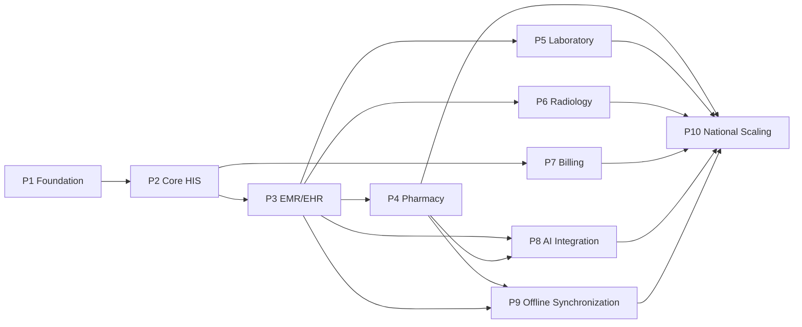

# AYBAK Complete Implementation Blueprint

**Ten-phase delivery plan from foundation to national-scale healthcare platform**  
**Plan date:** 2026-11-04  
**Baseline:** `9c1b9f826d2cfa63f5a25aef80b7b259889a22ba`  
**Architecture basis:** [`ENTERPRISE_TRANSFORMATION_PLAN.md`](./ENTERPRISE_TRANSFORMATION_PLAN.md)  
**Risk baseline:** [`ENTERPRISE_AUDIT.md`](./ENTERPRISE_AUDIT.md)  
**GitHub repository:** https://github.com/MAMONAMINYAR-stack/aybak-hospital-platform  
**Backlog:** 10 phase epics and 50 linked development-task issues

> This blueprint defines future work; it does not imply the capabilities are implemented. Estimates are ranges, not commitments. Production activation remains subject to clinical safety, security, privacy, regulatory, interoperability, accessibility, performance, recovery, and operational acceptance. Real PHI is prohibited in development and unapproved test environments.

## 1. Delivery Model

The program uses one reusable security/data/platform foundation and thin vertical clinical slices. Each phase adds domain capability without weakening earlier controls. Phases may overlap only when their issue-level dependencies and release gates are satisfied; national scaling is not merely an infrastructure project and requires evidence from every operational domain.

### 1.1 Estimation assumptions

- Effort is **person-days (pd)** for experienced engineering, QA, platform, security, data, design, and domain work. It is not elapsed time or a quotation.
- Calendar ranges assume a stable cross-functional team and timely access to identity, infrastructure, clinical owners, terminology, and vendor sandboxes.
- Procurement, legal/regulatory decisions, local clinical content, payer certification, analyzer/PACS/LIS/vendor delays, and national approvals can extend elapsed time.
- Rework from failed safety/security/interoperability gates is not hidden in the estimates. Clinical, pharmacy, laboratory, radiology, finance, privacy, and AI specialists must be available as named reviewers.
- The 50 tasks total **1280–1942 person-days**. Parallel work does not remove dependencies or permit production use before acceptance.

### 1.2 Phase dependency map

### 1.3 Epic and effort index

| Phase | GitHub epic | Effort | Indicative calendar | Dependencies |
|---|---|---:|---|---|
| P1 — Foundation | [#3](https://github.com/MAMONAMINYAR-stack/aybak-hospital-platform/issues/3) | 70–99 person-days | 8–12 calendar weeks after environments and IdP are available | None |
| P2 — Core HIS | [#7](https://github.com/MAMONAMINYAR-stack/aybak-hospital-platform/issues/7) | 100–143 person-days | 10–14 calendar weeks with Phase 1 platform reusable | P1 |
| P3 — EMR/EHR | [#8](https://github.com/MAMONAMINYAR-stack/aybak-hospital-platform/issues/8) | 120–175 person-days | 12–16 calendar weeks; EHR exchange can follow facility EMR pilot | P2 |
| P4 — Pharmacy | [#9](https://github.com/MAMONAMINYAR-stack/aybak-hospital-platform/issues/9) | 130–195 person-days | 14–20 calendar weeks including pharmacy content procurement and validation | P3 |
| P5 — Laboratory | [#10](https://github.com/MAMONAMINYAR-stack/aybak-hospital-platform/issues/10) | 120–180 person-days | 12–16 calendar weeks plus LIS/analyzer vendor coordination | P3 |
| P6 — Radiology | [#11](https://github.com/MAMONAMINYAR-stack/aybak-hospital-platform/issues/11) | 120–180 person-days | 12–18 calendar weeks plus PACS/RIS/viewer procurement and validation | P3 |
| P7 — Billing | [#12](https://github.com/MAMONAMINYAR-stack/aybak-hospital-platform/issues/12) | 110–165 person-days | 10–14 calendar weeks per initial jurisdiction/payer adapter | P2 |
| P8 — AI Integration | [#13](https://github.com/MAMONAMINYAR-stack/aybak-hospital-platform/issues/13) | 140–225 person-days | 12–18 calendar weeks for initial limited evaluation; clinical expansion is evidence-gated | P3, P4 |
| P9 — Offline Synchronization | [#14](https://github.com/MAMONAMINYAR-stack/aybak-hospital-platform/issues/14) | 145–230 person-days | 14–20 calendar weeks after core workflows and native-device operations are available | P2, P3, P4 |
| P10 — National Scaling | [#15](https://github.com/MAMONAMINYAR-stack/aybak-hospital-platform/issues/15) | 225–350 person-days | 24–36 calendar weeks for initial national readiness, followed by staged onboarding | P2, P3, P4, P5, P6, P7, P8, P9 |

### 1.4 GitHub backlog conventions

- Every phase has a milestone and `phase-XX` label. Epics use `type-epic`; implementation work uses `type-task`.
- Every task links its parent epic, clickable blocking issues, effort, deliverables, security requirements, acceptance criteria, and required evidence.
- Existing issues **#3**, **#4**, and **#5** were incorporated into Phase 1 rather than duplicated. Closed Next.js issue **#6** remains historical and is not evidence of a Next.js implementation.
- Teams break a task into smaller pull requests but do not mark it complete until all task acceptance evidence is linked. Phase acceptance is separately reviewed on the epic.

## 2. Cross-Phase Engineering Contract

Every phase inherits these requirements even when its specific section adds stricter rules:

1. **Patient context:** immutable patient/encounter IDs, two-identifier verification where required, source/status/effective time/recorded time/freshness, and wrong-patient tests.
2. **Server security:** OIDC session assurance, deny-by-default RBAC + ABAC + relationship + purpose + tenant scope; UI guards are never the sole control.
3. **Transactional integrity:** domain validation, database constraints, optimistic versions, idempotency keys, and state + audit + outbox atomicity.
4. **Clinical history:** no silent overwrite of signed records; explicit state transitions, reasons, amendments/corrections, and provenance.
5. **Integration safety:** schema/profile validation, inbox/outbox idempotency, bounded retries, dead letters, replay protection, and human reconciliation.
6. **Privacy:** minimum necessary data, no PHI in public assets/URLs/ordinary logs/analytics, managed encryption/secrets, controlled exports and retention.
7. **Experience:** responsive accessible UI, loading/empty/error/stale/partial states, route error boundaries, no clickable no-op controls, and double-submit prevention.
8. **Operability:** redacted OpenTelemetry, SLOs, clinical data-health indicators, alert runbooks, rollback/roll-forward, backup/restore, and downtime behavior.
9. **Evidence:** unit/integration/contract/authorization/concurrency/failure/E2E/accessibility/performance tests appropriate to risk and named domain approval.
10. **Delivery:** strict types, reviewed migrations/OpenAPI, locked dependencies, signed immutable artifacts, SBOM/provenance, and deployment through protected CI/CD.

### 2.1 Universal task definition of done

- Linked issue and all blockers are closed with evidence; implementation and documentation are on the approved branch/release path.
- Acceptance criteria are demonstrated in an isolated synthetic environment and linked from the issue.
- Security tests include denied role, denied object, denied tenant, expired/revoked identity, and malicious/invalid input where applicable.
- Retry-after-timeout and concurrent-update behavior is proven for every non-idempotent business action.
- Monitoring, audit, backup/retention, support, migration, and rollback implications are implemented and documented.
- Clinical/medical/AI work has hazard-to-control-to-test traceability and accountable human approval; no autonomous clinical authority is introduced.

---

## Phase 1 - Foundation

**GitHub epic:** [#3](https://github.com/MAMONAMINYAR-stack/aybak-hospital-platform/issues/3)  
**Objective:** Replace the unsafe prototype baseline with a reproducible engineering platform, real identity boundary, synthetic-data controls, operational telemetry, and recovery foundations.  
**Development effort:** 70–99 person-days across five tasks  
**Indicative calendar:** 8–12 calendar weeks after environments and IdP are available  
**Dependencies:** None; program entry phase

### Features

- Fix the dashboard crash and remove fake live/authentication claims and no-op clinical actions.
- Establish strict TypeScript React/Vite frontend, NestJS/Fastify backend, testing, linting, and CI/CD.
- Provide PostgreSQL migrations, synthetic seeds, local development, and documented configuration.
- Implement OIDC/BFF sessions, MFA claims, secure cookies, base policy enforcement, and staff lifecycle contracts.
- Add OpenTelemetry, redacted logging, signed artifacts, infrastructure baselines, PITR, restore tests, and governance documents.

### Database tables

| Table | Purpose |
|---|---|
| `app_config` | Versioned non-secret application configuration and feature flags. |
| `staff_principal` | Maps external IdP subject to internal staff identity; no local demo passwords. |
| `role_template` | Approved role definitions and policy versions. |
| `user_role_assignment` | Scoped user role assignments with validity and approver. |
| `auth_session` | Hashed/revocable server session metadata if BFF stores sessions. |
| `audit_event` | Append-only actor/action/resource/purpose/outcome events. |
| `outbox_event` | Transactional asynchronous integration outbox. |
| `schema_migration` | Applied migration and checksum history. |

_All tenant-owned tables also carry immutable ID, tenant/facility scope where applicable, audit timestamps/actors, and optimistic version where mutable. Clinical effective time is distinct from record creation time. Migrations must preserve tenant and patient/encounter consistency._

### APIs

| Method | Endpoint | Purpose |
|---|---|---|
| `GET` | `/v1/health/live` | Process liveness without PHI or dependency details. |
| `GET` | `/v1/health/ready` | Controlled readiness with safe dependency status. |
| `GET` | `/v1/me` | Current authenticated identity, scopes, assurance, and tenant memberships. |
| `POST` | `/v1/auth/callback` | BFF OIDC authorization-code callback. |
| `POST` | `/v1/logout` | Revoke local session and invoke IdP logout policy. |
| `POST` | `/v1/step-up` | Obtain elevated assurance for high-risk actions. |
| `GET` | `/v1/config/public` | Validated non-secret runtime configuration. |
| `GET` | `/v1/audit/events/{correlationId}` | Restricted support/audit lookup without general PHI access. |

All product endpoints require authenticated server authorization, bounded schemas, safe problem responses, audit/correlation, and tenant/object scope. Mutations additionally require idempotency/version semantics as appropriate. Interface endpoints authenticate through restricted adapters; they are not anonymous public webhooks.

### UI Pages

| Route | Page and clinical behavior |
|---|---|
| `/login` | Real OIDC initiation; production demo-auth disabled. |
| `/demo` | Isolated synthetic-data demonstration with persistent banner. |
| `/` | Stabilized lazy dashboard with route error boundary and truthful data state. |
| `/access-denied` | Safe 401/403 recovery and reauthentication guidance. |
| `/system-status` | Role-appropriate freshness/degraded-mode status without sensitive internals. |
| `/admin/sessions` | Privileged own-session/revocation views; no standing global chart access. |

### Backend services

| Service | Responsibility |
|---|---|
| `web-shell` | Strict React feature shell, accessible components, lazy routes, and error boundaries. |
| `bff-auth` | OIDC code flow, secure session cookies, CSRF, logout, and step-up assurance. |
| `policy-service` | Deny-by-default role/scope policy middleware and tests. |
| `audit-service` | Redacted append-only audit API and transactional audit helpers. |
| `platform-worker` | Outbox dispatcher with idempotency, retries, and dead-letter state. |
| `observability` | OpenTelemetry collection, metrics/traces/log redaction, alerts, and synthetic checks. |

These are logical module boundaries initially. They do not require separate deployable microservices until scaling, isolation, or ownership evidence justifies extraction.

### Security requirements

- Production builds fail if demo authentication or clinical fixture mode is enabled.
- OIDC issuer/audience/signature/nonce/state/PKCE validation and MFA assurance policies.
- HttpOnly, Secure, appropriate SameSite cookies; CSRF protection for cookie mutations; no tokens in localStorage.
- Deny-by-default server policy; tenant context is never trusted from a free-form client header.
- No PHI or credentials in source, public bundles, CI logs, telemetry, or synthetic fixtures.
- Pinned runtime/dependencies/actions, SBOM, signed artifacts, secret/dependency/SAST/IaC scans.
- Encryption, managed secrets/keys, private database networking, and tested backup/restore access separation.

### Development effort and dependencies

- **Effort:** 70–99 person-days; **calendar:** 8–12 calendar weeks after environments and IdP are available.
- **Entry dependencies:** none. Task-level blockers below are more precise and mandatory.
- Effort includes engineering and validation but excludes external procurement/approval waiting time. Production activation requires the phase acceptance criteria, not only task closure.

### Development tasks

| GitHub task | Scope | Effort | Dependencies |
|---|---|---:|---|
| [P1-T01 #16](https://github.com/MAMONAMINYAR-stack/aybak-hospital-platform/issues/16) — **Stabilize the React prototype and establish frontend quality gates** | Fix confirmed prototype failures, isolate synthetic demo behavior, and establish a strict tested React/Vite shell. | 12–16 pd | None |
| [P1-T02 #5](https://github.com/MAMONAMINYAR-stack/aybak-hospital-platform/issues/5) — **Create the NestJS backend workspace and required CI checks** | Establish the modular backend, versioned configuration, API standards, testing, and immutable build pipeline. | 12–18 pd | P1-T01 (#16) |
| [P1-T03 #4](https://github.com/MAMONAMINYAR-stack/aybak-hospital-platform/issues/4) — **Provision PostgreSQL, migrations, and synthetic development data** | Create the reproducible database foundation without prematurely adding clinical or vector data. | 10–15 pd | P1-T02 (#5) |
| [P1-T04 #17](https://github.com/MAMONAMINYAR-stack/aybak-hospital-platform/issues/17) — **Implement OIDC BFF sessions and deny-by-default authorization** | Replace the browser Boolean login with enterprise identity and server-enforced session/policy controls. | 18–25 pd | P1-T02 (#5), P1-T03 (#4) |
| [P1-T05 #18](https://github.com/MAMONAMINYAR-stack/aybak-hospital-platform/issues/18) — **Establish observability, infrastructure, recovery, and governance** | Make the foundation deployable, supportable, recoverable, and clinically governable. | 18–25 pd | P1-T02 (#5), P1-T03 (#4) |

### Acceptance criteria

- [ ] The original seven-value/six-label dashboard crash has a passing regression and browser E2E test.
- [ ] A clean checkout uses locked dependencies and passes lint, typecheck, unit, integration, build, accessibility, and security CI gates.
- [ ] Arbitrary non-empty credentials cannot create a production session; MFA, logout, expiry, revocation, and CSRF tests pass.
- [ ] Production assets contain no demo credentials or clinical-looking fixtures.
- [ ] A synthetic API transaction writes state, audit, and outbox atomically; duplicate retries have one business effect.
- [ ] An isolated restore meets the approved foundation RPO/RTO and application smoke tests pass.
- [ ] README, SECURITY, architecture decisions, threat model, data classification, and initial hazard log have named approvers.

Track and approve this phase in [GitHub epic #3](https://github.com/MAMONAMINYAR-stack/aybak-hospital-platform/issues/3). Each linked task contains its own deliverables, security controls, test evidence, and acceptance criteria.

---

## Phase 2 - Core HIS

**GitHub epic:** [#7](https://github.com/MAMONAMINYAR-stack/aybak-hospital-platform/issues/7)  
**Objective:** Deliver tenant/facility administration, trusted patient identity, encounters/ADT, care teams, and conflict-safe appointments as the first complete clinical vertical slice.  
**Development effort:** 100–143 person-days across five tasks  
**Indicative calendar:** 10–14 calendar weeks with Phase 1 platform reusable  
**Dependencies:** P1

### Features

- Organization, facility, department, resource, and delegated administration.
- Patient registration, multiple identifiers, duplicate detection, merge/unmerge, and emergency identities.
- Encounter creation, admission/discharge/transfer, attending team, and location history.
- Provider/room/equipment scheduling, availability, waitlist, reminders, and state history.
- Patient banner, registration/worklist/schedule UI, minimum-necessary search, and operational reconciliation.

### Database tables

| Table | Purpose |
|---|---|
| `organization` | Tenant owner and contractual/regulatory configuration. |
| `facility` | Facility within an organization with timezone and location. |
| `department` | Clinical/administrative department hierarchy. |
| `patient` | Immutable tenant-scoped patient identity. |
| `patient_identifier` | Issuer/type/value identifiers and validity. |
| `person_name` | Versioned structured patient names. |
| `patient_link` | Merge/unmerge lineage and surviving identity. |
| `identity_match_review` | Duplicate candidate evidence and human decision. |
| `encounter` | Episode class/status/times/facility/patient/version. |
| `care_team` | Practitioner/team assignments with valid periods. |
| `care_relationship` | ABAC relationship used for record access. |
| `location_assignment` | ADT location history. |
| `appointment` | UTC schedule, source zone, duration, resources, state, version. |
| `resource` | Provider/room/equipment scheduling resource. |
| `resource_unavailability` | Leaves, maintenance, and exceptions. |
| `appointment_transition` | Attributed scheduling state history. |
| `notification_delivery` | Minimum-PHI reminder status and retry/reconciliation. |

_All tenant-owned tables also carry immutable ID, tenant/facility scope where applicable, audit timestamps/actors, and optimistic version where mutable. Clinical effective time is distinct from record creation time. Migrations must preserve tenant and patient/encounter consistency._

### APIs

| Method | Endpoint | Purpose |
|---|---|---|
| `GET/POST` | `/v1/patients` | Authorized bounded registration/search and create. |
| `GET/PATCH` | `/v1/patients/{id}` | Minimum-necessary patient details/versioned updates. |
| `POST` | `/v1/patient-merges` | Reviewed identity merge with lineage. |
| `POST` | `/v1/patient-merges/{id}/unmerge` | Governed reversal preserving history. |
| `GET/POST` | `/v1/encounters` | Encounter query/create within scope. |
| `POST` | `/v1/encounters/{id}/transitions` | ADT state transition with version/reason. |
| `GET/POST` | `/v1/appointments` | Conflict-checked schedule query/create. |
| `POST` | `/v1/appointments/{id}/transitions` | Confirm/arrive/cancel/reschedule/no-show commands. |
| `GET` | `/v1/resources/{id}/availability` | Timezone-aware bounded availability. |
| `GET/POST` | `/v1/facilities` | Restricted facility administration. |

All product endpoints require authenticated server authorization, bounded schemas, safe problem responses, audit/correlation, and tenant/object scope. Mutations additionally require idempotency/version semantics as appropriate. Interface endpoints authenticate through restricted adapters; they are not anonymous public webhooks.

### UI Pages

| Route | Page and clinical behavior |
|---|---|
| `/registration` | Search-before-create, duplicate candidates, emergency registration. |
| `/patients/{id}` | Verified patient banner, identifiers, links, encounters, provenance. |
| `/registration/merges` | Side-by-side duplicate review and merge/unmerge audit. |
| `/encounters` | Facility census and ADT worklists. |
| `/encounters/{id}` | Encounter/team/location/status timeline. |
| `/appointments` | Day/week resource calendar with timezone and freshness. |
| `/appointments/{id}` | Appointment details, transitions, notifications, history. |
| `/admin/facilities` | Scoped organization/facility/department/resource administration. |

### Backend services

| Service | Responsibility |
|---|---|
| `tenant-service` | Tenant/facility resolution, delegated configuration, placement hooks. |
| `patient-service` | Registration, identifiers, matching, merge/unmerge, patient context. |
| `encounter-service` | ADT state machine, care team, location and relationship invariants. |
| `scheduling-service` | Availability, transactional conflicts, state transitions, versions. |
| `notification-service` | Policy-filtered reminders and delivery reconciliation. |
| `his-query-service` | Bounded census/schedule/search projections with tenant filters. |

These are logical module boundaries initially. They do not require separate deployable microservices until scaling, isolation, or ownership evidence justifies extraction.

### Security requirements

- Tenant and facility predicates plus defense-in-depth RLS on every patient/encounter/schedule query.
- Two-identifier patient verification and persistent patient context for clinical transitions.
- Duplicate merge requires scoped permission, review, reason, audit, and reversible lineage.
- PHI-minimized notifications and no patient identifiers in URLs, analytics, or logs.
- Registration/scheduling roles cannot access unrelated charts or grant themselves privileges.
- Idempotency, optimistic versions, database conflict constraints, and auditable break-glass.

### Development effort and dependencies

- **Effort:** 100–143 person-days; **calendar:** 10–14 calendar weeks with Phase 1 platform reusable.
- **Entry dependencies:** P1. Task-level blockers below are more precise and mandatory.
- Effort includes engineering and validation but excludes external procurement/approval waiting time. Production activation requires the phase acceptance criteria, not only task closure.

### Development tasks

| GitHub task | Scope | Effort | Dependencies |
|---|---|---:|---|
| [P2-T01 #19](https://github.com/MAMONAMINYAR-stack/aybak-hospital-platform/issues/19) — **Implement tenancy, facilities, departments, and delegated administration** | Create organization/facility boundaries and enforce tenant context across data and administration. | 20–28 pd | P1-T04 (#17), P1-T05 (#18) |
| [P2-T02 #20](https://github.com/MAMONAMINYAR-stack/aybak-hospital-platform/issues/20) — **Build patient registration, identity matching, and merge governance** | Implement authoritative patient identity rather than name-based display records. | 20–30 pd | P2-T01 (#19) |
| [P2-T03 #21](https://github.com/MAMONAMINYAR-stack/aybak-hospital-platform/issues/21) — **Implement encounters, ADT, care teams, and access relationships** | Provide the encounter and care-team context required by every downstream clinical module. | 18–25 pd | P2-T01 (#19), P2-T02 (#20) |
| [P2-T04 #22](https://github.com/MAMONAMINYAR-stack/aybak-hospital-platform/issues/22) — **Implement resource scheduling and appointment state machines** | Deliver conflict-safe appointments with unambiguous temporal semantics. | 20–28 pd | P2-T03 (#21) |
| [P2-T05 #23](https://github.com/MAMONAMINYAR-stack/aybak-hospital-platform/issues/23) — **Complete HIS operational UI, accessibility, and end-to-end validation** | Integrate the HIS vertical slice and prove safe registration, census, and scheduling workflows. | 22–32 pd | P2-T02 (#20), P2-T03 (#21), P2-T04 (#22) |

### Acceptance criteria

- [ ] Duplicate-name, temporary-identity, merge/unmerge, transfer, and concurrent-update tests pass.
- [ ] Cross-tenant/facility tests cover API, RLS, cache, search, object, notification, and audit paths.
- [ ] Concurrent booking cannot double-book a resource; retry-after-timeout returns the original appointment.
- [ ] DST gap/overlap, cross-midnight, leap-day, reschedule, cancel, and no-show cases pass.
- [ ] Registration staff cannot read unrelated clinical content and every search/access is audited.
- [ ] Mobile/zoom/screen-reader users can complete registration and scheduling with verified patient context.

Track and approve this phase in [GitHub epic #7](https://github.com/MAMONAMINYAR-stack/aybak-hospital-platform/issues/7). Each linked task contains its own deliverables, security controls, test evidence, and acceptance criteria.

---

## Phase 3 - EMR/EHR

**GitHub epic:** [#8](https://github.com/MAMONAMINYAR-stack/aybak-hospital-platform/issues/8)  
**Objective:** Create the signed facility legal record and a consent-aware source-attributed longitudinal EHR, including problems, allergies, observations, documents, orders/results foundations, and exchange.  
**Development effort:** 120–175 person-days across five tasks  
**Indicative calendar:** 12–16 calendar weeks; EHR exchange can follow facility EMR pilot  
**Dependencies:** P2

### Features

- Versioned clinical notes, signatures/co-signatures, amendments, corrections, and entered-in-error states.
- Problems, allergies/intolerances, observations, diagnoses, and structured provenance.
- Generic service requests, diagnostic results, corrections, and department-neutral order status.
- Consent directives, patient access/export, source attribution, and longitudinal chart aggregation.
- Enterprise patient links/match review and profiled FHIR exchange with record-locator foundation.

### Database tables

| Table | Purpose |
|---|---|
| `clinical_document` | Document metadata, patient/encounter/author/status/version. |
| `document_version` | Immutable signed content versions and amendment links. |
| `signature` | Author/co-signer assurance, meaning, and timestamp. |
| `problem` | Coded problem/diagnosis with verification and lifecycle. |
| `allergy_intolerance` | Substance/reaction/criticality/verification/unknown status. |
| `observation` | Coded value/unit/reference/effective and recorded times. |
| `service_request` | Department-neutral order intent/status/patient/encounter. |
| `diagnostic_result` | Result header/status/source/verification/correction link. |
| `result_value` | Structured coded result components and flags. |
| `consent_directive` | Purpose/resource/recipient/period policy directives. |
| `patient_access_request` | Access/correction/export request workflow. |
| `external_resource_ref` | Source system/resource/hash/mapping/provenance. |
| `enterprise_patient_link` | Cross-tenant source identity link and review provenance. |
| `record_locator_entry` | Authorized source location/type/time metadata. |
| `exchange_transaction` | Purpose, sender/recipient, policy, outcome, and correlation. |

_All tenant-owned tables also carry immutable ID, tenant/facility scope where applicable, audit timestamps/actors, and optimistic version where mutable. Clinical effective time is distinct from record creation time. Migrations must preserve tenant and patient/encounter consistency._

### APIs

| Method | Endpoint | Purpose |
|---|---|---|
| `POST` | `/v1/documents` | Create encounter-scoped draft. |
| `POST` | `/v1/documents/{id}/finalize` | Sign immutable version with assurance. |
| `POST` | `/v1/documents/{id}/amend` | Create linked amendment with reason/signature. |
| `GET/POST` | `/v1/patients/{id}/problems` | Problem list management. |
| `GET/POST` | `/v1/patients/{id}/allergies` | Allergy/unknown status and verification. |
| `GET/POST` | `/v1/observations` | Bounded coded observation capture/query. |
| `GET/POST` | `/v1/service-requests` | Department-neutral order commands. |
| `GET` | `/v1/diagnostic-results` | Authorized result query with freshness/status. |
| `POST` | `/v1/results/{id}/correct` | Linked corrected result and notification. |
| `GET` | `/v1/ehr/patients/{id}/summary` | Policy-filtered source-attributed longitudinal summary. |
| `POST` | `/v1/exports` | Step-up, purpose-limited encrypted export. |
| `GET/POST` | `/fhir/Patient` | Profiled FHIR patient exchange; other resources enabled by capability statement. |

All product endpoints require authenticated server authorization, bounded schemas, safe problem responses, audit/correlation, and tenant/object scope. Mutations additionally require idempotency/version semantics as appropriate. Interface endpoints authenticate through restricted adapters; they are not anonymous public webhooks.

### UI Pages

| Route | Page and clinical behavior |
|---|---|
| `/emr/patients/{id}/summary` | Encounter/longitudinal summary with source and freshness. |
| `/emr/patients/{id}/notes` | Draft/final/amended notes and signatures. |
| `/emr/patients/{id}/problems` | Problem/diagnosis history and verification. |
| `/emr/patients/{id}/allergies` | Allergy status, reactions, provenance, unknown state. |
| `/emr/patients/{id}/results` | Result trends/status/reference/corrections. |
| `/emr/patients/{id}/orders` | Cross-department order status timeline. |
| `/ehr/timeline` | Cross-facility source-grouped timeline and retrieval state. |
| `/privacy/consents` | Scoped consent/directive administration. |
| `/privacy/access-requests` | Authorized export/access/correction requests. |

### Backend services

| Service | Responsibility |
|---|---|
| `clinical-document-service` | Versioned notes, signatures, amendments, retention. |
| `clinical-record-service` | Problems, allergies, observations, and invariant validation. |
| `order-result-service` | Service requests/results/corrections and source provenance. |
| `ehr-aggregation-service` | Authorized source-attributed longitudinal queries. |
| `consent-policy-service` | Directive evaluation and policy versioning. |
| `fhir-gateway` | Profiles, validation, scope mapping, exchange audit. |
| `empi-service` | Enterprise links, match review, and source mappings. |
| `export-service` | Encrypted expiring minimum-necessary patient exports. |

These are logical module boundaries initially. They do not require separate deployable microservices until scaling, isolation, or ownership evidence justifies extraction.

### Security requirements

- Signed entries are immutable; corrections create linked signed versions and preserve originals.
- Every clinical resource enforces patient/encounter/tenant consistency and qualified author scope.
- Allergy unknown is distinct from no known allergy; stale/external data displays source/status.
- Cross-facility aggregation reauthorizes purpose, relationship, consent, and source at query time.
- Exports require step-up, minimization, encryption, expiry, access audit, and no public object URLs.
- FHIR scopes and profiles do not bypass internal tenant/object policy; external payloads are untrusted.

### Development effort and dependencies

- **Effort:** 120–175 person-days; **calendar:** 12–16 calendar weeks; EHR exchange can follow facility EMR pilot.
- **Entry dependencies:** P2. Task-level blockers below are more precise and mandatory.
- Effort includes engineering and validation but excludes external procurement/approval waiting time. Production activation requires the phase acceptance criteria, not only task closure.

### Development tasks

| GitHub task | Scope | Effort | Dependencies |
|---|---|---:|---|
| [P3-T01 #24](https://github.com/MAMONAMINYAR-stack/aybak-hospital-platform/issues/24) — **Implement versioned clinical documents and signatures** | Create the encounter-scoped legal documentation workflow with immutable signed history. | 25–35 pd | P2-T03 (#21), P2-T05 (#23) |
| [P3-T02 #25](https://github.com/MAMONAMINYAR-stack/aybak-hospital-platform/issues/25) — **Implement problems, allergies, and structured observations** | Provide reusable coded clinical data with explicit verification and unknown states. | 20–30 pd | P2-T02 (#20), P2-T03 (#21) |
| [P3-T03 #26](https://github.com/MAMONAMINYAR-stack/aybak-hospital-platform/issues/26) — **Build department-neutral orders, results, and correction provenance** | Create shared order/result semantics for pharmacy, laboratory, and radiology without weakening their specific controls. | 20–30 pd | P3-T02 (#25) |
| [P3-T04 #27](https://github.com/MAMONAMINYAR-stack/aybak-hospital-platform/issues/27) — **Implement consent-aware EHR aggregation and FHIR exchange** | Deliver source-attributed cross-facility records without creating an uncontrolled central chart. | 30–45 pd | P3-T01 (#24), P3-T02 (#25), P3-T03 (#26) |
| [P3-T05 #28](https://github.com/MAMONAMINYAR-stack/aybak-hospital-platform/issues/28) — **Validate EMR/EHR clinical safety, accessibility, and interoperability** | Prove the complete clinical record workflows before department modules rely on them. | 25–35 pd | P3-T01 (#24), P3-T02 (#25), P3-T03 (#26), P3-T04 (#27) |

### Acceptance criteria

- [ ] Signed note/result content cannot be updated in place; amendment/correction history is complete.
- [ ] Wrong-patient, cross-encounter, duplicate-name, co-signature, and expired-privilege tests pass.
- [ ] Allergy and observation code/value/unit/reference semantics survive API and FHIR round trips.
- [ ] Longitudinal EHR identifies source facility, author, status, freshness, and unavailable sources.
- [ ] Duplicate/out-of-order/replayed exchange messages are idempotent and reconciled.
- [ ] Patient access/export tests prove purpose, scope, expiry, encryption, and audit.

Track and approve this phase in [GitHub epic #8](https://github.com/MAMONAMINYAR-stack/aybak-hospital-platform/issues/8). Each linked task contains its own deliverables, security controls, test evidence, and acceptance criteria.

---

## Phase 4 - Pharmacy

**GitHub epic:** [#9](https://github.com/MAMONAMINYAR-stack/aybak-hospital-platform/issues/9)  
**Objective:** Implement structured medication ordering, validated deterministic safety review, pharmacist verification, dispensing/administration, formulary, and medication stock integration.  
**Development effort:** 130–195 person-days across five tasks  
**Indicative calendar:** 14–20 calendar weeks including pharmacy content procurement and validation  
**Dependencies:** P3

### Features

- Coded formulary, structured sig, medication reconciliation, and proposed/discontinued orders.
- Allergy/interaction/duplicate/dose-range checks using approved drug knowledge and local rules.
- Pharmacist verification/rejection, governed overrides, and surveillance.
- Dispense, lot/expiry, return/waste, administration, barcode verification, and discontinuation.
- Medication inventory ledger, recall/quarantine, FEFO, and controlled-stock extensions where legally approved.

### Database tables

| Table | Purpose |
|---|---|
| `formulary_item` | Coded drug/strength/form/local status and knowledge mapping. |
| `medication_request` | Structured order, dose/unit/route/frequency/duration/indication/status. |
| `medication_safety_review` | Rule inputs/results/knowledge version/reviewer/override. |
| `medication_override` | Severity, reason, actor, second review where required. |
| `dispense` | Verified order, lot, quantity, expiry, dispenser, status. |
| `medication_administration` | Patient/order/dose/route/time/performer/result. |
| `medication_reconciliation` | Source medication list and clinician resolution. |
| `stock_item` | Medication and general clinical item catalog. |
| `stock_location` | Facility/storeroom/ward stock location. |
| `stock_lot` | Lot/serial/expiry/quarantine/recall state. |
| `stock_movement` | Append-only receipt/issue/dispense/return/waste/transfer ledger. |
| `stock_recall` | Recall scope, notification, and blocking state. |
| `controlled_stock_count` | Dual-control count/witness records where applicable. |

_All tenant-owned tables also carry immutable ID, tenant/facility scope where applicable, audit timestamps/actors, and optimistic version where mutable. Clinical effective time is distinct from record creation time. Migrations must preserve tenant and patient/encounter consistency._

### APIs

| Method | Endpoint | Purpose |
|---|---|---|
| `GET/POST` | `/v1/formulary/items` | Scoped formulary administration/query. |
| `POST` | `/v1/medication-requests` | Validate structured proposed order idempotently. |
| `POST` | `/v1/medication-requests/{id}/safety-reviews` | Execute/record approved safety evaluation. |
| `POST` | `/v1/medication-requests/{id}/verify` | Pharmacist decision with version/assurance. |
| `POST` | `/v1/medication-requests/{id}/discontinue` | Authorized discontinuation and propagation. |
| `POST` | `/v1/medication-requests/{id}/dispenses` | Lot/quantity/verified-order dispensing. |
| `POST` | `/v1/medication-requests/{id}/administrations` | Barcode/patient/order administration record. |
| `GET` | `/v1/patients/{id}/medication-summary` | Current/source-attributed reconciled medication view. |
| `POST` | `/v1/stock-movements` | Idempotent append-only inventory movement. |
| `GET` | `/v1/stock-balances` | Bounded lot/location availability and recall state. |

All product endpoints require authenticated server authorization, bounded schemas, safe problem responses, audit/correlation, and tenant/object scope. Mutations additionally require idempotency/version semantics as appropriate. Interface endpoints authenticate through restricted adapters; they are not anonymous public webhooks.

### UI Pages

| Route | Page and clinical behavior |
|---|---|
| `/pharmacy/worklist` | Proposed/verified/rejected/discontinued order queue. |
| `/pharmacy/orders/{id}` | Structured order, patient context, checks, history. |
| `/pharmacy/safety-review` | Rule evidence, missing context, override workflow. |
| `/pharmacy/dispense` | Verified-order lot/quantity/return/waste workflow. |
| `/medications/administration` | Patient barcode/order/due administration and exceptions. |
| `/medications/reconciliation` | Source list comparison and clinician resolution. |
| `/pharmacy/formulary` | Scoped formulary/knowledge-version administration. |
| `/inventory/stock` | Location/lot/expiry/quarantine balances. |
| `/inventory/recalls` | Recall impact, blocking, notification, and reconciliation. |

### Backend services

| Service | Responsibility |
|---|---|
| `medication-order-service` | Structured order/state/discontinuation and idempotency. |
| `medication-safety-service` | Deterministic knowledge/rules and missing-context handling. |
| `pharmacy-verification-service` | Independent pharmacist decisions and overrides. |
| `dispense-admin-service` | Lot dispense, barcode administration, returns/waste. |
| `medication-reconciliation-service` | Source lists and resolved current medication view. |
| `inventory-ledger-service` | Append-only stock movements, FEFO, recall/quarantine. |
| `medication-event-worker` | Reliable stock/charge/notification reconciliation. |

These are logical module boundaries initially. They do not require separate deployable microservices until scaling, isolation, or ownership evidence justifies extraction.

### Security requirements

- Prescriber, pharmacist, dispenser, and administrator permissions are separated and credential-checked.
- Validated deterministic rules are authoritative; AI cannot clear/downgrade an alert or finalize an order.
- Missing allergies/weight/labs/knowledge status is explicit and never treated as proof of safety.
- High-risk actions require step-up, reason, and second review where policy mandates.
- Discontinued/wrong-patient/recalled/expired orders or stock are hard stops pending authorized resolution.
- Controlled medicines and e-prescribing remain disabled until jurisdiction-specific legal controls are validated.
- No offline final prescribing; every retry and administration is idempotent and audited.

### Development effort and dependencies

- **Effort:** 130–195 person-days; **calendar:** 14–20 calendar weeks including pharmacy content procurement and validation.
- **Entry dependencies:** P3. Task-level blockers below are more precise and mandatory.
- Effort includes engineering and validation but excludes external procurement/approval waiting time. Production activation requires the phase acceptance criteria, not only task closure.

### Development tasks

| GitHub task | Scope | Effort | Dependencies |
|---|---|---:|---|
| [P4-T01 #29](https://github.com/MAMONAMINYAR-stack/aybak-hospital-platform/issues/29) — **Implement formulary and structured medication ordering** | Replace free-text medication cards with coded, complete, encounter-scoped proposed orders. | 25–35 pd | P3-T02 (#25), P3-T03 (#26), P3-T05 (#28) |
| [P4-T02 #30](https://github.com/MAMONAMINYAR-stack/aybak-hospital-platform/issues/30) — **Integrate deterministic drug knowledge and safety review** | Implement governed allergy, interaction, duplication, dose, and context checks with explicit missing data. | 30–45 pd | P4-T01 (#29) |
| [P4-T03 #31](https://github.com/MAMONAMINYAR-stack/aybak-hospital-platform/issues/31) — **Implement pharmacist verification, dispensing, and administration** | Complete the closed-loop medication workflow with separated permissions and barcode checks. | 30–45 pd | P4-T02 (#30) |
| [P4-T04 #32](https://github.com/MAMONAMINYAR-stack/aybak-hospital-platform/issues/32) — **Implement medication inventory, lot expiry, and recall controls** | Integrate medication use with an auditable append-only inventory ledger. | 20–30 pd | P4-T03 (#31) |
| [P4-T05 #33](https://github.com/MAMONAMINYAR-stack/aybak-hospital-platform/issues/33) — **Validate pharmacy safety, compliance, usability, and recovery** | Obtain evidence-based pharmacy approval before enabling medication production workflows. | 25–40 pd | P4-T02 (#30), P4-T03 (#31), P4-T04 (#32) |

### Acceptance criteria

- [ ] Pharmacist-approved hazardous cases cover allergy unknown, interactions, duplicates, dose/unit, renal/hepatic context, and look-alike selection.
- [ ] The same retry cannot create two orders, dispenses, administrations, charges, or stock movements.
- [ ] A discontinued order or recalled/expired lot cannot be administered through normal or stale UI flows.
- [ ] Every safety override and state transition records actor, reason, knowledge version, and before/after state.
- [ ] Stock ledger balances reconcile to source events and recall/quarantine propagates within approved SLA.
- [ ] Pharmacy, clinical safety, security, and local regulatory owners sign the medication safety case.

Track and approve this phase in [GitHub epic #9](https://github.com/MAMONAMINYAR-stack/aybak-hospital-platform/issues/9). Each linked task contains its own deliverables, security controls, test evidence, and acceptance criteria.

---

## Phase 5 - Laboratory

**GitHub epic:** [#10](https://github.com/MAMONAMINYAR-stack/aybak-hospital-platform/issues/10)  
**Objective:** Deliver laboratory ordering, specimen traceability, LIS/analyzer integration, qualified result verification, correction propagation, and critical-result acknowledgment.  
**Development effort:** 120–180 person-days across five tasks  
**Indicative calendar:** 12–16 calendar weeks plus LIS/analyzer vendor coordination  
**Dependencies:** P3

### Features

- Versioned test catalog, ordering, collection instructions, priority, and accession management.
- Barcode specimen collection, container/type, chain of custody, rejection, and recollection.
- HL7v2/FHIR LIS interfaces, analyzer mapping, LOINC/local codes, units, and interface reconciliation.
- Automated/technical/clinical validation policies, reference ranges, flags, delta checks, and signatures.
- Preliminary/final/corrected results, critical communication/read-back/escalation, and trends.

### Database tables

| Table | Purpose |
|---|---|
| `lab_test_definition` | Versioned test/panel code, method, specimen, and collection requirements. |
| `lab_order` | Service request extension with priority/accession/status. |
| `specimen` | Type/container/collector/time/status and patient/order binding. |
| `specimen_event` | Collection/receipt/rejection/recollection chain of custody. |
| `analyzer` | Approved instrument/interface identity and metadata. |
| `lab_result` | Accession/result status/verifier/source/correction linkage. |
| `lab_result_component` | LOINC/local code, value, UCUM unit, flags. |
| `reference_range` | Method/context-specific range and version. |
| `delta_check` | Prior comparison, rule version, and review outcome. |
| `critical_result_communication` | Recipient, notification, read-back, acknowledgment, escalation. |
| `interface_message` | Raw protected reference, hash, mapping, status, retries. |
| `mapping_version` | Versioned code/unit/order/result mappings. |
| `reconciliation_issue` | Orphan/duplicate/missing/out-of-order interface issue. |

_All tenant-owned tables also carry immutable ID, tenant/facility scope where applicable, audit timestamps/actors, and optimistic version where mutable. Clinical effective time is distinct from record creation time. Migrations must preserve tenant and patient/encounter consistency._

### APIs

| Method | Endpoint | Purpose |
|---|---|---|
| `GET/POST` | `/v1/lab/tests` | Versioned test catalog administration/query. |
| `POST` | `/v1/lab/orders` | Create coded lab order from approved service request. |
| `POST` | `/v1/specimens` | Barcode-bound specimen collection. |
| `POST` | `/v1/specimens/{id}/events` | Receipt/rejection/recollection transitions. |
| `GET` | `/v1/lab/worklist` | Scoped accession/collection/verification worklist. |
| `POST` | `/v1/lab/results/{id}/verify` | Qualified preliminary/final verification. |
| `POST` | `/v1/lab/results/{id}/correct` | Signed correction and active propagation. |
| `POST` | `/v1/critical-communications/{id}/acknowledge` | Read-back/acknowledgment and escalation state. |
| `POST` | `/interfaces/hl7v2/lis` | Authenticated authorized HL7 ingress via adapter, not public anonymous endpoint. |
| `GET` | `/v1/lab/reconciliation` | Restricted interface exceptions and resolution. |

All product endpoints require authenticated server authorization, bounded schemas, safe problem responses, audit/correlation, and tenant/object scope. Mutations additionally require idempotency/version semantics as appropriate. Interface endpoints authenticate through restricted adapters; they are not anonymous public webhooks.

### UI Pages

| Route | Page and clinical behavior |
|---|---|
| `/laboratory/orders` | Order entry, requirements, status, and accession. |
| `/laboratory/collection` | Barcode collection, labels, rejection/recollection. |
| `/laboratory/worklist` | Specimen/result validation and analyzer flags. |
| `/laboratory/results/{id}` | Components/ranges/delta/history/verification. |
| `/laboratory/critical` | Critical notification/read-back/escalation board. |
| `/laboratory/interfaces` | Mapping version, lag, orphans, retries, reconciliation. |
| `/emr/patients/{id}/labs` | Clinical result trend, status, source, corrections. |
| `/admin/laboratory/catalog` | Scoped test/range/mapping administration. |

### Backend services

| Service | Responsibility |
|---|---|
| `lab-order-service` | Catalog/order/accession state and routing. |
| `specimen-service` | Barcode specimen identity and chain of custody. |
| `lis-adapter` | HL7/FHIR analyzer/LIS translation and protected message archive. |
| `result-validation-service` | Ranges/flags/delta and qualified verification policies. |
| `critical-result-service` | Notification, read-back, acknowledgment, escalation. |
| `lab-reconciliation-worker` | Duplicates/orphans/missing/out-of-order detection and resolution. |

These are logical module boundaries initially. They do not require separate deployable microservices until scaling, isolation, or ownership evidence justifies extraction.

### Security requirements

- Specimen, accession, patient, order, and analyzer mappings are verified at every transition.
- Only qualified staff perform technical/clinical verification within their privileges.
- Automated validation rules are laboratory-approved, versioned, and bypass abnormal/critical cases as configured.
- Interface credentials/certificates are scoped; raw payloads are encrypted, access-controlled, and redacted in logs.
- Corrections preserve original values and actively notify; critical alerts are not dependent on ordinary chat/email alone.
- General AI cannot verify results or silently remap units/codes.

### Development effort and dependencies

- **Effort:** 120–180 person-days; **calendar:** 12–16 calendar weeks plus LIS/analyzer vendor coordination.
- **Entry dependencies:** P3. Task-level blockers below are more precise and mandatory.
- Effort includes engineering and validation but excludes external procurement/approval waiting time. Production activation requires the phase acceptance criteria, not only task closure.

### Development tasks

| GitHub task | Scope | Effort | Dependencies |
|---|---|---:|---|
| [P5-T01 #34](https://github.com/MAMONAMINYAR-stack/aybak-hospital-platform/issues/34) — **Implement laboratory catalog, orders, and accession workflow** | Create versioned laboratory test definitions and encounter-linked orders. | 20–30 pd | P3-T03 (#26), P3-T05 (#28) |
| [P5-T02 #35](https://github.com/MAMONAMINYAR-stack/aybak-hospital-platform/issues/35) — **Implement barcode specimen collection and chain of custody** | Provide specimen identity and collection/rejection/recollection traceability. | 20–30 pd | P5-T01 (#34) |
| [P5-T03 #36](https://github.com/MAMONAMINYAR-stack/aybak-hospital-platform/issues/36) — **Build LIS/analyzer interfaces and mapping reconciliation** | Integrate protected HL7/FHIR laboratory feeds with explicit code/unit mapping and replay controls. | 30–45 pd | P5-T01 (#34) |
| [P5-T04 #37](https://github.com/MAMONAMINYAR-stack/aybak-hospital-platform/issues/37) — **Implement result verification, corrections, and critical communication** | Release qualified validated results with reference/delta context and closed-loop critical communication. | 25–40 pd | P5-T02 (#35), P5-T03 (#36) |
| [P5-T05 #38](https://github.com/MAMONAMINYAR-stack/aybak-hospital-platform/issues/38) — **Validate laboratory safety, conformance, and operational readiness** | Prove laboratory workflows under clinical, interface, accessibility, load, and downtime conditions. | 25–35 pd | P5-T02 (#35), P5-T03 (#36), P5-T04 (#37) |

### Acceptance criteria

- [ ] Wrong-patient/specimen, duplicate accession, rejection/recollection, and collection barcode tests pass.
- [ ] LOINC/local code, UCUM unit, method-specific range, analyzer flag, and mapping-version round trips pass.
- [ ] Duplicate/out-of-order/malformed/orphaned HL7/FHIR messages are detected and reconciled without duplicate final results.
- [ ] Preliminary/final/corrected statuses are unambiguous and corrections preserve prior values and notifications.
- [ ] Critical-result acknowledgment/read-back/escalation meets approved laboratory timing in failure tests.
- [ ] Laboratory leadership signs catalog/rules/mappings, interface evidence, downtime, and residual risks.

Track and approve this phase in [GitHub epic #10](https://github.com/MAMONAMINYAR-stack/aybak-hospital-platform/issues/10). Each linked task contains its own deliverables, security controls, test evidence, and acceptance criteria.

---

## Phase 6 - Radiology

**GitHub epic:** [#11](https://github.com/MAMONAMINYAR-stack/aybak-hospital-platform/issues/11)  
**Objective:** Integrate radiology ordering, RIS/modality workflows, PACS/DICOMweb study access, signed reporting, corrections, and critical-finding communication.  
**Development effort:** 120–180 person-days across five tasks  
**Indicative calendar:** 12–18 calendar weeks plus PACS/RIS/viewer procurement and validation  
**Dependencies:** P3

### Features

- Imaging orders, clinical question, laterality/protocol review, scheduling, and accession.
- RIS/HL7 and DICOM Modality Worklist integration with modality acquisition status.
- PACS/VNA study metadata and authorized diagnostic viewer launch; no image bytes in PostgreSQL.
- Preliminary/final/corrected radiology reports, signatures, comparison studies, and addenda.
- Critical/unexpected findings communication and imaging interface reconciliation.

### Database tables

| Table | Purpose |
|---|---|
| `imaging_order` | Service request extension, accession, modality, priority, clinical question. |
| `imaging_protocol` | Approved protocol/laterality/screening/reviewer/version. |
| `imaging_appointment` | Modality/resource schedule and preparation instructions. |
| `imaging_study_ref` | Study/series UID, PACS endpoint, metadata hash/status. |
| `dicom_worklist_item` | Scheduled modality worklist state and message version. |
| `radiology_report` | Report status/author/signature/correction linkage. |
| `radiology_report_version` | Immutable preliminary/final/addendum content. |
| `imaging_finding_communication` | Critical finding recipient/acknowledgment/escalation. |
| `pacs_access_grant` | Short-lived purpose-bound viewer/study authorization. |
| `imaging_interface_message` | Protected HL7/DICOM event status and reconciliation. |

_All tenant-owned tables also carry immutable ID, tenant/facility scope where applicable, audit timestamps/actors, and optimistic version where mutable. Clinical effective time is distinct from record creation time. Migrations must preserve tenant and patient/encounter consistency._

### APIs

| Method | Endpoint | Purpose |
|---|---|---|
| `POST` | `/v1/imaging-orders` | Create coded imaging order with clinical context. |
| `POST` | `/v1/imaging-orders/{id}/protocol` | Qualified protocol/laterality/screening review. |
| `POST` | `/v1/imaging-orders/{id}/schedule` | Conflict-safe modality scheduling/worklist. |
| `GET` | `/v1/imaging-studies` | Authorized study metadata query. |
| `POST` | `/v1/imaging-studies/{id}/viewer-grant` | Short-lived patient/order-bound viewer grant. |
| `POST` | `/v1/radiology-reports` | Create encounter/order-linked report draft. |
| `POST` | `/v1/radiology-reports/{id}/finalize` | Radiologist signature/finalization. |
| `POST` | `/v1/radiology-reports/{id}/correct` | Signed addendum/correction and notification. |
| `POST` | `/v1/imaging-findings/{id}/acknowledge` | Critical finding acknowledgment/escalation. |
| `GET` | `/v1/imaging/reconciliation` | Restricted RIS/PACS interface exceptions. |

All product endpoints require authenticated server authorization, bounded schemas, safe problem responses, audit/correlation, and tenant/object scope. Mutations additionally require idempotency/version semantics as appropriate. Interface endpoints authenticate through restricted adapters; they are not anonymous public webhooks.

### UI Pages

| Route | Page and clinical behavior |
|---|---|
| `/radiology/orders` | Ordering, clinical question, priority, and status. |
| `/radiology/protocol` | Qualified protocol/laterality/screening review. |
| `/radiology/schedule` | Modality/resource calendar and preparation. |
| `/radiology/worklist` | Acquisition/reporting/critical worklists. |
| `/radiology/studies/{id}` | Study metadata, validated viewer launch, status. |
| `/radiology/reports/{id}` | Draft/final/addendum/report comparison. |
| `/radiology/critical` | Critical finding acknowledgment/escalation. |
| `/radiology/interfaces` | RIS/PACS/worklist lag and reconciliation. |
| `/emr/patients/{id}/imaging` | Longitudinal reports/studies with source/freshness. |

### Backend services

| Service | Responsibility |
|---|---|
| `radiology-order-service` | Orders, protocol, accession, scheduling, and status. |
| `ris-adapter` | HL7 order/result/ADT and modality status integration. |
| `dicom-worklist-service` | Versioned modality worklist and acquisition reconciliation. |
| `pacs-gateway` | Authorized DICOMweb/metadata/viewer access without public URLs. |
| `radiology-report-service` | Versioned reports, signatures, addenda, corrections. |
| `imaging-finding-service` | Critical communication and escalation. |
| `imaging-reconciliation-worker` | Missing/mismatched study/order/accession detection. |

These are logical module boundaries initially. They do not require separate deployable microservices until scaling, isolation, or ownership evidence justifies extraction.

### Security requirements

- Study UID/accession/patient/order consistency is enforced; weak metadata matching cannot attach images.
- PACS/viewer grants are short-lived, audience/purpose-bound, audited, and never public permanent URLs.
- Only qualified radiologists finalize/correct reports; acquisition staff cannot sign diagnostic interpretations.
- DICOM metadata and images are PHI with encrypted transport/storage and controlled caches/logs.
- General browser previews are not labeled diagnostic viewers; viewer intended use is validated.
- Protocol/contrast/radiation screening follows radiology-approved rules and missing context is visible.

### Development effort and dependencies

- **Effort:** 120–180 person-days; **calendar:** 12–18 calendar weeks plus PACS/RIS/viewer procurement and validation.
- **Entry dependencies:** P3. Task-level blockers below are more precise and mandatory.
- Effort includes engineering and validation but excludes external procurement/approval waiting time. Production activation requires the phase acceptance criteria, not only task closure.

### Development tasks

| GitHub task | Scope | Effort | Dependencies |
|---|---|---:|---|
| [P6-T01 #39](https://github.com/MAMONAMINYAR-stack/aybak-hospital-platform/issues/39) — **Implement imaging orders, protocol review, and scheduling** | Create encounter-linked imaging orders and qualified protocol/modality scheduling. | 20–30 pd | P3-T03 (#26), P3-T05 (#28) |
| [P6-T02 #40](https://github.com/MAMONAMINYAR-stack/aybak-hospital-platform/issues/40) — **Integrate PACS/DICOMweb study metadata and secure viewer launch** | Provide authorized diagnostic imaging access without storing diagnostic images in PostgreSQL. | 25–40 pd | P6-T01 (#39) |
| [P6-T03 #41](https://github.com/MAMONAMINYAR-stack/aybak-hospital-platform/issues/41) — **Implement signed radiology reports and critical findings** | Deliver versioned preliminary/final/corrected reports and closed-loop findings. | 25–35 pd | P6-T01 (#39) |
| [P6-T04 #42](https://github.com/MAMONAMINYAR-stack/aybak-hospital-platform/issues/42) — **Build RIS/HL7 and DICOM modality-worklist reconciliation** | Integrate modality scheduling/acquisition and RIS/PACS status with idempotent reconciliation. | 25–40 pd | P6-T01 (#39), P6-T02 (#40) |
| [P6-T05 #43](https://github.com/MAMONAMINYAR-stack/aybak-hospital-platform/issues/43) — **Validate radiology safety, viewer use, interoperability, and recovery** | Obtain radiology approval through clinical, imaging, security, and operational validation. | 25–35 pd | P6-T02 (#40), P6-T03 (#41), P6-T04 (#42) |

### Acceptance criteria

- [ ] Order/accession/patient/study mismatch and duplicate/out-of-order DICOM/RIS event tests pass.
- [ ] Modality worklist and acquisition states reconcile without creating duplicate studies or appointments.
- [ ] Only authorized users can retrieve study metadata/viewer grants; grants expire and cross-tenant access fails.
- [ ] Preliminary/final/corrected reports preserve versions and propagate corrections/critical findings.
- [ ] PACS outage is visible, does not fabricate an empty imaging history, and meets approved downtime workflow.
- [ ] Radiology leadership approves protocols, viewer intended use, interfaces, reports, and safety evidence.

Track and approve this phase in [GitHub epic #11](https://github.com/MAMONAMINYAR-stack/aybak-hospital-platform/issues/11). Each linked task contains its own deliverables, security controls, test evidence, and acceptance criteria.

---

## Phase 7 - Billing

**GitHub epic:** [#12](https://github.com/MAMONAMINYAR-stack/aybak-hospital-platform/issues/12)  
**Objective:** Implement auditable charge capture, effective pricing, invoices, payments, claims/remittance, and reconciliation while minimizing finance access to clinical information.  
**Development effort:** 110–165 person-days across five tasks  
**Indicative calendar:** 10–14 calendar weeks per initial jurisdiction/payer adapter  
**Dependencies:** P2

### Features

- Versioned charge master, price lists, payer/coverage references, and service-to-charge rules.
- Idempotent charge capture from signed clinical/operational events and manual review queues.
- Invoices, integer-minor-unit ledger, payments/refunds, adjustments, and separation of duties.
- Jurisdiction-specific claims/remittance adapters and external transaction reconciliation.
- Finance dashboards, patient billing view where applicable, controlled exports, and audit.

### Database tables

| Table | Purpose |
|---|---|
| `charge_definition` | Versioned service/charge code, effective dates, and rules. |
| `price_version` | Payer/facility price, currency, tax/rule effective version. |
| `coverage_ref` | Minimum necessary payer/coverage reference and eligibility status. |
| `charge` | Source service, patient/encounter token, amount, status, idempotency. |
| `invoice` | Bill header, currency, state, totals, recipient. |
| `invoice_line` | Charge/price/tax/adjustment line details. |
| `payment` | External/internal payment transaction and status. |
| `payment_allocation` | Balanced allocation of payment to invoices/lines. |
| `refund` | Approved refund and original payment reference. |
| `financial_adjustment` | Discount/write-off/correction with reason/approval. |
| `claim` | Payer claim/version/status/submission hash. |
| `remittance` | Payer response/payment/denial/adjustment mapping. |
| `financial_reconciliation` | Source-to-charge/invoice/payment/claim differences. |
| `finance_export` | Approved expiring export and access audit. |

_All tenant-owned tables also carry immutable ID, tenant/facility scope where applicable, audit timestamps/actors, and optimistic version where mutable. Clinical effective time is distinct from record creation time. Migrations must preserve tenant and patient/encounter consistency._

### APIs

| Method | Endpoint | Purpose |
|---|---|---|
| `GET/POST` | `/v1/billing/charge-definitions` | Restricted effective charge/price administration. |
| `POST` | `/v1/billing/charges` | Idempotent source-linked charge capture/review. |
| `POST` | `/v1/billing/invoices` | Generate versioned invoice from valid charges. |
| `GET` | `/v1/billing/invoices/{id}` | Scoped invoice and ledger details. |
| `POST` | `/v1/billing/payments` | Record/receive idempotent payment transaction. |
| `POST` | `/v1/billing/refunds` | Approved refund with separation of duties. |
| `POST` | `/v1/billing/adjustments` | Reasoned approved financial adjustment. |
| `POST` | `/v1/billing/claims` | Create/submit payer-specific claim version. |
| `POST` | `/v1/billing/remittances` | Authorized remittance ingestion/reconciliation. |
| `GET` | `/v1/billing/reconciliation` | Restricted source/financial difference worklist. |
| `POST` | `/v1/billing/exports` | Step-up minimum-necessary expiring finance export. |

All product endpoints require authenticated server authorization, bounded schemas, safe problem responses, audit/correlation, and tenant/object scope. Mutations additionally require idempotency/version semantics as appropriate. Interface endpoints authenticate through restricted adapters; they are not anonymous public webhooks.

### UI Pages

| Route | Page and clinical behavior |
|---|---|
| `/billing/worklist` | Unbilled/review/rejected/reconciliation queues. |
| `/billing/charges` | Source-linked charges and effective price versions. |
| `/billing/invoices/{id}` | Invoice lines, totals, status, allocations, history. |
| `/billing/payments` | Payments, refunds, approvals, external references. |
| `/billing/claims` | Submission, denial, remittance, correction workflow. |
| `/billing/adjustments` | Reasoned adjustment and independent approval. |
| `/billing/reports` | Authorized aggregates/reconciliation without broad chart access. |
| `/admin/billing/charge-master` | Effective-dated charge/price/rule administration. |
| `/patient/billing` | Patient/representative own invoices and payment status where enabled. |

### Backend services

| Service | Responsibility |
|---|---|
| `charge-capture-service` | Signed event to idempotent source-linked charge. |
| `pricing-service` | Effective price/tax/payer rule evaluation with version. |
| `ledger-service` | Invoices/payments/allocations/refunds/adjustments and balancing. |
| `claims-adapter` | Jurisdiction/payer claim and remittance integration. |
| `finance-reconciliation-worker` | Source/charge/invoice/payment/claim matching. |
| `finance-export-service` | Controlled encrypted exports and audit. |

These are logical module boundaries initially. They do not require separate deployable microservices until scaling, isolation, or ownership evidence justifies extraction.

### Security requirements

- Finance roles receive minimum necessary demographics/clinical evidence, not full charts.
- Money uses integer minor units/currency and price/rules are effective-versioned.
- Charge creation, adjustment/refund approval, and reconciliation have controlled separation of duties.
- Payment/claim secrets and external IDs are scoped, encrypted, masked, and idempotency-protected.
- Financial corrections never rewrite signed clinical facts; all ledger changes preserve history.
- Exports require step-up/purpose/expiry and webhooks reject replay/invalid signatures.

### Development effort and dependencies

- **Effort:** 110–165 person-days; **calendar:** 10–14 calendar weeks per initial jurisdiction/payer adapter.
- **Entry dependencies:** P2. Task-level blockers below are more precise and mandatory.
- Effort includes engineering and validation but excludes external procurement/approval waiting time. Production activation requires the phase acceptance criteria, not only task closure.

### Development tasks

| GitHub task | Scope | Effort | Dependencies |
|---|---|---:|---|
| [P7-T01 #44](https://github.com/MAMONAMINYAR-stack/aybak-hospital-platform/issues/44) — **Implement charge master, pricing, and idempotent charge capture** | Translate signed service facts into reproducible source-linked charges. | 20–30 pd | P2-T04 (#22), P3-T03 (#26) |
| [P7-T02 #45](https://github.com/MAMONAMINYAR-stack/aybak-hospital-platform/issues/45) — **Implement invoices, payments, allocations, refunds, and adjustments** | Create the balanced financial ledger with independent approval controls. | 25–35 pd | P7-T01 (#44) |
| [P7-T03 #46](https://github.com/MAMONAMINYAR-stack/aybak-hospital-platform/issues/46) — **Integrate claims, remittance, and payment providers** | Add jurisdiction-specific external financial exchange with replay protection and reconciliation. | 25–40 pd | P7-T02 (#45) |
| [P7-T04 #47](https://github.com/MAMONAMINYAR-stack/aybak-hospital-platform/issues/47) — **Implement financial reconciliation and controlled reporting** | Provide minimum-necessary finance reporting and end-to-end source reconciliation. | 20–30 pd | P7-T02 (#45) |
| [P7-T05 #48](https://github.com/MAMONAMINYAR-stack/aybak-hospital-platform/issues/48) — **Validate billing correctness, security, usability, and operational readiness** | Prove financial and operational controls for the initial jurisdiction and pilot departments. | 20–30 pd | P7-T03 (#46), P7-T04 (#47) |

### Acceptance criteria

- [ ] Repeated clinical events/retries produce one charge and payment webhooks cannot duplicate postings.
- [ ] Invoice/payment/allocation/adjustment totals balance under concurrency and currency rounding tests.
- [ ] Staff cannot self-approve prohibited refunds/write-offs or access unrelated clinical records.
- [ ] Effective-dated pricing reproduces historical invoices exactly after charge-master changes.
- [ ] Claims/remittance duplicates, denials, corrections, and external outages reconcile without silent loss.
- [ ] Finance, security, clinical operations, and jurisdiction-specific experts approve the pilot ledger and controls.

Track and approve this phase in [GitHub epic #12](https://github.com/MAMONAMINYAR-stack/aybak-hospital-platform/issues/12). Each linked task contains its own deliverables, security controls, test evidence, and acceptance criteria.

---

## Phase 8 - AI Integration

**GitHub epic:** [#13](https://github.com/MAMONAMINYAR-stack/aybak-hospital-platform/issues/13)  
**Objective:** Add governed, source-linked AI assistance through a policy gateway, beginning with documentation drafts, then clinical summaries and medication explanations around deterministic safety rules.  
**Development effort:** 140–225 person-days across five tasks  
**Indicative calendar:** 12–18 calendar weeks for initial limited evaluation; clinical expansion is evidence-gated  
**Dependencies:** P3, P4

### Features

- AI model/provider registry, tenant feature policy, context minimization, prompt/version audit, and kill switches.
- Documentation transcription/draft workflow with consent, speaker attribution, source links, and human signature.
- Clinical encounter/longitudinal summarization with evidence citations, uncertainty, and unavailable-source states.
- Medication safety explanations grounded in deterministic rule outputs and approved drug knowledge.
- Evaluation sets, red-team tests, subgroup performance, drift/incident monitoring, feedback, and rollback.

### Database tables

| Table | Purpose |
|---|---|
| `ai_model_registration` | Approved provider/model/version/endpoint/intended use/status. |
| `ai_prompt_version` | Versioned approved template/instructions/schema and hash. |
| `ai_feature_policy` | Tenant/role/use-case enablement, limits, and kill-switch state. |
| `ai_interaction` | Purpose, actor, patient/encounter scope, model/prompt versions, disposition. |
| `ai_source_reference` | Source resource/document/guideline and support mapping. |
| `ai_output_assessment` | Validation outcome, safety flags, human edits/rating. |
| `ai_consent_record` | Recording/transcription consent/notice where required. |
| `documentation_draft` | AI draft/source transcript reference/status/final document link. |
| `ai_evaluation_case` | Approved synthetic/de-identified test and expected rubric. |
| `ai_evaluation_run` | Model/prompt/version scores and subgroup results. |
| `ai_incident` | Safety/privacy/model incident, mitigation, and resolution. |
| `ai_feedback` | Clinician disposition/feedback with controlled content. |

_All tenant-owned tables also carry immutable ID, tenant/facility scope where applicable, audit timestamps/actors, and optimistic version where mutable. Clinical effective time is distinct from record creation time. Migrations must preserve tenant and patient/encounter consistency._

### APIs

| Method | Endpoint | Purpose |
|---|---|---|
| `POST` | `/v1/ai/documentation-drafts` | Create authorized source-linked draft; never finalize. |
| `POST` | `/v1/ai/clinical-summaries` | Generate encounter-scoped evidence-linked summary. |
| `POST` | `/v1/ai/medication-explanations` | Explain existing deterministic safety findings. |
| `POST` | `/v1/ai/interactions/{id}/disposition` | Record accept/edit/discard and feedback. |
| `GET` | `/v1/ai/capabilities` | User/tenant-approved AI features and degraded status. |
| `POST` | `/v1/admin/ai/models/{id}/disable` | Privileged immediate tenant/global kill switch. |
| `GET` | `/v1/admin/ai/evaluations` | Restricted model evaluation/release evidence. |
| `GET` | `/v1/admin/ai/monitoring` | Privacy-safe quality/drift/override/incident metrics. |

All product endpoints require authenticated server authorization, bounded schemas, safe problem responses, audit/correlation, and tenant/object scope. Mutations additionally require idempotency/version semantics as appropriate. Interface endpoints authenticate through restricted adapters; they are not anonymous public webhooks.

### UI Pages

| Route | Page and clinical behavior |
|---|---|
| `/ai/documentation` | Consent/transcript/source-linked draft/edit/sign handoff. |
| `/ai/clinical-summary` | Summary with inline citations/freshness/uncertainty. |
| `/ai/medication-review` | Deterministic findings plus optional grounded explanation. |
| `/ai/history` | Authorized interaction/model/source/disposition history. |
| `/admin/ai/models` | Approved models/prompts/providers/intended-use status. |
| `/admin/ai/policies` | Tenant/role feature controls and kill switches. |
| `/admin/ai/evaluations` | Evaluation cases/runs/subgroups/release comparison. |
| `/admin/ai/monitoring` | Quality/drift/incidents/overrides without routine PHI. |

### Backend services

| Service | Responsibility |
|---|---|
| `ai-policy-gateway` | User/tenant/patient scope, purpose, minimization, limits, and kill switch. |
| `context-builder` | Authorized source-filtered retrieval and untrusted-content isolation. |
| `model-adapter` | Approved private/managed endpoints, timeouts, schema validation, no training contracts. |
| `citation-validator` | Evidence mapping, unsupported assertion/uncertainty checks. |
| `documentation-assistant` | Transcription, speaker attribution, source-linked draft workflow. |
| `clinical-assistant` | Encounter/longitudinal evidence summary. |
| `medication-explanation-service` | Explanation of deterministic outputs only. |
| `ai-evaluation-service` | Offline/online quality, safety, subgroup, and drift evaluation. |

These are logical module boundaries initially. They do not require separate deployable microservices until scaling, isolation, or ownership evidence justifies extraction.

### Security requirements

- AI has no direct SQL or independent chart browsing; context is rebuilt under user/tenant/patient authorization.
- No autonomous final diagnosis, prescription, result verification, order, or patient reassurance.
- Vendor contracts prohibit unapproved PHI training/retention/subprocessing and satisfy residency requirements.
- Prompts/retrieved notes are untrusted against prompt injection; tools/models are allowlisted and output schemas validated.
- Full prompts/PHI are not logged by default; model/prompt/source/disposition audit uses minimization.
- Human review is mandatory and AI states/citations/limitations are visible; deterministic non-AI care remains available.
- Regulatory intended-use assessment and clinical/privacy/security approval precede each higher-risk use case.

### Development effort and dependencies

- **Effort:** 140–225 person-days; **calendar:** 12–18 calendar weeks for initial limited evaluation; clinical expansion is evidence-gated.
- **Entry dependencies:** P3, P4. Task-level blockers below are more precise and mandatory.
- Effort includes engineering and validation but excludes external procurement/approval waiting time. Production activation requires the phase acceptance criteria, not only task closure.

### Development tasks

| GitHub task | Scope | Effort | Dependencies |
|---|---|---:|---|
| [P8-T01 #49](https://github.com/MAMONAMINYAR-stack/aybak-hospital-platform/issues/49) — **Build AI governance, policy gateway, and model registry** | Create centralized AI authorization, provider controls, audit, evaluation metadata, and kill switches. | 25–40 pd | P3-T04 (#27), P3-T05 (#28) |
| [P8-T02 #50](https://github.com/MAMONAMINYAR-stack/aybak-hospital-platform/issues/50) — **Implement source-linked AI documentation assistance** | Generate clinician-reviewed documentation drafts with consent and source traceability. | 30–45 pd | P8-T01 (#49), P3-T01 (#24) |
| [P8-T03 #51](https://github.com/MAMONAMINYAR-stack/aybak-hospital-platform/issues/51) — **Implement evidence-linked clinical summarization** | Provide encounter-scoped clinical summaries grounded only in authorized records and approved knowledge. | 30–50 pd | P8-T01 (#49), P3-T04 (#27) |
| [P8-T04 #52](https://github.com/MAMONAMINYAR-stack/aybak-hospital-platform/issues/52) — **Add medication safety explanations without autonomous authority** | Explain deterministic medication findings and approved evidence without making independent clearance decisions. | 25–40 pd | P8-T01 (#49), P4-T02 (#30), P4-T05 (#33) |
| [P8-T05 #53](https://github.com/MAMONAMINYAR-stack/aybak-hospital-platform/issues/53) — **Establish AI evaluation, monitoring, red teaming, and release governance** | Make model changes measurable, reversible, and clinically governed. | 30–50 pd | P8-T02 (#50), P8-T03 (#51), P8-T04 (#52) |

### Acceptance criteria

- [ ] Cross-patient/cross-tenant/prompt-injection/data-exfiltration tests fail closed with no unauthorized source content.
- [ ] Every generated clinical assertion has verifiable source support or is rejected/visibly uncertain according to use-case policy.
- [ ] Documentation cannot be signed without accountable clinician review and AI provenance.
- [ ] Medication AI cannot modify/downgrade deterministic findings or create/verify orders.
- [ ] Model/provider outage or kill switch removes AI features without blocking ordinary documentation, records, or medication safety.
- [ ] Approved evaluation meets factuality/omission/safety/subgroup thresholds and clinical/privacy/security owners sign limited release.

Track and approve this phase in [GitHub epic #13](https://github.com/MAMONAMINYAR-stack/aybak-hospital-platform/issues/13). Each linked task contains its own deliverables, security controls, test evidence, and acceptance criteria.

---

## Phase 9 - Offline Synchronization

**GitHub epic:** [#14](https://github.com/MAMONAMINYAR-stack/aybak-hospital-platform/issues/14)  
**Objective:** Provide managed-device clinical continuity through expiring encrypted snapshots and limited drafts, with authoritative reauthorization, idempotent sync, explicit conflicts, and downtime reconciliation.  
**Development effort:** 145–230 person-days across five tasks  
**Indicative calendar:** 14–20 calendar weeks after core workflows and native-device operations are available  
**Dependencies:** P2, P3, P4

### Features

- Device enrollment, user/tenant binding, posture/expiry/revocation, remote wipe, and offline feature policy.
- Authorized patient/encounter snapshot subscriptions and ordered change-feed cursors.
- Encrypted native client storage, visible last-sync/stale state, and non-PHI PWA shell.
- Idempotent draft/approved-mutation upload with base versions and server domain revalidation.
- Manual conflict resolution, reconnect storm handling, downtime packs, and post-outage reconciliation.

### Database tables

| Table | Purpose |
|---|---|
| `device_enrollment` | Device/user/tenant binding, posture, status, expiry, revocation. |
| `offline_policy` | Permitted data/actions/retention/max offline period by role/module. |
| `sync_subscription` | Authorized patient/encounter/resource snapshot scope. |
| `sync_change` | Tenant-scoped ordered resource change cursor and version. |
| `sync_cursor` | Device/subscription acknowledged server cursor. |
| `offline_snapshot_manifest` | Issued source versions, expiry, hash, and scope. |
| `offline_mutation` | Mutation ID/device/base version/status/result/error. |
| `sync_conflict` | Base/current version, reason, resolution, reviewer. |
| `device_wipe_event` | Logout/revocation/wipe request and acknowledgment. |
| `downtime_reconciliation` | Accepted/rejected/conflicted/manual paper/digital reconciliation. |

_All tenant-owned tables also carry immutable ID, tenant/facility scope where applicable, audit timestamps/actors, and optimistic version where mutable. Clinical effective time is distinct from record creation time. Migrations must preserve tenant and patient/encounter consistency._

### APIs

| Method | Endpoint | Purpose |
|---|---|---|
| `POST` | `/v1/sync/devices` | MFA-backed device enrollment and policy assignment. |
| `POST` | `/v1/sync/devices/{id}/revoke` | Revoke device/session and request wipe. |
| `GET/POST` | `/v1/sync/subscriptions` | Authorized expiring snapshot subscription management. |
| `GET` | `/v1/sync/snapshots/{id}` | Minimum necessary encrypted snapshot manifest/content. |
| `GET` | `/v1/sync/changes?cursor=...` | Authorized ordered delta page and next cursor. |
| `POST` | `/v1/sync/mutations` | Idempotent base-version mutation batch and per-item outcomes. |
| `GET` | `/v1/sync/conflicts` | Authorized manual conflict worklist. |
| `POST` | `/v1/sync/conflicts/{id}/resolve` | Reviewed resolution; never blind last-write-wins. |
| `GET` | `/v1/sync/reconciliation` | Downtime accepted/rejected/pending/manual status. |
| `POST` | `/v1/sync/devices/{id}/wipe-ack` | Attested/recorded wipe acknowledgment. |

All product endpoints require authenticated server authorization, bounded schemas, safe problem responses, audit/correlation, and tenant/object scope. Mutations additionally require idempotency/version semantics as appropriate. Interface endpoints authenticate through restricted adapters; they are not anonymous public webhooks.

### UI Pages

| Route | Page and clinical behavior |
|---|---|
| `/offline/snapshots` | Authorized snapshot scope, issue/expiry, last-sync state. |
| `/offline/patients/{id}` | Read-only source-attributed downtime chart with stale banner. |
| `/offline/drafts` | Patient/encounter-bound drafts and local encryption/status. |
| `/offline/sync` | Upload/download progress, failures, expiration, and retry. |
| `/offline/conflicts` | Side-by-side base/current/draft manual resolution. |
| `/offline/reconciliation` | Accepted/rejected/pending/manual downtime outcomes. |
| `/admin/offline/devices` | Scoped enrollment/revocation/wipe/posture status. |
| `/admin/offline/policies` | Approved module/role/data/offline-window configuration. |

### Backend services

| Service | Responsibility |
|---|---|
| `device-trust-service` | Enrollment, posture, expiry, revocation, and wipe. |
| `snapshot-service` | Policy-filtered minimum necessary snapshots and manifests. |
| `change-feed-service` | Authorized ordered tenant change log and cursor pages. |
| `sync-command-service` | Idempotent mutation reauthentication/domain validation. |
| `conflict-service` | Explicit base/current versions and manual resolution. |
| `offline-client` | Encrypted SQLite/native storage, key lifecycle, drafts, sync UI. |
| `downtime-reconciliation-worker` | Outcome tracking, duplicate prevention, and escalation. |

These are logical module boundaries initially. They do not require separate deployable microservices until scaling, isolation, or ownership evidence justifies extraction.

### Security requirements

- Managed encrypted native storage is preferred; ordinary browser service workers cache only non-PHI shell by default.
- Snapshots are minimum necessary, expiring, reauthorized, device/user/tenant-bound, and visibly stale.
- Logout/termination/revocation blocks sync and triggers remote/local wipe policy.
- Every mutation is reauthenticated/reauthorized/revalidated online; client role/time/status is never authoritative.
- No offline final prescriptions, final results, or blind last-write-wins for clinical/schedule/stock data.
- Patient/encounter mismatches fail closed; conflicts require human review and audit.
- Offline AI is disabled by default and downtime procedures cover unavailable critical alerts.

### Development effort and dependencies

- **Effort:** 145–230 person-days; **calendar:** 14–20 calendar weeks after core workflows and native-device operations are available.
- **Entry dependencies:** P2, P3, P4. Task-level blockers below are more precise and mandatory.
- Effort includes engineering and validation but excludes external procurement/approval waiting time. Production activation requires the phase acceptance criteria, not only task closure.

### Development tasks

| GitHub task | Scope | Effort | Dependencies |
|---|---|---:|---|
| [P9-T01 #54](https://github.com/MAMONAMINYAR-stack/aybak-hospital-platform/issues/54) — **Implement device enrollment, offline policy, revocation, and wipe** | Establish managed-device trust before storing any offline clinical data. | 25–40 pd | P1-T04 (#17), P2-T01 (#19), P2-T05 (#23) |
| [P9-T02 #55](https://github.com/MAMONAMINYAR-stack/aybak-hospital-platform/issues/55) — **Build authorized snapshots, subscriptions, and ordered change feeds** | Provide minimum necessary continuity data with explicit source versions and cursors. | 25–40 pd | P9-T01 (#54), P3-T04 (#27), P3-T05 (#28) |
| [P9-T03 #56](https://github.com/MAMONAMINYAR-stack/aybak-hospital-platform/issues/56) — **Implement encrypted native offline storage and continuity UI** | Build the managed offline client for read-only summaries and patient-bound drafts. | 30–45 pd | P9-T02 (#55) |
| [P9-T04 #57](https://github.com/MAMONAMINYAR-stack/aybak-hospital-platform/issues/57) — **Implement idempotent mutation sync and manual conflict resolution** | Revalidate limited offline drafts/actions against current authoritative state without silent overwrites. | 30–50 pd | P9-T03 (#56), P2-T04 (#22), P4-T05 (#33) |
| [P9-T05 #58](https://github.com/MAMONAMINYAR-stack/aybak-hospital-platform/issues/58) — **Validate offline safety, reconnect storms, downtime, and recovery** | Prove continuity under realistic device, network, clinical, and infrastructure failures. | 35–55 pd | P9-T03 (#56), P9-T04 (#57) |

### Acceptance criteria

- [ ] Lost/revoked/terminated-user devices cannot sync and wipe/expiry behavior is verified.
- [ ] Snapshots exclude unauthorized fields/tenants and show source/last-sync/expiry throughout the UI.
- [ ] Retry/reconnect storms do not duplicate notes/appointments/medication-related records or overload the service.
- [ ] Patient merge, order discontinuation, result correction, schedule conflict, and role revocation during offline are handled explicitly.
- [ ] No last-write-wins overwrites clinical data; all accepted/rejected/manual outcomes reconcile and are auditable.
- [ ] Clinical operations and security approve downtime packs, native-device management, recovery, and residual risks.

Track and approve this phase in [GitHub epic #14](https://github.com/MAMONAMINYAR-stack/aybak-hospital-platform/issues/14). Each linked task contains its own deliverables, security controls, test evidence, and acceptance criteria.

---

## Phase 10 - National Scaling

**GitHub epic:** [#15](https://github.com/MAMONAMINYAR-stack/aybak-hospital-platform/issues/15)  
**Objective:** Scale the validated platform through independent regional cells, tenant placement, national EMPI/record locator/consent exchange, multi-region recovery, and evidence at 1M+ patient-scale associated workloads.  
**Development effort:** 225–350 person-days across five tasks  
**Indicative calendar:** 24–36 calendar weeks for initial national readiness, followed by staged onboarding  
**Dependencies:** P2, P3, P4, P5, P6, P7, P8, P9

### Features

- Cell-based deployment, tenant directory/placement/migration, residency-aware routing, and delegated national operations.
- Multi-region/cell HA, backup/DR, clean-room recovery, failover, and national incident coordination.
- National EMPI links, record locator, organization/practitioner registries, consent/policy exchange, and source attribution.
- Partitioning, read/capacity optimization, worker autoscaling, 1M+ patient/high-volume benchmark, and reconnect/failover load.
- 24/7 SecOps/SRE, national rollout waves, migration reconciliation, external assurance, and governance.

### Database tables

| Table | Purpose |
|---|---|
| `clinical_cell` | Regional cell, residency, capacity, status, and version. |
| `tenant_placement` | Tenant-to-cell assignment, residency, migration, and routing version. |
| `tenant_migration` | Source/target cell, validation, checksums, cutover, rollback. |
| `cell_routing_policy` | Authoritative tenant/facility routing and failover policy. |
| `national_patient_link` | National link ID to source tenant identities and match provenance. |
| `national_identity_review` | Cross-region candidate match evidence and human decision. |
| `record_locator` | Authorized source cell/resource type/time/freshness metadata. |
| `registry_organization` | National organization/facility registry mapping and status. |
| `registry_practitioner` | National practitioner registration/privilege source mappings. |
| `national_policy_directive` | Jurisdiction/consent/data-sharing policy versions. |
| `exchange_audit` | Cross-cell actor/purpose/resource/outcome/correlation. |
| `capacity_benchmark` | Workload model, version, results, bottlenecks, approval. |
| `dr_exercise` | Scenario, RPO/RTO actuals, evidence, issues, approvals. |
| `rollout_wave` | Facility cohort, readiness, migration, training, and go-live status. |

_All tenant-owned tables also carry immutable ID, tenant/facility scope where applicable, audit timestamps/actors, and optimistic version where mutable. Clinical effective time is distinct from record creation time. Migrations must preserve tenant and patient/encounter consistency._

### APIs

| Method | Endpoint | Purpose |
|---|---|---|
| `GET/POST` | `/v1/national/cells` | Restricted cell/capacity/status administration. |
| `POST` | `/v1/national/tenant-placements` | Reviewed residency-aware tenant placement. |
| `POST` | `/v1/national/tenant-migrations` | Controlled migration/checksum/cutover commands. |
| `POST` | `/v1/national/patient-links` | Reviewed cross-cell identity link creation. |
| `GET` | `/v1/national/record-locator` | Purpose/scope-filtered source record locations. |
| `POST` | `/v1/national/exchange/authorize` | Policy/purpose/tenant/source exchange authorization. |
| `GET` | `/v1/national/registries/organizations` | Versioned organization registry query. |
| `GET` | `/v1/national/registries/practitioners` | Authorized practitioner registry query. |
| `GET` | `/v1/ops/capacity` | Restricted cell saturation/benchmark/SLO views. |
| `POST` | `/v1/ops/dr-exercises` | Controlled DR exercise evidence and sign-off. |
| `GET` | `/v1/national/rollout-waves` | Restricted rollout readiness and migration status. |

All product endpoints require authenticated server authorization, bounded schemas, safe problem responses, audit/correlation, and tenant/object scope. Mutations additionally require idempotency/version semantics as appropriate. Interface endpoints authenticate through restricted adapters; they are not anonymous public webhooks.

### UI Pages

| Route | Page and clinical behavior |
|---|---|
| `/national/cells` | Cell health/capacity/version/residency and failure state. |
| `/national/tenants` | Tenant placement, isolation tier, migration, routing. |
| `/national/identity` | Cross-region identity candidates/link provenance/review. |
| `/national/record-locator` | Authorized source registry and exchange freshness. |
| `/national/registries` | Organization/practitioner/terminology registry management. |
| `/national/exchange` | Cross-cell transaction/policy/reconciliation monitoring. |
| `/national/operations` | National SLO/capacity/incidents without routine PHI. |
| `/national/recovery` | Backup/restore/DR exercise and RPO/RTO evidence. |
| `/national/rollouts` | Facility wave readiness/migration/training/go-live. |
| `/ehr/national-summary` | Authorized source-attributed national longitudinal view. |

### Backend services

| Service | Responsibility |
|---|---|
| `cell-control-plane` | Tenant placement/routing/configuration without broad clinical storage. |
| `tenant-migration-service` | Export/import/checksum/cutover/rollback and reconciliation. |
| `national-empi-service` | Cross-cell link candidates, review, provenance, unmerge. |
| `record-locator-service` | Minimum necessary source record directory. |
| `national-exchange-gateway` | Policy/purpose/identity/routing and exchange audit. |
| `registry-service` | Versioned organization/practitioner/terminology registries. |
| `capacity-service` | Benchmarks, saturation, placement recommendations, autoscaling signals. |
| `national-secops-sre` | Cross-cell SLO/security/incident/DR and rollout coordination. |

These are logical module boundaries initially. They do not require separate deployable microservices until scaling, isolation, or ownership evidence justifies extraction.

### Security requirements

- Control plane stores no broad clinical chart and cannot arbitrarily route a tenant without approved versioned policy.
- Every cross-cell request revalidates user, tenant, purpose, consent/policy, source, residency, and object scope.
- National patient links require strong matching/review and preserve source identities and unmerge lineage.
- Cell, object, queue, cache, search, audit, backup, and AI data paths enforce tenant/residency isolation.
- Cross-region replication complies with residency; KMS/backup/admin failure domains are separated.
- National administrators use just-in-time dual-controlled access with complete audit and no default chart browsing.
- National release requires independent penetration, privacy/regulatory, clinical safety, capacity, and DR evidence.

### Development effort and dependencies

- **Effort:** 225–350 person-days; **calendar:** 24–36 calendar weeks for initial national readiness, followed by staged onboarding.
- **Entry dependencies:** P2, P3, P4, P5, P6, P7, P8, P9. Task-level blockers below are more precise and mandatory.
- Effort includes engineering and validation but excludes external procurement/approval waiting time. Production activation requires the phase acceptance criteria, not only task closure.

### Development tasks

| GitHub task | Scope | Effort | Dependencies |
|---|---|---:|---|
| [P10-T01 #59](https://github.com/MAMONAMINYAR-stack/aybak-hospital-platform/issues/59) — **Implement regional cells, tenant placement, and migration control plane** | Create reproducible independent cells and authoritative residency-aware tenant routing. | 40–60 pd | P2-T01 (#19), P3-T04 (#27), P9-T05 (#58) |
| [P10-T02 #60](https://github.com/MAMONAMINYAR-stack/aybak-hospital-platform/issues/60) — **Implement multi-region HA, routing, and clean-room recovery** | Provide tested regional resilience for clinical cells and supporting control services. | 45–70 pd | P10-T01 (#59) |
| [P10-T03 #61](https://github.com/MAMONAMINYAR-stack/aybak-hospital-platform/issues/61) — **Build national EMPI, record locator, registries, and consent exchange** | Enable authorized source-attributed national exchange without centralizing every clinical record. | 45–70 pd | P10-T01 (#59), P3-T04 (#27), P3-T05 (#28) |
| [P10-T04 #62](https://github.com/MAMONAMINYAR-stack/aybak-hospital-platform/issues/62) — **Prove 1M+ patient-scale performance and high-volume data growth** | Benchmark realistic associated clinical volumes and optimize from measured query/workload evidence. | 45–70 pd | P10-T01 (#59), P10-T02 (#60), P4-T05 (#33), P5-T05 (#38), P6-T05 (#43), P7-T05 (#48) |
| [P10-T05 #63](https://github.com/MAMONAMINYAR-stack/aybak-hospital-platform/issues/63) — **Establish national SecOps/SRE and staged rollout governance** | Operate and onboard national facilities through evidence-based waves with 24/7 ownership. | 50–80 pd | P10-T02 (#60), P10-T03 (#61), P10-T04 (#62), P8-T05 (#53) |

### Acceptance criteria

- [ ] 1M+ patient benchmark with associated encounters/observations/audit meets approved p95/p99, saturation, integrity, and headroom targets at normal and 2× peak.
- [ ] Cell loss/failover/tenant migration meets RPO/RTO with zero unreconciled clinical mutations and no cross-tenant leakage.
- [ ] National EHR results preserve source/consent/freshness and unavailable cells are explicit.
- [ ] Weak identity matches never auto-link; link/unmerge and source outages are clinically safe and audited.
- [ ] Clean-room ransomware recovery restores identity, application, data, objects, audit, keys, and integrations with reconciliation.
- [ ] National clinical, security, privacy, regulatory, operations, and facility owners approve each rollout wave independently.

Track and approve this phase in [GitHub epic #15](https://github.com/MAMONAMINYAR-stack/aybak-hospital-platform/issues/15). Each linked task contains its own deliverables, security controls, test evidence, and acceptance criteria.

---

## 3. Program Acceptance and Release Governance

### 3.1 Stage gates

| Gate | Required evidence |
|---|---|
| Foundation complete | Real identity/session/policy, reproducible CI/CD, audit/outbox, observability, restore, governance baseline |
| Facility MVP | Patient identity/encounter/scheduling and signed EMR validated; tenant isolation, accessibility, downtime, support |
| Department activation | Pharmacy/lab/radiology/finance domain safety cases, interface reconciliation, local regulatory and clinical approval |
| AI limited release | Intended use, gateway isolation, evaluation/subgroup/red-team results, human oversight, monitoring, kill switch |
| Offline limited release | Managed devices, encrypted expiring data, conflict/revocation/reconnect evidence, downtime reconciliation |
| National wave | 1M+ workload evidence, cell failover/migration, national exchange/identity/consent, 24/7 ownership and facility sign-off |

### 3.2 Issue workflow

1. Confirm blockers and intended scope; refine task acceptance with domain owners before development.
2. Create small reviewed pull requests linked to the task. Include migrations, contracts, tests, telemetry, documentation, and rollout implications together.
3. Run required CI and synthetic integration evidence. Do not use coverage percentage as a substitute for clinical hazard and authorization coverage.
4. Link test reports, screenshots/accessibility results where safe, migration/rollback notes, security evidence, and domain approvals to the issue.
5. Close tasks only when their own acceptance is met. Close epics only when phase-level criteria and operational readiness are independently approved.
6. Reopen or create corrective work when production monitoring, incidents, clinical review, or recovery exercises reveal unmet assumptions.

### 3.3 Immediate execution order

1. **P1-T01 — Stabilize the React prototype and establish frontend quality gates** ([#16](https://github.com/MAMONAMINYAR-stack/aybak-hospital-platform/issues/16)); blockers: none.
1. **P1-T02 — Create the NestJS backend workspace and required CI checks** ([#5](https://github.com/MAMONAMINYAR-stack/aybak-hospital-platform/issues/5)); blockers: P1-T01.
1. **P1-T03 — Provision PostgreSQL, migrations, and synthetic development data** ([#4](https://github.com/MAMONAMINYAR-stack/aybak-hospital-platform/issues/4)); blockers: P1-T02.
1. **P1-T04 — Implement OIDC BFF sessions and deny-by-default authorization** ([#17](https://github.com/MAMONAMINYAR-stack/aybak-hospital-platform/issues/17)); blockers: P1-T02, P1-T03.
1. **P1-T05 — Establish observability, infrastructure, recovery, and governance** ([#18](https://github.com/MAMONAMINYAR-stack/aybak-hospital-platform/issues/18)); blockers: P1-T02, P1-T03.
1. **P2-T01 — Implement tenancy, facilities, departments, and delegated administration** ([#19](https://github.com/MAMONAMINYAR-stack/aybak-hospital-platform/issues/19)); blockers: P1-T04, P1-T05.
1. **P2-T02 — Build patient registration, identity matching, and merge governance** ([#20](https://github.com/MAMONAMINYAR-stack/aybak-hospital-platform/issues/20)); blockers: P2-T01.
1. **P2-T03 — Implement encounters, ADT, care teams, and access relationships** ([#21](https://github.com/MAMONAMINYAR-stack/aybak-hospital-platform/issues/21)); blockers: P2-T01, P2-T02.
1. **P2-T04 — Implement resource scheduling and appointment state machines** ([#22](https://github.com/MAMONAMINYAR-stack/aybak-hospital-platform/issues/22)); blockers: P2-T03.
1. **P2-T05 — Complete HIS operational UI, accessibility, and end-to-end validation** ([#23](https://github.com/MAMONAMINYAR-stack/aybak-hospital-platform/issues/23)); blockers: P2-T02, P2-T03, P2-T04.

The first implementation milestone is not a broad hospital demo. It is one secure, recoverable synthetic vertical slice: authenticated user → tenant/facility → registered patient → encounter → conflict-safe appointment → signed clinical document → audit/outbox → monitored backup/restore.
