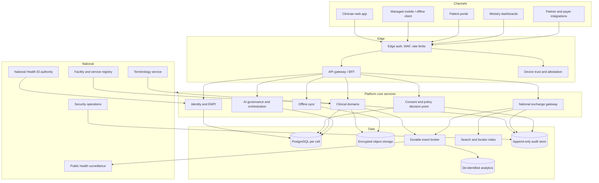
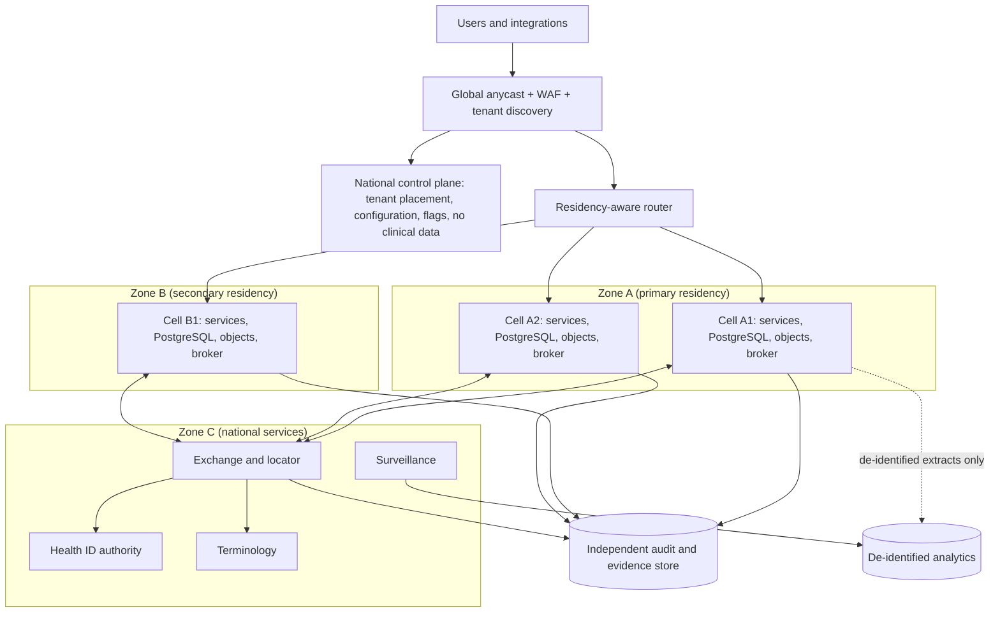
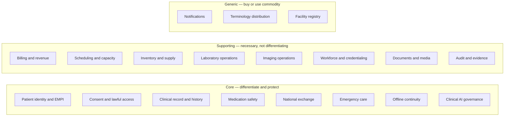
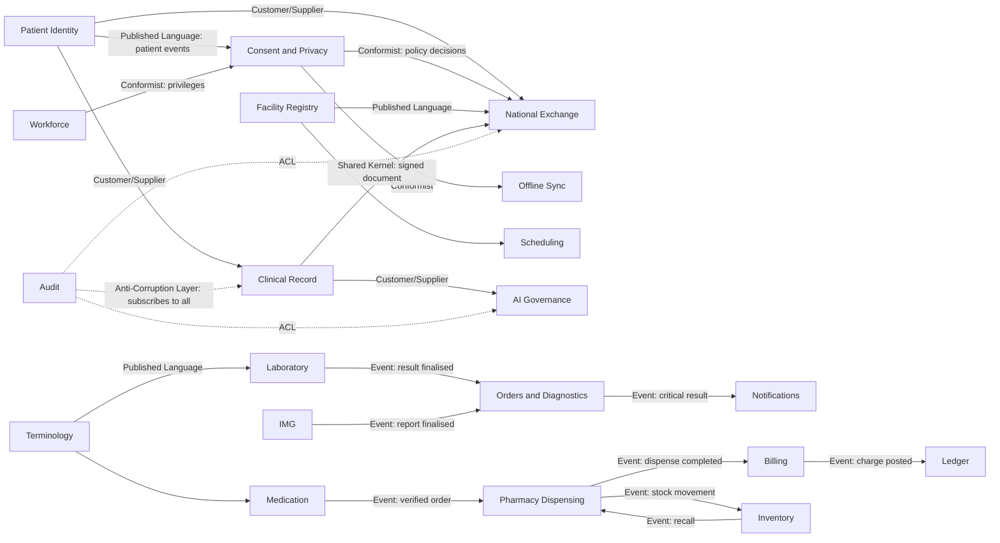
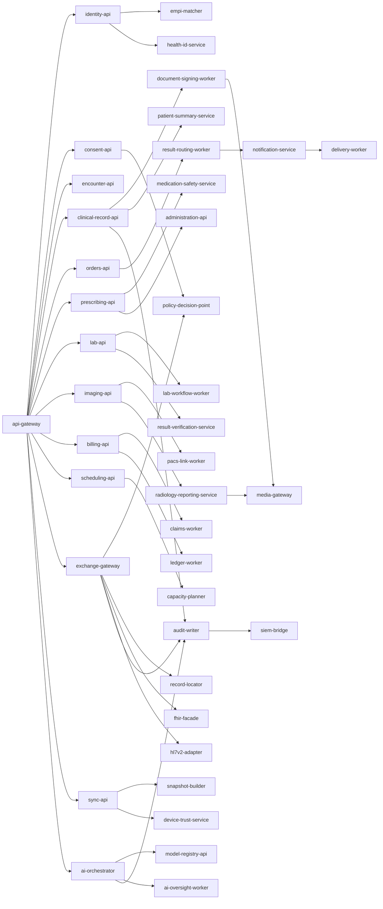
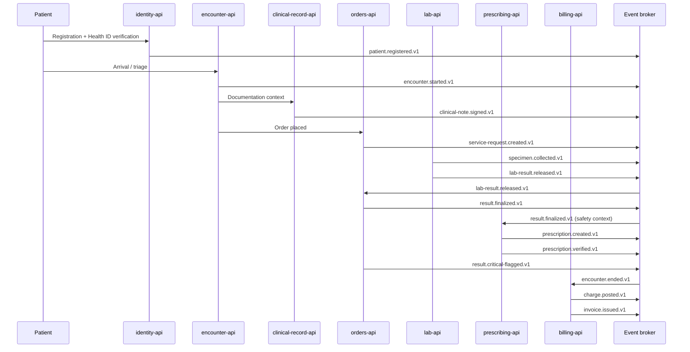
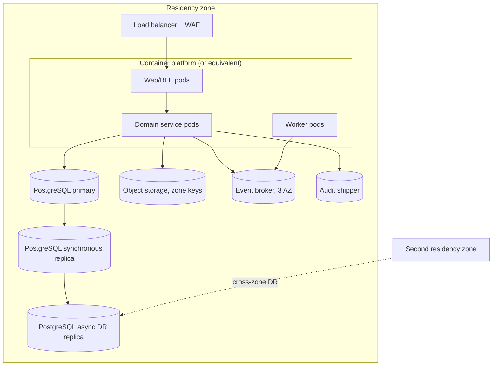
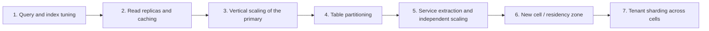
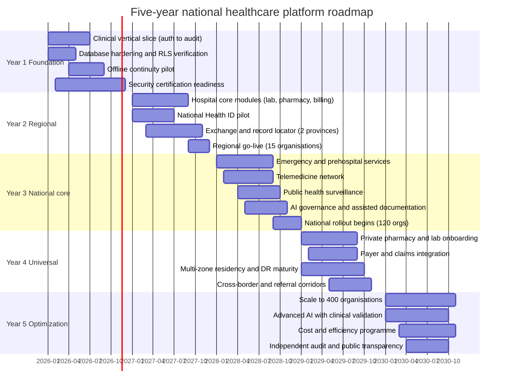

# AYBAK National Healthcare Platform — Target Enterprise Architecture

**Role basis:** National Healthcare Platform Architect  
**Scope:** hospitals, clinics, pharmacies, laboratories, radiology centres, emergency services, telemedicine, Ministry of Health  
**Status:** Target architecture — design only. The repository remains **NO-GO for real patient data or clinical use**.  
**Companion documents:** `docs/ENTERPRISE_AUDIT.md`, `docs/ENTERPRISE_TRANSFORMATION_PLAN.md`, `docs/IMPLEMENTATION_BLUEPRINT.md`, `docs/DATABASE_ERD.md`

> Every table, service, and event listing in this document is generated from `architecture/catalog/*.json`, which is validated by `architecture/tools/validate_architecture.py`: 24 bounded contexts, 63 services, 102 domain events, and 103 database tables, each owned by exactly one context.

---

## 1. Executive Direction

### 1.1 What is being asked for, and what it costs

The request is a national healthcare platform serving hospitals, clinics, pharmacies, laboratories, radiology centres, emergency services, telemedicine, and the Ministry of Health. That is not a bigger version of a hospital system. It is a **federated clinical record network with a national identity layer**, and its hardest problems are not feature problems. They are identity, consent, sovereignty, connectivity, and the consequences of being wrong.

This document is a target architecture. It is paired with an honest statement of current maturity, because the two must never be confused:

| Position | Status today | Evidence |
|---|---|---|
| Production readiness of this repository | **NO-GO — 6/100** | `docs/ENTERPRISE_AUDIT.md`, 37 findings |
| Executable database foundation | **Built and verified** | 103 tables, 272 FKs, 387 indexes, 43 integrity tests passing on PostgreSQL 17.11 |
| Application/services | **Not built** | `src/App.jsx` is a 546-line prototype with embedded fixtures |
| National platform | **Design only** | This document |

Nothing in this document authorises real patient data, clinical use, or production deployment. A target architecture is a promise about direction, not evidence of capability.

### 1.2 Design commitments

1. **Clinical safety outranks availability, which outranks convenience.** Where a feature could silently produce a wrong clinical fact, the platform fails closed and asks a human.
2. **The record follows the patient; the data stays in the jurisdiction.** Sovereignty is achieved by federation, not by centralising a copy of every citizen's record in one database.
3. **Offline is a first-class continuity mode, never a second uncontrolled database.** Downtime workflows are designed, bounded, and reconciled — not discovered during an outage.
4. **Every access is attributable and lawful.** Purpose, legal basis, consent, actor, and outcome are recorded at the boundary, and denials are evidence too.
5. **AI assists, humans decide.** No model output becomes a clinical fact without a named clinician accepting it, and no unapproved model runs at all.
6. **Microservices are a destination justified by evidence.** The modular monolith ships first; boundaries are extracted when a measured constraint demands it.
7. **Boring, proven technology in the critical path.** Innovation budget goes to clinical workflow and interoperability, not to novel storage engines.

### 1.3 Scale envelope used for design

These are planning assumptions, not commitments. They are stated so that capacity, cost, and phasing can be argued with.

| Dimension | Year 1 | Year 3 | Year 5 |
|---|---|---|---|
| Organisations (tenants) | 15 | 120 | 400 |
| Facilities | 60 | 700 | 2,500 |
| Registered patients | 2 M | 12 M | 30 M |
| Clinicians with accounts | 4,000 | 40,000 | 120,000 |
| Clinical documents/year | 6 M | 90 M | 300 M |
| Observations/year | 150 M | 2 B | 8 B |
| Events/day (peak) | 2 M | 40 M | 150 M |
| Offline devices | 1,000 | 25,000 | 90,000 |
| Residency zones | 1 | 3 | 5 |

### 1.4 The five decisions that matter most

| # | Decision | Why it dominates | Reversal cost |
|---|---|---|---|
| D1 | Federated exchange + record locator, **not** a central clinical data warehouse | Sovereignty, blast radius, legal defensibility | Very high |
| D2 | National Health ID as a **linkage key, never an authentication secret** | Prevents a single credential from becoming the master key to the nation's health data | High |
| D3 | Consent and policy evaluated at a **central policy decision point**, enforced at every boundary | One place to change law; no per-service drift | High |
| D4 | **Modular monolith first**, extract services on measured pressure | Avoids distributed-systems tax before product-market fit | Low if deferred, very high if premature |
| D5 | Offline with **explicit conflict resolution**, no last-write-wins on clinical facts | The alternative silently corrupts the record | Very high |

---

## 2. Target Enterprise Architecture

### 2.1 Layered view

### 2.2 Cell-based topology with residency zones

The unit of deployment is a **cell**: a regionally placed, independently operable slice containing application services, its own PostgreSQL cluster, object storage, broker, and audit shipper. A cell serves a set of tenants. Tenants are placed in a cell for residency, latency, blast-radius, or contractual reasons.

**Rules that make cells safe**

- No tenant is served by two cells at the same time for writes. Failover is an explicit, exercised operation, not an accident.
- The control plane can never read clinical data. If it is compromised, patient records are not exposed — only routing metadata.
- The exchange and locator live in the national zone but hold **identifiers and availability metadata**, not clinical content.
- Every cell ships audit to an independent store with a write-once retention policy, so an attacker who owns a cell cannot erase their traces.

### 2.3 Runtime layering inside a cell

| Layer | Responsibility | Explicitly not responsible for |
|---|---|---|
| Edge | TLS, WAF, bot mitigation, coarse rate limits, tenant discovery | Authorization decisions |
| BFF / gateway | Session, token exchange, request shaping, aggregation for the UI | Business rules |
| Domain services | Business invariants, transactions, audit emission | Cross-domain bypass |
| Data | Persistence, RLS, constraints, immutability triggers | Authorization policy |
| Event backbone | Durable publication, ordering per key, replay | Business interpretation |
| Integration | Protocol translation, quarantine, mapping | Writing straight into clinical tables |

### 2.4 Non-negotiable platform invariants

1. **Tenant identity is server-derived.** A client-supplied tenant header is a hint for routing, never an authorization input.
2. **Every tenant-owned row carries `tenant_id`, and every relationship is a composite `(tenant_id, id)` foreign key.** Cross-tenant references are impossible in the schema; national linkage happens through link tables with external references.
3. **Row-level security is forced**, and the application role is not the table owner. RLS is defense in depth, not the primary authorization mechanism.
4. **Audit is append-only and independent.** Generic audit records field *names*, never full PHI payloads.
5. **Money is integer minor units; clinical quantities are `numeric` with explicit UCUM units; no stored age.**
6. **Clinical records are versioned, not overwritten.** Signed documents and released results are immutable; corrections supersede.
7. **The event log is the integration truth.** State changes publish events in the same transaction as the state change (transactional outbox), so an event is never lost and never invented.

### 2.5 Architecture decision records (summary)

| ADR | Decision | Consequence |
|---|---|---|
| ADR-001 | PostgreSQL as the system of record | Mature RLS, constraints, exclusion constraints; operational familiarity; not the bottleneck at national scale if partitioned and cached |
| ADR-002 | Modular monolith first, extract on measured pressure | Faster safe delivery; avoids premature distribution; requires disciplined module boundaries from day one |
| ADR-003 | Transactional outbox + durable broker (Kafka-class) | No dual-write problem; at-least-once with idempotent consumers |
| ADR-004 | FHIR R4 as the external interoperability surface; internal model stays relational | Standards compliance at the edge without contorting the domain model |
| ADR-005 | Federated record locator, no central record copy | Sovereignty and reduced blast radius; cost is latency and cross-org availability |
| ADR-006 | National Health ID stored as salted hash + display suffix | Linkage without creating a national master key; requires a verification service for lookups |
| ADR-007 | Policy decision point as a shared service | Consistent consent semantics; becomes a P0 dependency with a strict latency and availability budget |
| ADR-008 | Offline clients are managed native apps with encrypted local stores | Realistic rural continuity; higher operational burden than a browser PWA |
| ADR-009 | AI runs only through a governance gateway with registered, approved model versions | Prevents shadow AI; adds friction that is intentional |
| ADR-010 | Kubernetes optional per cell, mandatory nowhere | Avoids operational complexity as a status symbol; managed container platforms acceptable |

---

## 3. Domain-Driven Design

### 3.1 Domain classification

Domains are classified by strategic value, not by team convenience. Core domains get the strongest engineers, the strictest review, and the most test coverage.

### 3.2 Ubiquitous language (selected, binding)

Ambiguity in these terms causes real harm, so they are defined once and used everywhere.

| Term | Means precisely | Does not mean |
|---|---|---|
| Patient | The person as a subject of care, with one authoritative identity per tenant | A user account, a device, or a visit |
| National Health ID | A national linkage identifier, verified by a national authority | A password, a login, or a bearer credential |
| Encounter | A bounded episode of care between a patient and a facility | A single appointment or a single note |
| Clinical document | A versioned, signable statement of clinical record | An uploaded file attachment |
| Result | A verified diagnostic finding with provenance and status | A raw device reading |
| Medication order | A clinician's structured intent to medicate | A dispensed package or an administered dose |
| Dispense | A pharmacy event reducing stock against a verified order | A prescription |
| Administration | A bedside event recording what the patient actually received | A dispense |
| Consent directive | A patient's or law's instruction about permitted use | A UI checkbox |
| Break-glass | A time-boxed, reviewed override of normal access control | A superuser login |
| Offline snapshot | A scoped, expiring, encrypted copy for continuity | A replica of the facility database |
| Record locator | Metadata answering *where* records exist | A copy of the records |
| Event | An immutable statement that something happened, in past tense | A command or a request |
| Tenant | An independently governed organisation boundary | A facility or a department |

### 3.3 Aggregate boundaries and invariants

Aggregates are the consistency boundaries. The table below is the authoritative list; if a rule is not enforced inside one of these boundaries, it needs a saga.

| Context | Aggregates | Invariants enforced inside the boundary |
|---|---|---|
| Patient Identity & National Health ID | **Patient**, **PatientIdentifier**, **HealthIdCredential**, **IdentityMatchCandidate** | • A National Health ID is never reused, never recycled, and never encodes PHI. • Two patient records may only be merged through a reviewed, reversible link with full lineage. • An identifier value is unique per (tenant, issuer, type) and case-normalised on write. • Merge never deletes the source record; it becomes a redirect target. |
| Consent, Privacy & Lawful Access | **ConsentDirective**, **PrivacyRestriction**, **BreakGlassSession**, **PurposeOfUse** | • Deny by default; absence of consent is not consent. • Break-glass is time-boxed, reason-coded, notified, and independently reviewed. • A consent withdrawal is effective for new access immediately and never rewrites prior history. • Policy decisions are versioned; every decision cites the policy version used. |
| Encounters, Admission & Care Teams | **Encounter**, **CareTeamMembership**, **LocationAssignment** | • An encounter always references a patient and a facility in the same tenant. • Status transitions follow the clinical state machine; completed requires an end time. • Care team changes are append-only history, never destructive edits. • A discharge summary cannot be signed while unresolved critical results are open without an explicit acknowledgement. |
| Clinical Record, Notes & Medical History | **ClinicalDocument**, **DocumentVersion**, **Signature**, **Problem**, **AllergyIntolerance**, **Observation**, **Immunization** | • A signed document version is immutable; amendments create a new version with a reason. • Every clinical statement carries author, effective time, and provenance. • Allergy and problem entries are never hard-deleted; entered-in-error is an explicit status. • Clinical values are unit-bearing; a numeric value without a UCUM unit is rejected. |
| Orders & Diagnostic Orchestration | **ServiceRequest**, **DiagnosticResult**, **ResultValue**, **ProvenanceRecord** | • A result is only final after contributor and verifier identity are recorded. • A corrected result supersedes but never overwrites a finalised result. • Order state changes are idempotent and auditable by request id. • A critical result must have a documented notification before the order is closed. |
| Medication Management & Safety | **MedicationRequest**, **SafetyReview**, **MedicationOverride**, **Administration**, **Reconciliation** | • No order reaches dispensing without a recorded safety review outcome. • A hard-stop may only be overridden by an authorised clinician with a reason and, where policy requires, a second reviewer. • Dose is structured (value + UCUM unit + route + frequency); free text alone is invalid. • Administration always references an order and, where required, a dispensed lot. |
| Emergency & Prehospital Care | **AmbulanceMission**, **PrehospitalContact**, **TriageAssessment**, **MassCasualtyIncident** | • Emergency documentation must be completable with no connectivity and reconciled later. • Triage category changes are timestamped and attributed, never silently overwritten. • An unidentified patient may be treated under a temporary identity that is later linked, never duplicated. • Dispatch state is monotonic and idempotent; duplicate dispatch requests are rejected. |
| Telemedicine & Remote Consultation | **TelehealthSession**, **RemoteConsultation**, **Referral** | • A remote consultation is an encounter with an explicit channel and consent to remote care. • Recordings and transcripts are opt-in, consented, encrypted, and retention-bound. • A referral has an explicit receiving organisation and cannot auto-close without their action. • Prescribing remotely requires the same verification gates as in person. |
| Laboratory Operations | **LabOrder**, **Specimen**, **SpecimenEvent**, **LabResult**, **ReferenceRange**, **DeltaCheck** | • A specimen is unique and traceable for its entire custody chain. • A rejected specimen cannot produce a released result. • A released result requires technical and clinical verification per test policy. • Reference ranges are versioned and resolved at result time, not display time. |
| Radiology & Medical Imaging | **ImagingOrder**, **ProtocolReview**, **StudyReference**, **RadiologyReport**, **ReportVersion** | • Pixel data stays in PACS/VNA; the platform stores references, hashes, and reports. • A study reference is unique by Study Instance UID. • A final report is signed and immutable; amendments create a new version. • Laterality and protocol screening are mandatory before acquisition. |
| Pharmacy Dispensing | **Dispense**, **DispenseReturn**, **RecallResponse** | • No dispense without a verified order and an available, in-date, non-quarantined lot. • Every dispense decrements inventory through an append-only ledger entry. • A recall can reach every affected patient and lot within the defined response window. • A dispense reversal is a new record, never an edit. |
| Inventory & Supply Chain | **StockItem**, **StockLocation**, **StockLot**, **StockMovement**, **Recall** | • Stock balances are derived from the ledger; there is no mutable balance column. • A movement is signed, attributed, and never updated or deleted. • Expired, quarantined, or recalled stock cannot be issued. • Inter-facility transfers balance to zero across the pair. |
| Billing, Claims & Revenue | **ChargeItem**, **Invoice**, **Payment**, **Allocation**, **Claim**, **Adjustment**, **LedgerEntry** | • Money is integer minor units; currency is explicit and never implicit. • An invoice balance equals total minus allocations, enforced in the database. • Over-allocation beyond a payment is impossible. • The ledger is append-only and balanced; corrections are reversals. |
| Scheduling & Capacity | **ScheduleResource**, **Unavailability**, **Appointment**, **CapacitySnapshot** | • Two booked appointments for one resource may never overlap. • Bookings are idempotent by request key and version-checked on update. • Time is stored as an instant plus the source timezone. • A cancelled slot is immediately rebookable. |
| Workforce, Credentialing & Privileges | **StaffPrincipal**, **Practitioner**, **RoleAssignment**, **Credential**, **Privilege** | • A user cannot hold a clinical privilege without a verified, in-date credential. • Role assignment is scoped by tenant/facility/department and time-bound. • Credential expiry automatically blocks privileged actions at the next access check. • Termination revokes sessions and sync devices immediately. |
| Organisation & Facility Registry | **Organization**, **Facility**, **Department**, **ServiceCapability** | • Facility codes are unique per tenant and globally resolvable. • A facility cannot be deactivated while active episodes of care exist without an explicit migration plan. • Service capability changes are versioned and visible to referral and emergency routing. |
| Terminology & Value Sets | **CodeSystem**, **ValueSet**, **ConceptMap**, **MappingVersion** | • No clinical record may cite a code system version that is not registered. • Mapping changes never rewrite stored codes; they apply prospectively and are versioned. • A retired concept remains resolvable for historical records. |
| Health Information Exchange | **ExchangeRequest**, **RecordLocation**, **SharingAgreement**, **InboundMessage** | • No cross-organisation data leaves without a policy decision and an audit record. • Every exchange is attributable to a requesting organisation, user, purpose, and legal basis. • Inbound messages are quarantined until validated and mapped; nothing is written straight into clinical tables. • Document sharing preserves the source's signature and provenance. |
| Offline Synchronisation & Field Continuity | **SyncDevice**, **ChangeLog**, **Snapshot**, **Conflict** | • A device holds only the scope it is entitled to, with an expiry and a visible freshness marker. • No last-write-wins for clinical facts; conflicts require human resolution. • Every mutation carries a device, user, base version, and idempotency key. • Revocation triggers local wipe on next contact and blocks sync immediately. |
| Public Health Surveillance & Reporting | **NotifiableDiseaseReport**, **SurveillanceSignal**, **IndicatorSnapshot**, **Outbreak** | • Surveillance receives the minimum dataset; identifiers are replaced by linkage tokens. • Small-cell suppression applies to every published aggregate. • A signal never identifies an individual and never auto-triggers enforcement action. • Reporting definitions are versioned and reproducible. |
| Clinical AI Governance & Assistance | **ModelRegistration**, **InferenceRecord**, **OutputReview**, **SafetyIncident** | • No inference runs on an unapproved model version. • AI output is a draft until a named clinician accepts, edits, or rejects it. • Every inference records inputs by reference, prompt version, and model version. • Any AI safety incident is recorded and can trigger immediate model suspension. |
| Audit, Security & Access Evidence | **AuditEvent**, **AccessExport**, **SecuritySignal**, **ReviewCase** | • Audit is append-only, tenant-scoped, and independent of the application database. • Audit stores field names and metadata, never full PHI payloads. • Audit survives loss of a clinical cell and is retained per legal schedule. • Every privileged action is attributable to a human or a named service identity. |
| Notifications & Clinical Communication | **Notification**, **DeliveryAttempt**, **Subscription** | • A critical result notification is retried until acknowledged or escalated to a human. • Delivery is never claimed as success without evidence. • Patient-facing messages contain the minimum necessary information. |
| Documents & Medical Media | **StoredObject**, **ObjectVersion**, **RetentionPolicy** | • Objects are encrypted at rest with tenant-scoped keys and accessed only via short-lived authorised URLs. • Every object is hash-recorded, malware-scanned, and immutable once attached to a signed record. • Deletion is policy-driven and auditable; legal holds override deletion. |

### 3.4 Context map

### 3.5 Context relationships, stated as rules

| Relationship | Pattern | Rule |
|---|---|---|
| Identity → everyone | Published Language | Consumers may store a patient reference; they may never store a second copy of demographics as truth |
| Consent → Exchange/Sync | Conformist | If the PDP says no, the boundary says no; no local override except recorded break-glass |
| Clinical Record → AI | Customer/Supplier | AI adapts to clinical models, never the reverse |
| Laboratory/Imaging → Orders | Event-driven | Result ownership stays with the performing domain; the ordering domain owns the order lifecycle |
| Exchange → Clinical Record | Anti-Corruption Layer | External FHIR/C-CDA content is translated and validated, never persisted raw as clinical truth |
| Audit → all | ACL consumer | Audit subscribes to events; no domain writes directly into another's audit records |
| Inventory ↔ Pharmacy | Shared Kernel: stock ledger | One ledger, one truth; both sides append, neither mutates balances |

### 3.6 Anti-corruption layers

Every boundary that accepts foreign data needs an explicit ACL: HL7 v2 feeds, FHIR bundles from other vendors, DICOM metadata, laboratory analysers, payer claim responses, and national ID registries. An ACL must:

1. Quarantine the raw payload before parsing (stored with hash, never overwritten).
2. Validate structure, codes, units, and patient binding.
3. Map through a versioned mapping, recording the mapping version used.
4. Refuse to publish a clinical fact when validation fails — produce a review task instead.
5. Never write directly into a clinical table from the adapter process.

---

## 4. Bounded Contexts

### 4.1 Context catalogue

Each context is a candidate service boundary with its own model, its own data ownership, and an explicit integration contract. "Owns" means the context is the only writer of those tables. "Reads" means it consumes others' data through APIs or events, never through cross-context SQL joins in production.

| # | Context | Type | Owner team | Owns (tables) | Reads | Consistency |
|---|---|---|---|---|---|---|
| 1 | **Patient Identity & National Health ID** (`patient-identity`) | Core | Identity & Exchange | 9 | 0 | Strong inside a patient aggregate; eventual for cross-facility identity propagation. |
| 2 | **Consent, Privacy & Lawful Access** (`consent-privacy`) | Core | Privacy & Compliance | 3 | 0 | Strong on directives, read-optimised with a short-lived versioned cache. |
| 3 | **Encounters, Admission & Care Teams** (`encounters`) | Core | Clinical Core | 3 | 0 | Strong inside the encounter aggregate; eventual for downstream reporting. |
| 4 | **Clinical Record, Notes & Medical History** (`clinical-record`) | Core | Clinical Core | 10 | 0 | Strong per document version; eventual for derived summaries and search. |
| 5 | **Orders & Diagnostic Orchestration** (`orders-diagnostics`) | Core | Clinical Core | 4 | 0 | Strong per order; eventual for cross-facility visibility. |
| 6 | **Medication Management & Safety** (`medication`) | Core | Pharmacy & Safety | 5 | 0 | Strong per order and administration; eventual for formulary updates. |
| 7 | **Emergency & Prehospital Care** (`emergency`) | Core | Emergency Systems | 0 | 4 | Strong locally, convergent after reconnection; conflict resolution by clinical review. |
| 8 | **Telemedicine & Remote Consultation** (`telehealth`) | Core | Digital Care | 2 | 2 | Strong session state; eventual media artefacts. |
| 9 | **Laboratory Operations** (`laboratory`) | Core | Diagnostics | 7 | 0 | Strong within the laboratory; eventual to the ordering facility. |
| 10 | **Radiology & Medical Imaging** (`imaging`) | Core | Diagnostics | 7 | 0 | Strong for reports; eventual for study availability events. |
| 11 | **Pharmacy Dispensing** (`pharmacy-dispensing`) | Core | Pharmacy & Safety | 1 | 0 | Strong within a pharmacy; eventual for national stock views. |
| 12 | **Inventory & Supply Chain** (`inventory-supply`) | Supporting | Supply Chain | 5 | 0 | Strong per location; eventual for national aggregate stock. |
| 13 | **Billing, Claims & Revenue** (`billing-revenue`) | Supporting | Revenue Cycle | 16 | 0 | Strong per invoice and payment; eventual across facilities. |
| 14 | **Scheduling & Capacity** (`scheduling-capacity`) | Supporting | Operations | 4 | 0 | Strong per resource; eventual for cross-facility capacity views. |
| 15 | **Workforce, Credentialing & Privileges** (`workforce`) | Supporting | People Operations | 7 | 0 | Strong; authoritative for authorisation inputs. |
| 16 | **Organisation & Facility Registry** (`facility-registry`) | Generic | National Platform | 3 | 0 | Strong; replicated read-only to every cell. |
| 17 | **Terminology & Value Sets** (`terminology`) | Generic | Interoperability | 1 | 0 | Eventual; versioned releases. |
| 18 | **Health Information Exchange** (`interoperability-exchange`) | Core | Identity & Exchange | 6 | 0 | Strong for authorisation; eventual for propagation. |
| 19 | **Offline Synchronisation & Field Continuity** (`offline-sync`) | Core | Edge & Devices | 2 | 0 | Convergent with explicit conflict handling; never silent merges of clinical data. |
| 20 | **Public Health Surveillance & Reporting** (`public-health`) | Core | Public Health | 0 | 4 | Eventual; batch and streaming indicators. |
| 21 | **Clinical AI Governance & Assistance** (`ai-governance`) | Core | Clinical Informatics & AI Safety | 4 | 0 | Strong for approvals; eventual for evaluation telemetry. |
| 22 | **Audit, Security & Access Evidence** (`audit-security`) | Supporting | Security | 2 | 0 | Append-only, eventually consistent replication to an independent store. |
| 23 | **Notifications & Clinical Communication** (`notifications`) | Generic | Platform | 2 | 0 | At-least-once with acknowledgement. |
| 24 | **Documents & Medical Media** (`documents-media`) | Supporting | Platform | 0 | 3 | Strong per object; eventual for derived indexes. |

### 4.2 Ownership detail

Ownership is the difference between a modular monolith and a distributed ball of mud. The table below is the single source of truth for "who may write this table".

| Context | Tables it exclusively owns |
|---|---|
| **Patient Identity & National Health ID** | `patient`, `patient_identifier`, `person_name`, `patient_contact_point`, `patient_address`, `patient_link`, `identity_match_review`, `patient_link_organisation`, `national_health_id` |
| **Consent, Privacy & Lawful Access** | `consent_directive`, `break_glass_session`, `care_relationship` |
| **Encounters, Admission & Care Teams** | `encounter`, `care_team_member`, `location_assignment` |
| **Clinical Record, Notes & Medical History** | `clinical_document`, `document_version`, `signature`, `problem`, `allergy_intolerance`, `observation`, `immunization`, `procedure_record`, `family_history`, `social_history` |
| **Orders & Diagnostic Orchestration** | `service_request`, `diagnostic_result`, `result_value`, `clinical_provenance` |
| **Medication Management & Safety** | `medication_request`, `medication_safety_review`, `medication_override`, `medication_administration`, `medication_reconciliation` |
| **Emergency & Prehospital Care** | — (no tables; stateless or read-only) |
| **Telemedicine & Remote Consultation** | `telehealth_session`, `referral` |
| **Laboratory Operations** | `lab_test_definition`, `lab_order`, `specimen`, `specimen_event`, `reference_range`, `lab_result`, `delta_check` |
| **Radiology & Medical Imaging** | `imaging_order`, `imaging_protocol`, `imaging_study_ref`, `radiology_report`, `radiology_report_version`, `critical_result_notification`, `external_result_import` |
| **Pharmacy Dispensing** | `dispense` |
| **Inventory & Supply Chain** | `stock_item`, `stock_location`, `stock_lot`, `stock_movement`, `stock_recall` |
| **Billing, Claims & Revenue** | `currency`, `payer`, `coverage_plan`, `patient_coverage`, `payer_authorization`, `charge_master`, `charge_item`, `invoice`, `invoice_line`, `payment`, `payment_allocation`, `refund`, `billing_adjustment`, `claim`, `claim_line`, `financial_ledger_entry` |
| **Scheduling & Capacity** | `schedule_resource`, `resource_unavailability`, `appointment`, `appointment_transition` |
| **Workforce, Credentialing & Privileges** | `staff_principal`, `practitioner`, `role_template`, `user_role_assignment`, `worker_assignment`, `professional_credential`, `training_privilege` |
| **Organisation & Facility Registry** | `organization`, `facility`, `department` |
| **Terminology & Value Sets** | `formulary_item` |
| **Health Information Exchange** | `integration_endpoint`, `inbound_message`, `sharing_agreement`, `record_share_request`, `record_share_result`, `record_locator_entry` |
| **Offline Synchronisation & Field Continuity** | `sync_device`, `sync_change_log` |
| **Public Health Surveillance & Reporting** | — (no tables; stateless or read-only) |
| **Clinical AI Governance & Assistance** | `ai_model_registration`, `ai_inference_record`, `ai_output_review`, `ai_model_feedback` |
| **Audit, Security & Access Evidence** | `audit_event`, `access_export` |
| **Notifications & Clinical Communication** | `outbox_event`, `delivery_attempt` |
| **Documents & Medical Media** | — (no tables; stateless or read-only) |

### 4.3 Contexts that guard safety-critical decisions

| Context | Failure mode if it silently fails | Required behaviour |
|---|---|---|
| Consent & policy | Unlawful disclosure of patient data | Fail closed; deny and audit; queue for review |
| Medication safety | Unsafe order dispensed or administered | Fail closed on knowledge-base unavailability; no silent "assume safe" |
| Laboratory verification | Unverified result treated as final | Hold result; escalate; never auto-release |
| Radiology reporting | Unsigned report used in care | Mark preliminary and require acknowledgement |
| AI governance | Unreviewed model output enters the record | Block inference; log the attempt |
| Offline sync | Stale or conflicting data overwrites truth | Reject, surface conflict, require human resolution |
| Audit | Evidence gap after an incident | Block the privileged action rather than proceed unaudited |

---

## 5. Service Map

### 5.1 Service inventory

63 services across 24 contexts. Tiering drives runbooks, SLOs, and on-call: a T0 service is never allowed to depend synchronously on a T2 service.

| Tier | Count | Meaning |
|---|---|---|
| T0 | 11 | P0 — safety-critical, never degraded |
| T1 | 36 | P1 — clinical/operational |
| T2 | 11 | P2 — supporting |
| T3 | 5 | P3 — analytical/administrative |

| Service | Context | Kind | Tier | Responsibility |
|---|---|---|---|---|
| `audit-writer` | audit-security | worker | T0 | Append-only audit ingestion and replication |
| `document-signing-worker` | clinical-record | worker | T0 | Signature creation and verification |
| `policy-decision-point` | consent-privacy | api | T0 | Low-latency authorisation decisions for every access |
| `dispatch-adapter` | emergency | api | T0 | Integration to ambulance dispatch systems |
| `emergency-api` | emergency | api | T0 | Triage, prehospital, mass casualty |
| `triage-service` | emergency | api | T0 | Triage category computation and audit |
| `result-verification-service` | laboratory | api | T0 | Two-step verification and release |
| `administration-api` | medication | api | T0 | Bedside administration and witness capture |
| `medication-safety-service` | medication | api | T0 | Allergy/interaction/dose safety checks |
| `api-gateway` | notifications | gateway | T0 | Edge authentication, routing, quotas |
| `result-routing-worker` | orders-diagnostics | worker | T0 | Critical result detection and escalation |
| `ai-orchestrator` | ai-governance | api | T1 | Governed inference requests and guardrails |
| `ai-oversight-worker` | ai-governance | worker | T1 | Review enforcement, drift and incident tracking |
| `model-registry-api` | ai-governance | api | T1 | Model registration, approval, evaluation evidence |
| `siem-bridge` | audit-security | worker | T1 | Security telemetry to national SOC |
| `clinical-record-api` | clinical-record | api | T1 | Notes, problems, allergies, observations |
| `patient-summary-service` | clinical-record | api | T1 | Assembles the International Patient Summary view |
| `consent-api` | consent-privacy | api | T1 | Consent directive lifecycle |
| `media-gateway` | documents-media | api | T1 | Object upload/download with short-lived URLs |
| `adt-event-processor` | encounters | worker | T1 | Admission/discharge/transfer stream processing |
| `encounter-api` | encounters | api | T1 | Encounter lifecycle and care team |
| `imaging-api` | imaging | api | T1 | Imaging orders and report metadata |
| `pacs-link-worker` | imaging | worker | T1 | DICOMweb/PACS reference synchronisation |
| `radiology-reporting-service` | imaging | api | T1 | Structured reporting and signatures |
| `exchange-gateway` | interoperability-exchange | gateway | T1 | Consent-aware cross-organisation exchange |
| `fhir-facade` | interoperability-exchange | api | T1 | FHIR R4 resource API and search |
| `hl7v2-adapter` | interoperability-exchange | worker | T1 | HL7 v2 ingestion and quarantine |
| `record-locator` | interoperability-exchange | api | T1 | Where records exist, not what they contain |
| `stock-ledger-worker` | inventory-supply | worker | T1 | Append-only movement validation and balance projection |
| `lab-api` | laboratory | api | T1 | Orders, specimens, results |
| `lab-workflow-worker` | laboratory | worker | T1 | Analyzer integration, delta checks, verification queue |
| `prescribing-api` | medication | api | T1 | Medication orders and discontinuation |
| `delivery-worker` | notifications | worker | T1 | SMS/push/email delivery with evidence |
| `device-trust-service` | offline-sync | api | T1 | Enrolment, attestation, revocation, wipe |
| `sync-api` | offline-sync | api | T1 | Delta sync, mutation apply, conflict report |
| `orders-api` | orders-diagnostics | api | T1 | Service requests and result lifecycle |
| `empi-matcher` | patient-identity | worker | T1 | Probabilistic demographic matching and review queue |
| `health-id-service` | patient-identity | api | T1 | National Health ID issuance, verification, revocation |
| `identity-api` | patient-identity | api | T1 | Patient CRUD, search, merge orchestration |
| `dispensing-api` | pharmacy-dispensing | api | T1 | Dispense, return, recall response |
| `pharmacy-inventory-worker` | pharmacy-dispensing | worker | T1 | Dispense-to-ledger reconciliation |
| `notifiable-disease-worker` | public-health | worker | T1 | Case detection and de-identification |
| `media-session-broker` | telehealth | api | T1 | WebRTC/SFU session brokering and recording control |
| `referral-service` | telehealth | api | T1 | Inter-facility referral workflow |
| `telehealth-api` | telehealth | api | T1 | Sessions, remote consults, referrals |
| `credential-verification-worker` | workforce | worker | T1 | Licence verification and expiry sweeps |
| `workforce-api` | workforce | api | T1 | Staff, roles, credentials, privileges |
| `access-review-service` | audit-security | worker | T2 | Periodic access reviews and anomaly cases |
| `billing-api` | billing-revenue | api | T2 | Charges, invoices, payments |
| `claims-worker` | billing-revenue | worker | T2 | Claim assembly, submission, adjudication |
| `ledger-worker` | billing-revenue | worker | T2 | Double-entry posting and reconciliation |
| `object-lifecycle-worker` | documents-media | worker | T2 | Retention, legal hold, malware scanning |
| `facility-registry-api` | facility-registry | api | T2 | Organisation/facility directory |
| `supply-chain-api` | inventory-supply | api | T2 | Items, lots, transfers, recalls |
| `notification-service` | notifications | api | T2 | Notification orchestration |
| `snapshot-builder` | offline-sync | worker | T2 | Scoped encrypted offline snapshots |
| `surveillance-api` | public-health | api | T2 | Notifiable disease and indicator queries |
| `scheduling-api` | scheduling-capacity | api | T2 | Appointments and resources |
| `service-catalog-api` | facility-registry | api | T3 | Service capability catalogue |
| `analytics-export-service` | public-health | worker | T3 | Approved aggregate publication |
| `capacity-planner` | scheduling-capacity | worker | T3 | Capacity forecasting and thresholds |
| `terminology-service` | terminology | api | T3 | Code systems, value sets, mappings |
| `terminology-sync-worker` | terminology | worker | T3 | Versioned terminology distribution |

### 5.2 Synchronous call rules

Synchronous calls are a coupling budget, and the budget is small.

| Allowed | Prohibited |
|---|---|
| Gateway → T0/T1 service (with timeout and circuit breaker) | T0 → T2/T3 synchronous dependency |
| Service → own database | Service → another service's database |
| Service → PDP for an access decision (strict budget) | Service → another service for a write it does not own |
| Gateway → read model for display | Chatty per-row cross-service calls |
| Any service → object storage via short-lived credential | Long-lived shared bucket credentials |

### 5.3 Service-to-service map

### 5.4 Degradation ladder

When a dependency fails, behaviour is designed in advance rather than improvised at 3 a.m.

| Failed dependency | Clinical behaviour | Technical behaviour |
|---|---|---|
| Policy decision point | Deny cross-organisation access; allow same-facility care with recorded local policy snapshot | Short local cache with version stamp; circuit breaker; alert |
| Medication knowledge base | Block new high-risk orders; allow continuation of existing orders with warning | Fail closed; queue for manual pharmacist review |
| Event broker | Continue local writes; buffer in outbox | Outbox drains on recovery; consumer lag alert |
| Laboratory interface | Manual result entry with double-check | Quarantine inbound messages; replay after recovery |
| Exchange gateway | Local care continues; cross-org requests queued | Locator returns cached availability with staleness marker |
| Object storage | Documents show unavailable, never silently empty | Retry with backoff; escalate |
| Audit store | **Block privileged actions** | This is a deliberate, uncomfortable choice: unaudited privileged access is worse than downtime |

---

## 6. Event Map

### 6.1 Event catalogue

102 versioned domain events, 88 of which carry patient identifiers and therefore inherit tenant partitioning, encryption, and strict access control.

| Event | Producer | Key consumers | Partition key | PHI | Retention (days) |
|---|---|---|---|---|---|
| `access.break-glass-opened.v1` | `consent-api` | audit-writer, access-review-service, siem-bridge | `tenant_id, session_id` | yes | 36500 |
| `access.export-completed.v1` | `audit-writer` | audit-security, access-review-service | `tenant_id, export_id` | yes | 36500 |
| `ai.inference-completed.v1` | `ai-orchestrator` | ai-oversight-worker, audit-writer | `tenant_id, inference_id` | yes | 3650 |
| `ai.model-approved.v1` | `model-registry-api` | ai-orchestrator, audit-writer | `model_key` | no | 36500 |
| `ai.output-reviewed.v1` | `ai-orchestrator` | clinical-record, audit-writer, ai-oversight-worker | `tenant_id, inference_id` | yes | 36500 |
| `ai.safety-incident.v1` | `ai-oversight-worker` | model-registry-api, audit-security, notification-service | `model_key` | yes | 36500 |
| `allergy.recorded.v1` | `clinical-record-api` | medication, patient-summary-service, ai-orchestrator | `tenant_id, patient_id` | yes | 36500 |
| `ambulance.dispatched.v1` | `dispatch-adapter` | emergency, encounters, audit-writer | `tenant_id, mission_id` | yes | 3650 |
| `appointment.arrived.v1` | `scheduling-api` | encounters, emergency | `tenant_id, appointment_id` | yes | 365 |
| `appointment.booked.v1` | `scheduling-api` | notification-service, telehealth, audit-writer | `tenant_id, appointment_id` | yes | 365 |
| `appointment.cancelled.v1` | `scheduling-api` | notification-service, capacity-planner | `tenant_id, appointment_id` | yes | 365 |
| `appointment.no-show.v1` | `scheduling-api` | capacity-planner, notification-service | `tenant_id, appointment_id` | yes | 365 |
| `appointment.rescheduled.v1` | `scheduling-api` | notification-service, audit-writer | `tenant_id, appointment_id` | yes | 365 |
| `audit.event-recorded.v1` | `audit-writer` | siem-bridge, access-review-service | `tenant_id, event_id` | yes | 36500 |
| `capacity.threshold-reached.v1` | `capacity-planner` | notification-service, emergency, public-health | `tenant_id, facility_id` | no | 365 |
| `care-team.updated.v1` | `encounter-api` | policy-decision-point, audit-writer | `tenant_id, encounter_id` | yes | 3650 |
| `charge.posted.v1` | `billing-api` | ledger-worker, claims-worker | `tenant_id, charge_id` | yes | 3650 |
| `claim.adjudicated.v1` | `claims-worker` | billing-api, ledger-worker | `tenant_id, claim_id` | yes | 3650 |
| `claim.submitted.v1` | `claims-worker` | ledger-worker, audit-writer | `tenant_id, claim_id` | yes | 3650 |
| `clinical-note.amended.v1` | `clinical-record-api` | audit-writer, exchange-gateway | `tenant_id, patient_id` | yes | 36500 |
| `clinical-note.signed.v1` | `document-signing-worker` | audit-writer, exchange-gateway, documents-media, ai-orchestrator | `tenant_id, patient_id` | yes | 36500 |
| `consent.granted.v1` | `consent-api` | policy-decision-point, exchange-gateway, audit-writer | `tenant_id, patient_id` | yes | 36500 |
| `consent.withdrawn.v1` | `consent-api` | policy-decision-point, exchange-gateway, offline-sync, identity-api, +1 | `tenant_id, patient_id` | yes | 36500 |
| `credential.expiring.v1` | `credential-verification-worker` | workforce-api, notification-service, policy-decision-point | `tenant_id, staff_id` | yes | 3650 |
| `critical-result.notified.v1` | `imaging-api` | audit-writer, notification-service | `tenant_id, patient_id` | yes | 36500 |
| `device.enrolled.v1` | `device-trust-service` | sync-api, audit-writer | `tenant_id, device_id` | yes | 3650 |
| `device.revoked.v1` | `device-trust-service` | sync-api, audit-writer, siem-bridge | `tenant_id, device_id` | yes | 3650 |
| `dispense.completed.v1` | `dispensing-api` | medication, billing-api, stock-ledger-worker, audit-writer | `tenant_id, dispense_id` | yes | 3650 |
| `dispense.recall-response.v1` | `dispensing-api` | audit-writer, public-health | `tenant_id, recall_id` | yes | 36500 |
| `dispense.reversed.v1` | `dispensing-api` | medication, billing-api, stock-ledger-worker | `tenant_id, dispense_id` | yes | 3650 |
| `document.received-external.v1` | `hl7v2-adapter` | clinical-record, audit-writer | `tenant_id, patient_id` | yes | 36500 |
| `document.scan-failed.v1` | `object-lifecycle-worker` | audit-writer, notification-service | `tenant_id, object_id` | yes | 3650 |
| `document.stored.v1` | `media-gateway` | documents-media, audit-writer | `tenant_id, object_id` | yes | 3650 |
| `encounter.discharged.v1` | `adt-event-processor` | clinical-record, billing-api, public-health, notification-service | `tenant_id, encounter_id` | yes | 3650 |
| `encounter.ended.v1` | `encounter-api` | billing-api, scheduling-capacity, public-health, clinical-record | `tenant_id, encounter_id` | yes | 3650 |
| `encounter.started.v1` | `encounter-api` | clinical-record, orders-api, billing-api, audit-writer | `tenant_id, encounter_id` | yes | 3650 |
| `encounter.transferred.v1` | `adt-event-processor` | clinical-record, billing-api, capacity-planner | `tenant_id, encounter_id` | yes | 3650 |
| `facility.registered.v1` | `facility-registry-api` | encounters, scheduling-capacity, inventory-supply, patient-identity, +2 | `facility_id` | no | 3650 |
| `facility.status-changed.v1` | `facility-registry-api` | emergency, record-locator, notification-service | `facility_id` | no | 3650 |
| `health-id.issued.v1` | `health-id-service` | record-locator, exchange-gateway, audit-writer | `national_health_id` | yes | 36500 |
| `health-id.revoked.v1` | `health-id-service` | record-locator, exchange-gateway, offline-sync, audit-writer | `national_health_id` | yes | 36500 |
| `identity.match-review-required.v1` | `empi-matcher` | identity-api, audit-writer | `tenant_id, candidate_id` | yes | 3650 |
| `imaging-order.scheduled.v1` | `imaging-api` | scheduling-capacity, orders-api | `tenant_id, order_id` | yes | 3650 |
| `imaging.study-available.v1` | `pacs-link-worker` | radiology-reporting-service, orders-api | `tenant_id, study_uid` | yes | 3650 |
| `immunization-coverage.updated.v1` | `analytics-export-service` | public-health, notification-service | `province_code` | no | 3650 |
| `immunization.recorded.v1` | `clinical-record-api` | patient-summary-service, public-health, exchange-gateway | `tenant_id, patient_id` | yes | 36500 |
| `invoice.issued.v1` | `billing-api` | notification-service, ledger-worker | `tenant_id, invoice_id` | yes | 3650 |
| `lab-order.accepted.v1` | `lab-api` | orders-api, scheduling-capacity | `tenant_id, order_id` | yes | 3650 |
| `lab-result.released.v1` | `result-verification-service` | orders-api, public-health | `tenant_id, patient_id` | yes | 36500 |
| `ledger.posted.v1` | `ledger-worker` | public-health, audit-writer | `tenant_id, entry_group_id` | no | 36500 |
| `mass-casualty.activated.v1` | `emergency-api` | capacity-planner, public-health, notification-service, audit-writer | `tenant_id, incident_id` | yes | 3650 |
| `medication.administered.v1` | `administration-api` | clinical-record, billing-api, audit-writer | `tenant_id, patient_id` | yes | 36500 |
| `medication.override-recorded.v1` | `prescribing-api` | audit-writer, access-review-service | `tenant_id, request_id` | yes | 36500 |
| `medication.safety-alert.v1` | `medication-safety-service` | prescribing-api, audit-writer, ai-oversight-worker | `tenant_id, request_id` | yes | 36500 |
| `notifiable-disease.reported.v1` | `notifiable-disease-worker` | surveillance-api, audit-writer | `province_code` | yes | 36500 |
| `notification.delivered.v1` | `delivery-worker` | audit-writer, notification-service | `tenant_id, notification_id` | yes | 365 |
| `notification.failed.v1` | `delivery-worker` | notification-service, audit-writer | `tenant_id, notification_id` | yes | 365 |
| `observation.recorded.v1` | `clinical-record-api` | patient-summary-service, public-health, audit-writer | `tenant_id, patient_id` | yes | 36500 |
| `outbreak.alert-issued.v1` | `surveillance-api` | notification-service, emergency | `province_code` | no | 3650 |
| `patient.demographics-updated.v1` | `identity-api` | patient-summary-service, record-locator, audit-writer | `tenant_id, patient_id` | yes | 3650 |
| `patient.merged.v1` | `identity-api` | encounters, clinical-record, laboratory, imaging, +3 | `tenant_id, patient_id` | yes | 36500 |
| `patient.registered.v1` | `identity-api` | encounters, laboratory, imaging, medication, +3 | `tenant_id, patient_id` | yes | 3650 |
| `payment.received.v1` | `billing-api` | ledger-worker, audit-writer | `tenant_id, payment_id` | yes | 3650 |
| `prehospital.contact-recorded.v1` | `emergency-api` | encounters, clinical-record | `tenant_id, contact_id` | yes | 3650 |
| `prescription.created.v1` | `prescribing-api` | pharmacy-dispensing, billing-api, audit-writer | `tenant_id, patient_id` | yes | 3650 |
| `prescription.discontinued.v1` | `prescribing-api` | pharmacy-dispensing, administration-api, audit-writer | `tenant_id, patient_id` | yes | 3650 |
| `prescription.verified.v1` | `prescribing-api` | pharmacy-dispensing, administration-api | `tenant_id, patient_id` | yes | 3650 |
| `privacy.restriction-added.v1` | `consent-api` | policy-decision-point, exchange-gateway, audit-writer | `tenant_id, patient_id` | yes | 36500 |
| `privilege.suspended.v1` | `workforce-api` | policy-decision-point, audit-writer, sync-api | `tenant_id, staff_id` | yes | 36500 |
| `problem.recorded.v1` | `clinical-record-api` | patient-summary-service, exchange-gateway, public-health | `tenant_id, patient_id` | yes | 36500 |
| `radiology-report.finalized.v1` | `radiology-reporting-service` | orders-api, clinical-record, exchange-gateway | `tenant_id, patient_id` | yes | 36500 |
| `record-locator.query-logged.v1` | `record-locator` | audit-writer, access-review-service | `tenant_id, patient_id` | yes | 36500 |
| `record.share-approved.v1` | `exchange-gateway` | audit-writer, encounters, documents-media | `tenant_id, request_id` | yes | 36500 |
| `record.share-denied.v1` | `exchange-gateway` | audit-writer, siem-bridge | `tenant_id, request_id` | yes | 36500 |
| `record.share-requested.v1` | `exchange-gateway` | policy-decision-point, audit-writer | `tenant_id, request_id` | yes | 36500 |
| `referral.accepted.v1` | `referral-service` | encounters, notification-service | `tenant_id, referral_id` | yes | 3650 |
| `referral.created.v1` | `referral-service` | notification-service, scheduling-capacity, audit-writer | `tenant_id, referral_id` | yes | 3650 |
| `refund.approved.v1` | `billing-api` | ledger-worker, audit-writer | `tenant_id, refund_id` | yes | 3650 |
| `result.corrected.v1` | `orders-api` | clinical-record, patient-summary-service, audit-writer | `tenant_id, patient_id` | yes | 36500 |
| `result.critical-flagged.v1` | `result-routing-worker` | notification-service, emergency, audit-writer | `tenant_id, patient_id` | yes | 36500 |
| `result.finalized.v1` | `orders-api` | clinical-record, patient-summary-service, billing-api, public-health, +1 | `tenant_id, patient_id` | yes | 36500 |
| `security.anomaly-detected.v1` | `siem-bridge` | audit-security, notification-service | `tenant_id, signal_id` | yes | 3650 |
| `service-catalogue.updated.v1` | `service-catalog-api` | referral-service, emergency, record-locator | `facility_id` | no | 3650 |
| `service-request.cancelled.v1` | `orders-api` | laboratory, imaging, billing-api | `tenant_id, request_id` | yes | 3650 |
| `service-request.created.v1` | `orders-api` | laboratory, imaging, billing-api, audit-writer | `tenant_id, request_id` | yes | 3650 |
| `specimen.collected.v1` | `lab-api` | orders-api, audit-writer | `tenant_id, specimen_id` | yes | 3650 |
| `specimen.received.v1` | `lab-api` | orders-api, lab-workflow-worker | `tenant_id, specimen_id` | yes | 3650 |
| `specimen.rejected.v1` | `lab-api` | orders-api, notification-service | `tenant_id, specimen_id` | yes | 3650 |
| `staff.terminated.v1` | `workforce-api` | policy-decision-point, sync-api, audit-writer | `tenant_id, staff_id` | yes | 36500 |
| `stock-movement.recorded.v1` | `stock-ledger-worker` | supply-chain-api, billing-api | `tenant_id, location_id` | no | 3650 |
| `stock.below-reorder.v1` | `stock-ledger-worker` | supply-chain-api, notification-service | `tenant_id, location_id` | no | 365 |
| `stock.expiry-warning.v1` | `stock-ledger-worker` | supply-chain-api, notification-service | `tenant_id, lot_id` | no | 365 |
| `stock.recall-issued.v1` | `supply-chain-api` | pharmacy-dispensing, notification-service, audit-writer | `tenant_id, recall_id` | yes | 36500 |
| `surveillance-signal.detected.v1` | `surveillance-api` | public-health, notification-service | `province_code` | no | 3650 |
| `sync.batch-applied.v1` | `sync-api` | audit-writer, clinical-record | `tenant_id, device_id` | yes | 3650 |
| `sync.conflict-detected.v1` | `sync-api` | notification-service, audit-writer, access-review-service | `tenant_id, device_id` | yes | 3650 |
| `sync.snapshot-issued.v1` | `snapshot-builder` | audit-writer, device-trust-service | `tenant_id, device_id` | yes | 3650 |
| `telehealth.session-ended.v1` | `telehealth-api` | clinical-record, billing-api | `tenant_id, session_id` | yes | 3650 |
| `telehealth.session-started.v1` | `telehealth-api` | encounters, audit-writer | `tenant_id, session_id` | yes | 3650 |
| `terminology-version.published.v1` | `terminology-sync-worker` | lab-api, prescribing-api, fhir-facade, ai-orchestrator | `code_system` | no | 36500 |
| `triage.assigned.v1` | `triage-service` | encounters, notification-service | `tenant_id, encounter_id` | yes | 3650 |
| `value-set.retired.v1` | `terminology-service` | lab-api, prescribing-api, fhir-facade | `code_system` | no | 36500 |

### 6.2 Event flow by clinical journey

### 6.3 Delivery semantics

| Property | Commitment |
|---|---|
| Publication | Transactional outbox in the same database transaction as the state change |
| Delivery | At least once; consumers must be idempotent by event ID |
| Ordering | Per partition key only (tenant, patient, encounter, or aggregate ID); no global ordering |
| Schema evolution | Additive fields within a major version; breaking changes publish a new `.vN` and both run during migration |
| Replay | Retained per the catalogue; replay is a supported operational procedure, not an emergency hack |
| Poison messages | Dead-letter queue with alerting; nothing is silently dropped |
| PHI in payloads | Identifiers and clinical deltas only where a consumer is entitled; otherwise reference + fetch |

### 6.4 Why the event map is not event sourcing

The platform uses events for **integration and audit**, not as the primary store of clinical state. Clinical state lives in relational tables with constraints, transactions, and RLS. Full event sourcing of clinical records would make consent-driven restriction, correction semantics, and regulatory reporting dramatically harder, and would couple every consumer to an internal history format. Selective history (document versions, stock ledger, financial ledger, audit) is append-only; the rest is mutable state with versioning.

---

## 7. Database Strategy

### 7.1 What already exists (verified, not aspirational)

`database/migrations/V001`–`V008` implement the clinical core. These numbers come from a live catalog, not from a design sketch:

| Property | Value |
|---|---|
| Tables | 103 |
| Foreign keys | 272 |
| Indexes | 387 |
| Row-level-security-enabled tables | all tenant-owned tables, forced |
| Integrity tests | 43, all passing on PostgreSQL 17.11 |
| Tenant-safe composite FKs | enforced; single-column cross-tenant FKs are rejected by test |

The full entity-relationship diagrams, table inventory, and index inventory are generated from the live catalog into **`docs/DATABASE_ERD.md`**.

### 7.2 Data ownership and the polyglot boundary

| Store | Owns | Must never own |
|---|---|---|
| PostgreSQL (per cell) | Clinical and transactional truth | Imaging pixels, large media blobs, analytics scans |
| Object storage | Documents, media, exports, snapshots | Authoritative clinical status |
| PACS/VNA | DICOM pixels and series | Reports, orders, or patient identity |
| Search index (locator/EMPI) | Candidate matches, record locations | Authoritative patient or clinical data |
| Analytics store | De-identified aggregates and indicators | Re-identifiable clinical records |
| Append-only audit store | Access and change evidence | Full PHI payloads |
| Broker | Event transport and replay buffer | The only copy of any fact |

### 7.3 Partitioning and growth

Partitioning is an operational response to measured size, not an opening architecture.

| Table family | Trigger to partition | Scheme |
|---|---|---|
| `audit_event` | > 50 M rows or 100 GB | Monthly range on `occurred_at`; BRIN retained |
| `observation`, `result_value` | > 200 M rows | Monthly range on effective time, subpartition by tenant for very large tenants |
| `outbox_event`, `inbound_message` | > 50 M rows | Daily/weekly range with aggressive retention |
| `stock_movement`, `financial_ledger_entry` | > 100 M rows | Quarterly range by posting date |
| `sync_change_log` | > 100 M rows | Daily range, short retention |

### 7.4 Multi-tenancy tiers

| Tier | Pattern | When | Trade-off |
|---|---|---|---|
| Shared cell, shared schema, RLS | Default for clinics, pharmacies, small hospitals | 80% of tenants | Cheapest; noisy-neighbour risk mitigated by quotas |
| Shared cell, dedicated schema | Mid-size hospitals wanting isolation within a cell | 15% | More migration overhead |
| Dedicated database cluster | Large hospitals, national programmes, strict contracts | 5% | Highest isolation and cost |

Schema-per-tenant for thousands of tenants is explicitly rejected: migration fan-out, connection management, and monitoring become unmanageable.

### 7.5 National identity and cross-organisation linkage

The national layer solves the problem relational databases cannot solve safely on their own: linking one person across organisations without merging their databases.

- `national_health_id` stores a salted hash plus a four-character display suffix. The identifier is never a login credential.
- `patient_link_organisation` is the only permitted cross-organisation patient reference, and it is a link table with an external reference — never a foreign key into another tenant.
- `record_locator_entry` answers *where* records exist without copying them.
- Merge never deletes: `patient_link` records lineage and can be reverted.

### 7.6 Data lifecycle and sovereignty

| Data class | Residency | Retention (baseline) | Deletion model |
|---|---|---|---|
| Clinical record | Tenant's residency zone | Per national health-records law (commonly 10–25 years after last contact) | Legal hold, then archival review; not user-deletable |
| Audit evidence | Independent national store | Longer than clinical data (often 6–10 years minimum) | Never deleted before schedule; WORM archive |
| Biometric/identity documents | Highest-residency zone | Minimum necessary | Aggressive deletion after verification |
| Offline snapshots | On device only | Maximum offline window (e.g. 72 hours) | Cryptographic erase on expiry or revocation |
| Analytics | National zone, de-identified | Rolling | Small-cell suppression before publication |
| Backups | Same zone as source | 35 days operational + monthly archives | Encrypted with zone-held keys |

### 7.7 Backup, restore, and disaster recovery targets

| Service class | RPO | RTO | Mechanism |
|---|---|---|---|
| Identity, consent, clinical core | ≤ 5 min | ≤ 1 h | Streaming replication + PITR + warm standby cell |
| Laboratory, imaging metadata | ≤ 15 min | ≤ 4 h | Streaming replication + PITR |
| Billing and ledger | ≤ 5 min | ≤ 2 h | Synchronous replica + append-only ledger replay |
| Audit store | 0 (no loss acceptable) | ≤ 1 h | Independent append-only store, cross-zone replication, WORM |
| Analytics | ≤ 24 h | ≤ 24 h | Rebuildable from event archive |
| Offline clients | Best effort | N/A | Encrypted local store; resync after recovery |

Restore is treated as a product feature: quarterly restore drills with measured timings, published results, and a rule that an untested backup is not a backup.

### 7.8 Migration and legacy onboarding

```mermaid
flowchart LR
    Profile[Profile source data] --> Map[Map to national model]
    Map --> Cleanse[Cleanse and validate]
    Cleanse --> Match[Identity match and review]
    Match --> Rehearse[Rehearse on masked copy]
    Rehearse --> Reconcile[Clinical and financial reconciliation]
    Reconcile --> Approve[Clinical owner approval]
    Approve --> Cutover[Cut over with rollback plan]
    Cutover --> Archive[Archive source per policy]
```

Every migration reports row counts, rejects, mapping versions, identifier links, and financial/stock control totals. Production PHI never populates developer or test environments.

---

## 8. Infrastructure Strategy

### 8.1 Environments

| Environment | Data | Purpose | Access |
|---|---|---|---|
| Local dev | Synthetic fixtures only | Fast iteration | Developer laptop |
| CI ephemeral | Synthetic + generated | Automated tests incl. RLS and constraint tests | Pipeline identity |
| Integration | Synthetic, reset nightly | Cross-service contracts | Team |
| Staging | Masked subset with written approval | Release candidate and performance | Restricted |
| Production | Real PHI | Care delivery | Break-glass, audited |
| DR | Replicated production | Recovery | Two-person rule |

### 8.2 Deployment topology per cell

### 8.3 Security architecture

| Control | Implementation |
|---|---|
| Authentication | OIDC with MFA; BFF pattern so tokens never live in the browser |
| Authorisation | ABAC/RBAC in the PDP; purpose-of-use and consent as first-class inputs |
| Tenant context | Server-derived, transaction-local database setting after authorization |
| Secrets | Managed KMS/secrets; no credentials in images or repos; short-lived DB credentials |
| Encryption | TLS 1.3 in transit; AES-256 at rest; zone-held keys; separate keys per data class |
| Field-level protection | Application-level envelope encryption for the most sensitive identifiers |
| Network | Default-deny, private service mesh, egress allowlists, WAF |
| Supply chain | Pinned dependencies, SBOM, signed images, provenance attestation |
| Vulnerability management | SAST/DAST/dependency/secret scanning in CI, with time-bound exceptions |
| Monitoring | OpenTelemetry traces, metrics, structured logs with PHI scrubbing at the SDK |
| Incident response | Severity model, 24/7 on-call for T0, forensic readiness with preserved audit |

### 8.4 Observability without leaking PHI

- Trace and log payloads contain IDs, not clinical content. A redaction layer runs before export.
- Clinical services emit **clinical safety metrics** alongside technical ones: unsafe-order blocks, failed-closed safety checks, unacknowledged critical results, sync conflicts.
- SLOs are defined per tier, and error budgets are real: repeated budget burn blocks feature work in favour of reliability.

### 8.5 Delivery pipeline

| Stage | Gate |
|---|---|
| Pre-commit | Formatting, type check, secret scan |
| PR | Unit tests, contract tests, schema migration dry run, RLS negative tests |
| Merge | Build, SBOM, image signing, ephemeral integration environment |
| Staging | Performance test, migration rehearsal on masked data, clinical smoke scripts |
| Production | Progressive rollout, feature flags, automated rollback, post-deploy verification |
| Database changes | Expand → migrate → contract, never a destructive single-step change |

### 8.6 Cost strategy

Cost is an architectural constraint. The dominant costs are clinical data storage, audit retention, imaging, managed databases, and security tooling — in that order. Controls: tiered object storage, audit partitioning with legal retention discipline, strict imaging lifecycle, per-tenant quotas, and a rule that no service may scale replicas without an SLO justification.

---

## 9. National Scaling Strategy

### 9.1 Scaling model

Growth is absorbed in this order, and only when the previous lever is exhausted:

Premature steps are expensive and add failure modes. A team that adds a cell before fixing an N+1 query has bought two problems.

### 9.2 Onboarding waves

| Wave | Tenants | Focus | Exit criteria |
|---|---|---|---|
| Pilot | 1 hospital + 2 clinics | Clinical core, offline, audit | 90 days without a safety incident; restore drill passed |
| Regional | 15 organisations across 2 provinces | Exchange, locator, pharmacy, laboratory | Cross-org sharing works with consent; latency within budget |
| National core | 120 organisations | Emergency, telemedicine, public health | Outbreak signal within 24 h; mass-casualty drill passed |
| Universal | 400 organisations incl. private pharmacies | Health ID at scale, payer integration | 95% of facilities onboarded; support cost per facility falling |

### 9.3 Bottlenecks and mitigations

| Bottleneck | Symptom | Mitigation |
|---|---|---|
| PostgreSQL write throughput | Rising commit latency on encounter writes | Partition hot tables, move audit writes off the primary path, extract the highest-volume writer |
| Policy decision point latency | Every request waits on consent | Local decision caching with versioned invalidation; PDP horizontally scaled with strict p99 |
| Exchange fan-out | Cross-org queries slow at national scale | Locator-first design; cached availability; asynchronous document retrieval |
| Patient identity contention | Merge storms during onboarding | Batch matching off-peak, review queues, merge rate limiting |
| Audit volume | Storage and write amplification | Field-name-only audit, sampling for reads, tiered retention |
| Offline sync bursts | Reconnect storms after outages | Jittered sync, server-side batching, per-device rate limits |
| Event lag | Stale analytics and surveillance | Consumer isolation by tier; backpressure with retention buffer |

### 9.4 Availability targets

| Tier | Availability target | Maintenance window | Degraded-mode requirement |
|---|---|---|---|
| T0 | 99.95% monthly | None for writes; rolling | Read-only clinical access + offline continuity |
| T1 | 99.9% | Low-activity windows | Queue and retry; no data loss |
| T2 | 99.5% | Scheduled | Manual fallback acceptable |
| T3 | 99.0% | Scheduled | Deferred |

### 9.5 Supporting 2,500 facilities without 2,500 support tickets

Self-service onboarding with a facility checklist, automated configuration validation, in-product guided setup, a tiered support model (national → regional → facility), and a published capability matrix per facility. Every recurring support question becomes a product decision or a documentation fix; a support queue that grows with onboarding is an architectural failure signal.

---

## 10. Five-Year Transformation Roadmap

### 10.1 Roadmap principles

1. Every phase ships something a clinician can use safely; no phase is purely foundational for a year.
2. Safety, security, and operability gates are passed **before** expanding scope.
3. Certification and regulatory work runs in parallel with engineering, starting in Year 1 — not after go-live.
4. Each phase has explicit exit criteria and a kill/pause condition.

### 10.2 Phase detail

| Phase | Objectives | Deliverables | Exit criteria | Primary risks |
|---|---|---|---|---|
| **P0 — Foundation** (M0–6) | Prove one safe clinical vertical slice end to end | Authenticated tenant/facility/patient/encounter chain, conflict-safe appointment, signed document, audit + outbox, monitored backup/restore, hard-coded fixtures removed, real test suite in CI | External security review passed for the slice; restore drill ≤ RTO; zero PHI in logs; 43+ database integrity tests green | Scope creep; treating the prototype as a base; underestimating identity work |
| **P1 — Clinical core** (M6–12) | Make one hospital fully operable | Laboratory, pharmacy, imaging metadata, billing, scheduling, medical history, RBAC/ABAC enforcement, offline continuity pilot | 90 days live without a patient-safety incident; clinical sign-off on workflows; support load within plan | Workflow mismatch; resistance from staff; downtime procedure gaps |
| **P2 — Regional exchange** (Y2) | Connect organisations without centralising data | National Health ID pilot, EMPI, consent service, PDP, record locator, exchange gateway, FHIR facade, cross-org sharing | Consent-correct sharing verified by independent test; refusal/denial paths evidenced; latency within budget | Consent semantics disagreements; vendor interoperability; identity match quality |
| **P3 — National core** (Y3) | Cover urgent and remote care plus public health | Emergency/dispatch, telemedicine, referrals, surveillance, AI governance with documentation assistance | Mass-casualty drill passed; outbreak signal ≤ 24 h; every AI output has human review evidence | Emergency integration complexity; AI overreach; surveillance privacy |
| **P4 — Universal coverage** (Y4) | Extend to private pharmacies, labs, payers; mature DR | Pharmacy/lab onboarding, claims and payer integration, multi-zone residency, cross-border corridors | 3 residency zones operational; DR failover exercised; claims reconciliation within tolerance | Commercial/legal negotiation; payer data quality; multi-zone latency |
| **P5 — Optimisation** (Y5) | Scale, reduce cost, deepen capability | 400 organisations, validated clinical AI, cost programme, independent audit and public reporting | Cost per facility down ≥ 30%; availability targets met for 4 consecutive quarters; independent audit clean | Complacency; accumulated technical debt; funding continuity |

### 10.3 Workstreams and ownership

| Workstream | Owns | Key interfaces |
|---|---|---|
| Clinical safety & informatics | Clinical models, decision support, safety cases | Product, engineering, regulator |
| Identity & exchange | EMPI, Health ID, locator, consent enforcement | Privacy, facilities, national ID authority |
| Platform engineering | Cells, data, events, sync, observability | Security, SRE |
| Security & privacy | Threat model, PDP policy, audit evidence, incident response | Legal, regulator, SOC |
| Interoperability | FHIR/HL7/DICOM, terminology, vendor onboarding | Vendors, facilities |
| Data & analytics | Public health indicators, de-identification | Ministry, epidemiology |
| Delivery & adoption | Training, change management, support model | Facilities, regional health authorities |

### 10.4 Investment profile (indicative, relative)

| Phase | Engineering | Infrastructure | Security/compliance | Change management |
|---|---|---|---|---|
| P0 | High | Low | Medium | Low |
| P1 | High | Medium | Medium | High |
| P2 | High | Medium | High | Medium |
| P3 | High | Medium | Medium | High |
| P4 | Medium | High | High | High |
| P5 | Medium | High | Medium | Medium |

Security and compliance spending is front-loaded on purpose: retrofitting it into a live national platform costs multiples more and damages public trust irreversibly.

### 10.5 Kill and pause conditions

The programme should pause expansion — not necessarily stop — when any of these is true:

- A patient-safety incident traced to the platform remains without a verified fix.
- Restore drills fail their RTO two quarters running.
- Consent correctness fails independent testing.
- Audit evidence has a proven gap.
- Onboarding support cost per facility is rising quarter over quarter.
- A residency or legal obligation cannot be met by the current cell topology.

### 10.6 What five years should actually produce

A clinician in a rural clinic documents care offline that reconciles safely when the network returns; a patient's allergy recorded in one province is visible — with consent — in another; a critical lab result reaches a named clinician with evidence of acknowledgement; the ministry sees outbreak signals without seeing individuals; and an independent auditor can reconstruct who accessed what, why, and under which policy version. If the platform delivers those five things, the technology choices were right. If it delivers a feature list without them, they were not.

---

## 11. Risk Register and Honest Limits

### 11.1 Top risks

| # | Risk | Likelihood | Impact | Mitigation | Residual |
|---|---|---|---|---|---|
| R1 | Identity mismatch links the wrong patient's records | Medium | Severe | Reviewed merges, reversible links, confidence thresholds, no auto-merge across organisations | Medium |
| R2 | Consent logic is subtly wrong and discloses data | Medium | Severe | Independent consent testing, deny-by-default, policy versioning, red-team exercises | Medium |
| R3 | Offline conflict resolution corrupts clinical truth | Medium | Severe | No last-write-wins, explicit conflict queues, clinical adjudication | Medium |
| R4 | Connectivity outages exceed offline window | High | High | Managed devices, bounded snapshots, printed downtime procedures, drills | Medium |
| R5 | Scope outruns delivery capability | High | High | Phase gates, kill conditions, ruthless prioritisation | Medium |
| R6 | Vendor interoperability gaps (PACS, analysers, payers) | High | Medium | ACLs, quarantine, certification programme, fallback manual paths | Medium |
| R7 | Insider misuse of access | Medium | High | Break-glass review, anomaly detection, least privilege, audit independence | Medium |
| R8 | National Health ID becomes a de facto master credential | Low | Severe | Hash storage, no authentication use, independent verification service, policy prohibition | Low |
| R9 | AI output enters the record unreviewed | Low | Severe | Model registry approval gate, database-level blocking, review evidence required | Low |
| R10 | Multi-zone residency latency degrades care | Medium | Medium | Locator-first design, asynchronous propagation, zone-local reads | Low |
| R11 | Funding or political discontinuity | Medium | High | Phased value delivery, open standards, documented handover | Medium |
| R12 | Data breach of a cell | Low | Severe | Cell isolation, minimal national data, encryption, incident readiness | Medium |

### 11.2 What this document does not establish

- It does not make the platform production-ready. The repository remains **NO-GO** for real patient data.
- It does not constitute a clinical safety case, a privacy impact assessment, or a regulatory submission.
- It does not validate any AI model for clinical use.
- It does not prove the capacity model; it states assumptions that must be tested with real load.
- It does not resolve legal questions about consent, minors, mentally incapacitated patients, or cross-border transfer — those require named legal authority and documented decisions.

### 11.3 Verification status of the artefacts

| Artefact | Status | How it is checked |
|---|---|---|
| `database/migrations/V001–V008` | Executed successfully on PostgreSQL 17.11 | Full apply from empty cluster |
| `database/tests/schema_integrity.sql` | 43 assertions passing | Live run against the applied schema |
| `docs/DATABASE_ERD.md` | Generated from the live catalog | `database/tools/generate_erd.py` |
| `architecture/catalog/*.json` | Internally consistent | `architecture/tools/validate_architecture.py` |
| This document | Generated from the catalogs | `architecture/tools/render_architecture.py` |

---
